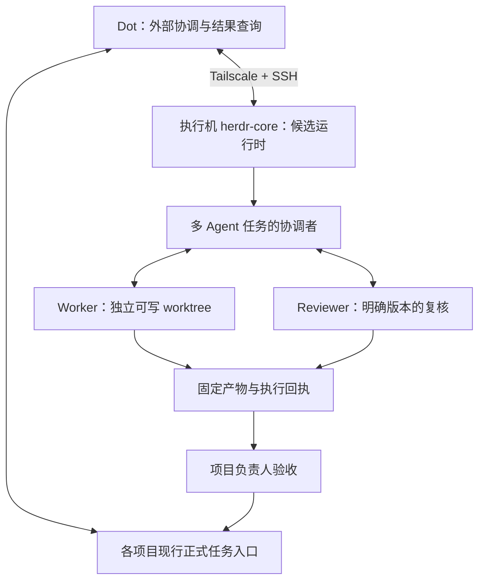

# 跨 Agent 通信与协作指引

研究日期：2026-10-30。本文是本仓跨 Agent 通信选型与后续试点准备的统一指引；当前建议为 **PILOT：优先验证 herdr-core 的适配条件，保留 Herdr TUI CLI 作为对照**。尚未确定生产通信底座，尚未安装、接通或迁移真实任务。

本指引与[仓库架构](architecture.md)共同说明候选边界；[本仓状态](status.md)记录实际进度。[现有试点指引](pilot.md)保留 TUI 路线的准备与检查；原任务上下文继续使用[交接模板](templates/pilot-task.md)和组织协议，不另建任务数据库。本文不是安装、入网、派发或扩大权限的执行授权；具体任务复用其有效授权，不重复确认已经获准的步骤。

2026-11-01 编制的[多项目协作迭代指引](collaboration-iteration-guide.md)维护后续搭建次序、优化取舍和多项目验收。本文保留通信选型及研究快照；资源配置可升级，具体采用仍需按实际接口与授权验证。

## 1. 当前建议与理由

目标是减少人工转述、准确关联任务与结果，并在控制连接中断后沿原执行恢复查询。首先验证第一方 herdr-core 能否满足这些要求，再决定是否需要额外插件或持久邮箱。

本仓目前只有初始化资料和离线检查，没有已经启用的 Herdr 业务链路。优先比较 core 的成本主要是版本、启动配置、状态报告、网络及回报方式的核验；不涉及迁移在途 Herdr 执行。旧 Lody 任务仍沿原入口收尾。

采用评估：

| 项目 | 判断 |
| --- | --- |
| 增量价值 | MEDIUM，信心中等：第一方父子协作与远端控制有望减少适配器和回报脚本；实际提效未测 |
| 总成本 | MEDIUM，信心中等：需要核版本、Agent 启动方式、OSC 状态、Dot 外部查询及故障对账；长期维护成本尚无运行数据 |
| 净收益 | UNCERTAIN |
| 建议 | PILOT，先验证 core 的适配条件，不能据此直接切换主入口 |

## 2. 先区分两套 Herdr

| 项目 | Herdr TUI | Herdr App / herdr-core |
| --- | --- | --- |
| 入口 | `herdr` CLI、TUI 及其 server | `hc` 核心 CLI；App 是可选客户端 |
| Agent 状态 | 支持屏幕识别及集成报告，按实际版本核对 | 只保存程序通过 OSC 7501 报告的状态，不按品牌或屏幕猜测 |
| 协作方式 | `agent prompt/read/wait`，可选插件适配 | `run/send/wait`、父子终端、自动系统通知和远端地址 |
| 运行关系 | 自己的 Agent、server 和状态 | 独立程序；与 TUI 不共享 Agent |

独立 PTY 不自动提供共享上下文，但运行时可以提供通信。不能将“默认互不感知”推广成“任何运行时都原生无法通信”；也不能把 TUI 插件的能力和限制套到新 core。[官方产品区别](https://herdr.dev/#questions)、[core 概览](https://herdr.dev/core/)、[TUI 自动化](https://herdr.dev/tui/docs/agent-automation/)

研究基线与目标端实际版本分别记录：

- **TUI：**核查时 GitHub 最新发布为 `v0.9.5`；研究的官方文档源码提交为 `ee5bfb5041bb3e4a49d591c72308aae3c81ecdde`。这不证明目标端安装了该版本或包含相同能力。[发布](https://github.com/herdrdev/herdr/releases/tag/v0.9.5)
- **core：**研究固定提交为 `dbcdcffc779f7516d5815cbd6f0a37da2b5e6628`，源码 crate 版本为 `0.1.14`。官方发行使用 `releases.herdr.dev/core/latest.json`；本轮该入口返回 403，最新可安装发行版保留 **UNKNOWN**。源码版本不能冒充发行证据。[源码版本](https://github.com/herdrdev/herdr-core/blob/dbcdcffc779f7516d5815cbd6f0a37da2b5e6628/crates/herdr-core/Cargo.toml)

## 3. 通信路线比较

| 路线 | 已核范围 | 对本仓的采用边界 |
| --- | --- | --- |
| herdr-core 原生协作 | 第一方启动、发送、父子通知及 SSH 远端控制 | 优先验证适配；不能当业务可靠消息队列 |
| TUI CLI | 通过准确机器与原生引用跨 workspace 控制 Agent | 保留对照；`prompt/wait` 不代替本次任务与产物回执 |
| Herdr Link 0.6.0 | 同一 workspace 内的工具适配与消息包装，底层调用 TUI `agent prompt` | 不提供跨机器、离线 inbox 或业务 ACK；需要逐 runtime 接线 |
| Chatter 0.19.0 | 本机、同 Git 仓库的共享聊天、上下文及任务辅助功能 | 当前支持 Linux/macOS，不覆盖 win-work 的原生 Windows 路线；自身任务功能不能成为第二权威 |
| AWP | 跨机器持久发件、收件去重及 daemon 接收 ACK | 额外引入 daemon、身份、存储与连接维护；有实际离线投递需求时再评估 |
| A2A | 远程 Agent 服务的发现、消息、任务与产物协议 | CLI 仍需适配成服务，当前不引入这层基础设施 |

### Herdr Link：工具化没有消除范围和投递限制

研究基线为发布包 `0.6.0` 的 Git 提交 `b795e8f3d6719c20fa7c8164d294be21914c308d`，要求 Node ≥22.6.0。协议限定同一 workspace 的 live named peers，不承担跨 workspace、跨机器、持久队列、ACK、离线投递或自动重试。`sent` 只表示 Herdr 接受投递，`done` 是普通文本。[发布配置](https://github.com/LZHcode1986/herdr-link/blob/b795e8f3d6719c20fa7c8164d294be21914c308d/package.json)、[协议](https://github.com/LZHcode1986/herdr-link/blob/b795e8f3d6719c20fa7c8164d294be21914c308d/PROTOCOL.md)

TUI 的 `herdr worktree create` 会把 worktree 打开为独立 workspace；Link 拒绝跨 workspace 通信，因此不能直接组合成“每 Worker 一个官方 worktree，彼此通过 Link 通信”。同 workspace、不同 tab/cwd 指向既有 worktree，从代码看不会被这个 guard 排除，但本项目尚未实测。[TUI worktree 语义](https://herdr.dev/tui/docs/cli-reference/#worktrees)、[固定实现](https://github.com/LZHcode1986/herdr-link/blob/b795e8f3d6719c20fa7c8164d294be21914c308d/src/herdr.ts#L975-L1049)

工具接口可能减少重复学习 CLI 的成本；本轮未找到可复核的 Token/延迟对照基准，不将“零学习”或“几乎零延迟”列为已证实收益。

### Chatter：共享聊天不等于可靠任务回执

研究基线为 `0edc18f4a130a6e013b24f9090b07372c8c41feb`、版本 `0.19.0`，要求 Herdr ≥0.8、Node ≥22.5，仅列 Linux/macOS。SQLite 按本机 Git common-dir 定位，同仓 worktree 可共享；不同机器的 clone 不会自动共享聊天。[平台条件](https://github.com/marcvermeeren/chatter/blob/0edc18f4a130a6e013b24f9090b07372c8c41feb/herdr-plugin.toml)、[存储定位](https://github.com/marcvermeeren/chatter/blob/0edc18f4a130a6e013b24f9090b07372c8c41feb/src/db.ts#L15-L31)

底层投递仍运行 `herdr agent prompt`。源码先记录投递标记，CLI 成功后便记录 `read_at`；它们不等于接收 Agent 已理解或接受任务。由调用顺序可推断存在标记与注入之间的崩溃窗口，本轮未做故障实测，不赋予 exactly-once 语义。[投递实现](https://github.com/marcvermeeren/chatter/blob/0edc18f4a130a6e013b24f9090b07372c8c41feb/src/team.ts#L296-L355)

### 持久邮箱与远程协议：由实际需求触发

AWP 文档描述了先落盘发件、收件 commit 后 ACK、重连重放和去重；ACK 只证明接收 daemon 持久保存，不证明 Agent 已读、任务完成或负责人验收。研究时核心发布为 `v0.6.0`，当前源码 `cc6d6ac3dc165ceb15a9cfe3173afa726e6b55c8` 的 CHANGELOG 仍将 Herdr 插件列在 Unreleased。核心与插件当前均面向 Linux/macOS，不作为 win-work 的直接接入方案。[投递语义](https://docs.agentwireprotocol.com/concepts/delivery)、[固定 CHANGELOG](https://github.com/agentwireprotocol/awp/blob/cc6d6ac3dc165ceb15a9cfe3173afa726e6b55c8/CHANGELOG.md)

AWP 默认 tailcat 路线不属于已有 Tailscale tailnet，不能自动继承其访问策略。将来若采用，单独确定传输、身份、存储、消费者唤醒和保留期限；不默默换网络，也不连带启用远程命令或文件写入。[跨机器指引](https://docs.agentwireprotocol.com/guides/across-machines)、[tailcat 说明](https://github.com/tailscale/tailcat#tailcat)

A2A 1.0 定义跨服务任务交互，但不能默认获得消息幂等或可靠持久投递。MCP Agent Mail Rust 提供另一种持久邮箱方向，不过新增有状态服务，且研究版许可证带附加条款；本轮不复制或安装。[A2A 规范](https://a2a-protocol.org/v1.0.0/specification/)、[Agent Mail Rust v0.3.39](https://github.com/Dicklesworthstone/mcp_agent_mail_rust/blob/v0.3.39/README.md)、[许可证](https://github.com/Dicklesworthstone/mcp_agent_mail_rust/blob/v0.3.39/LICENSE)

## 4. 候选协作结构

图示是候选关系，不表示连接、任职或正式 Project 已建立。

- **Dot 首轮保持外部协调者。** 通过已授权控制入口查询结果；core 的自动父子回报发生在真实 hc 终端之间，不能假定会自动进入 Dot 聊天。以后如需自动唤醒 Dot，再单独核平台能力，不在首轮增设消息桥接服务。
- **按任务规模安排协调者。** 单任务可直接交 Worker；只有多 Agent 任务需要对应协调关系。协调者可承担互不冲突的实现工作，不强制全职派单。角色按任务能力与责任安排，不固定为模型品牌。
- **按写入冲突隔离代码。** 并行写代码使用独立 worktree；只读复核不强制创建分支。Git worktree、TUI workspace、core session 和通信身份不是同一种边界。
- **正式记录保留原入口。** Projects/Issues 沿各项目已确认的采用范围使用；本仓未绑定项继续记 UNKNOWN。聊天、插件任务和原生进程状态不接管负责人验收。
- **两个环境仓库继续独立。** 不为通信引入跨仓库运行目录、软链接或自动同步。消息传递和按任务授权的产物交接不要求共享源码目录。

## 5. core 适配与可靠性边界

以下依据固定源码与官方说明，未在目标端实测。

### 启动配置与状态报告

core 只保存程序报告的 OSC 7501 状态。模板不安装 Agent，也不自动配置状态报告；`ready: quiet` 只是等待启动输出安静，不会产生 Agent 状态。无状态的长驻交互程序不能直接套用 Agent 的等待语义。[模板条件](https://github.com/herdrdev/herdr-core/blob/dbcdcffc779f7516d5815cbd6f0a37da2b5e6628/docs/templates.md#L62-L88)

该源码快照的内嵌手册要求 Codex 使用 `--no-daemon`，包括模板，否则命令可能在 hc 之外执行。这是该路线的待核适配条件，不是可以机械附加到任意 Codex 版本的默认参数。核对实际 CLI 支持、执行位置，以及 win-work 的 `codex over Claude` 供应商、模型、认证和权限映射；不得静默替换。[固定手册](https://github.com/herdrdev/herdr-core/blob/dbcdcffc779f7516d5815cbd6f0a37da2b5e6628/crates/herdr-core/src/SKILL.md)

### 发送、等待与对账

core 会串行处理同一终端的输入，普通发送仍是 paste＋Enter；`blocked` 默认拒绝。不要为方便投递默认使用 `--force` 回答权限或问题对话。普通消息没有因此成为带业务 ACK 的持久 inbox。[输入实现](https://github.com/herdrdev/herdr-core/blob/dbcdcffc779f7516d5815cbd6f0a37da2b5e6628/crates/herdr-core/src/input.rs#L102-L213)

`send --wait` 返回原生状态、turn 和启动观察，不提供独立的业务请求 ID。turn 在根状态离开 `working` 时增加；向忙碌 Agent 插入新任务后，旧活动结束仍可能满足等待，这是代码推断而非故障实测。新业务任务交给已确认空闲且没有未决任务的 Worker，或独立终端。[turn 定义](https://github.com/herdrdev/herdr-core/blob/dbcdcffc779f7516d5815cbd6f0a37da2b5e6628/crates/herdr-core/src/status.rs#L1-L3)、[发送观察](https://github.com/herdrdev/herdr-core/blob/dbcdcffc779f7516d5815cbd6f0a37da2b5e6628/crates/herdr-core/src/input.rs#L203-L212)

跨机 `wait --children all` 的当前实现会略过不可达或失败的一侧。必须对照原派发清单逐项核对；返回 `all` 不得清除离线项的 UNKNOWN。[跨机等待实现](https://github.com/herdrdev/herdr-core/blob/dbcdcffc779f7516d5815cbd6f0a37da2b5e6628/crates/herdr-core/src/api/waiting.rs#L128-L187)

父子系统通知有自己的去重与远端 outbox；不能把这项能力推广成所有普通业务消息的可靠投递。父子回报需要真实、有效的父终端绑定；不伪造 `HC_TERMINAL_ID`。[父端通知条件](https://github.com/herdrdev/herdr-core/blob/dbcdcffc779f7516d5815cbd6f0a37da2b5e6628/crates/herdr-core/src/notes.rs#L54-L57)、[系统通知 outbox](https://github.com/herdrdev/herdr-core/blob/dbcdcffc779f7516d5815cbd6f0a37da2b5e6628/crates/herdr-core/src/remote.rs#L648-L659)

### 生命周期与权限

区分控制连接断开、core 重启/升级、父 Agent 退出和主机重启。holder 可以在 core 重启/升级时保留程序；父进程结束默认结束子进程；主机重启后不能声称原任务继续运行。`--keep` 恢复的是新 shell，不重跑任务。是否使用 `--outlive-parent` 沿任务已确认的存活与清理要求决定，不默认扩大后台执行范围。[生命周期与恢复](https://github.com/herdrdev/herdr-core/blob/dbcdcffc779f7516d5815cbd6f0a37da2b5e6628/README.md)、[参数](https://github.com/herdrdev/herdr-core/blob/dbcdcffc779f7516d5815cbd6f0a37da2b5e6628/docs/commands.md#L494-L499)

core 不是沙箱或组织权限代理；API 访问意味着相应账号的命令、文件及终端控制。session 用于分组，不构成用户权限隔离。来自其他 Agent 的消息是对等方输入，不是公子的新指令，不扩大原任务授权；既有任务允许的沟通和实现可直接继续。[安全边界](https://github.com/herdrdev/herdr-core/blob/dbcdcffc779f7516d5815cbd6f0a37da2b5e6628/docs/security.md)

## 6. 消息与结果的最小约定

沿[原任务上下文](../skill/organization-collaboration/references/context-and-reporting.md)补必要关联，不要求每条消息重复整份任务包：

- 准确任务引用、固定输入版本及已授权范围。
- 实际发送/接收执行引用；跨机使用返回的完整地址，不按名字预测 ID。
- 需要追踪的消息关联与回复关系；工具不提供时在原任务记录和正文中明确，不伪造原生字段。
- 结论、缺口和精确产物引用；不靠复制完整聊天历史交接上下文。

四类证据分别报告，不另造平台状态枚举：

| 证据 | 可说明什么 | 不能替代什么 |
| --- | --- | --- |
| 工具接受投递/原生发送结果 | 此次工具调用的实际结果 | 接收方理解或接受任务 |
| 接收者确认准确任务与输入 | 接收 Agent 已明确本次关联 | 已执行、已产出 |
| 固定产物与检查回执 | 明确版本的成果及检查范围 | 负责人正式验收 |
| 负责人验收并回读正式记录 | 本次约定范围的正式结论 | 其他机器、版本或任务的通过 |

超时、断线、`started=false/null` 或回执不完整时，保留原生信息并先查询原执行和产物，不自动重派、切换 Lody 或新建替代任务。对账和验收仍沿[任务追溯](../skill/organization-collaboration/references/task-traceability.md)与[产物复核](../skill/organization-collaboration/references/execution-and-review.md#产物就地复核)。

## 7. 后续最小验证切片

选择一台已获授权的非生产执行机、一个新任务、两个需要协作的实际 Agent；不把全部生产任务或角色库接入试点。

| 顺序 | 验证内容 | 放行依据 |
| --- | --- | --- |
| 1. 版本与配置 | 可取得的固定发行版、来源/摘要、实际启动参数、供应商/模型/认证/权限、执行位置、OSC 状态 | 目标端实际观察；源码和官网描述不足以放行 |
| 2. 双向通信 | 空闲/工作/blocked 情况、准确发送者与接收者、任务/输入关联、回报到底进入谁的上下文 | 双端回读；不能假定外部 Dot 自动收信 |
| 3. 并行与恢复 | 必要的独立 worktree、控制端断开、远端不可达、父进程结束、core 重启 | 对照原派发清单；保留失联 UNKNOWN，无重复执行或意外清理 |
| 4. 交付与比较 | 固定产物、约定检查、负责人验收；人工转述次数、调用次数、耗时及错误关联情况 | 与相同任务口径的 TUI 路线比较；无基线项标 UNKNOWN，不编造提效比例 |

步骤 1 不满足时，只暂停依赖它的试点分支并比较补齐成本，不自动改供应商、网络、权限或切换工具重派。TUI 只是对照候选，本仓也没有它已经可用的运行证据。

只有取得上述证据后，才决定哪些项目的新任务采用该运行时，再更新相应架构、运行指引和正式记录入口。在途任务按原引用处理，采用结论不追溯为旧任务的通过。

## 8. 证据范围与维护

本轮依据官方文档、GitHub 讨论、协议和固定源码进行只读研究。静态代码推断、作者文档主张、源码版本、发行版本和目标端实测分别记录。没有取得本项目真机投递、恢复或业务验收证据；两段视频及旧布局页未取得可核正文，不作为结论依据。

原讨论保留为需求背景，不能当成当前发布功能的承诺：[跨 Agent 委派提案 #741](https://github.com/herdrdev/herdr/discussions/741)、[排队投递与发送者归因提案 #2401](https://github.com/herdrdev/herdr/discussions/2401)。TUI 旧 `agent.send` 名称不作为本仓当前调用合同；按目标端实际帮助和 schema 核对。

后续只更新这一份指引，不另建“补充版/增强版”。能力或版本变化时定向复核影响范围；实际进度与验收结论仍统一写入[本仓状态](status.md)或已确认的正式项目入口。
