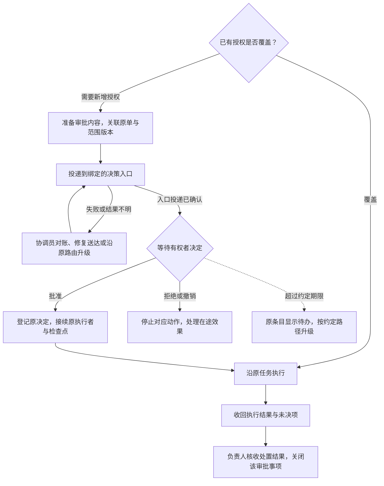

# 审批子工作流设计

2026-11-06 · 设计已采纳，代码与部署待完成。公子在本轮讨论中要求推进审批工作流，并将设计沉淀为文档。本文是该能力的唯一设计与实施依据；[ADR-003](decisions/003-approval-workflow.md)记录选择和取舍。设计采纳不代表真实投递、答复接回或宿主采用已经通过。

## 1. 目标与已确认缺口

让确需新增授权的动作有人决定、决定能够回到原任务，获准后继续执行。已有授权覆盖的工作直接推进；普通工具调用、已授权的低成本重跑和可选人工听审，不因本设计增加审批节点。

[凡人 Issue #2](https://github.com/CF-FE/fanren-work/issues/2)的 Win 制作入口恢复暴露了三处缺口：

| 观察 | 缺口与依据 |
| --- | --- |
| 11 月 5 日申请只留在协调员原生会话；11 月 6 日提问工具返回 `accepted` | 受理记录没有证明审批内容到达已绑定的用户决策入口；不能把它解释为“公子已收到” |
| 内部提醒持续触发，却没有接回主会话答复 | [提醒程序](../scripts/coordinator_followup_wake.py)只唤醒协调员；[收件器](../scripts/coordinator_followup_intake.py)只消费其自身 `COORD_FOLLOWUP` 消息，不能代替审批投递和答复适配器 |
| `RECHECK` 不断更新检查时间 | [现有记录操作](../scripts/project_coordinator.py)核版本与处置引用，却未约束同一审批阻塞的最迟升级时间 |

本次恢复批准已沿原申请登记，并交原执行者办理。开发使用原记录回放，不重新询问、倒退状态或重做这次维护。

## 2. 工作流与职责

投递重试须先证明旧动作未送出，或使用该通道已支持的幂等方式；图中回路不表示遇到超时即可重发。升级后仍由原协调员跟进，其他独立分支继续。

| 参与者 | 职责 |
| --- | --- |
| 用户／本单有权审批者 | 决定超出已有授权的范围；批准不等于成果验收 |
| 云端Dot | 整理需求和选项，发现待决事项后向公子汇报，沿原单转达有来源的决定；不作业务验收 |
| 项目负责人 | 判断项目依赖、准备可审方案、指定执行和验收要求；维护项目流程，默认核收项目成果 |
| 项目协调员 | 维护审批关联和真实路由，落实投递、答复接回、升级及批准后的接续责任；不能把等用户作为无人承接的理由 |
| 执行者／授权记录者 | 执行者按原范围交结果；记录者独立回填原 Issue／Project，回填受阻不占住协调员接单入口 |
| 程序／模型 | 程序校验状态、保存决定、计时、去重和执行确定步骤；模型整理方案、处理新判断，不自行授予权限 |

Herdr 继续承载协调员、负责人和本地 Worker；只有获准的 Codex Cloud 作业沿原路由在云端执行。[角色宿主](agent-hosts.md)与[主动汇报](coordination-policy.md#主动汇报与用户沟通)保持有效。

## 3. 最小记录与状态

以下是待实现的内部合同语义，不是已经可调用的 CLI 或 MCP schema。实现应沿协调核心的现有私有 SQLite 与事件记录扩展，不另养一份项目进度表。

| 字段组 | 必须回答的问题 |
| --- | --- |
| 原任务关联 | 稳定审批 ID、项目 ID、原任务引用、工作流／待决定节点和当前任职代次是什么？ |
| 审批内容 | 批什么、为何超出现有授权、输入与方案的范围版本／摘要、额度、停止条件及必要回退是什么？ |
| 决定与回流 | 谁有权批准、最终决策入口、获准中转入口、谁接回答复、批准后谁接续？ |
| 时限 | 最迟送达时间、最迟升级时间、下一检查条件；仅在原授权确有期限时另记授权有效期 |
| 证据与效果 | 原投递意图／回执、决定来源及时间、原执行引用、执行结果与核收结论分别在哪里？ |

审批内容在首次投递前冻结。同一内容断线重试沿用 ID 和范围版本；内容变更留新版本及差异，原决定不能无说明地套到扩大后的范围。项目流程只保存采用的决定引用与后继状态，不复制协调层的全部投递台账。

三个维度分别记账，避免把取消请求、投递成功或进程结束当作业务事实：

| 维度 | 状态与推进条件 |
| --- | --- |
| 投递 | 待送达 → 已受理／结果未知 → 已到指定入口。`accepted` 单独只支持受理；无目标入口证据时仍由协调员处理送达 |
| 决定 | 待决定 → 批准／拒绝／撤回；范围明确失效时记失效。已批准但未派出仍显示“已批准、待接续”，不能回写成“待用户批准” |
| 执行与核收 | 未派出 → 意图已登记 → 已受理／执行中／结果未知 → 结果待核收 → 已关闭。关闭要有实际结果或明确取消处置，不能把批准当完成 |

“待决定”要求审批内容已到达约定入口，**不要求用户额外确认已读**。来自有权者的有效答复可直接补齐本次送达事实，不为补传输回执再次等待。审批待办关闭不自动关闭父项目，也不将失败或取消改成成功。

## 4. 路由、投递与答复接回

项目接手时复用已验证的上游绑定，缺少时明确登记缺口与补齐责任，不选择当前焦点窗格、列表首项或一个方便的聊天代替。路由配置存在不证明该次投递可达。

| 路由 | 交付与回流要求 |
| --- | --- |
| 已绑定的本地用户决策入口 | 明确具体会话／原生审批入口和答复来源。适配器应能核对审批内容实际到达该入口，并将该入口的决定关联原请求。只在 Herdr 协调员自身终端发问不构成这条链路 |
| 原 Task Mailbox 业务单 | 沿原 job 和结果版本发布待决摘要；云端Dot按现有计划读取并提请公子决定。信箱持久化、Dot 收到与用户决定分别记证，答复沿本单已授权入口导入 |
| GitHub Project／关联 Issue | 展示原审批待办、影响、决定责任人和下一步，供用户及云端Dot感知。评论发布或看板状态不是批准；决定仍核真实作者、范围和已授权接回方式 |

原生任务没有 Mailbox job 时，使用其已绑定的本地决策入口和原项目记录，不补造信箱业务单。GitHub 继续经独立记录通道回填；私有材料留受控位置，公开记录只放获准摘要。

需要实现的操作边界如下；具体名称在代码合同中固定：

| 操作 | 行为与结果 |
| --- | --- |
| 准备审批 | 核已有授权及原决定，冻结当前范围、路由和时限；返回原待办或新审批记录，不产生外部发送 |
| 投递／核投递 | 先记意图，由原通道适配器发送；保存真实入口与回执。结果未知先对账；状态查询不发送 |
| 导入决定 | 可信入口验证审批者、原请求、当前范围和原生来源，再提交结构化决定；消息正文、任意评论或自报身份不能自行授权 |
| 接续执行 | 有效批准解除对应阻塞，核原在途效果后交原唯一派发者续行；保留原动作、执行者及检查点 |
| 检查／升级 | 程序检查绝对期限及实质变化，生成一次需要上游处置的待办，并由明确责任人落实实际升级；不能只生成通知行就算送达 |
| 收回／核收 | 原执行者交结果，负责人核收本次批准范围内的处置；后续业务生产及整体验收仍按原项目规则办理 |

审批者身份和来源校验归真实入口适配器，协调核心负责状态与范围一致性。不能仅因一个命令能写入“批准”字段就宣称用户答复链路已接通。有效授权不会因模型换回合、重启或消息重复而消失。

## 5. 等待、恢复与异常出口

- **无进展不无限顺延。** 检查时间不改变最初的最迟升级时间；新日志、新观察时间或新证据文件名不算解除阻塞。期限到达后，原条目必须显示待办、升级接收者和实际升级结果。通道不可用时明确“待送达”，由协调员继续负责。
- **通知去重。** 同一审批版本、同一阶段只产生一次升级意图；结果未知先核旧动作。后续实质变化或原单明确的新处置决定可以触发更新，不能无变化反复唤醒模型或催批。
- **超时不是批准，也不自动过期。** 升级期限与授权有效期分开；若原授权未规定失效时间，不因检查点逾期自行撤销已获许可。明确过期的范围不能采用迟到批准放行，先向原决定方说明变化。
- **拒绝／撤回只影响对应范围。** 未执行的动作停止派发；已受理或效果未知的动作先记录停止请求并对账，保留实际残留及承接责任。其他具备条件的任务继续。
- **范围变化保留历史。** 新增机器、写域、费用或动作需要核原批准是否仍覆盖；只处理新增缺口，不要求重复批准已经覆盖的部分。冲突答复交原有权者澄清，不选择有利的一条。
- **重启沿原单恢复。** 恢复未决审批、来源游标和原执行引用；结果已写但确认丢失时先读回。不承诺通用 exactly-once，不靠重跑生产取得确认。

这些规则只约束审批所依赖的动作。云端Dot离线、普通进度尚未读取、GitHub回填延后或可选人工听审未完成，均不使其他已授权步骤停工。

## 6. 与现有工作流的连接

[项目工作流](project-workflow-development.md)仍拥有程序节点、`decision`、`handoff` 和检查点。审批内容从当前决定节点产生；协调层办理真实投递和答复导入；取得合法决定后，沿原节点继续，不重新 `start` 或生成另一份生产任务。

通用审批规则和路由适配归本仓；各项目在自己的 `workflows/` 定义触发条件、范围、审批者和批准后的去向。跨仓传递任务与决定引用，不跨仓导入源码、共享运行目录或建立第二个派发者。现有 `role_followups` 只保留跟进与唤醒职责，不能再被当作上行投递或答复来源。

## 7. 实施切片与验收

| 切片 | 交付与退出条件 |
| --- | --- |
| 1. 真实路由的最小闭环 | 先核一个已绑定入口的实际发送、查询及答复接回能力，以这条路由完成“审批内容 → 决策入口 → 原决定节点”的端到端切片。缺任何接口就报告具体缺口，不能只实现审批台账便交付 |
| 2. 状态与恢复合同 | 在上述切片中复用现有标准库、协调数据库和事件，补齐范围关联、有界升级和恢复；用历史记录副本核旧待办仍可读，再补原信箱任务与无信箱任务的路由差异 |
| 3. 原任务接续 | 复用现有决定导入、原生交接、结果回收与核收；一次批准只解除对应阻塞，重复回执和重启不会再派同一动作 |
| 4. 部署采用 | 固定发布、备份原台账与路由、核可读回滚版本，再在一个自然审批事项采用。旧记录按证据迁移；已批准的 Win 恢复保持原办理，不作新测试单 |

一次集中验收覆盖：已有授权直接通过；受理但未送达及投递未知；到期升级有实际接收入口；有效批准与重复／迟到答复；拒绝、撤回及范围变更；重启与执行结果未知；两个项目的范围与决定不串用。优先使用真实失败记录的离线回放，真实链路只沿下一件自然审批取证。

开发会话接手时先交清选定入口、实际可调用接口、投递／答复各自的证据、当前唯一执行者和未决动作。实施只围绕已选路由增加必要适配，不预建通用通知平台。若自然审批尚未到来，分别报告工程检查与真实闭环的待验状态，不生成额外生产测试单。

真实闭环验收必须能沿同一审批找到：目标入口、可信决定、原执行受理、实际结果和负责人核收。首次运行后更新[状态页](status.md)，分别记录源码、部署、通道与业务边界，不以测试数量或进程在线代替这些证据。

**当前未实现范围：**本文新增的审批状态约束、对外投递／答复适配器及自然单闭环尚未交付。现有工作流和提醒能力继续按原版本运行；本次用户已经批准的具体事项沿原有效授权处理，不等待此开发完成。
