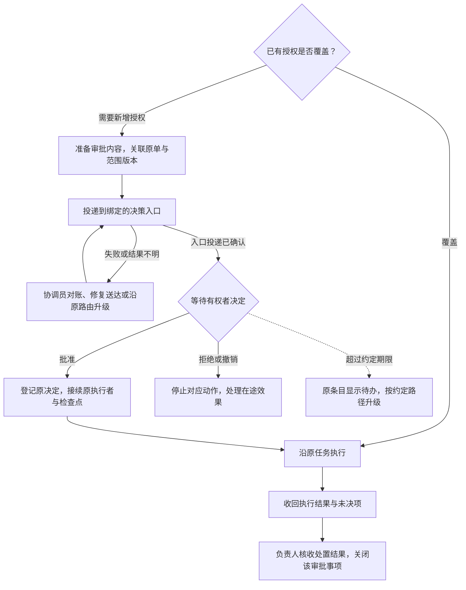

# 审批子工作流设计

2026-11-06 · 设计已采纳，两仓已合并到 main；Mac 安装和运行接线已采用，自然单待验。本文是该能力的唯一设计与实施依据；[ADR-003](decisions/003-approval-workflow.md)记录选择和取舍。安装与进程回执不代替真实 UI、自然审批及业务验收。

## 1. 目标与已确认缺口

让确需新增授权的动作有人决定、决定能够回到原任务，获准后继续执行。已有授权覆盖的工作直接推进；普通工具调用、已授权的低成本重跑和可选人工听审，不因本设计增加审批节点。

[凡人 Issue #2](https://github.com/CF-FE/fanren-work/issues/2)的 Win 制作入口恢复暴露了三处缺口：

| 观察 | 缺口与依据 |
| --- | --- |
| 11 月 5 日申请只留在协调员原生会话；11 月 6 日提问工具返回 `accepted` | 受理记录没有证明审批内容到达已绑定的用户决策入口；不能把它解释为“公子已收到” |
| 内部提醒持续触发，却没有接回主会话答复 | [提醒程序](../scripts/coordinator_followup_wake.py)只唤醒协调员；[收件器](../scripts/coordinator_followup_intake.py)只消费其自身 `COORD_FOLLOWUP` 消息，不能代替审批投递和答复适配器 |
| `RECHECK` 不断更新检查时间 | [现有记录操作](../scripts/project_coordinator.py)核版本与处置引用，却未约束同一审批阻塞的最迟升级时间 |

本次恢复批准已沿原申请登记，并交原执行者办理。开发使用原记录回放，不重新询问、倒退状态或重做这次维护。

## 2. 工作流与职责



投递重试须先证明旧动作未送出，或使用该通道已支持的幂等方式；图中回路不表示遇到超时即可重发。升级后仍由原协调员跟进，其他独立分支继续。

| 参与者 | 职责 |
| --- | --- |
| 用户／本单有权审批者 | 决定超出已有授权的范围；批准不等于成果验收 |
| 云端Dot | 整理需求和选项，发现待决事项后向公子汇报，沿原单转达有来源的决定；不作业务验收 |
| 项目负责人 | 判断项目依赖、准备可审方案、指定执行和验收要求；维护项目流程，默认核收项目成果 |
| 项目协调员 | 维护审批关联和真实路由，落实投递、答复接回、升级及批准后的接续责任；不能把等用户作为无人承接的理由 |
| 执行者／授权记录者 | 执行者按原范围交结果；记录者独立回填原 Issue／Project，回填受阻不占住协调员接单入口 |
| 程序／模型 | 程序校验状态、保存决定、计时、去重和执行确定步骤；模型整理方案、处理新判断，不自行授予权限 |

Herdr 继续承载协调员、负责人和本地 Worker；只有获准的 Codex Cloud 作业沿原路由在云端执行。[角色宿主](agent-hosts.md)与[主动汇报](coordination-policy.md#主动汇报与用户沟通)保持有效。

## 3. 最小记录与状态

以下是待实现的内部合同语义，不是已经可调用的 CLI 或 MCP schema。实现应沿协调核心的现有私有 SQLite 与事件记录扩展，不另养一份项目进度表。

| 字段组 | 必须回答的问题 |
| --- | --- |
| 原任务关联 | 稳定审批 ID、项目 ID、原任务引用、工作流／待决定节点和当前任职代次是什么？ |
| 审批内容 | 批什么、为何超出现有授权、输入与方案的范围版本／摘要、额度、停止条件及必要回退是什么？ |
| 决定与回流 | 谁有权批准、最终决策入口、获准中转入口、谁接回答复、批准后谁接续？ |
| 时限 | 最迟送达时间、最迟升级时间、下一检查条件；仅在原授权确有期限时另记授权有效期 |
| 证据与效果 | 原投递意图／回执、决定来源及时间、原执行引用、执行结果与核收结论分别在哪里？ |

审批内容在首次投递前冻结。同一内容断线重试沿用 ID 和范围版本；内容变更留新版本及差异，原决定不能无说明地套到扩大后的范围。项目流程只保存采用的决定引用与后继状态，不复制协调层的全部投递台账。

三个维度分别记账，避免把取消请求、投递成功或进程结束当作业务事实：

| 维度 | 状态与推进条件 |
| --- | --- |
| 投递 | 待送达 → 已受理／结果未知 → 已到指定入口。`accepted` 单独只支持受理；无目标入口证据时仍由协调员处理送达 |
| 决定 | 待决定 → 批准／拒绝／撤回；范围明确失效时记失效。已批准但未派出仍显示“已批准、待接续”，不能回写成“待用户批准” |
| 执行与核收 | 未派出 → 意图已登记 → 已受理／执行中／结果未知 → 结果待核收 → 已关闭。关闭要有实际结果或明确取消处置，不能把批准当完成 |

“待决定”要求审批内容已到达约定入口，**不要求用户额外确认已读**。来自有权者的有效答复可直接补齐本次送达事实，不为补传输回执再次等待。审批待办关闭不自动关闭父项目，也不将失败或取消改成成功。

## 4. 路由、投递与答复接回

项目接手时复用已验证的上游绑定，缺少时明确登记缺口与补齐责任，不选择当前焦点窗格、列表首项或一个方便的聊天代替。路由配置存在不证明该次投递可达。

| 路由 | 交付与回流要求 |
| --- | --- |
| 已绑定的本地用户决策入口 | 明确具体会话／原生审批入口和答复来源。适配器应能核对审批内容实际到达该入口，并将该入口的决定关联原请求。只在 Herdr 协调员自身终端发问不构成这条链路 |
| 原 Task Mailbox 业务单 | 沿原 job 和结果版本发布待决摘要；云端Dot按现有计划读取并提请公子决定。信箱持久化、Dot 收到与用户决定分别记证，答复沿本单已授权入口导入 |
| GitHub Project／关联 Issue | 展示原审批待办、影响、决定责任人和下一步，供用户及云端Dot感知。评论发布或看板状态不是批准；决定仍核真实作者、范围和已授权接回方式 |

原生任务没有 Mailbox job 时，使用其已绑定的本地决策入口和原项目记录，不补造信箱业务单。GitHub 继续经独立记录通道回填；私有材料留受控位置，公开记录只放获准摘要。

需要实现的操作边界如下；具体名称在代码合同中固定：

| 操作 | 行为与结果 |
| --- | --- |
| 准备审批 | 核已有授权及原决定，冻结当前范围、路由和时限；返回原待办或新审批记录，不产生外部发送 |
| 投递／核投递 | 先记意图，由原通道适配器发送；保存真实入口与回执。结果未知先对账；状态查询不发送 |
| 导入决定 | 可信入口验证审批者、原请求、当前范围和原生来源，再提交结构化决定；消息正文、任意评论或自报身份不能自行授权 |
| 接续执行 | 有效批准解除对应阻塞，核原在途效果后交原唯一派发者续行；保留原动作、执行者及检查点 |
| 检查／升级 | 程序检查绝对期限及实质变化，生成一次需要上游处置的待办，并由明确责任人落实实际升级；不能只生成通知行就算送达 |
| 收回／核收 | 原执行者交结果，负责人核收本次批准范围内的处置；后续业务生产及整体验收仍按原项目规则办理 |

审批者身份和来源校验归真实入口适配器，协调核心负责状态与范围一致性。不能仅因一个命令能写入“批准”字段就宣称用户答复链路已接通。有效授权不会因模型换回合、重启或消息重复而消失。

## 5. 等待、恢复与异常出口

- **无进展不无限顺延。** 检查时间不改变最初的最迟升级时间；新日志、新观察时间或新证据文件名不算解除阻塞。期限到达后，原条目必须显示待办、升级接收者和实际升级结果。通道不可用时明确“待送达”，由协调员继续负责。
- **通知去重。** 同一审批版本、同一阶段只产生一次升级意图；结果未知先核旧动作。后续实质变化或原单明确的新处置决定可以触发更新，不能无变化反复唤醒模型或催批。
- **超时不是批准，也不自动过期。** 升级期限与授权有效期分开；若原授权未规定失效时间，不因检查点逾期自行撤销已获许可。明确过期的范围不能采用迟到批准放行，先向原决定方说明变化。
- **拒绝／撤回只影响对应范围。** 未执行的动作停止派发；已受理或效果未知的动作先记录停止请求并对账，保留实际残留及承接责任。其他具备条件的任务继续。
- **范围变化保留历史。** 新增机器、写域、费用或动作需要核原批准是否仍覆盖；只处理新增缺口，不要求重复批准已经覆盖的部分。冲突答复交原有权者澄清，不选择有利的一条。
- **重启沿原单恢复。** 恢复未决审批、来源游标和原执行引用；结果已写但确认丢失时先读回。不承诺通用 exactly-once，不靠重跑生产取得确认。

这些规则只约束审批所依赖的动作。云端Dot离线、普通进度尚未读取、GitHub回填延后或可选人工听审未完成，均不使其他已授权步骤停工。

## 6. 与现有工作流的连接

[项目工作流](project-workflow-development.md)仍拥有程序节点、`decision`、`handoff` 和检查点。审批内容从当前决定节点产生；协调层办理真实投递和答复导入；取得合法决定后，沿原节点继续，不重新 `start` 或生成另一份生产任务。

通用审批规则和路由适配归本仓；各项目在自己的 `workflows/` 定义触发条件、范围、审批者和批准后的去向。跨仓传递任务与决定引用，不跨仓导入源码、共享运行目录或建立第二个派发者。现有 `role_followups` 只保留跟进与唤醒职责，不能再被当作上行投递或答复来源。

## 7. 实施切片与验收

| 切片 | 交付与退出条件 |
| --- | --- |
| 1. 真实路由的最小闭环 | 先核一个已绑定入口的实际发送、查询及答复接回能力，以这条路由完成“审批内容 → 决策入口 → 原决定节点”的端到端切片。缺任何接口就报告具体缺口，不能只实现审批台账便交付 |
| 2. 状态与恢复合同 | 在上述切片中复用现有标准库、协调数据库和事件，补齐范围关联、有界升级和恢复；用历史记录副本核旧待办仍可读，再补原信箱任务与无信箱任务的路由差异 |
| 3. 原任务接续 | 复用现有决定导入、原生交接、结果回收与核收；一次批准只解除对应阻塞，重复回执和重启不会再派同一动作 |
| 4. 部署采用 | 固定发布、备份原台账与路由、核可读回滚版本，再在一个自然审批事项采用。旧记录按证据迁移；已批准的 Win 恢复保持原办理，不作新测试单 |

一次集中验收覆盖：已有授权直接通过；受理但未送达及投递未知；到期升级有实际接收入口；有效批准与重复／迟到答复；拒绝、撤回及范围变更；重启与执行结果未知；两个项目的范围与决定不串用。优先使用真实失败记录的离线回放，真实链路只沿下一件自然审批取证。

开发会话接手时先交清选定入口、实际可调用接口、投递／答复各自的证据、当前唯一执行者和未决动作。实施只围绕已选路由增加必要适配，不预建通用通知平台。若自然审批尚未到来，分别报告工程检查与真实闭环的待验状态，不生成额外生产测试单。

真实闭环验收必须能沿同一审批找到：目标入口、可信决定、原执行受理、实际结果和负责人核收。首次运行后更新[状态页](status.md)，分别记录源码、部署、通道与业务边界，不以测试数量或进程在线代替这些证据。

**采用边界：**源码、Mac 安装和运行接线、自然单闭环分别核验。本次已采用两仓 main 的固定发布，原任务及有效授权继续沿原记录处理；真实 UI、审批答复接续、执行结果与负责人核收仍在下一自然事项取证。

## 8. 实现合同与候选采用

2026-11-06，审批实现及原生提案入口补丁已合并并部署，复用既有协调数据库、事件、Mac hook 和 Herdr watcher，未新增服务、定时器、业务单或派发者。当前 Herdr 固定发布为 [f63e3b8](https://github.com/CF-FE/herdr-4-codexcloud/commit/f63e3b879db577afda1fd36f9ef9e0378545ec48)，由 [PR #16](https://github.com/CF-FE/herdr-4-codexcloud/pull/16) 承接 PR #15；Mac 桥固定发布为 [1b3da867](https://github.com/CF-FE/task-mailbox-mcp/commit/1b3da867b8b1cbda2562667b75b1698c18bee8b9)。“协调员原生提案 → 原 watcher 登记 → hook 提示 → 受信记录者答复 → 原 watcher 回流／原检查点”的 Mac 安装和运行接线已采用；通知仍依赖用户活动，真实 UI 与自然审批完整链路待验。

### 入口核查与最小缺口

| 入口／来源 | 本次取得的证据 | 采用限制 |
| --- | --- | --- |
| Codex App 定向工具 | 开发宿主发现 `send_message_to_thread`、`read_thread` 合同，并实际只读查询原主会话；查询返回指定 thread/host、turn/item 与正文 | 未发送审批测试。本次采用下述本地 hook 路线，不依赖这些 App 定向工具，也不推定 Herdr 自动取得它们 |
| `request_user_input_async` 历史回执 | 原失败记录只支持 `accepted:true`，协调员自身发布只支持本地发布 | 离线回放保留待送达；不重问已有批准，不把受理推成到达 |
| 原生 `userMessage`／`role=user` | App Server 支持程序通过 `turn/start`、`turn/steer` 写入 user input，见[官方合同](https://learn.chatgpt.com/docs/app-server#api-overview) | 不扫描关键词自动批准；这类消息只可用于证明本次程序投递确实出现在绑定入口 |
| GitHub 原评论 raw REST | 只读接口可核原 Issue、作者稳定 ID、时间及 `performed_via_github_app`；[已有记录](https://github.com/CF-FE/herdr-4-codexcloud/issues/13#issuecomment-6653501073)同时具有 User 作者与 Codex Connector 代写来源 | 同一账户也由记录者使用，不能把账户正确或 app 字段为空当作公子亲自批准；本候选不新增 GitHub 审批入口 |
| 既有 Mac 协调桥 hook | 安装侧 hook／安装器／store 与信箱仓源码一致；现有 `SessionStart`／`UserPromptSubmit` 已提供 `additionalContext`。官方另有 [systemMessage 输出](https://learn.chatgpt.com/docs/hooks#common-output-fields)，可显示于 UI／事件流 | 本次已配置绑定审批摘要，原 hook 定义字节保留；实际 UI 显示仍待自然事件。hook 输入没有可靠真人来源字段，不能将用户消息自动导入为批准 |
| 本机固定 Codex CLI 原生读取 | 对已知原主会话只读 probe 成功，核 `vscode`／`Codex Desktop` 来源、原 thread／路径／cwd 及 paginated 历史；使用 `thread/read`、`thread/turns/list:notLoaded` 和逐项 `thread/items/list`，约 0.68 秒 | 该探针本身未绑定或导入决定；部署沿用此前仅为当前登记的 `fanren-work` 从 EOF 启用的来源。提案入口升级保留 policy 与原游标，未重新绑定；按 item 读取，单项上限 8 MiB |

选定路径不依赖开发窗口转发或待提供回调：既有 hook 承载提示；已明确受权的原主会话记录者确认公子答复并出具回执；固定 CLI 从同一原生历史验证并导入。信任来自 operator 对该记录者的明确任命与原始答复核对，不要求平台提供不存在的真人密码学证明，也不把任意 `userMessage` 自动当批准。公子正常答复一次，记录者在内部关联原请求、范围与原生引用，不要求复制 hash、再次确认或已读。

早期 App 工具适配器仍默认关闭，缺实际宿主函数时报 `MISSING_COORDINATOR_DECISION_CHANNEL`／`MISSING_TRUSTED_DECISION_INTAKE`；它不属于本轮选定 hook 路线的依赖，不把 App 开发工具推定为 Herdr 协调员工具。

### 既有 hook 的跨仓接线

只读 `approval_notice_snapshot` 进程接口已由本次既有 hook 接线采用。输入是明确配置的 `thread_id`、`host_id`、项目白名单及分页；输出仅包含稳定 notice ID、原审批版本、阶段、事先准备的 `notice_summary`、原单入口、责任与期限。没有 `notice_summary` 不投影，不返回原 scope、检查点、机器路径或私有答复来源。`--input -` 可经 stdin 传 JSON；读取不登记发送、不迁移数据库、不改变审批状态。

桥侧源码落在所属的 `CF-FE/task-mailbox-mcp`，不使用其信箱业务 port 承载无 job 审批：

1. [桥侧适配器](https://github.com/CF-FE/task-mailbox-mcp/blob/760083df2d6f05df213af54fc5e2edb072ec4d9b/mac/approval_hook.py)从私有配置取得固定解释器／固定发布 `coordinator_approval_hook.py` argv，只传 session、turn、cwd、transcript 路径与事件名。不使用 shell，不跨仓导入源码、不打开协调数据库、不采集 prompt／答复／最后消息。总子进程默认 2.2 秒；配置错误与运行失败均隔离，保留原 counts／Stop 回填，固定禁用码在旧状态提示可见。
2. [协调 hook 入口](../scripts/coordinator_approval_hook.py)核精确 thread、cwd 与 transcript 绑定，读取本地最小投影，沿原审批登记一次意图与输出准备受理；`systemMessage` 给出获准摘要，`additionalContext` 提供原索引和受信记录者合同。投递去重仍由原审批台账负责，桥不保存第二份审批状态。主／子 Agent 可能共用 session ID，不能仅以此推定用户主入口收到；实际 UI 显示留自然事件验收。
3. [原生收件器](../scripts/coordinator_approval_intake.py)核固定 binary 摘要、已绑定的原 thread／home／来源／cwd／路径，再用原生分页 API 读取源。首次显式 `bind` 从当前 EOF 建锚点；同 policy 恢复保留 turn/item 游标，变更先对账。只接收该受信记录者独立单行 `APPROVAL_DECISION` 回执，核所引 user item 属同线程且先于回执；身份由私有 policy 提供，正文不得自报。决定与原检查点先落盘，再推进游标。
4. **通知与答复回收触发不同。** 提示只在下一次 `SessionStart`／`UserPromptSubmit` 活动时显示，不能唤醒闲置窗口。hook 的 Stop 可收件，但 Stop 先于 TurnComplete 时保守等待；[既有 watcher](../scripts/coordinator_followup_wake.py)下一原轮次读取同一 policy／游标，在回合完成后接回，无需再发用户消息。不新增计时器或另一条回流入口；两调用方共享非阻塞源锁。interrupted／failed 历史跳过，不堵住后续完整回执。
5. hook 的原生读取限 0.9 秒，暂失败仍输出本地绑定待办，并保留读取不可用与原承接责任；原 watcher 收件异常也不压住共享观察项。hook 输出成功仍只是准备／受理；真实宿主证据或有效原答复补齐送达。拒绝、撤回与在途未知显示停止／对账待办，不再次请求批准。

部署回读确认：Mac 桥 14 项文件摘要与 `1b3da867` 一致，仍仅 `approval_hook.py`、`config.py`、`codex_hook.py` 三项升级；原 hook／plist 定义字节、凭据、允许目录和业务表保留，hook 固定 argv 已指向 `f63e3b8`。协调员沙箱不能直接写正式台账的缺口，现由 `COORD_APPROVAL_PREPARE` 只提案、原 watcher 沿既有来源和游标登记解决；不增加台账写权或扩大沙箱，policy 暂不可用时保留原消息，下一原轮次重试。受信记录者仍仅绑定当前登记的 `fanren-work`；policy 和两个原游标保留，未重新 bind／EOF。新 watcher 已实际运行 `f63e3b8`，每 60 秒收件；原 waits、bridge-pump 均加载同一发布且首轮退出码为 0。本次未创建审批或测试单，原收件历史保留。原协调员已返回新登记入口采用回执，核对主仓、安装、watcher 均为同一版本且收件器摘要一致；确认沿原生提案办理，不再直接写台账，无新采用阻塞，未发测试提案。自然 UI、审批全链及业务验收仍待自然单。远端 collector 的既有 `AUTH_FAILED` 保留，本轮未重新认证或启动该分支。

### 已实现的程序合同

| 代码入口 | 合同 |
| --- | --- |
| [协调核心](../scripts/project_coordinator.py)的 `approval_prepare` | 受信本地调用先核既有授权；`covered_authorization_ref` 返回 `BYPASSED`，不建立审批或业务单。新审批冻结原项目／任职、范围版本、路由、时限、原派发者、执行者、检查点与核收者；同版本重放须内容一致 |
| `approval_list` | 分页只读；旧台账缺少审批表时返回空，不做隐式迁移。投递、决定、执行与核收分开显示 |
| [摘要投影](../scripts/coordinator_approval_notice.py) `approval_notice_snapshot` | 精确绑定当前任职、thread/host 与允许项目，只输出已准备的最小摘要；无表时只读返回空。用于既有 hook 的投影接口，读取不代表已投递 |
| `approval_claim`／`approval_record` | 先登记动作意图，再记 `ACCEPTED`／`UNKNOWN`／`DELIVERED` 等原通道证据。结果未知只核旧动作；确认未发送才允许重试。普通 CLI 没有写入批准的操作 |
| [入口适配器](../scripts/coordinator_approval_channel.py) | 围绕上述两个 App 工具发送并分页查询，精确核 thread/host 与本次完整原生消息。`accepted` 单独仍是受理；消息缺失不推定未发送。`receive` 必须交受信 verifier，缺失即失败 |
| [受信决定导入](../scripts/coordinator_approvals.py) `receive_decision` | 不注册为 CLI、远程 RPC 或 Worker MCP。宿主 verifier 读取原答复后返回 `VerifiedDecision`；核心再核绑定审批者／记录者、项目、版本、范围及任职。冲突需澄清；重复原决定幂等；有效答复可直接补齐送达 |
| 既有 `tick`／`approval_recheck` | 原绝对时限不变；每审批版本、每到期阶段产生一次有责任人的 `PENDING` 升级待送达，实际发送另有意图与结果。批准后停在 `INTENT`／`UNKNOWN` 或仅 `CHECKPOINT_APPLIED` 仍保留原期限和对账责任；原执行者的 `ACCEPTED`／`RUNNING` 原生回执明确接手后才交已有后继跟进。没有新情况不反复唤醒模型；`RECHECK` 不清除升级历史 |
| [检查点接续](../scripts/coordinator_approval_workflow.py) `resume_approval` | 核原 runner/definition、输入与项目身份，登记一次执行意图，调用原 runner 的 `decide`；重启先 `status` 对账。同一决定已采用时只读返回原后继 action。`CHECKPOINT_APPLIED` 仅证明原节点已采用决定，实际派发与 `ACCEPTED` 仍交原唯一派发者 |
| `approval_result`／`approval_close` | 实际结果或明确取消处置进入待核收；冻结的核收者必须仍属原有效任职。换任后旧负责人不得作新核收；现任负责人须带当前代次、原任务验收交接与原生核验引用接手。迟到结果继续记账，云端Dot不得代验。拒绝／撤回停止对应动作；在途未知保留停止请求与原效果引用，其他分支继续 |

关联 `followup_key` 只用于追溯，**不抑制原待办**。共享观察者可覆盖多个独立分支；在实际审批驱动接手前，原提醒机制保持有效。本候选没有自动接管或关闭旧提醒的操作。

`route.kind` 当前只接受 `codex_app` 的显式绑定；已有 Mailbox 请求可用 `request_id` 核原任务后关联，但原 job 结果发布与云端可信回流适配尚未实现。不接受另建信箱单来补缺口。

### 协调员通过原生提案准备审批

协调员不需要原台账写权限。沿已绑定的 Herdr 协调员原生会话发一条独立单行提案，载荷仅为 `{"spec": <完整冻结对象>}`；下例是结构示意，完整对象使用上表 `approval_prepare` 的 spec，不是另一份审批方案：

```text
COORD_APPROVAL_PREPARE {"spec": <原任务的完整 approval_prepare spec>}
```

[原收件器](../scripts/coordinator_followup_intake.py)复用 `COORD_FOLLOWUP` 的来源、EOF 绑定和游标，只认当前绑定协调员的单段 assistant commentary／final 消息；代码块、引用、工具输出及任意 user 消息不能登记。watcher 核当前 `native-approval-policy.json` 的项目白名单和整条 route（kind、thread、host、授权引用、审批者、记录者），并要求非空 `notice_summary`，再以程序权限调用 `approval_prepare`。载荷不能选择 `op`、传 `covered_authorization_ref` 或导入批准；不开放派发、核收或新 DB 写权。

提案必须保留原 `task_ref`、工作流 `checkpoint`、任职代次、原 `dispatcher`／`executor_ref` 及核收者。已有原任务待办时复用 `followup_key`；由已运行的父工作流观察项负责时，沿原父流程继续，不新建唤醒链。若原任务尚无人跟进，先沿既有 `COORD_FOLLOWUP put` 登记原检查／回收责任，再提案。批准只推进原检查点，仍由原唯一派发者接续并收回结果，不能把登记成功当作已经交给执行者。

发出提案仅表示提出。应从原 watcher 的 `coordination_intake.last_approval_prepare` 或审批只读状态核到原 ID／版本／scope hash；`APPROVAL_PREPARE_PROPOSAL` 事件和原生 source 引用保留追溯。同一消息在游标落盘失败后重放，不新增审批或重复该来源事件。提案字段、项目或路由不符会记录 `last_rejection` 后继续旧 followup。策略缺失／暂不可读／配置损坏及登记存储故障属于宿主故障：保留原偏移与 `last_failure`，修复后下一原轮次继续同一提案，无需重发。已登记共享跟进仍继续，不因本提案失败停住其他分支。

该入口补丁不改变现有主会话决定来源、桥接绑定或后续原节点接续规则，不为已批准的 C001 重新提案或执行。

### 受信记录者绑定与回执

operator 在**原安装根**保存私有 `native-approval-policy.json`，示例所有路径与身份均为占位值；实际采用前核真实入口、原任命和允许项目，不复制认证或会话历史：

```json
{
  "schema_version": 1,
  "binary": "/absolute/codex",
  "binary_sha256": "<固定可执行文件的64位SHA256>",
  "codex_home": "/private/original-codex-home",
  "thread_id": "<已绑定的用户主会话>",
  "host_id": "local",
  "cwd": "/absolute/original-project",
  "transcript_path": "/private/original-codex-home/sessions/<原元数据文件>.jsonl",
  "source": "vscode",
  "originator": "Codex Desktop",
  "approver_principal": "user:bound-approver",
  "relay_principal": "recorder:bound-main",
  "project_ids": ["example-project"],
  "authorization_ref": "<审批者与受信记录者的原核准引用>",
  "resume_checkpoints": true
}
```

`resume_checkpoints:true` 只允许把合法决定采用到本单冻结的原检查点，不代表 Herdr 派发或成果验收。先从固定发布运行下列命令；`probe` 只读，`bind` 首次从 EOF 启用并保留旧来源，不能把历史批准自动当作新任务执行：

```bash
python3 -I -B /fixed/release/scripts/coordinator_approval_intake.py --state-dir /private/coordinator/state --policy /private/coordinator/native-approval-policy.json probe
python3 -I -B /fixed/release/scripts/coordinator_approval_intake.py --state-dir /private/coordinator/state --policy /private/coordinator/native-approval-policy.json bind
```

原桥的固定 argv 指向同一安装根的 `coordinator_approval_hook.py` 与同一 policy；原 Herdr watcher 的 `--root` 也必须指向该安装根，才会在既有轮次消费同一来源／游标。其他安装若未加载固定发布或未核 watcher 实际承接，不能宣称答复可在用户离线后自动接回。

**App 升级或主控交接后先核来源。** 固定摘要不匹配会先报 `NATIVE_BINARY_CHANGED`，其后仍可能有旧 thread／元数据文件不可读等独立缺口，不能只换摘要。先核新二进制来源、当前真实 thread／cwd／元数据、允许项目及公子的实际交接授权，并在实际运行宿主执行只读 `probe`。只读 RPC 子进程启动仍需初始化 Codex 自有状态；受限执行环境若阻止其打开 SQLite，可能表现为 `NATIVE_READER_EXITED`，应保留原启动错误，不能仅据此判定原生接口不兼容，也不直接修改 Codex 内部数据。

不同来源的游标不能移植。先对账原审批与未决决定；有在途审批时逐项保留原 route 和接回责任，不能整库改绑。原审批为空且已核交接时，成对归档旧 policy／审批游标，为新来源从当前 EOF 建新锚点；核新旧 policy hash，并在既有审批来源锁内切换。保留独立的 `native-followup-source.json`。`bind` 遇旧 hash 会拒绝，不能只改游标内 hash 绕过。桥 hook 与 watcher 均采用原根的新绑定，修后分别回读 `probe`、收件和原驱动自然轮次；空台账成功不代表真实提示、用户答复和业务接续已验，应沿下一件自然审批验证。

独立原生 reader 可能把桌面仍在运行的回合暂报为 `interrupted`／`failed`。收件器须保留同回合已绑定的非空 EOF item 锚点，待完成后只读取其后的回执；其他终断回合仍跳过，不阻塞后续正常回合。回归覆盖“绑定前已有有效回执 → 暂报终断 → 同回合新答复并完成”，只能采纳绑定后的回执。不得把临时状态变化当成扩大历史读取范围的依据。

受信记录者在核人、核明确原范围后，发一条独立单行回执；原用户无需填写下列字段：

```text
APPROVAL_DECISION {"project_id":"example-project","approval_id":"original-approval","scope_version":1,"scope_hash":"<原冻结摘要>","decision":"APPROVED","user_response_ref":{"turn_id":"<原答复turn>","item_id":"<原答复item>"},"decided_at":"<原决定的带时区时间>"}
```

身份由绑定 policy 提供，不接受正文自报。`decision` 还可为 `REJECTED`／`WITHDRAWN`；冲突澄清／撤回由记录者带 `supersedes_ref` 关联原来源。原生读取／协议失败保留游标并交下一原轮次，不把读取失败当作非法答复吞掉；真正范围不符或无原始引用的回执才拒收。

### 安装、升级与回退

本次已按经复审的固定提交完成 Mac 切换；后续升级与回退沿用以下步骤，保留新取得的决定与在途效果。

1. 记录原固定发布、服务参数、数据库与路由；停止原定时写者后，用 SQLite backup 保存一致快照。保留原在途执行，不重发业务单。
2. 用 `python3 scripts/install_project_coordinator.py --revision <完整40位候选提交> --destination <原私有安装根>` 准备发布。安装器自动包含审批模块，保留原状态；它不会加载服务、增加定时器或启用审批通道。
3. 两仓分别安装经复审的固定发布；在**原台账副本**上做升级与只读核对。按上节完成 probe／EOF 绑定，桥启用固定 argv，原 watcher 加载同一 policy 和游标；只有核清实际宿主承接、受信记录者与原唯一派发者后，才在下一件自然审批采用。缺少证据就保持未启用，已有批准沿原路由办理。
4. 回退时先停新写者并保全新台账／来源游标／在途引用，再恢复原固定发布的服务参数。新增表对旧核心是旁路数据，旧台账仍可读；旧核心不处理新审批，未结事项须由原协调员显式承接。不要回滚数据库快照抹掉切换后的批准或副作用；只有核清快照后无新业务变化时才可恢复快照。

工程验证使用临时 SQLite、合成 App 工具与受信 verifier double，以及真实生成器／原 runner 子进程。覆盖旧台账、范围与任职隔离、受理／送达、UNKNOWN、重复／冲突／迟到、期限／升级、共享观察者与独立分支、原节点恢复和核收。它不证明实际宿主投递、真人来源、Herdr 执行受理或自然单业务验收；这些仍沿第 7 节核证。

首版状态候选集中回归完成 **325 项测试，既有 4 项宿主 smoke 跳过**；结构与 Worker 库检查通过。独立复审发现的撤回穿透与冲突未阻断均已修复并复核；换任核收、明确未执行后的原单接续、执行意图中断后的期限升级均有回归。原两份失败记录仅作只读影子回放：本地发布和 `accepted` 均未推成送达或批准，连续观察没有顺延原期限或重复升级；未修改原审批、未重做维护、未发送测试审批。

本轮接线的 **Herdr 43 项、Task Mailbox 26 项定向检查均通过**，包括隔离固定发布入口、原 watcher／Stop 兼容、读取失败保留游标、中断历史活性、撤回停止待办与可选配置错误可见。原主会话随后完成 PR #15 的必需根目录回归：**342 项／39.602 秒，OK，保留既有 4 项跳过**；本实现会话未重复运行。结构检查与两仓 diff 检查通过，最后独立复审 Required／Critical 为 0。另有一次真实本机只读 probe 和一次跨进程临时联调；均不代替自然单验收。

PR #16 提案入口补丁的最终全量回归由原主会话实际运行：**348 项完成，保留既有 4 项跳过**。Task Mailbox 的 26 项相关检查沿用原证据，本次未重跑；生产未创建审批或测试单。
