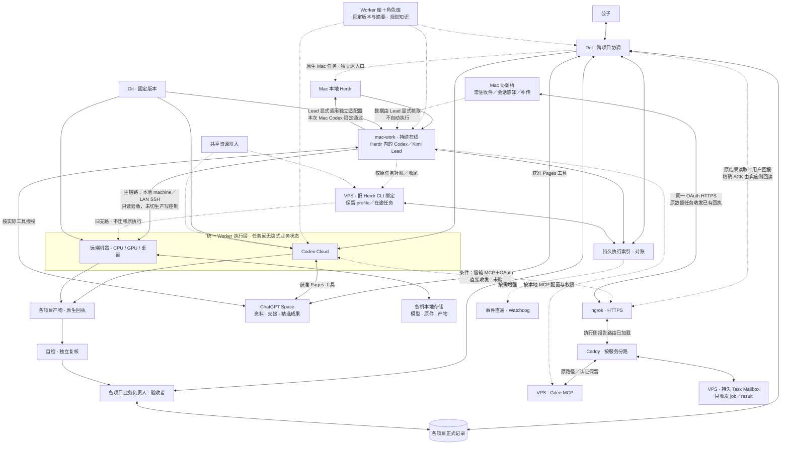
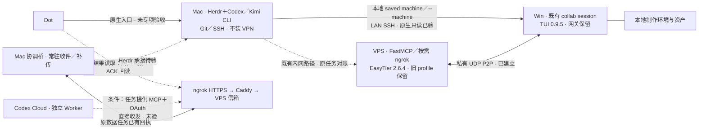

# 架构与范围

当前方案修订：2026-11-03。**按公子明确的 Mac 持续在线前提，Mac 的 Herdr 托管项目协调 CLI，并以原生 saved machine／`--machine` 经 LAN／SSH 直连 Win 既有 `collab` session；VPS 承载 FastMCP 工具服务及持久 Task Mailbox，经 ngrok HTTPS／Caddy 分路提供接入，不是 Win 机器控制中转层。** Mac 协调桥已常驻收件、会话感知及补传；独立[Herdr 执行适配器](herdr-executor.md)已完成桌面 Lead 显式调用 Mac 既有 Codex 的一次限定闭环，并由原 review 读全结果、ACK 及给出工程限定通过。信箱自动消费／无人值守派发未实现，Win／Cloud 扩展、生产业务与长期稳定性未验。公子确认既有 Gitee MCP 已部署并登记云端；其入口、认证与旧 Herdr profile／在途任务保留。文档更新不新增部署、Agent 启动或生产写控制切换；本仓采用边界见[本仓状态](status.md)，服务运行明细由其权威记录维护。

## 初始化决定

2026-10-29，公子要求参考“阅读仓库结构与说明”聊天的 Herdr 可行性方案初始化独立仓库，先与来源聊天充分沟通、取得复制清单再执行。双方已核对依赖与排除项，按固定提交复制 19 个文件，精确路径与摘要见[清单](copy-manifest.json)。

初始化阶段只建立仓库和试点准备资料，未切换实际执行入口、数据所有权、正式 Project、旧任务或验收责任；后续试点按[试点指引](pilot.md)逐项验证。

2026-10-30 新增[跨 Agent 通信与协作指引](agent-communication.md)：优先验证独立产品 herdr-core 的适配条件，原 TUI 路线保留作对照。该研究尚未切换运行时或业务入口，不能把 `herdr` 与 `hc` 的命令、状态和恢复语义混用。

2026-11-01 新增[轻量 VPS 制作控制端方案](vps-control-pilot.md)：在 Dot 与执行机之间增加 VPS 上的单协调 Codex 和选定控制接口，制作与模型仍在 win-work。它是待验证的候选托管位置；先核 Dot 对无头 Linux VPS 的实际入口，再测脱离 Mac、一台及多机闭环。新路线不依赖 Lody，旧入口与在途绑定继续保留；本轮仅文档，不改变任何运行状态。

后续搭建按[多项目协作迭代指引](collaboration-iteration-guide.md)：目标是多个项目同时推进，单项目只是起步切片。公子此前明确选择 **mac-work 承载各项目 AI Lead，VPS 保留轻量控制与查询，执行机承担具体工作**；这替换原草案在 VPS 上常驻协调 Codex 的分工，不修改前述有日期的研究历史。Dot 保持全局协调，各项目保留业务负责人、正式入口与验收。VPS 仍可升级，起始规格不作为架构上限；该次分工修订仅为文档，后续安装状态另记。

2026-11-02，公子选定 Herdr TUI，替换此前 core／hc 优先方案；旧研究保留来源，不把 hc 命令改名成 herdr。后续明确授权开展网络／协作环境 Goal，由 Win 作为子网代理和网关。主会话已配置双节点私有 EasyTier、指定 Mac 主机 `/32` 代理及回程、Mac 到 VPS 虚拟地址的 `/32` 主机路由，并回读两段 SSH；早期“映射未定／不配置子网代理”的准备口径已被替换，默认出口与 DNS 保留。

整套方案采用 **统一协调与资源视图、分布式执行与资产保管**。Mac Lead 负责获准项目的拆解、依赖、任务包和复核；Cloud 沿既有 Dot 入口。已确定的机器主链路为 **Mac 本地 Herdr 原生 machine → LAN／SSH → Win `collab`**；普通 SSH 加远端 CLI 不能代替这条原生入口的验收。此前经 VPS 的网络、SSH、小文件与双窗格证据仍归旧支路，不转记为 Mac 新入口已执行任务。新旧入口不对同一执行双发，状态与交接沿[迭代指引](collaboration-iteration-guide.md#统一-worker-的状态边界)。

## 当前机器主链路与既有支路

VPS 的主要定位为 **自建 MCP 服务宿主**，FastMCP 为实现框架，ngrok HTTPS 经 Caddy 路由至各服务。Gitee 保留原入口和认证；新增 Task Mailbox 只持久收发小任务／小结果，与 Mac 项目协调、Herdr 控制和正式业务记录分层，不承担调度或自动执行。指定客户端的真实工具与资源权限分别核验。

公子已明确采用 **Dot → Mac 原生任务 → Mac Herdr 项目 Lead → 本地 saved machine／`--machine` → LAN／SSH → Win `collab`**。Mac → Win 的原生配置与只读连接验收已由主会话直接回读通过，不再等待候选选型；生产写控制及新任务派发并未因此切换。

主会话复用 Mac／Win 的 LAN、既有 SSH 身份和 Win TUI 0.9.5，以原生 `machine add` 保存到既有 `collab` 的连接，退出 0、耗时约 11.3 秒；Mac 的 machine 清单由 0 变为 1，label 为 `win-work`、session 为 `collab`、enabled 为 true。按真实返回 ID 查询 status 得到 reachable，`herdr --machine` 查询 Agent 清单退出 0、`result.agents=[]`，识别到 0 个 Agent；空表是有效只读结果，不为补齐清单启动 Agent。预检的 `collab` 为 running、default 为 stopped，没有因此启动或替换它们。真实 ID／地址仅留私密回执，普通 SSH 预检不冒充上述原生调用。VPS 旧 profile 与在途执行保留用于原任务对账和收尾，不关闭服务、不迁移旧任务，也不增加桥接或 MCP 控制层。Dot 定向交互、Win Herdr 模型／业务回收、正式写权及恢复仍分别未验。

Mac 持续在线是公子确定的设计与部署前提，不是本轮已取得的连续可用性实测结果。按[限定需求](dot-mac-herdr-evaluation.md)分别验证 Dot → Mac → Herdr → Lead，Mac → Win 的原生只读验收不代替该链路或 Win 业务任务通过；先前 Dot 短时闭环仍按执行侧自报保留。官方的“一次只能直接连接一台个人电脑”不等于只能保存一台设备；其云端电脑另算。App 通过 SSH 连接 VPS 是 App 所在机器到 VPS 的连接，不据此扩展 Dot 的设备权限。[Dot 计算机连接](https://learn.chatgpt.com/docs/dots/computers-and-apps)、[App SSH 连接](https://learn.chatgpt.com/docs/remote-connections#connect-to-an-ssh-host)

### Task Mailbox：持久收发与本地承接

2026-11-03 当前采用：本地收件组件名为 **Mac 协调桥（Mac Coordination Bridge）**，已完成新目录迁移、专用 OAuth 延续、唯一 launchd collector 与原生新 hook 取证；具体固定版本、游标和输出证据见[本仓摘要](status.md#vps-任务信箱与客户端接入进行中)及[服务权威验证记录](https://github.com/CF-FE/task-mailbox-mcp/blob/main/docs/verification.md)。原数据任务由桌面云端 App 发起并读回，指定 Dot 读取另按用户回报及服务 ACK 回读归属；本次另由桌面 Lead 显式调用独立适配器，Mac Codex 一次执行、产物核验、Lead 交还与原 review 实际读取／ACK 已限定通过，详见[适配器规范与验收](herdr-executor.md)。这不是 Dot 新派任务或 Kimi 回合的证据，反向新任务、Win／Cloud、生产业务与长期稳定性仍未验。

以下 2026-11-02 段落是早期接入快照，保留当时事实，不作为当前客户端状态：

2026-11-02 来源会话的**执行侧进展报告**：公子已在 VPS 填完信箱独立 OAuth 并授权启动／接入；`task-mailbox.service` 运行，回环 MCP 未认证返回 401、OAuth discovery 成功，公网 HTTPS／discovery 通过；ngrok → Caddy 的信箱路由已热加载、PID 不变，旧 Gitee 路径保留，云端私有 Task Mailbox 插件已创建。Mac 客户端授权正在推进，最新一次本地回调返回后令牌交换失败，原实施侧正查原交换日志，尚未重启授权。上述为执行侧回报，本会话未亲测；各侧工具发现、真实调用、双向 nonce 及 Herdr 承接尚无完整通过回执，后续快照以[本仓状态](status.md)为准。

信箱及 Mac 桥的代码、文档、配置、Skill／插件和 Issue 唯一维护于外部 [CF-FE/task-mailbox-mcp](https://github.com/CF-FE/task-mailbox-mcp)，个人 `create-network-sh` 仅为历史整合来源；参见[服务契约](https://github.com/CF-FE/task-mailbox-mcp/blob/main/SPEC.md)、[逐文件来源记录](https://github.com/CF-FE/task-mailbox-mcp/blob/main/docs/source-updates.json)与[客户端指引](https://github.com/CF-FE/task-mailbox-mcp/blob/main/clients/README.md)。本仓只维护架构与外部引用，不复制服务、共享运行库或自动同步。示例端点统一为 `https://mcp.example.com/mailbox/mcp`；信箱使用独立 OAuth，Gitee 继续原认证，不共用应用凭据。

Dot 与指定 Mac 客户端需各自认证后主动读写：先保存稳定 `job_id`、`payload_hash` 和原任务引用，再由获准客户端按游标读取、核目标／输入并承接；结果保留不可变版本、摘要与准确读确认。`submit_job` 同 ID 同内容返回原记录，冲突拒绝；`ack_result_read` 只证明调用方确认了指定结果版本／摘要，不等于业务验收或写权交还，取消请求也不等于进程已停。

**Codex Cloud 可作为第三类条件客户端**：该云任务实际具备信箱 MCP 工具、相应 OAuth 身份和动作权限时，可直接对同一公网 HTTPS 端点收发，无需经 Mac／Dot 转述，也不要求 VPN。Dot 私有插件已创建或 Mac CLI 已配置不证明 Cloud 任务获得工具与授权；命令网络和托管 apps／MCP 的执行控制分开核验。此路径尚未实际验收，信箱 `submit_job` 也不会创建 Codex Cloud 任务、唤醒 Worker 或替代其原生生命周期和成果验收。[Cloud 连接服务](https://learn.chatgpt.com/docs/environments/cloud-environments#connect-to-services)、[执行控制边界](https://learn.chatgpt.com/docs/enterprise/agent-security#execution-controls-executor)

提交信箱不会执行或唤醒 Agent。Mac 桥按现有授权主动轮询并持久接收、补传结果，本身不运行 Herdr／模型；Lead 核完整输入和授权后，显式调用独立适配器定向 Mac 既有 Agent，本次 Codex 限定闭环已通过。信箱自动消费／无人值守派发与 Dot 自动唤醒未实现，不能因收件、Mac 在线或模板存在就推定后续任务会执行。Dot 原生 Mac 任务入口独立保留，同一工作沿原任务／job 与执行引用对账，不因超时自动换入口或重派。后续 Herdr 仍由 Mac 直接管理 Win，不将信箱作为机器中转，也不公开 shell、Herdr socket 或 Codex app-server。

## 整套协作分工

图中 VPS 节点表示同一宿主的不同职责：Gitee 与持久信箱是独立工具服务，Herdr CLI 保留原任务绑定。指定 Dot 的原数据读取与本次桌面 Lead／原 review 闭环分别归属；独立适配器的显式 Mac Codex 范围已限定通过，Cloud 条件路径、Win 扩展和自动派发未因此通过。Mac 原生 machine 直连 Win 已取得主会话的连接与 Agent 清单回执，仍未移交生产写控制；旧 VPS 小任务证据不转记给新入口。Cloud／Space 的工具和资源权限逐边核验，执行索引及信箱读确认不竞争正式业务验收。

Mac 协调桥是独立的确定性收件进程，项目 Lead 仍是原 Herdr 内 Codex／Kimi 会话，不增加一层 AI。Codex／Kimi 各自 MCP 客户端与桥的认证分别取证；所有客户端经同一 OAuth HTTPS 端点访问，不直接共享 VPS 数据库。

图中的[Worker 与角色库](worker-library/README.md)是随仓库维护的规划知识，不是实例池或调度服务。两库独立为 1.0.0：Worker 描述 host／harness／backend 与声明能力，角色描述职责、方法与交付；当前为 7 个模板、9 个后端、13 个角色，其中 11 个专业角色可选、2 个仅组织导航。每次任务组合固定版本／摘要、项目合同和实际原生引用；`active` 不表示实时可用，声明能力须预检，外部方法 `bundled: false` 不代表已安装。离线 `prepare` 不创建或派发实例；库已在本仓本地提交，目标端分发／采用回执尚未取得。

AI Lead 是项目工作角色，正式业务负责人／验收者由公子或已指定责任人承担。每项目有责任边界，不要求每项目常驻一个进程；Mac 上的会话并发和隔离按实测选择。VPS 不默认部署项目规划 Codex，Herdr TUI 负责选定机器执行入口的终端与控制；安装软件不产生任职或业务权限。

Codex Cloud 适合输入、依赖和权限可在云端准备的编码、测试、文档与复核；GPU、音频、桌面或特定宿主验证按任务条件留在对应机器。两类 Worker 都通过任务包定位输入、权限、环境和成果，减少对某条聊天或终端记忆的唯一依赖；单次执行、未提交文件、写权和外部效果仍有真实状态。可重建 Worker、可换机器、可恢复中间进度分别验证，UNKNOWN 不自动换池重做。云平台也保留自己的任务工作区与历史。[官方云环境说明](https://learn.chatgpt.com/docs/environments/cloud-environments#reuse-and-update-saved-state)

ChatGPT Space 是共享资料、交接与精选成果入口；公子提供的 100G 容量尚待核账号口径和实际额度，不当作所有 Worker 已挂载的共享盘。源码与方法沿仓库固定版本，模型、原件和大产物可以保留各机本地。成果外置是由明确落点持久保管，不要求全量上传或统一存储；本地唯一资产的备份与宿主依赖仍需单列。Space 页面、链接原件、云任务和机器工具的权限逐边核验，具体路径见[资源整合与连通](collaboration-iteration-guide.md#chatgpt-协作空间与本地存储怎样连通)。[官方 Space 定位](https://learn.chatgpt.com/docs/space)

Dot 与任务实际提供获准 Pages／Space 工具的 Codex Cloud Worker 都可直接访问各自获准页面与文件引用，Cloud 资料访问不强制经 Dot 或 VPS 中转。图中 Space 工具线表示这一接入设计，Mac Lead 也须以实际工具与授权接入；具体读写仍核工具、账号、动作和目标资源，不宣称所有 Cloud 任务默认带 Pages，也不把分享管理开启当成指定 Page 已可读写。同一待写页面或成果的写权仍须明确。[Cloud 工具边界](https://learn.chatgpt.com/docs/cloud/internet-access#agent-security-command-network-requirements)、[Space 连接账号权限](https://learn.chatgpt.com/docs/enterprise/chatgpt-space#plugins-and-connected-accounts)

现有 Codex Cloud 委派路线和旧 Lody 执行继续沿各自有效入口；不新建云任务或迁移旧绑定。迁移单位是新任务或明确结束的阶段；一个执行只能由一个入口控制，不自动双发。当前小任务通过不代替 Agent 验证；未具备的条件只约束依赖动作，不阻塞独立、已获准的云任务。

## 各端组件清单

机器主链路采用 **Mac 本地 Herdr saved machine／`--machine` → LAN／SSH → Win `collab`**；VPS／Win 私有 EasyTier 与指定 Mac 主机代理保留，服务于独立网络与旧支路，不是直连前置。Mac 不安装 EasyTier、hc 或 Herdr App。下表区分组件、原生连接和任务验收；普通 SSH 预检不代替原生机器查询，原生查询也不取得生产写控制。实际地址、账号、网络标识与凭证不进入文档；网络与安全边界见[独立组网方案](networking-plan.md)。

主会话已在获准 VPS 安装 EasyTier **2.6.4** core／cli、Herdr TUI **0.9.5** 并核官方 SHA；后续启动 EasyTier systemd 服务，两端 TUN／UDP P2P peer 已建立。Mac 经 Win 网关内网 SSH 到 VPS 成功，VPS 见源为 Mac LAN；VPS 专用身份到 Win 的 hostname 返回 0，显式失败命令返回 23。私钥未跨端复制，Win 仅部署来源受限公钥。完整证据沿[本仓状态](status.md)，不冒称本文编辑者重新操作了宿主。

Mac 的 TUI **0.9.5** 由公子安装，主会话另核 Git **2.39.5**、OpenSSH **9.9p2** 与 Codex 应用内 CLI 可见。Mac 已持久保存到 VPS 虚拟地址的 `/32` 路由经 Win，默认网关／DNS 前后不变；Win 网络服务重建后自动恢复转发，Mac 内网 SSH 再次成功。另已通过 VPS 核 Win 原生 session／pane、小文件及两个窗格的交叠执行；这不证明 Dot 原生派发、指定 Agent 或多项目业务通过。

### 三机部署速查

| 组件 | mac-work：协调 | VPS：MCP 服务／过渡控制 | win-work：执行 | 用途 |
| --- | --- | --- | --- | --- |
| EasyTier core＋cli | **不装**；仅到 VPS 的 `/32` 路由经 Win | **2.6.4 已运行**，systemd／TUN／UDP P2P 已核 | **2.6.4 已运行**，TUN／WLAN 转发，发布指定 Mac 主机 `/32` | 只保留必要主机代理与回程；不发布整个 LAN 或默认出口 |
| ChatGPT 桌面应用／本地任务入口 | Dot 采用该入口时复用 | 不需要 | 本执行路线不需要 | Dot 的设备任务入口；与 Herdr 内的 Lead 会话定向接线另验 |
| Codex／Kimi CLI 与指定 Agent CLI | Codex 0.166.0-alpha.5.1、Kimi 2.4.1 已识别 | 不需要 | 本轮按任务选择 OMP／Hermes／Kimi，复用各自原生配置 | Mac 的 Herdr pane 托管项目 Lead；Windows Codex 保持原状，本轮暂不考虑 |
| Herdr TUI／`herdr` CLI／server | **0.9.5**，本地 pane 托管 Lead；原生 profile 已保存，Win `collab` reachable，Agent 清单查询有效且为 0 | **0.9.5 CLI**；保留旧 Win profile／在途任务，无 VPS 本地 server | **0.9.5** 完整包；复用已运行 `collab`，未启动停止的默认 session | 原生连接与只读验收已通过，pane／业务执行分别取证；未移交生产写控制 |
| herdr-core／hc、Herdr App | 不作为本轮组件 | 未安装，也非本轮必需 | 不作为当前 TUI 路线前置 | 仅保留历史研究，不与 TUI 混用 server、Agent 或命令 |
| FastMCP 与各服务项目运行时 | MCP 客户端按任务配置 | 自建服务的优先框架；Gitee 部署／登记由公子确认，实际依赖另核 | MCP 客户端按任务配置 | 工具服务与项目 Lead 分层，不把本仓索引当已有服务源码 |
| Task Mailbox MCP／Mac 协调桥 | 桥已常驻收件／补传，原任务交付与读取有分层回执；各 CLI 认证另列 | 服务与 HTTPS／discovery、原数据任务收发已有执行侧记录 | 不作为 Mac 直连 Win 的中转层 | VPS 持久收发，Mac 桥主动轮询，本身不执行 Herdr；自动消费／无人值守派发与 Dot 自动唤醒未实现 |
| 独立 HerdrExecutionAdapter | 固定源码 c89d5c5 已安装，Lead 显式调用 Mac 既有 Codex 的一次限定闭环通过，见[规范](herdr-executor.md) | 不部署 | 首版不支持 | journal／manifest／显式交还；Win／Cloud 扩展未实现，不迁移 Mac 桥或生产写控制 |
| ngrok | 不作本地 Lead 前置 | 服务需要公网 HTTPS 时复用；具体隧道与认证按现有部署核 | 不作机器执行前置 | 为目标 MCP 提供可达入口，HTTPS 不代替 MCP 认证与授权 |
| OpenSSH Client | 复用原身份供本地 Herdr 经 LAN 直连 Win；既有到 VPS 的网络路径保留 | 旧支路专用身份保留，私钥留 VPS | 主动 SSH／SSH 方式 Git 等任务才需 | Mac 原生机器连接直接调用系统 SSH；普通 SSH 预检不能替代原生 profile 验收 |
| OpenSSH Server／sshd | 本轮不新增 | 内网接收 Mac，源地址已核 | 服务运行，VPS 经 EasyTier 的 hostname 0／exit 23 已核 | 身份、host key 与目录／任务权限分开，SSH 成功不等于任意操作授权 |
| Git | 必需 | 按需：本机取仓库才需 | 按项目任务需要 | 获取固定源码、提交和回收变更；不自动复制认证 |
| 实际 shell | 复用现有 | 复用现有 | 核 sshd 实际 shell；Git Bash 按模板需要 | 执行控制命令与任务脚本，不默认装 PowerShell 7 或 WSL |
| 制作软件、模型与驱动 | 按本机项目需要 | 本分工不部署 | 复用原有制作环境 | 音频／模型等具体工作及本地资产保管 |

VPS 使用官方预编译产物，Win 复用已有 EasyTier 服务，不另起重复 core；Mac 没有 VPN 安装项。已装 TUI 可按需管理本地终端，但版本回读和 SSH 成功不代替远端 session／pane。Herdr App 是另一产品，不因为需要 TUI 界面就额外安装 App。[EasyTier 包内程序](https://easytier.cn/en/guide/download.html)、[Windows 包依赖](https://github.com/EasyTier/EasyTier#installation)、[TUI 与 App 区别](https://herdr.dev/#questions)

VPS 基线不安装项目 Lead Codex CLI、桌面应用或 EasyTier Web 管理台；双节点直接组网，无需另建中继／Docker 控制平台。独立 MCP 服务的持久化与接入沿其自身记录，不增加竞争正式项目状态的全局任务库。Mac 已复用应用自带 Codex CLI 并补用户命令入口，Kimi 复用现有安装；新 pane 的类型与就绪状态已有回读，模型回合另验。网络日志已按 warn、5 MiB×3 份限制；配置与身份私密保管。Win 使用原生启动＋网络事件任务恢复转发，非周期轮询；一次服务重建后的自动恢复已核，主机重启与长期运行仍未验。

### 三机组件与调用图

Mac 到 Win 的机器主链路直接使用 LAN／SSH，不经过 VPS 或额外控制桥；本轮按真实 profile 回读 `collab` reachable 及空 Agent 清单，通过原生只读验收，不等于 Agent／业务通过。既有到 VPS 的物理路径、内网 SSH 及经 VPS 的小任务证据仍保留：Win 只发布 Mac 主机 `/32`，Mac 只把 VPS 虚拟地址 `/32` 路由到 Win，默认出口与 DNS 不变。这是 IP 转发，不是 SSH 跳板；未新增 Mac sshd、广播、端口映射或整个 LAN 发布。Dot 保留原生入口，Cloud 独立执行且不入 VPN。

### 部署顺序与准备项

| 顺序 | 公子部署时准备什么 | 应核对的结果 |
| --- | --- | --- |
| 1 | 复用版本、私网、路由和两段 SSH 的已有证据 | 逐项保存实际账户／环境与回执，不把已完成动作重新派发 |
| 2 | 按[组网方案](networking-plan.md)维护私有双节点、指定 Mac 主机代理、定向路由及三条 ACL 链 | 已配置默认 Drop 和指定 SSH／健康 ICMP；拒绝用例与 2.6.4 ICMP 边界单列，不扩成整个 LAN |
| 3 | 保留 Mac 原身份与 VPS 旧支路身份，核后续任务的目录／资产权限 | 不复制私钥；Mac 连接 Win 使用本地原生机器入口，查询可用不代表可改写资产 |
| 4 | 复用 Mac 已保存的 `win-work` 原生 profile、`collab` reachable 与空 Agent 清单回执；继续查询时仍显式定向真实 ID | 本轮没有启动 Agent、替换 server 或操作 focused；空清单有效，普通 SSH 加 Win CLI 不算原生入口通过 |
| 5 | 保留 VPS 旧 profile 与原执行，不复用其小文件／双窗格结果替代新入口验收；后续写控制与业务任务分别绑定 | 本轮不迁移旧任务、不停服务；按[当前 TUI 试点](pilot.md)区分连接、实际执行和业务验收，未知结果查原任务 |

VPS／Win TUN 已 up，普通 TUN 私网地址用于主动 SSH；无地址纯中继不能替代它。Windows OpenSSH Server 与 Client 已分别回读，TUI 的 PowerShell pane 已实际执行标准库小命令，Agent 启动映射与项目环境仍待核。Git Bash 按实际模板决定，不默认更换 WSL。[EasyTier TUN 条件](https://github.com/EasyTier/easytier.github.io/blob/main/en/guide/network/no-root.md)、[Windows SSH 安装与服务](https://learn.microsoft.com/en-us/windows-server/administration/openssh/openssh_install_firstuse)、[Windows SSH 默认 shell](https://learn.microsoft.com/en-us/windows-server/administration/openssh/openssh-server-configuration#configuring-the-default-shell-for-openssh-in-windows)

### mac-work：项目协调

| 组件／配置 | 采用条件与用途 |
| --- | --- |
| Herdr 内的项目 Lead | 本地 session／pane 托管 Codex 或 Kimi CLI，按项目绑定目录、模型、当前协调入口与写者；双 Agent 识别不自动任命两个 Lead |
| Dot 的本地任务入口 | 以 Mac 持续在线、应用运行并登录相应账号／工作区为部署前提，访问获准；定向操作 Herdr 与回收 Agent 结果仍按实际任务验收 |
| Git、SSH 客户端 | 读取固定版本；复用既有 SSH 身份与 LAN 直连 Win，供 Mac 原生 Herdr 使用；到 VPS 的限定主机路由保留，不装 VPN |
| 项目上下文、组织技能和必要工具连接 | 显式绑定项目、任务、输入、预算与交付；Space／Projects 仅采用该任务实际提供且获准的工具，不从别的聊天继承权限 |
| Codex／Kimi CLI | Codex 已补 `~/.local/bin/codex` 入口，复用应用内 0.166.0-alpha.5.1；Kimi 复用现有 2.4.1。普通 shell、实际 Herdr pane 及类型／就绪状态已核，业务模型回合未测 |
| Mac 协调桥／Task Mailbox 客户端 | 桥的专用 OAuth、常驻收件／补传及新路径原生 hook 已有实施侧证据；Codex 原直接 OAuth 失败与 Kimi 登录／发现未验各自保留。桥不代替这些 CLI 的认证或本地 Herdr 执行承接；逐项状态见服务权威记录 |
| 本地 Herdr TUI | 公子自行安装 0.9.5；托管本地项目协调 CLI。到 Win `collab` 的原生 profile 保存、reachable 与空 Agent 清单已由主会话直接回读，不沿旧 VPS profile 推定成功 |
| 官方 Herdr Agent skill | 已按公子要求原样安装至当前 Codex 用户全局目录，与 TUI 0.9.5 内置内容一致；仅供满足 `HERDR_ENV=1` 的 Herdr 窗格内 Agent 使用。外部 SSH 协调及其他机器账号的范围见[技能与外部协调](pilot.md#官方操作技能与外部协调) |
| 网络与历史组件 | 复用现有 LAN，持久主机路由经 Win；Mac 本身不装 EasyTier、hc 或 Herdr App，也不新增 sshd。Win 只代理指定 Mac 主机 |
| 工作目录与有界日志 | 按项目授权组织，本地聊天不能作为持久任务事实的唯一落点 |

### VPS：MCP 服务与过渡控制

优先复用现有 Gitee 服务与 ngrok 配置，不因角色修订重启、重建或更换公网 URL。新增服务按其项目依赖管理，不将 FastMCP 装进本仓仅标准库的检查环境；本仓仍只保管方案和证据，不复制来源服务或建立跨仓运行依赖。

来源核对：固定[源仓 Gitee 部署资料](https://github.com/CF-FE/mymcp-4-codexcloud/tree/02e6ca4c1cb201904abd2ef2f107f6dce957e051/mcp/gitee)及脚本采用 FastMCP／fastmcp-slim 4.0.11、MCP 2.3.0，前端 HTTP 回环监听并由 ngrok 转发；源码与该固定对象字节一致。这是实现／部署方法证据，不冒称 VPS 正在运行同一提交或版本。源码资料也记录 OAuth 内存状态及重启后重连边界，持续运行须沿实际服务另验。[FastMCP HTTP 运行](https://gofastmcp.com/deployment/running-server)、[ngrok 暴露自建 MCP](https://ngrok.com/docs/gateway/api-gateway/mcp-gateway)

| 组件／配置 | 采用条件与用途 |
| --- | --- |
| FastMCP／Gitee MCP | 作为自建工具服务承载；现有 Gitee 部署及云端登记由公子确认，服务框架／构建／传输／认证与实际调用分别回读 |
| Task Mailbox／独立持久状态 | 只保存任务、结果与事件。指定 Dot 原数据读取区分用户报告与 ACK 回读；本次 Lead 显式 Mac 执行后的原链补传／review ACK 见[适配器验收](herdr-executor.md#验收记录)。反向新任务及生产业务未验，服务细项沿其权威记录 |
| Caddy 分路与独立 OAuth | 复用 ngrok HTTPS 后按服务分路；信箱新路由热加载及旧 Gitee 路径保留为执行侧回报。各服务保持独立认证／私密状态，不共享 Gitee 应用凭据，不暴露任意命令控制 |
| ngrok HTTPS 入口 | 仅在客户端需要公网可达时提供目标 MCP 入口；保留已登记 URL 和有效认证，不连带开放 Herdr socket、Codex app-server 或任意 shell |
| Herdr TUI／herdr | 0.9.5 CLI 与旧 Win profile 保留；此前小文件／新 pane 结果只归该支路，原任务沿原入口对账和收尾，不常驻本地 server，不作为新任务必经层 |
| OpenSSH 服务端与客户端 | 已分别回读 Mac 内网连接与 VPS → Win 的成功／显式失败退出码；VPS 私钥本地保管，Win 公钥限制来源，任务权限另核 |
| EasyTier core／cli | 2.6.4 systemd 服务、TUN、UDP 11010 及私有 P2P peer 已核；已学到指定 Mac 主机回程，不增加 Web 管理台或公共中继 |
| 轻执行索引、日志轮转、缓存上限与必要备份配置 | 复用已有持久目录及 OS 管理机制，保留原生执行引用、未决效果与报告承接，不新建业务任务平台 |
| Codex／桌面应用 | 基线不要求常驻项目 Lead、协调 Codex 或桌面应用；将来新增运行组件需有具体任务价值与执行授权 |
| hc／Herdr App | 本轮未安装；保留历史研究，不是 TUI 路线依赖 |

### Codex Cloud：托管 Worker

| 环境／工具准备 | 采用条件与用途 |
| --- | --- |
| 可访问的已发布 Cloud 环境 | 绑定实际仓库、输入版本、工具和运行条件；保存配置可列举／runnable 不等于本仓任务已验证 |
| 项目依赖、仓库技能与任务检查命令 | 在环境与任务中准备所需运行时和依赖；本仓离线检查仅需 Python 3.10+ 标准库，其他业务按项目确定，不默认搬入整台 Mac 配置 |
| Git／GitHub 权限与 Pages／MCP 等工具 | 源码沿固定版本；Space 仅在任务实际提供工具且目标资源允许时直接读写，插件可用不代替账号及资源授权 |
| Task Mailbox MCP（条件路径） | 任务实际具备信箱工具、相应 OAuth 与动作权限时，直接使用同一公网 HTTPS 端点，无需经 Dot／Mac 转述或连接 VPN；实际发现／读写未验。不从 Dot 插件或本机 CLI 配置推导继承，信箱提交不创建或唤醒 Cloud 任务 |
| 私网／SSH 访问 | 按当前范围暂不考虑 Cloud 连接 VPN，不纳入 VPS／Win 网络准备和验收；Cloud 保留独立仓库与获准工具路径 |
| Herdr、桌面应用、额外 Codex CLI | 通常不为普通 Cloud Worker 再部署这些组件；使用平台托管任务及原生查询／成果能力，不把云任务当 VPS 常驻控制进程 |

### win-work／其他执行机：具体执行

| 组件／配置 | 采用条件与用途 |
| --- | --- |
| Herdr TUI／herdr | 0.9.5 完整包；Mac 原生机器入口以已运行的 `collab` 为目标，不启动已停止的默认 session。旧 VPS profile／在途任务保留，不关闭既有 pane，不额外要求 hc／Herdr App。[完整包说明](https://herdr.dev/tui/docs/install/#windows-archive) |
| Windows OpenSSH Server／sshd | 服务与原 LAN 身份供 Mac 原生 Herdr 直连；VPS 经 EasyTier 的旧 hostname 0／exit 23 证据保留。实际 Agent shell 与项目权限另验，不把新公钥扩成任意来源 |
| 指定 Agent CLI 及启动配置 | 本轮按任务选择 OMP／Hermes／Kimi，供应商、模型、传输协议、认证和权限分别绑定；Windows Codex 保持原状，本轮暂不考虑，不列入本次验证或后续调度 |
| Git 与实际 shell | 代码任务按项目需要具备 Git；TUI／Agent 模板需要 sh／Git Bash 时另核。核原生 PowerShell、路径和 TUI 版本兼容，不默认迁移 WSL |
| 原有制作工具、模型、驱动与本地资产目录 | 音频制作及模型继续归 win-work；只按现有模型实际需要核版本与资源，记录原件、产物、检查点、日志和当前写者，不全量搬到 VPS／Space |
| EasyTier、主机代理与有界配置 | 2.6.4 原服务与当前 TUN 运行，仅发布 Mac 主机 `/32`，`proxy_forward_by_system=true`；WLAN／TUN 转发及一次服务重建后的自动恢复已核。日志有限保留，其他执行机不自动加入 |

2026-11-02 [Win-work harness 执行侧交接](local-agent-inventory.md#7-win-work-harness执行侧交接)报告：OMP **18.15.0** 经 CLI Proxy／`gpt-6-luna` 的 `openai-completions`、`openai-responses` 两种模式均取得真实短回复并退出 0；Hermes **0.19.0** 默认已按公子要求改为 CLI Proxy／`gpt-6-luna`、`chat_completions`，短回复及退出 0；Kimi **2.4.1** 的官方 `kimi-for-coding` 与既有 `local-gpt/gpt-6.1-sol` 分支也分别取得真实短回复并退出 0。ZCode、DeepSeek Harness 仅安装，公子暂不处理。

这是 Win 上经 SSH 调用原生 CLI 的**执行侧交接报告**；源会话读取返回 ephemeral 不支持，本会话未独立核原件或重测。它未经过 Herdr `agent start`／`prompt`，不能代替 Mac 原生主链路的派发、回收或业务验收，也不改变生产写权。OMP 两种代理模式、Hermes 新默认及 Kimi `local-gpt` 实际依赖 **Mac 上的 CLI Proxy**，在 Mac 持续在线的前提下采用该运行依赖；官方 Kimi 入口单列，不将代理依赖推广到所有 Win 任务。供应商、协议与完整证据边界在上述交接节维护，不据短回复和退出 0 推导项目任务已通过。

### SSH 依赖与已有组件复用

当前 TUI 的远端机器路线通过 SSH 接入；仍需实际调用端的系统 SSH 能力、目标端 sshd 与授权身份，安装 `herdr` 不代替这些条件。具体命令、机器绑定及安装／启动影响按[当前 TUI 试点](pilot.md)与目标版本帮助核，不套用 hc 的参数或生命周期。[TUI 的 SSH 机器入口](https://herdr.dev/tui/)

| 位置 | 本分工需具备的 SSH 能力 |
| --- | --- |
| mac-work | 本地 Herdr 调用原 SSH 客户端与身份，经 LAN 直连 Win；到 VPS 的既有路径保留，不安装 EasyTier 或新增 Mac sshd |
| VPS | SSH 服务端与客户端保留旧支路和原任务；不是 Mac 原生连接 Win 的中转层 |
| win-work | SSH 服务端 `sshd` 接收 Mac 的原 LAN 身份及仍有效的 VPS 旧支路身份；仅作为被连接执行机时，不强制额外准备出站 SSH 客户端 |
| Codex Cloud | 本轮不准备 Cloud 的私网／SSH 接入；普通云任务不以 SSH 为默认前置 |

“需要”指对应能力可用，不是每端重复安装。先核 OS／镜像已有组件，满足条件即复用，缺失才在获授权的环境准备任务中补齐。VPS 的 TUI 版本回读也不代替 Win sshd、两端账号、文件与任务权限的核验。

Windows 公钥免登参考：公子提供的 [wklchris《Windows 免密码 SSH 连接指南》](https://gist.github.com/wklchris/d875e7056d5536ab520a7921f85a2a7c)（2026-11-02 查阅），覆盖 OpenSSH、密钥、公钥部署与连接验证。原文以 Windows → Windows 为例，本仓 Mac／VPS 客户端按实际平台调整，不照搬其本地 PowerShell 服务命令；已有密钥满足条件即复用，私钥留在对应客户端，只向 Win 部署公钥。

公钥落点按 [微软官方密钥管理](https://learn.microsoft.com/en-us/windows-server/administration/openssh/openssh_keymanagement#deploy-the-public-key)和目标端实际 `sshd_config` 核对：普通账户默认使用用户目录的 `.ssh/authorized_keys`；管理员组账户默认使用 `C:\ProgramData\ssh\administrators_authorized_keys`，该文件 ACL 仅允许 Administrators 与 SYSTEM。以当前 `sshd -T` 的有效公钥落点为准，保留既有可用规则；不因教程改写管理员匹配或采用评论区允许空密码的配置。免登指公钥认证，不等于允许空账户密码；教程链接本身不是接入证据；本轮已有连接实测另见当前状态。

**以下保留 2026-11-01 的 hc 专属研究，不是当前 TUI 安装步骤。** 固定源码 `7a54c2975225a859b7e7d67302df5efc249fb9d0` 的 hc 默认调用 `std::process::Command::new("ssh")`；其 core server 不替代 sshd。安装 hc 不自动安装 OpenSSH，`hc machine add --install` 允许复制目标 hc，不能机械改为 TUI 命令。[历史 SSH 调用源码](https://github.com/herdrdev/herdr-core/blob/7a54c2975225a859b7e7d67302df5efc249fb9d0/crates/herdr-core/src/machines.rs#L150-L165)、[历史 hc 复制](https://github.com/herdrdev/herdr-core/blob/7a54c2975225a859b7e7d67302df5efc249fb9d0/docs/machines.md#L18-L23)

该源码的 Windows **发起端**在远端复制 hc 的相应路径调用系统 `scp`，仅在采用该平台与复制路径时核此依赖；不能推广成所有机器必须另装 scp，尤其不能把 win-work 作为被连接端与 Windows 发起端混同。[Windows 发起端复制源码](https://github.com/herdrdev/herdr-core/blob/7a54c2975225a859b7e7d67302df5efc249fb9d0/crates/herdr-core/src/machines.rs#L510-L522)

以上 hc 内容只证明该固定源码的依赖，不证明当前 TUI 使用相同实现，也不代表目标机器已有 hc 或本轮运行过 hc；原 `de82…` 研究历史继续保留。

官方依据：[Dot 本地任务与 Cloud 任务](https://learn.chatgpt.com/docs/dots/tasks-and-memory#assigned-work)、[计算机在线与授权条件](https://learn.chatgpt.com/docs/enterprise/cloud-local-access#end-user-experience)、[TUI 产品与 SSH](https://herdr.dev/tui/)、[Cloud 环境准备](https://learn.chatgpt.com/docs/environments/cloud-environments#create-and-publish-an-environment)。具体版本、启动参数、Windows 适配及恢复沿[通信指引](agent-communication.md)和[VPS 清单](vps-control-pilot.md)；本文件修订未新增任何宿主操作。

### 三机连通、效率与 Dot

机器主链路为 **Mac 本地 Herdr → LAN／SSH → Win `collab`**，不经 VPS。既有网络 **VPS ↔ 私有 EasyTier ↔ Win 指定主机代理／网关 ↔ LAN ↔ Mac** 同时保留：Mac 不装 VPN，经到 VPS 虚拟地址的 `/32` 路由访问其内网；回程由 Win 发布的指定主机 `/32` 提供。Mac 默认出口／DNS 不变，没有新增整个 LAN 开放、广播、端口映射或 Mac sshd。

两段 SSH 已分别取得回读，一次 Win 网络服务重建后的转发自动恢复与 Mac 内网复核也已完成，主机重启仍未验。短样本 ping 10 次丢 3，成功 RTT 约 132–141 ms，不能称稳定性或性能 SLA 通过。Herdr pane／小文件已有限定证据；Dot 原生、Agent 与多项目业务仍分别验收；细节见[独立组网方案](networking-plan.md)。Cloud VPN 继续排除。

## Mac 持续在线与执行依赖

公子已明确 Mac 会一直在线，当前方案以此承载项目 Lead、Herdr 与 CLI Proxy。Win 的代理分支可以依赖 Mac 的 CLI Proxy，官方 Kimi 入口按自身配置使用；Dot 与 Cloud 的独立任务仍沿各自获准入口执行。当前验收聚焦原生入口、准确目标、任务执行与结果回收；Mac 离线后的备用入口、接管、脱离 Mac 持续规划及独立推理不属于本轮要求，也不作为未完成项阻塞搭建。

持续在线是部署前提，不等于 24 小时可用性或任意故障恢复已实测。正常请求超时、结果不明或控制连接中断时，仍沿原任务、profile、session、pane、产物与当前写者对账，保留 UNKNOWN，不自动重派或引入第二 Lead。既有 Win 网络服务重建后的恢复证据保持原范围，不新增故障注入、备用协调或生产控制切换。

## 唯一维护位置

- `skill/<id>/` 维护技能及其相对资源。组织协议和 Projects 技能分别保持自己的版本。
- `mcp/` 与 `plugin/` 当前仅保留分类索引；实现或打包有真实需求时再新增。
- Task Mailbox 及 Mac 协调桥的唯一维护仓为外部 `CF-FE/task-mailbox-mcp`；个人 `create-network-sh` 仅保留历史整合来源。本仓只保存 Herdr 采用边界与外部权威链接，不复制或建立跨仓运行依赖。
- `docs/status.md` 维护本仓当前开发状态；正式项目绑定未建立前，不代写其他项目的进度。
- `docs/worker-library/` 独立维护 Worker 注册表、角色索引及唯一正文；[库指引](worker-library/README.md)管理版本、证据、离线选型与准备稿，不另建运行队列。
- 试点上下文、过程和验收复用组织技能已有字段，[任务模板](templates/pilot-task.md)只补充 Herdr 绑定信息，不建立第二套任务数据库。

两个仓库独立。清单中的源仓库、commit 和 hash 只说明导入来源；本仓复制件的当前维护来源是本仓。后续修订在本仓审查、验证和提交，不回写源仓、不自动跟随其变化，不需要原 checkout 才能运行本地检查。

## 复制与排除

以下为 2026-10-29 初始化导入的历史范围：

| 处理 | 内容 | 理由 |
| --- | --- | --- |
| 原样复制 | 组织协议 11 文件、Projects 技能 5 文件 | 完整相对资源闭包，保留原版本和证据语义 |
| 原样复制 | 结构检查、结构测试、迭代日期测试各 1 文件 | 标准库工具，可在本仓独立运行 |
| 本仓新写 | README、AGENTS、分类索引、架构、试点模板、状态和来源清单 | 避免继承旧项目的事实与执行边界 |
| 排除 | Lody runtime/插件/安装器、命令快照、Gitee 服务、角色库、旧 `.codex` 队列、历史验收、缓存与凭证 | 不是本次试点准备的必要依赖 |

组织协议已独立于 Lody。Projects 中的 Lody 迭代异常、组织正文里的重派反例仍是带来源的历史说明；保留原义，不改名伪装成本仓实测。

2026-11-02 新增的 Worker／角色库按[独立来源清单](worker-library/source-manifest.json)另接收固定源 `02e6ca4c1cb201904abd2ef2f107f6dce957e051` 的 14 文件闭包：9 份原样、5 份适配，保留源摘要及初版改编记录；本仓另增代码实现和产物处理两项职责。它不改写初始排除事实，也不继承 Lody 运行身份、任职或生产许可。两库可脱离源 checkout 独立维护，不跨仓运行导入或自动同步；外部方法仅保留引用，不随库打包其全文。

## 执行与证据

网络可安装、网络可达、SSH 身份与权限、Herdr 可用、Agent 配置正确、任务产物通过、负责人验收是不同层次。当前证据见[本仓状态](status.md)。

Herdr 的机器、session、workspace、pane 和 Agent 引用属于对应 server；界面选择不会替 CLI 改变目标。目标绑定与等待语义按[试点指引](pilot.md)核对。`UNKNOWN` 保留原生值并沿原引用查询，不能据此创建替代执行。
