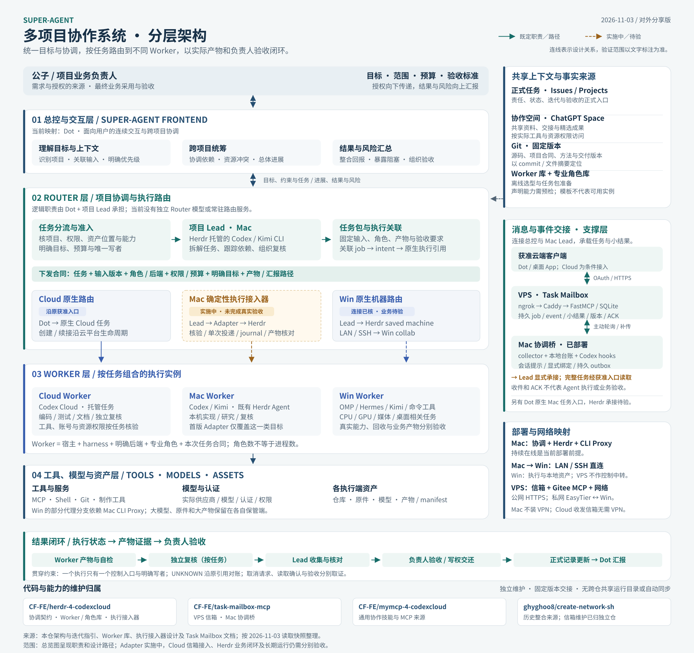
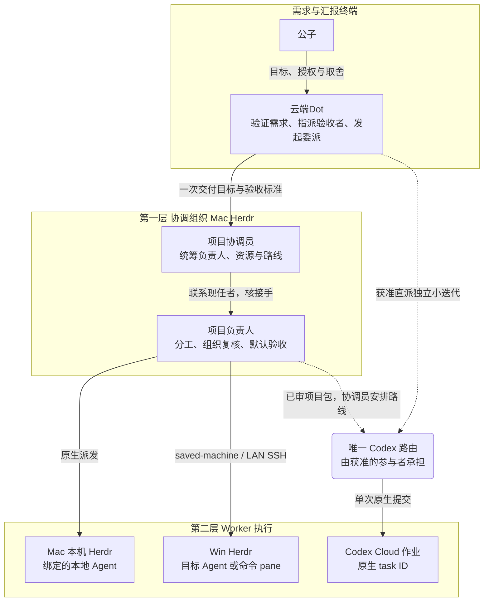
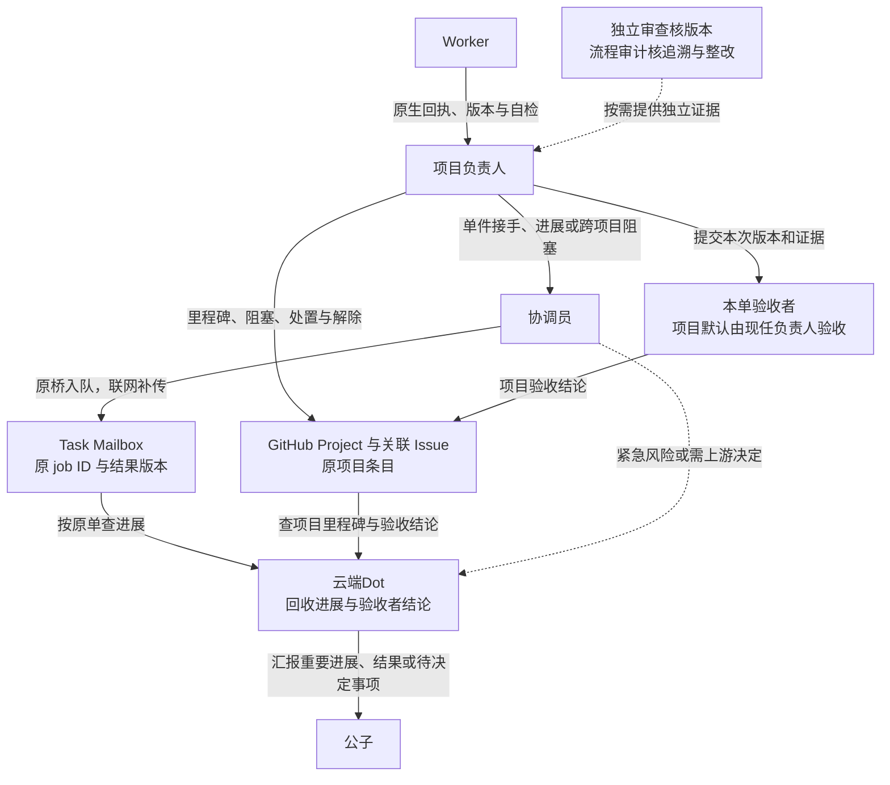
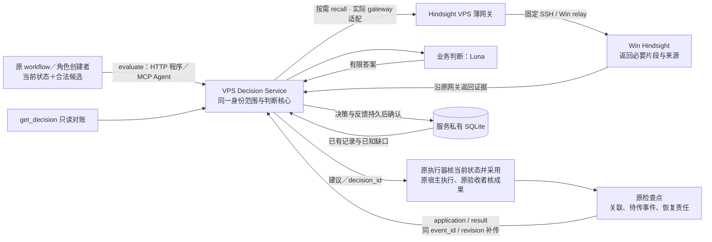
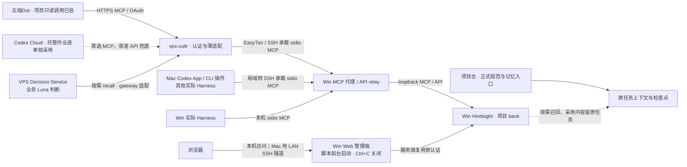

# 架构与范围

修订日期：2026-11-09。本页维护稳定职责、当前拓扑和组件归属；最新采用状态见[状态总表](status.md)，逐轮证据见[历史记录](history/status-through-2026-11-03.md)。当前采用 **Herdr TUI**，以公子确认的 **Mac 持续在线** 为前提，不部署 hc／Herdr App。

## 初始化决定

本仓是独立协作环境仓库。初始化从固定版本复制组织协议、Projects 技能及离线检查，后续在本仓独立维护；来源和增量分别见[初始清单](copy-manifest.json)、[增量记录](copy-updates.json)。复制不继承来源项目的运行身份、任职、权限或验收，也不建立跨仓导入、软链接、共享运行目录或自动同步。

早期 core 优先、VPS 常驻协调 Codex 和脱离 Mac 的设想已被当前分工替代；研究沿[通信指引](agent-communication.md)及历史记录保留，不作为当前安装要求。

## 整套协作分工

**向下交办。** 公子和云端Dot是需求与汇报终端。下游分协调组织与执行两层。协调员统筹各项目；现任负责人决定本项目怎么做、派给谁、怎样验。图中的机器名表示 Worker 的运行位置，同一机器可有多个按任务绑定的 Agent。当前有哪些环境、各自验证过哪些工具和模型，查 [CF-FE 环境能力看板](https://github.com/orgs/CF-FE/projects/6/views/3)；新增同类宿主沿用该入口。

上图是稳定职责与当前组件的总览；以下分别展开交办、回收和记忆路径。PPT 使用的 SVG／高清 PNG 及讲解顺序见[分享图索引](share-doc/README.md)。云端Dot负责需求验证、交办与向公子汇报，交付成果的业务验收由现任项目负责人或本单指定验收者作出。

虚线是有条件的 Cloud 路线，每单只选一个实际提交者。项目包由负责人审定，协调员可安排获准的云端Dot代建；**协调员自动触发 Cloud 尚未验证**。若路由职责由协调层 Agent 承担，其本体仍在 Herdr，唯一转到云端的是具体 Cloud 作业。提交者沿原生 task ID 拉回状态、版本或 PR。已发布 Cloud 环境、Mac 显式调用既有 Codex Agent 的工程样本、Win 定向只读回读分别在[状态总表](status.md#当前结论)记录。[角色、宿主和调用示例](agent-hosts.md) · [小迭代和 Cloud 路由](coordination-policy.md#4-协调员指挥-cloud-路由)

**向上异步回收。** Worker 将版本、产物、自检和未决项交负责人。需独立复核时，审查者直接交核验范围与发现；流程审计者按需核遗漏和整改。项目成果由现任负责人默认验收，另有指定时从原任务；非项目成果须指定其他验收者。云端Dot可核自己是否完成传递，但业务成果的验收结论由本单验收者给出。

云端Dot交办可使用获准的信箱目标合同，已经从原 Issue 正式交办的项目沿原条目继续。两种回收入口各回答一个问题：**Task Mailbox 查这一单，Project／Issue 查这个项目**。只选项目入口的任务无需补造信箱单；离线先存证据，联网补传，日常推进无需等待已读 ACK。执行层能解决的问题就地验证，影响承诺或跨项目资源的阻塞由负责人报协调员；需要新授权或目标取舍的事项再由云端Dot提请公子决定，原任务保留责任人、影响和下次检查点。[弱连接下的进度与迭代](coordination-policy.md#弱连接下的进度与迭代) · [单件目标合同](goal-handoff.md)

| 角色／对象 | 负责什么 | 权威记录 |
| --- | --- | --- |
| 公子／用户 | 总体目标、有效授权及超出既定范围的取舍 | 原指令及对应正式任务 |
| 云端Dot | 调研需求、拆分成果、发起委派、指派验收者及汇总结果；条件成立时直派独立小迭代 | 原聊天、原任务及正式项目记录 |
| 项目协调员 | 授权内统筹各项目负责人、跨项目资源、调度顺序及 Cloud／本地路线，主动识别风险、推进未完事项与提出改进；重要影响按既有授权决定或升级，实际访问、预算及审批权限另核 | 组织职责与决定追溯见[协作约定](coordination-policy.md)；已实现接口见[协调入口](project-coordinator.md#7-本机交付与运行) |
| 项目负责人／Lead | 业务拆解、核输入／权限、组织执行与独立复核、集成，默认负责项目验收；与协调员固定唯一路由 | 任务包、原生执行引用与原项目记录 |
| Cloud 路由执行者 | 按已审任务包承担唯一原生调用、状态与产物回传，不重复决定业务或自行扩大预算 | 原生执行与原任务关联；协调员指挥路线仍待实现／验证 |
| 执行者／独立审查者／流程审计者 | 执行者交付版本和自检；审查者独立核指定版本；审计者按需核跨来源记录、遗漏和整改。业务验收由本单验收者作出 | 原任务、执行或审查回执、审计发现及验收决定 |
| Worker／角色库 | 描述宿主、harness、后端、职责和验收要求；生成离线准备稿 | [双库入口](worker-library/README.md)；`active` 不等于实时可用 |
| 执行适配器 | 确定地执行 Lead 明确批准的单次请求，保全 UNKNOWN 与产物关联 | [适配器规范](herdr-executor.md)及独立 journal |
| 信箱／Mac 协调桥 | 持久传输数据、会话观察、结果补传 | 服务原 job／event／版本／摘要及桥台账 |
| Herdr／执行机 | 原生 session／pane／Agent、实际进程与本机资产 | 原生引用、固定产物和宿主证据 |

每项目有责任边界，不要求每项目常驻一个进程。现有 Cloud 或旧 Lody 任务沿原入口收尾；同一执行和待写资产只能有一个实际控制入口及当前写者，UNKNOWN 不换池重做。

**角色由谁创建。** 协调员的职责由有效任命方确定，技术初始化／恢复由独立受信宿主管理入口执行；协调员依据有效任命安排项目负责人的创建、绑定或交接；负责人或获准唯一派发者按任务单元决定 Worker 的复用、恢复或创建。组织岗位与本地 Worker 落在 Herdr 原生绑定，只有获准的具体 Codex Cloud 作业使用云端原生载体。任命、技术创建和实际接手分别核证，工具返回 ID 不代表角色已履职。完整责任表见[创建职责与载体](agent-hosts.md#role-creation-responsibility)，自动化已实现范围见[生命周期](project-coordinator.md#agent-lifecycle)。

源码和方法沿 Git 固定版本，模型、原件与大产物按所属机器保管。ChatGPT Space 供获准资料、交接与精选成果使用，不视为所有 Worker 自动挂载的共享盘；页面、原件和工具权限逐边核验。具体任务路由与资料交接见[协作迭代指引](collaboration-iteration-guide.md)。

### 项目自有动态工作流

每个项目由现任负责人初始化和迭代 `workflows/`，集合入口为 `workflows/README.md`，流程代码与项目规范一起版本化。**程序负责执行，模型负责决策**：确定规则直接运行，需要新判断时保存检查点并交对口角色决定；跨 Worker 交接沿原生动作与成果回执恢复。负责人按任务能力、资产位置和接手成本安排 Worker，项目内适合时复用，跨项目优先复制明确版本并建立独立绑定。

工作流运行检查点保留在执行侧私有状态目录，GitHub Project／Issue 记录项目进度与验收，Task Mailbox 回收原单进展；Hindsight 为接手和判断提供带来源背景。程序结束、Worker 自检和负责人业务验收分别记录。[流程生成与交接](project-workflow-development.md) · [设计依据](decisions/001-project-owned-workflows.md) · [分享图](share-doc/project-workflow.svg)

需要新增授权的节点按已实现并在 Mac 采用的[审批子工作流](approval-workflow.md)接续：当前绑定协调员以 `COORD_APPROVAL_PREPARE` 提案，原 watcher 登记；hook 在用户活动时提示，受信主会话记录者的答复由原 watcher 回流并接续原检查点。项目负责人定义触发条件及后继，已有授权直接继续；通知不即时，真实 UI、自然审批及业务验收仍待自然单。[ADR-003](decisions/003-approval-workflow.md)

### Decision Service：判断、采用与结果回收

独立项目 [CF-FE/decision-service](https://github.com/CF-FE/decision-service)提供有限候选判断。原 workflow／角色创建者提交合法动作或宿主实际可用的模型／推理强度组合；服务按需取带来源的记忆，用业务 Luna 选择；原执行器在原授权内采用。服务不创建角色、不派发任务，不接管审批、工作流检查点或业务验收。固定规则直接运行，普通判断不逐步审批。

HTTP 与 MCP 已在 VPS 部署，共用 `evaluate_decision`、`get_decision`、`record_decision_feedback`、身份范围和 SQLite；OAuth 状态独立保存。Skill 说明何时调用、怎样提交和反馈，插件分发 MCP 与同一 Skill，主源均在 Decision Service 仓。实际部署通过 Hindsight VPS 网关检索；`native` 只是显式可配置适配，不自动探测或换路。[公共合同](https://github.com/CF-FE/decision-service/blob/main/docs/api-contract.md) · [适配与分发](https://github.com/CF-FE/decision-service/blob/main/docs/provider-integration.md)

`application` 报实际采用或未采用，`result` 报原工作单元结果和已有质量证据；同一执行可关联多条决策，后补质量使用新修订。原端先持久留事件，再直传，失败沿同事件补传，不重跑业务。只读 `get_decision` 不触发业务或补传，服务库也不能证明原端尚未回传的事实。当前由显式适配命令及 `reconcile` 接续，未自动改造旧 runner。[消费者反馈合同](project-workflow-development.md#decision-feedback)

| 数据或状态 | 拥有者 |
| --- | --- |
| 判断输入、候选、实际采用的检索片段与来源，已收反馈及修订 | VPS Decision Service 私有 SQLite，消费者只走 HTTP／MCP |
| 执行状态、原生动作、待传事件与恢复 | 原项目 workflow／Herdr 私有检查点 |
| 项目经验与记忆库 | Win Hindsight／PostgreSQL；VPS 薄网关不复制记忆数据库 |
| 原件、质量证据与业务验收结论 | 原项目资产、指定验收者与原 Issue／Project；信箱负责持久传输 |

### 三类模型分别配置

| 用在哪里 | 做什么 | 当前证据与边界 |
| --- | --- | --- |
| Decision Service 的业务 Luna | 在原调用方合法候选中做有限判断 | VPS 判断与记录读回已验；不执行所选动作 |
| Win Hindsight 内部 Luna | recall 候选排序、consolidation 内部判断 | 已应用候选级拒答补丁并继续 Luna；reflect 沿原普通 LLM 路径，Q8 不自动接管 |
| 原宿主中的执行模型／推理强度 | 完成 Worker 的实际任务 | 合成工程样例为 `gpt-6.1-sol / low`，推荐、启动与实际配置分记；不代表生产角色已迁移 |

三者是独立调用与配置边界，不合并密钥。模型类型、型号与推理强度留记录；消耗仅附现成值、缺失留空，不记现金费用。选型实际应用见[宿主合同](agent-hosts.md#decision-model-selection)，内部 Luna 与拒答处理见[主仓说明](https://github.com/CF-FE/decision-service/blob/main/docs/hindsight-decision-models.md)。

环境可用能力沿 CF-FE Project 维护。组织白名单按场景在本仓保存版本化 JSON。Mac Codex `new-unit` 已在源码接线，筛选和启动前复核均使用发布目录中的 `active` 策略快照。Win、Cloud 和图像调用仍各有待接入口。[策略与接线范围](agent-hosts.md#decision-model-selection) · [宿主采用证据](status.md#当前结论)

**截至 2026-11-09 的证据范围：** VPS HTTP／MCP 同记录读回已验；Mac 插件安装、OAuth 和工具读回有回执，Cloud 插件另已确认 OAuth、工具读回及显式 Skill 加载。Mac workflow 和模型配置的真实合成闭环通过。Win 候选级拒答补丁后，一次双 bank 判断及同记录读回通过。生产角色迁移、自然业务效果、长期稳定性与效率收益仍未证实，原始 refusal 原因仍为 UNKNOWN。Hindsight retain、webhook 与自动补偿不是当前直传闭环的必经步骤，webhook 尚未配置或验证；当前模板也不支持任意在途改图或角色热切换。采用事实来自 [Decision Service 固定资料 2e5ff940](https://github.com/CF-FE/decision-service/blob/2e5ff94021d76b89c3bce30c8df38c8702ba0a9e/docs/evidence-and-open-questions.md#当前交付边界)，各部署版本轴集中见[当前状态](status.md#当前结论)。

### 项目共享记忆

Hindsight 为上述角色提供按项目共享的经验与背景，不承担派发或验收。仓库拥有正式规范及记忆入口，原检查点拥有执行状态；必要上下文随任务保存，在线召回失败不阻断已有确定性步骤。Mac 与 VPS 的运行文件已按 2026-11-05 main 核对，实际读取、修复后的提取与来源文档读回已有成功样本；各客户端采用和 Codex Cloud 托管作业的证据分别见[状态总表](status.md#当前结论)。

VPS 不复制记忆数据库。图示为首选 MCP 路径；公子允许 Hindsight API 兜底，沿同一已认证入口与原 Win 服务，采用方式分别记录。超时、重试和协议切换共用总预算，不把 API 切换当作 EasyTier 断网的修复。角色读写、薄适配与集中验收见[共享记忆实施文档](hindsight-memory-integration.md)，[ADR-002](decisions/002-shared-project-memory.md)保留取舍。

Web 管理端是按需使用的浏览和配置入口：在 Win 可见终端通过脚本运行、显示实时日志，Ctrl+C 关闭；不配置开机启动、隐藏后台或守护。它复用原 Hindsight API 与 tenant 权限，关闭 UI 后原后端继续运行。管理端只监听 loopback，Mac 经已有 LAN SSH 隧道浏览，不经过 VPS。启动脚本和端口配置只在[管理端说明](../mcp/hindsight-memory/control-plane/README.md)维护。

## 当前机器主链路与既有支路

| 路径 | 作用与边界 |
| --- | --- |
| Lead → 独立执行适配器 → Mac 既有 Herdr Agent | 当前显式执行切片。适配器核完整任务包、policy、目标和预算，持久记录意图、原生引用、产物与交还；首版 Mac Codex 工程限定验收已通过 |
| Mac 本地 Herdr saved-machine／`--machine` → LAN SSH → Win `collab` | 选定的远端机器主链。连接与原生只读查询已验；适配器首版未扩展到 Win，Win Herdr 模型及业务回收另验 |
| Mac → LAN → Win 网关 → EasyTier → VPS 内网地址 | VPS 管理路径；Mac 不装 VPN，Win 仅代理指定 Mac 主机 `/32`，Mac 仅路由 VPS 虚拟主机 `/32` |
| VPS 旧 Herdr profile → EasyTier／SSH → 原执行机 | 仅保留原任务查询和收尾，不作为新机器任务必经层；未知执行沿原入口，不双发或静默迁移写权 |
| Codex 路由 → Codex Cloud 原生任务 | 仅已获准的具体作业转到云端，以平台返回的 task ID 取回状态和产物；承担路由的协调层 Agent 仍在 Herdr |

[执行适配器规范](herdr-executor.md)拥有其接口、安装和限定验收；[试点指引](pilot.md)拥有原生目标选择、等待与恢复语义；[网络方案](networking-plan.md)拥有路由、SSH 和固定版本风险。本页不重复维护这些合同或逐次回执。

### Task Mailbox：持久收发与本地承接

**VPS Task Mailbox 持久收发，Mac 原桥轮询和补传，协调员及项目负责人按单件授权办理。** 部署的目标合同可在完整原件、可信主体、现任负责人及单件授权都已绑定时沿原生入口交办。桥收件、后台轮询和 Herdr Agent 接手分别有回执。发送信箱消息不会自行启动模型、Cloud 作业或唤醒云端Dot。

Lead 从获准入口取得完整 job、核原任务授权与固定输入后，显式调用适配器。桥 jobs 台账保存身份、路由和状态摘要，不能据此重建完整任务正文；摘要一致只证明内容关联。适配器的 journal 不接管桥的 SQLite、OAuth、collector 或 hook，结果按已有获准报告接口回传。

服务和 Mac 桥的唯一维护仓为 [CF-FE/task-mailbox-mcp](https://github.com/CF-FE/task-mailbox-mcp)，个人 `create-network-sh` 仅保留历史整合来源。契约、部署和运行证据分别由其 [SPEC](https://github.com/CF-FE/task-mailbox-mcp/blob/main/SPEC.md)、[部署说明](https://github.com/CF-FE/task-mailbox-mcp/blob/main/docs/deployment.md)、[验证记录](https://github.com/CF-FE/task-mailbox-mcp/blob/main/docs/verification.md)维护。本仓引用这些权威，不复制服务或共享运行库。信箱与 Gitee 保持独立认证；示例端点为 `https://mcp.example.com/mailbox/mcp`。

Codex Cloud 仅在具体任务实际具备信箱 MCP 工具、OAuth 身份和动作权限时直接收发同一 HTTPS 端点，不经 Mac 中转、不加入 VPN；这条条件路径仍未验，信箱提交也不会创建或唤醒 Cloud 任务。原数据任务、指定 Dot 读取、本次桌面 Lead／原 review 显式闭环的证据归属见[当前状态](status.md)，不合并为“所有客户端双向业务通过”。

## 各端组件清单

以下描述部署归属；实际版本、能力回合和运行状态由[能力盘点](local-agent-inventory.md)、[状态总表](status.md)及各组件权威记录更新。

环境是可扩展的执行资源，Mac／Win 是当前实例，不是固定上限。新增 `linux-herdr` 等环境时，沿组织环境能力看板登记稳定环境身份、可联系入口、实际工具／模型、资产位置和最近验证时间，再由负责人按任务选用。安装 FFmpeg、本地模型或新增能力时更新对应能力卡；稳定调用合同和组件归属变化才更新仓库架构。

### 三机部署速查

| 组件 | mac-work | VPS | win-work |
| --- | --- | --- | --- |
| Herdr TUI／`herdr` | 托管协调层 Agent 和 Mac 执行者，原生连接 Win | 保留旧 CLI／profile；无本地 pane 用途时不启本地 server | 既有 `collab`、完整 Windows 包及 ConPTY 附属文件 |
| Agent CLI | 复用既有 Codex／Kimi | 不部署项目 Lead、本地推理模型或桌面 Agent | 本轮候选 OMP／Hermes／Kimi；Windows Codex 暂不纳入 |
| HerdrExecutionAdapter | 独立安装，显式控制获准 Mac 既有 Agent | 不部署 | 首版不支持 |
| Task Mailbox／Mac 协调桥 | 专用桥及其 OAuth／台账／collector／hook | 独立信箱、SQLite、OAuth；保留原 Gitee 服务 | 不作为本轮执行接入前置 |
| Decision Service | workflow／模型消费者；本地插件用 OAuth 调用 MCP | 独立 HTTP／MCP、判断核心、私有持久 SQLite；按需经 Hindsight 网关召回 | 不部署业务服务；内部 Hindsight Luna 单独配置 |
| Hindsight 项目记忆 | Codex App／CLI 共享本地插件与 LAN 客户端；其他 Harness 分别配置 | 独立 HTTPS MCP／API 薄入口，经 EasyTier 到原 Win 服务 | 原 Hindsight、PostgreSQL、BGE 与 MCP 代理；按项目 bank 共享 |
| Hindsight Web 管理端 | 浏览器经可见 LAN SSH 隧道按需访问 | 不承载 UI | 官方 Control Plane 1.2.0，脚本前台运行、Ctrl+C 关闭，不自启 |
| ngrok／Caddy | 客户端使用 HTTPS | 复用公网入口并按服务分路 | 非机器执行前置 |
| EasyTier | 不装；仅到 VPS 的主机路由经 Win | 2.6.4 私有节点／TUN | 2.6.4 节点／指定 Mac 主机代理／系统转发 |
| SSH | 原客户端和身份，LAN 直连 Win | 服务端管理入口、旧支路客户端 | 接收连接的 sshd；出站客户端按任务需要 |
| Git、shell、项目依赖 | 按本机项目及控制入口需要 | 仅服务维护和旧支路需要 | 复用原制作环境，Git Bash 按模板需要，不默认迁移 WSL |
| hc／Herdr App | 不部署 | 不部署 | 不作为当前路线前置 |

### 部署顺序与准备项

1. 从原任务确认资产、当前写者、目标与组件 owner；先复用已有版本和回执，缺项才进入获准准备。
2. 需要 VPS 管理或旧支路时按[网络配置](networking-plan.md#4-easytier-各端安装与配置准备)核私有节点、主机路由、ACL 和 SSH；Mac → Win 的 LAN 主链不以 VPS 路径为前置。
3. 按[原生试点](pilot.md#herdr-目标选择)回读准确 session、profile、pane／Agent；不为补齐清单启动默认 session、重新注册机器或替换 server。
4. 显式 Mac 执行采用[适配器安装与资源合同](herdr-executor.md#安装与资源)，固定源码／catalog、私有 policy、真实目标和预算；不改桥的运行目录。
5. 先完成具体任务的输入—执行—产物关联，再分别交付、读回、复核和交还。旧 VPS／Lody／Cloud 在途引用继续沿原入口，不自动迁移。

### mac-work：项目协调

协调员、项目负责人和 Mac 执行者按原任务绑定到 Mac Herdr。Mac 另运行显式执行适配器、协调桥与 CLI Proxy。Codex 复用应用内 CLI 和已有用户入口，Kimi 复用自身安装／配置；桥的专用 OAuth 不代验 Codex／Kimi 的直接 MCP 认证。官方 Herdr skill 的宿主与 `HERDR_ENV=1` 条件见[原生技能边界](pilot.md#官方操作技能与外部协调)。

桌面 Lead 显式调用 Mac Codex 的首版工程闭环已验；这不等于任意 Dot 原生任务都能定向操作 Lead，也不代验 Kimi。现有 LAN、SSH 身份、到 VPS 的主机路由及默认出口／DNS 保留，Mac 不新增 VPN 或 sshd。

### VPS：MCP 服务与过渡控制

VPS 承载独立 FastMCP 服务、Task Mailbox 持久状态和 ngrok／Caddy 接入；Gitee 保留原认证及路径。旧 Herdr CLI、profile、SSH 与 EasyTier 用于原任务对账，不常驻项目规划 Codex 或本地模型，不作为 Mac → Win 中转。服务维护、安装归属和容量见[VPS 专项指引](vps-control-pilot.md)。

Decision Service 在 VPS 独立运行 HTTP／MCP 服务，调用业务 Luna，持久保存自己的 SQLite；它与信箱和 Hindsight 网关各自维护身份及数据。部署与插件主源归 [CF-FE/decision-service](https://github.com/CF-FE/decision-service)，Herdr 只维护消费者与原宿主应用。

Hindsight 使用独立 HTTPS MCP／API 路由及认证，经既有 EasyTier／SSH 访问 Win；对应薄适配唯一维护于公子指定的 [ghyghoo8/create-network-sh/fastmcp/hindsight-memory](https://github.com/ghyghoo8/create-network-sh/tree/main/fastmcp/hindsight-memory)。它与信箱分别部署，不复制数据库或模型。

### Codex Cloud：托管 Worker

Cloud 沿获准原生任务入口使用已准备的仓库、环境、依赖和工具。信箱与 Pages／Space 都以该任务实际提供的工具、OAuth 及资源权限为条件，不能从 Mac 或 Dot 配置推定继承；本轮不配置 Cloud VPN，不为普通 Cloud Worker 安装另一套 Herdr 或桌面应用。Cloud 执行扩展仍未由适配器首版验收覆盖。

Decision Service Cloud 插件的原生 OAuth、工具读回及显式 Skill 加载已有独立回执；这证明该客户端访问服务，不证明协调员自动创建 Cloud 作业、Hindsight Cloud Skill 已打包或每个托管作业自动继承连接。

### win-work／其他执行机：具体执行

Win 保留既有 TUI `collab`、sshd、制作工具、模型及本地资产；本轮候选为 OMP／Hermes／Kimi。代理分支可依赖常在线 Mac 的 CLI Proxy，Kimi 官方入口单列。原生 CLI 短对话交接不等于 Herdr 托管派发，供应商、模型、认证、工具和项目权限仍逐项绑定；详细版本与证据在[执行侧盘点](local-agent-inventory.md#7-win-work-harness执行侧交接)。其他机器不继承 Win 的连接或验收结果。

### SSH 依赖与已有组件复用

SSH 能力、Windows 公钥落点、既有身份复用和教程来源统一见[网络方案：SSH 依赖与公钥免登](networking-plan.md#ssh-依赖与公钥免登)。`herdr` 不替代 sshd；原生 profile 回读与普通 SSH 登录分别验收。

### 三机连通、效率与 Dot

三条网络路径、路由／DNS 边界和测量口径统一见[网络拓扑](networking-plan.md#2-已选拓扑与分层)与[效率判断](networking-plan.md#6-效率与-dot-连通怎样判断)。网络可达不等于平台任务权限、Agent 回合或业务验收。

## Mac 持续在线与执行依赖

Mac 持续在线是公子确认的部署前提；当前不建设离线接管、备用规划／推理入口，也不把 Mac 离线测试列为采用门槛。持续在线不代表长期可用性已实测。请求超时或结果不明时沿原任务、session／pane、产物及当前写者对账，保留 UNKNOWN；原 Win 网络服务恢复不证明 Agent 业务恢复。

## 唯一维护位置

| 内容 | 唯一维护位置 |
| --- | --- |
| 全仓采用状态／逐轮历史 | [status.md](status.md)／[冻结历史](history/status-through-2026-11-03.md) |
| 稳定架构／网络／VPS 专项 | 本页／[networking-plan.md](networking-plan.md)／[vps-control-pilot.md](vps-control-pilot.md) |
| 原生试点／显式执行适配器 | [pilot.md](pilot.md)／[herdr-executor.md](herdr-executor.md)及本仓源码 |
| Worker／角色定义 | [worker-library](worker-library/README.md)，独立版本与资源正文 |
| 技能及复制来源 | `skill/<id>/`、[初始清单](copy-manifest.json)、[增量记录](copy-updates.json) |
| 信箱与 Mac 桥 | 外部 [CF-FE/task-mailbox-mcp](https://github.com/CF-FE/task-mailbox-mcp) |
| Decision Service 服务、公共合同、SQLite、插件与 Skill | 外部 [CF-FE/decision-service](https://github.com/CF-FE/decision-service)；本仓只维护 [workflow 消费者](project-workflow-development.md)与[宿主应用](agent-hosts.md#decision-model-selection) |
| Hindsight 本地合同、Win 代理、Mac 客户端与 Web 启停脚本 | 本仓 [mcp/hindsight-memory](../mcp/hindsight-memory/README.md)；Mac Codex 分发在 [plugin/hindsight-memory](../plugin/hindsight-memory/README.md) |
| Hindsight VPS 接入 | 指定的 [ghyghoo8/create-network-sh/fastmcp/hindsight-memory](https://github.com/ghyghoo8/create-network-sh/tree/main/fastmcp/hindsight-memory) |
| Hindsight 引擎／本地候选拒答补丁 | 上游 [vectorize-io/hindsight](https://github.com/vectorize-io/hindsight)／本仓 [Win 补丁与回退](../mcp/hindsight-memory/decision-reranker/README.md) |
| 项目工作流、规范与记忆入口／动态经验 | 各项目主仓 `workflows/` 及记忆入口／同项目 Hindsight bank；实时能力仍在组织环境能力看板 |
| Gitee MCP 来源／项目业务资产 | 对应所属仓库；各项目正式状态仍留原入口 |

`mcp/project-coordinator-tools/` 维护本仓受限 stdio 组织工具，依赖同一固定发布的协调模块；它不扩展外部 Task Mailbox 服务。`mcp/hindsight-memory/` 维护记忆客户端与 Win 代理，[Hindsight 本地插件](../plugin/hindsight-memory/README.md)为 Mac Codex App／CLI 统一分发 MCP 入口和 Skill。源码、安装与真实启用分别记证，新实现或分发须有实际需求和明确 owner。

## 复制与排除

初始化固定接收 19 文件：组织协议 11、Projects 技能 5、标准库检查及测试 3；未接收 Lody runtime、队列、Gitee 服务、运行凭据或历史验收。后续 Worker／角色库按[独立来源清单](worker-library/source-manifest.json)接收固定源的 14 文件闭包并记录改编，另有本仓新写职责；这不改写初始化历史，也不继承源运行身份。

本仓复制件的维护 owner 是本仓。初始来源摘要保留历史基线，后续采用记录增量，不自动跟随上游，不依赖源 checkout；独立安装使用固定闭包和摘要收据。

## 执行与证据

安装、网络、SSH、Herdr 原生目标、Agent 模型／工具、产物、结果读确认、负责人验收和写权交还分别取证。机器、session、pane、Agent 引用归对应 server；UI 选择不会改变 CLI 路由。`agent prompt --wait` 不定位单个 turn，`idle/done`、退出 0 和 ACK 都不能合并成业务完成；等待与 UNKNOWN 处理见[试点指引](pilot.md#等待未知与恢复)。
