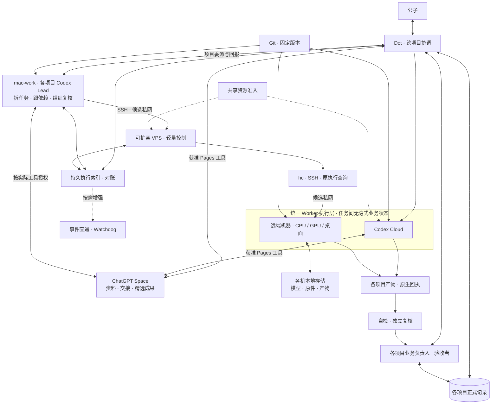

# 架构与范围

## 初始化决定

2026-10-29，公子要求参考“阅读仓库结构与说明”聊天的 Herdr 可行性方案初始化独立仓库，先与来源聊天充分沟通、取得复制清单再执行。双方已核对依赖与排除项，按固定提交复制 19 个文件，精确路径与摘要见[清单](copy-manifest.json)。

本次只建立仓库和试点准备资料。实际执行入口、数据所有权、正式 Project、旧任务和验收责任均未切换；后续试点按[试点指引](pilot.md)逐项验证。

2026-10-30 新增[跨 Agent 通信与协作指引](agent-communication.md)：优先验证独立产品 herdr-core 的适配条件，原 TUI 路线保留作对照。该研究尚未切换运行时或业务入口，不能把 `herdr` 与 `hc` 的命令、状态和恢复语义混用。

2026-11-01 新增[轻量 VPS 制作控制端方案](vps-control-pilot.md)：在 Dot 与执行机之间增加 VPS 上的单协调 Codex 和选定控制接口，制作与模型仍在 win-work。它是待验证的候选托管位置；先核 Dot 对无头 Linux VPS 的实际入口，再测脱离 Mac、一台及多机闭环。新路线不依赖 Lody，旧入口与在途绑定继续保留；本轮仅文档，不改变任何运行状态。

后续搭建按[多项目协作迭代指引](collaboration-iteration-guide.md)：目标是多个项目同时推进，单项目只是起步切片。公子在本轮明确选择 **mac-work 承载各项目 AI Lead，VPS 保留轻量控制与查询，执行机承担具体工作**；这替换原草案在 VPS 上常驻协调 Codex 的分工，不修改前述有日期的研究历史。Dot 保持全局协调，各项目保留业务负责人、正式入口与验收。VPS 仍可升级，起始规格不作为架构上限；新增组件按真实需求判断，本轮仅文档。

整套方案采用 **统一协调与资源视图、分布式执行与资产保管**。Mac Lead 在项目授权内拆任务、跟依赖、准备任务包和组织复核；Cloud 派发仍沿已获准 Dot 入口，机器主路径为 Mac Lead → SSH 调用 VPS 既定 hc 入口 → 执行机。规划者与唯一实际派发／续发入口分列，不自动双发。两类 Worker 都以任务间无隐式业务状态为目标，一个项目可以同时使用两池；状态与交接沿[迭代指引](collaboration-iteration-guide.md#统一-worker-的状态边界)，不宣称已实现或接通。

## 整套候选分工

这是目标职责关系，不表示已接通或已部署。机器支路优先验证 core，TUI 仍为独立对照，不把两者当同一 server。执行索引复用获准持久落点，记录原生引用而不竞争项目正式状态；资源视图复用原任务所需的保管者、访问方式、版本、授权与占用，不为图中每个逻辑节点新建服务。组织协议、专业方法、真实任职和工具权限分别维护，复制岗位定义不创建任职。

AI Lead 是项目工作角色，正式业务负责人／验收者由公子或已指定责任人承担。每项目有责任边界，不要求每项目常驻一个进程；Mac 上的会话并发和隔离按实测选择。VPS 不再默认部署项目规划 Codex，hc 只提供终端、进程和机器控制；安装软件不产生任职或业务权限。

Codex Cloud 适合输入、依赖和权限可在云端准备的编码、测试、文档与复核；GPU、音频、桌面或特定宿主验证按任务条件留在对应机器。两类 Worker 都通过任务包定位输入、权限、环境和成果，减少对某条聊天或终端记忆的唯一依赖；单次执行、未提交文件、写权和外部效果仍有真实状态。可重建 Worker、可换机器、可恢复中间进度分别验证，UNKNOWN 不自动换池重做。云平台也保留自己的任务工作区与历史。[官方云环境说明](https://learn.chatgpt.com/docs/environments/cloud-environments#reuse-and-update-saved-state)

ChatGPT Space 是共享资料、交接与精选成果入口；公子提供的 100G 容量尚待核账号口径和实际额度，不当作所有 Worker 已挂载的共享盘。源码与方法沿仓库固定版本，模型、原件和大产物可以保留各机本地。成果外置是由明确落点持久保管，不要求全量上传或统一存储；本地唯一资产的备份与宿主依赖仍需单列。Space 页面、链接原件、云任务和机器工具的权限逐边核验，具体路径见[资源整合与连通](collaboration-iteration-guide.md#chatgpt-协作空间与本地存储怎样连通)。[官方 Space 定位](https://learn.chatgpt.com/docs/space)

Dot 与任务实际提供获准 Pages／Space 工具的 Codex Cloud Worker 都可直接访问各自获准页面与文件引用，Cloud 资料访问不强制经 Dot 或 VPS 中转。图中 Space 工具线表示这一接入设计，Mac Lead 也须以实际工具与授权接入；具体读写仍核工具、账号、动作和目标资源，不宣称所有 Cloud 任务默认带 Pages，也不把分享管理开启当成指定 Page 已可读写。同一待写页面或成果的写权仍须明确。[Cloud 工具边界](https://learn.chatgpt.com/docs/cloud/internet-access#agent-security-command-network-requirements)、[Space 连接账号权限](https://learn.chatgpt.com/docs/enterprise/chatgpt-space#plugins-and-connected-accounts)

现有 Codex Cloud 委派路线和旧 Lody 执行继续沿各自有效入口；本次补齐架构映射，不新建云任务或迁移旧绑定。迁移单位是新任务或明确结束的阶段；一个执行只能由一个入口控制，不自动双发。VPS／hc 接入未验只约束机器支路，不阻塞独立、已获准的云任务。

## 各端组件清单

下表区分本分工所需能力和按需组件，先核目标端已有安装与版本，不能把表格当成已部署清单或安装脚本。普通执行账号、允许动作、认证配置和私密落点分别绑定；凭证不进入文档。候选私网沿 Tailscale，需要采用时再按各端有效授权配置，不因画了连接线就自动入网。

### mac-work：项目协调

| 组件／配置 | 采用条件与用途 |
| --- | --- |
| ChatGPT 桌面应用中的本地 Codex | 首选 Lead 入口；Dot 需获准访问这台计算机，Mac 在线、应用运行并登录相应账号／工作区 |
| Git、SSH 客户端 | 读取固定版本，通过获准 SSH 调用 VPS 原 hc 入口；先核已有工具、身份与目标 |
| 项目上下文、组织技能和必要工具连接 | 显式绑定项目、任务、输入、预算与交付；Space／Projects 仅采用该任务实际提供且获准的工具，不从别的聊天继承权限 |
| Codex CLI | 仅终端运行 Lead 或采用 hc 托管 CLI 进程时需要另核；桌面路线不因此必须额外安装 |
| 本地 hc、Herdr App | 管理 Mac 本地 Agent 终端时按需采用；Herdr App 是可选客户端。仅 SSH 调用 VPS 的 hc 时，Mac 不要求本地 hc |
| 私网客户端、工作目录与有界日志 | 私网客户端随选定路径采用；本地上下文与文件按项目授权组织，持久事实不能只留在 Mac 聊天 |

### VPS：轻量执行控制

| 组件／配置 | 采用条件与用途 |
| --- | --- |
| herdr-core／hc | 本分工的机器控制组件，记录实际二进制与运行中核心版本；不承担项目业务规划 |
| OpenSSH 服务端与客户端 | 服务端接收 Mac 的获准调用，客户端连接执行机；分别核账号、host key、目录和命令范围 |
| 选定的私网组件 | 采用 Tailscale 路线时需相应客户端、路由和访问策略；其他路径不自动补设 |
| 轻执行索引、日志轮转、缓存上限与必要备份配置 | 复用已有持久目录及 OS 管理机制，保留原生执行引用、未决效果与报告承接，不新建业务任务平台 |
| Codex／桌面应用 | 基线不要求常驻项目 Lead、协调 Codex 或桌面应用；将来新增运行组件需有具体任务价值与执行授权 |

### Codex Cloud：托管 Worker

| 环境／工具准备 | 采用条件与用途 |
| --- | --- |
| 可访问的已发布 Cloud 环境 | 绑定实际仓库、输入版本、工具和运行条件；保存配置可列举／runnable 不等于本仓任务已验证 |
| 项目依赖、仓库技能与任务检查命令 | 在环境与任务中准备所需运行时和依赖；本仓离线检查仅需 Python 3.10+ 标准库，其他业务按项目确定，不默认搬入整台 Mac 配置 |
| Git／GitHub 权限与 Pages／MCP 等工具 | 源码沿固定版本；Space 仅在任务实际提供工具且目标资源允许时直接读写，插件可用不代替账号及资源授权 |
| 私网／SSH 访问 | 只有任务确需访问私网服务时才按官方环境配置 Tailscale、代理适配和服务身份；不是默认前置 |
| Herdr、桌面应用、额外 Codex CLI | 通常不为普通 Cloud Worker 再部署这些组件；使用平台托管任务及原生查询／成果能力，不把云任务当 VPS 常驻控制进程 |

### win-work／其他执行机：具体执行

| 组件／配置 | 采用条件与用途 |
| --- | --- |
| 与选定路线兼容的 hc | VPS／hc 机器执行支路需要对应核心；安装及实际运行版本分别记录，不与独立 Herdr TUI 混用 |
| Windows OpenSSH Server／sshd | 原生 Windows 远端 SSH 需要服务端，只有 OpenSSH Client 不够；服务账号、shell、host key 与网络访问分别核验 |
| 指定 Agent CLI 及启动配置 | 仅按现有任务需要配置；win-work 的 `codex over Claude` 供应商、模型、认证和权限保持原绑定，不默认换成官方登录或其他供应商 |
| Git 与实际 shell | 代码任务按项目需要具备 Git；模板需要 sh／Git Bash 时另核。核原生 PowerShell、路径和 core 版本兼容，不默认迁移 WSL |
| 原有制作工具、模型、驱动与本地资产目录 | 音频制作及模型继续归 win-work；只按现有模型实际需要核版本与资源，记录原件、产物、检查点、日志和当前写者，不全量搬到 VPS／Space |
| 选定私网客户端与有界运行配置 | 随获准网络路径采用；明确目录、日志／缓存上限和资源占用。其他执行机按各自 OS 与任务准备，不机械复制 Windows 配置 |

### SSH 依赖与已有组件复用

hc 提供 SSH 远端管理，默认仍调用系统 SSH 客户端。2026-11-01 核对官方固定源码 `7a54c2975225a859b7e7d67302df5efc249fb9d0`：连接辅助函数直接使用 `std::process::Command::new("ssh")`；hc 的 core server 不替代被连接端的 `sshd`。[SSH 调用源码](https://github.com/herdrdev/herdr-core/blob/7a54c2975225a859b7e7d67302df5efc249fb9d0/crates/herdr-core/src/machines.rs#L150-L165)

| 位置 | 本分工需具备的 SSH 能力 |
| --- | --- |
| mac-work | SSH 客户端，向 VPS 发起调用；不为这条出站路径额外要求 Mac 的 SSH 服务端 |
| VPS | SSH 服务端接收 Mac；SSH 客户端连接 win-work／其他机器，两个方向分别核验 |
| win-work | SSH 服务端 `sshd` 接收 VPS；仅作为被连接执行机时，不因此强制额外准备出站 SSH 客户端 |
| Codex Cloud | 只有任务需要主动访问 SSH 服务时才核客户端、代理适配和服务身份；普通云任务不以 SSH 为默认前置 |

“需要”指对应能力可用，不是每端重复安装一套软件。先核 OS／镜像已有组件与版本，已有且满足条件就复用；缺失时才在获授权的环境准备任务中补齐。安装 hc 不自动安装或启用 OpenSSH／sshd，`hc machine add --install` 的作用是允许复制目标 hc，不能代替 SSH 服务准备。[机器接入与 hc 复制](https://github.com/herdrdev/herdr-core/blob/7a54c2975225a859b7e7d67302df5efc249fb9d0/docs/machines.md#L18-L23)

该源码的 Windows **发起端**在远端复制 hc 的相应路径调用系统 `scp`，仅在采用该平台与复制路径时核此依赖；不能推广成所有机器必须另装 scp，尤其不能把 win-work 作为被连接端与 Windows 发起端混同。[Windows 发起端复制源码](https://github.com/herdrdev/herdr-core/blob/7a54c2975225a859b7e7d67302df5efc249fb9d0/crates/herdr-core/src/machines.rs#L510-L522)

以上是固定源码的依赖研究，不代表目标机器已有相同版本或本轮已执行安装、SSH 连通和登录测试；原 `de82…` 研究历史继续保留。

官方依据：[Dot 本地任务与 Cloud 任务](https://learn.chatgpt.com/docs/dots/tasks-and-memory#assigned-work)、[计算机在线与授权条件](https://learn.chatgpt.com/docs/enterprise/cloud-local-access#end-user-experience)、[Herdr-core 的职责与客户端](https://herdr.dev/core/)、[Cloud 环境准备](https://learn.chatgpt.com/docs/environments/cloud-environments#create-and-publish-an-environment)。具体版本、启动参数、Windows 适配和恢复语义沿[通信指引](agent-communication.md)与[VPS 清单](vps-control-pilot.md)，本轮不运行这些组件。

### 三机连通、效率与 Dot

机器支路需要 **mac-work → VPS、VPS → win-work** 两段获准互通，不要求三台位于同一物理局域网，也不默认开放 Mac → Win。Tailscale 是推荐试点的私网候选：三端加入同一获准 tailnet，按来源、目标和实际 SSH 端口配置访问策略；已有可用私网也可复用。这两段是本方案的调用与授权边界，Tailscale 不自动将 Mac → Win 流量强制经过 VPS，也不因入网就已限制成两段。网络可达、SSH 账号与资产权限分别核验，同网不代表全端互信。[Tailscale 接入](https://tailscale.com/docs/how-to/quickstart)、[访问控制](https://tailscale.com/docs/features/access-control)

基线采用 **Tailscale IP 连通 + 系统 OpenSSH + hc 控制**；无需为三台客户端互通额外引入出口节点或子网路由。Tailscale SSH 是另一个改变 SSH 认证／授权方式的可选功能，不随组网默认启用，也不能代替 Windows 的 OpenSSH Server。本分工保留原 SSH 身份与唯一控制入口；普通 Codex Cloud Worker 不强制入网，确需访问私网时按其环境单独配置。[普通 SSH 与 Tailscale SSH 的区别及平台限制](https://tailscale.com/docs/features/tailscale-ssh#how-is-tailscale-ssh-different)

收益先看可达性与连接维护成本，**不承诺组网必然提速**。Tailscale 直连通常比中继延迟低、吞吐高；无法直连时可能经 DERP 或 peer relay，最终速度还受两端网络、VPS 带宽和负载影响。命令／状态回读与大文件传输分别测；前者以请求回读耗时和失败率为准，后者只传任务需要的对象，不把模型与原件全量绕经 VPS。试点记录实际直连／中继、传输量、吞吐和资源占用，再决定是否优化路径。[连接类型与性能](https://tailscale.com/docs/reference/connection-types)

Dot → Mac 继续使用平台原生电脑连接，不把 Dot 当作 tailnet 内的第四台机器。官方要求本地计算机在线、ChatGPT 应用运行且访问已开启；Mac 的 VPN 和登录不会自动延伸到 Dot 云端。[Dot 本地接入与 VPN 边界](https://learn.chatgpt.com/docs/enterprise/dots-admin-guide#access-and-eligibility)

按官方默认路由说明，Tailscale 只承载设备间私网流量，普通公网流量不经过它。因此本试点建议保留原公网出口和代理，不选择 exit node，不启用全局 DNS 覆盖；私网名称解析按需核验。DNS、地址／路由重叠或与已有 VPN 的冲突仍可能影响 Dot 连通，不能保证零影响。后续获准实施时，对照入网前后的 Dot 原生任务回读、登录与普通联网，再分别验证两段 SSH；今天只补方案，不修改网络。[出口路由](https://tailscale.com/docs/features/exit-nodes)、[DNS 设置](https://tailscale.com/docs/reference/dns-in-tailscale)、[与其他 VPN 共存](https://tailscale.com/docs/reference/faq/other-vpns)

## Mac 离线时的边界

mac-work 项目 Lead 离线会暂停依赖它的新规划、续派或本地复核；本地任务不会自动迁移到云端。Dot 与 Cloud 的独立获准任务可沿各自入口继续。机器已派任务是否存活按 hc 父子关系、控制连接和目标进程实测，不预先保证全部继续。

VPS 独立查询能力只有在另有获准且实际可用的访问入口后才能成立；现有 Mac → SSH → VPS 链路本身不能证明 Mac 离线后 Dot 仍可查询。原“完全脱离 Mac”目标保留为历史设计，当前分别验证控制／查询独立和项目规划依赖，不把前者冒称后者通过。恢复先对账原任务、写权和产物，不自动启用第二 Lead、替代派发或 Lody 回退。

## 唯一维护位置

- `skill/<id>/` 维护技能及其相对资源。组织协议和 Projects 技能分别保持自己的版本。
- `mcp/` 与 `plugin/` 当前仅保留分类索引；实现或打包有真实需求时再新增。
- `docs/status.md` 维护本仓当前开发状态；正式项目绑定未建立前，不代写其他项目的进度。
- 试点上下文、过程和验收复用组织技能已有字段，[任务模板](templates/pilot-task.md)只补充 Herdr 绑定信息，不建立第二套任务数据库。

两个仓库独立。清单中的源仓库、commit 和 hash 只说明导入来源；本仓复制件的当前维护来源是本仓。后续修订在本仓审查、验证和提交，不回写源仓、不自动跟随其变化，不需要原 checkout 才能运行本地检查。

## 复制与排除

| 处理 | 内容 | 理由 |
| --- | --- | --- |
| 原样复制 | 组织协议 11 文件、Projects 技能 5 文件 | 完整相对资源闭包，保留原版本和证据语义 |
| 原样复制 | 结构检查、结构测试、迭代日期测试各 1 文件 | 标准库工具，可在本仓独立运行 |
| 本仓新写 | README、AGENTS、分类索引、架构、试点模板、状态和来源清单 | 避免继承旧项目的事实与执行边界 |
| 排除 | Lody runtime/插件/安装器、命令快照、Gitee 服务、角色库、旧 `.codex` 队列、历史验收、缓存与凭证 | 不是本次试点准备的必要依赖 |

组织协议已独立于 Lody。Projects 中的 Lody 迭代异常、组织正文里的重派反例仍是带来源的历史说明；保留原义，不改名伪装成本仓实测。专业角色库含 Lody 配置语义，本轮不复制；真实需要某种专业方法时再按范围抽取、修订和标版本。

## 执行与证据

网络可安装、网络可达、SSH 身份与权限、Herdr 可用、Agent 配置正确、任务产物通过、负责人验收是不同层次。当前证据见[本仓状态](status.md)。

Herdr 的机器、session、workspace、pane 和 Agent 引用属于对应 server；界面选择不会替 CLI 改变目标。目标绑定与等待语义按[试点指引](pilot.md)核对。`UNKNOWN` 保留原生值并沿原引用查询，不能据此创建替代执行。
