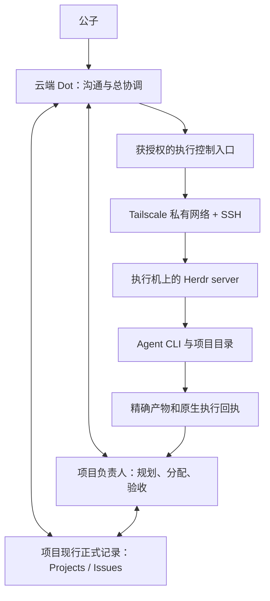

# 架构与范围

## 初始化决定

2026-10-29，公子要求参考“阅读仓库结构与说明”聊天的 Herdr 可行性方案初始化独立仓库，先与来源聊天充分沟通、取得复制清单再执行。双方已核对依赖与排除项，按固定提交复制 19 个文件，精确路径与摘要见[清单](copy-manifest.json)。

本次只建立仓库和试点准备资料。实际执行入口、数据所有权、正式 Project、旧任务和验收责任均未切换；后续试点按[试点指引](pilot.md)逐项验证。

2026-10-30 新增[跨 Agent 通信与协作指引](agent-communication.md)：优先验证独立产品 herdr-core 的适配条件，原 TUI 路线保留作对照。下图保留初始化时的候选分工；新增研究尚未切换运行时或业务入口，不能把 `herdr` 与 `hc` 的命令、状态和恢复语义混用。

2026-11-01 新增[轻量 VPS 制作控制端方案](vps-control-pilot.md)：在 Dot 与执行机之间增加 VPS 上的单协调 Codex 和选定控制接口，制作与模型仍在 win-work。它是待验证的候选托管位置；先核 Dot 对无头 Linux VPS 的实际入口，再测脱离 Mac、一台及多机闭环。新路线不依赖 Lody，旧入口与在途绑定继续保留；本轮仅文档，不改变下图的历史分工或任何运行状态。

后续搭建按[多项目协作迭代指引](collaboration-iteration-guide.md)：目标是多个项目同时推进，单项目只是起步切片；Dot 负责全局协调，VPS 在受委派任务内作技术规划、派发和查询，各项目保留自己的负责人、正式入口与验收。共享资源按真实范围准入。VPS 配置可升级，起始规格不作为架构上限；是否增加路由、持久队列或 Watchdog 按具体问题与收益判断，文档编制不表示机制已部署。

## 候选分工

这是候选连接关系。Dot 负责协调，执行机管理自己的 Herdr server、进程和项目文件；只有要在 Dot 自身执行任务时，才需要在那里运行 server。组织协议、专业方法、真实任职和工具权限分别维护，复制岗位定义不创建任职。

现有 Codex Cloud 委派路线和旧 Lody 执行继续沿各自有效入口。迁移单位是新任务或明确结束的阶段；一个执行只能由一个入口控制，不自动双发。

## 唯一维护位置

- `skill/<id>/` 维护技能及其相对资源。组织协议和 Projects 技能分别保持自己的版本。
- `mcp/` 与 `plugin/` 当前仅保留分类索引；实现或打包有真实需求时再新增。
- `docs/status.md` 维护本仓当前开发状态；正式项目绑定未建立前，不代写其他项目的进度。
- 试点上下文、过程和验收复用组织技能已有字段，[任务模板](templates/pilot-task.md)只补充 Herdr 绑定信息，不建立第二套任务数据库。

两个仓库独立。清单中的源仓库、commit 和 hash 只说明导入来源；本仓复制件的当前维护来源是本仓。后续修订在本仓审查、验证和提交，不回写源仓、不自动跟随其变化，不需要原 checkout 才能运行本地检查。

## 复制与排除

| 处理 | 内容 | 理由 |
| --- | --- | --- |
| 原样复制 | 组织协议 11 文件、Projects 技能 5 文件 | 完整相对资源闭包，保留原版本和证据语义 |
| 原样复制 | 结构检查、结构测试、迭代日期测试各 1 文件 | 标准库工具，可在本仓独立运行 |
| 本仓新写 | README、AGENTS、分类索引、架构、试点模板、状态和来源清单 | 避免继承旧项目的事实与执行边界 |
| 排除 | Lody runtime/插件/安装器、命令快照、Gitee 服务、角色库、旧 `.codex` 队列、历史验收、缓存与凭证 | 不是本次试点准备的必要依赖 |

组织协议已独立于 Lody。Projects 中的 Lody 迭代异常、组织正文里的重派反例仍是带来源的历史说明；保留原义，不改名伪装成本仓实测。专业角色库含 Lody 配置语义，本轮不复制；真实需要某种专业方法时再按范围抽取、修订和标版本。

## 执行与证据

网络可安装、网络可达、SSH 身份与权限、Herdr 可用、Agent 配置正确、任务产物通过、负责人验收是不同层次。当前证据见[本仓状态](status.md)。

Herdr 的机器、session、workspace、pane 和 Agent 引用属于对应 server；界面选择不会替 CLI 改变目标。目标绑定与等待语义按[试点指引](pilot.md)核对。`UNKNOWN` 保留原生值并沿原引用查询，不能据此创建替代执行。
