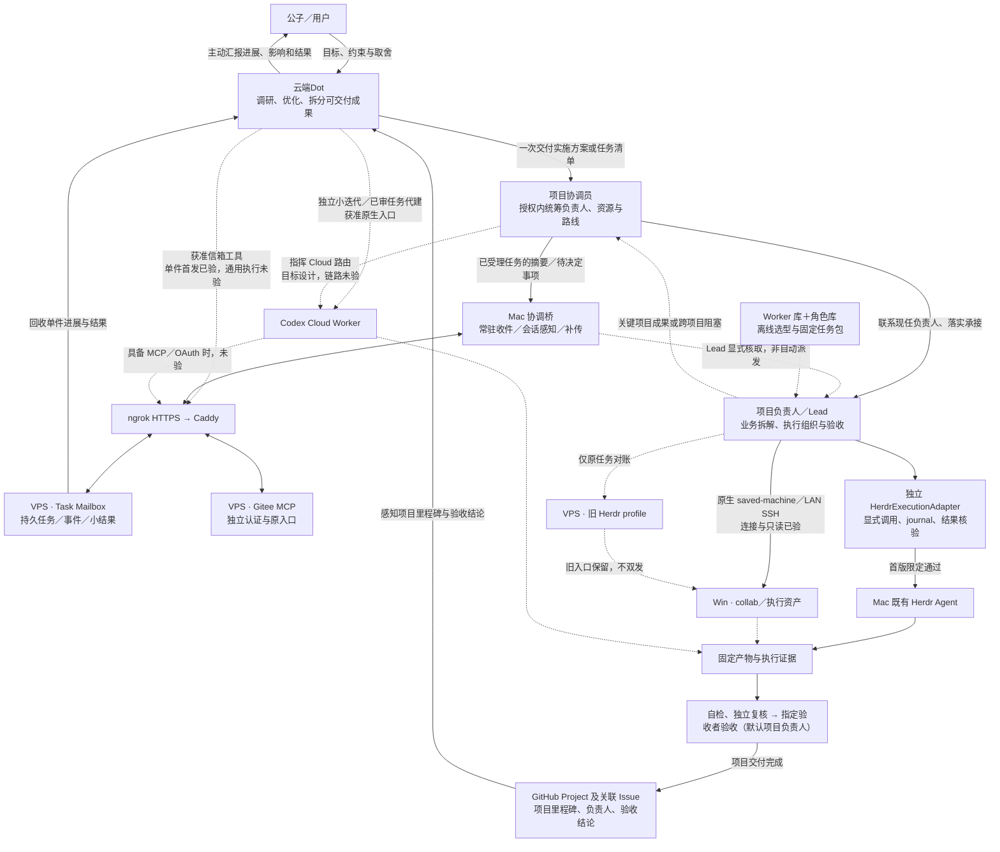

# 架构与范围

修订日期：2026-11-04。本页维护稳定职责、当前拓扑和组件归属；最新采用状态见[状态总表](status.md)，逐轮证据见[历史记录](history/status-through-2026-11-03.md)。当前采用 **Herdr TUI**，以公子确认的 **Mac 持续在线** 为前提，不部署 hc／Herdr App。

## 初始化决定

本仓是独立协作环境仓库。初始化从固定版本复制组织协议、Projects 技能及离线检查，后续在本仓独立维护；来源和增量分别见[初始清单](copy-manifest.json)、[增量记录](copy-updates.json)。复制不继承来源项目的运行身份、任职、权限或验收，也不建立跨仓导入、软链接、共享运行目录或自动同步。

早期 core 优先、VPS 常驻协调 Codex 和脱离 Mac 的设想已被当前分工替代；研究沿[通信指引](agent-communication.md)及历史记录保留，不作为当前安装要求。

## 当前机器主链路与既有支路

| 路径 | 作用与边界 |
| --- | --- |
| Lead → 独立执行适配器 → Mac 既有 Herdr Agent | 当前显式执行切片。适配器核完整任务包、policy、目标和预算，持久记录意图、原生引用、产物与交还；首版 Mac Codex 工程限定验收已通过 |
| Mac 本地 Herdr saved-machine／`--machine` → LAN SSH → Win `collab` | 选定的远端机器主链。连接与原生只读查询已验；适配器首版未扩展到 Win，Win Herdr 模型及业务回收另验 |
| Mac → LAN → Win 网关 → EasyTier → VPS 内网地址 | VPS 管理路径；Mac 不装 VPN，Win 仅代理指定 Mac 主机 `/32`，Mac 仅路由 VPS 虚拟主机 `/32` |
| VPS 旧 Herdr profile → EasyTier／SSH → 原执行机 | 仅保留原任务查询和收尾，不作为新机器任务必经层；未知执行沿原入口，不双发或静默迁移写权 |
| Dot 原生 Mac 任务／Codex Cloud 原生任务 | 各沿实际获准的平台入口运行，任务生命周期与信箱、Herdr 分开；不从另一客户端或会话推定继承权限 |

[执行适配器规范](herdr-executor.md)拥有其接口、安装和限定验收；[试点指引](pilot.md)拥有原生目标选择、等待与恢复语义；[网络方案](networking-plan.md)拥有路由、SSH 和固定版本风险。本页不重复维护这些合同或逐次回执。

### Task Mailbox：持久收发与本地承接

**VPS Task Mailbox 传数据，Mac 协调桥收件和补传，项目 Lead 决策，独立适配器执行明确请求。** 桥已常驻主动轮询、感知配置范围内的会话并补传显式结果；提交信箱本身不执行 Herdr／模型，不自动唤醒 Dot。信箱自动消费到业务派发的路径尚未实现。

Lead 从获准入口取得完整 job、核原任务授权与固定输入后，显式调用适配器。桥 jobs 台账保存身份、路由和状态摘要，不能据此重建完整任务正文；摘要一致只证明内容关联。适配器的 journal 不接管桥的 SQLite、OAuth、collector 或 hook，结果按已有获准报告接口回传。

服务和 Mac 桥的唯一维护仓为 [CF-FE/task-mailbox-mcp](https://github.com/CF-FE/task-mailbox-mcp)，个人 `create-network-sh` 仅保留历史整合来源。契约、部署和运行证据分别由其 [SPEC](https://github.com/CF-FE/task-mailbox-mcp/blob/main/SPEC.md)、[部署说明](https://github.com/CF-FE/task-mailbox-mcp/blob/main/docs/deployment.md)、[验证记录](https://github.com/CF-FE/task-mailbox-mcp/blob/main/docs/verification.md)维护。本仓引用这些权威，不复制服务或共享运行库。信箱与 Gitee 保持独立认证；示例端点为 `https://mcp.example.com/mailbox/mcp`。

Codex Cloud 仅在具体任务实际具备信箱 MCP 工具、OAuth 身份和动作权限时直接收发同一 HTTPS 端点，不经 Mac 中转、不加入 VPN；这条条件路径仍未验，信箱提交也不会创建或唤醒 Cloud 任务。原数据任务、指定 Dot 读取、本次桌面 Lead／原 review 显式闭环的证据归属见[当前状态](status.md)，不合并为“所有客户端双向业务通过”。

## 整套协作分工

图中实线表达已采用的职责或路径，不代表所有业务已验；虚线标注目标合同、条件接入、人工承接或旧入口。云端Dot的完整目标交办、小迭代直派及协调员的广泛调度职责按[协作约定](coordination-policy.md)执行。协调核心支持查询及独立目标合同；原线程和受限组织工具的实现见[目标运行入口](goal-runtime.md)，实际启用另核。协调员指挥 Cloud 的箭头仍是目标设计，信箱不创建 Cloud。Herdr执行适配器当前仅支持其原项目 Mac 本地已有 Agent；一次合成回合通过不扩展为自动消费、Win／Cloud、生产业务或长期稳定性通过。

| 角色／对象 | 负责什么 | 权威记录 |
| --- | --- | --- |
| 公子／用户 | 总体目标、有效授权及超出既定范围的取舍 | 原指令及对应正式任务 |
| 云端Dot | 调研需求、拆分成果、发起委派、指派验收者及汇总结果；条件成立时直派独立小迭代 | 原聊天、原任务及正式项目记录 |
| 项目协调员 | 授权内统筹各项目负责人、跨项目资源、调度顺序及 Cloud／本地路线，主动识别风险、推进未完事项与提出改进；重要影响按既有授权决定或升级，实际访问、预算及审批权限另核 | 组织职责与决定追溯见[协作约定](coordination-policy.md)；已实现接口见[协调入口](project-coordinator.md#7-本机交付与运行) |
| 项目负责人／Lead | 业务拆解、核输入／权限、组织执行与独立复核、集成，默认负责项目验收；与协调员固定唯一路由 | 任务包、原生执行引用与原项目记录 |
| Cloud 路由执行者 | 按已审任务包承担唯一原生调用、状态与产物回传，不重复决定业务或自行扩大预算 | 原生执行与原任务关联；协调员指挥路线仍待实现／验证 |
| 执行者／独立审查者 | 按负责人交付的任务实施或独立复核，将产物、覆盖范围和问题直接交给负责人 | 原项目任务、执行或审查回执 |
| Worker／角色库 | 描述宿主、harness、后端、职责和验收要求；生成离线准备稿 | [双库入口](worker-library/README.md)；`active` 不等于实时可用 |
| 执行适配器 | 确定地执行 Lead 明确批准的单次请求，保全 UNKNOWN 与产物关联 | [适配器规范](herdr-executor.md)及独立 journal |
| 信箱／Mac 协调桥 | 持久传输数据、会话观察、结果补传 | 服务原 job／event／版本／摘要及桥台账 |
| Herdr／执行机 | 原生 session／pane／Agent、实际进程与本机资产 | 原生引用、固定产物和宿主证据 |

每项目有责任边界，不要求每项目常驻一个进程。现有 Cloud 或旧 Lody 任务沿原入口收尾；同一执行和待写资产只能有一个实际控制入口及当前写者，UNKNOWN 不换池重做。

源码和方法沿 Git 固定版本，模型、原件与大产物按所属机器保管。ChatGPT Space 供获准资料、交接与精选成果使用，不视为所有 Worker 自动挂载的共享盘；页面、原件和工具权限逐边核验。具体任务路由与资料交接见[协作迭代指引](collaboration-iteration-guide.md)。

## 各端组件清单

以下描述部署归属；实际版本、能力回合和运行状态由[能力盘点](local-agent-inventory.md)、[状态总表](status.md)及各组件权威记录更新。

### 三机部署速查

| 组件 | mac-work | VPS | win-work |
| --- | --- | --- | --- |
| Herdr TUI／`herdr` | 托管项目 Lead 与本地 Agent，原生连接 Win | 保留旧 CLI／profile；无本地 pane 用途时不启本地 server | 既有 `collab`、完整 Windows 包及 ConPTY 附属文件 |
| Agent CLI | 复用既有 Codex／Kimi | 不部署项目 Lead、模型或桌面 Agent | 本轮候选 OMP／Hermes／Kimi；Windows Codex 暂不纳入 |
| HerdrExecutionAdapter | 独立安装，显式控制获准 Mac 既有 Agent | 不部署 | 首版不支持 |
| Task Mailbox／Mac 协调桥 | 专用桥及其 OAuth／台账／collector／hook | 独立信箱、SQLite、OAuth；保留原 Gitee 服务 | 不作为本轮执行接入前置 |
| ngrok／Caddy | 客户端使用 HTTPS | 复用公网入口并按服务分路 | 非机器执行前置 |
| EasyTier | 不装；仅到 VPS 的主机路由经 Win | 2.6.4 私有节点／TUN | 2.6.4 节点／指定 Mac 主机代理／系统转发 |
| SSH | 原客户端和身份，LAN 直连 Win | 服务端管理入口、旧支路客户端 | 接收连接的 sshd；出站客户端按任务需要 |
| Git、shell、项目依赖 | 按本机项目及控制入口需要 | 仅服务维护和旧支路需要 | 复用原制作环境，Git Bash 按模板需要，不默认迁移 WSL |
| hc／Herdr App | 不部署 | 不部署 | 不作为当前路线前置 |

### 部署顺序与准备项

1. 从原任务确认资产、当前写者、目标与组件 owner；先复用已有版本和回执，缺项才进入获准准备。
2. 需要 VPS 管理或旧支路时按[网络配置](networking-plan.md#4-easytier-各端安装与配置准备)核私有节点、主机路由、ACL 和 SSH；Mac → Win 的 LAN 主链不以 VPS 路径为前置。
3. 按[原生试点](pilot.md#herdr-目标选择)回读准确 session、profile、pane／Agent；不为补齐清单启动默认 session、重新注册机器或替换 server。
4. 显式 Mac 执行采用[适配器安装与资源合同](herdr-executor.md#安装与资源)，固定源码／catalog、私有 policy、真实目标和预算；不改桥的运行目录。
5. 先完成具体任务的输入—执行—产物关联，再分别交付、读回、复核和交还。旧 VPS／Lody／Cloud 在途引用继续沿原入口，不自动迁移。

### mac-work：项目协调

Mac 承载 Herdr 内的项目 Lead、独立执行适配器、Mac 协调桥与 CLI Proxy。Codex 复用应用内 CLI 和已有用户入口，Kimi 复用自身安装／配置；桥的专用 OAuth 不代验 Codex／Kimi 的直接 MCP 认证。官方 Herdr skill 的宿主与 `HERDR_ENV=1` 条件见[原生技能边界](pilot.md#官方操作技能与外部协调)。

桌面 Lead 显式调用 Mac Codex 的首版工程闭环已验；这不等于任意 Dot 原生任务都能定向操作 Lead，也不代验 Kimi。现有 LAN、SSH 身份、到 VPS 的主机路由及默认出口／DNS 保留，Mac 不新增 VPN 或 sshd。

### VPS：MCP 服务与过渡控制

VPS 承载独立 FastMCP 服务、Task Mailbox 持久状态和 ngrok／Caddy 接入；Gitee 保留原认证及路径。旧 Herdr CLI、profile、SSH 与 EasyTier 用于原任务对账，不常驻项目规划 Codex 或本地模型，不作为 Mac → Win 中转。服务维护、安装归属和容量见[VPS 专项指引](vps-control-pilot.md)。

### Codex Cloud：托管 Worker

Cloud 沿获准原生任务入口使用已准备的仓库、环境、依赖和工具。信箱与 Pages／Space 都以该任务实际提供的工具、OAuth 及资源权限为条件，不能从 Mac 或 Dot 配置推定继承；本轮不配置 Cloud VPN，不为普通 Cloud Worker 安装另一套 Herdr 或桌面应用。Cloud 执行扩展仍未由适配器首版验收覆盖。

### win-work／其他执行机：具体执行

Win 保留既有 TUI `collab`、sshd、制作工具、模型及本地资产；本轮候选为 OMP／Hermes／Kimi。代理分支可依赖常在线 Mac 的 CLI Proxy，Kimi 官方入口单列。原生 CLI 短对话交接不等于 Herdr 托管派发，供应商、模型、认证、工具和项目权限仍逐项绑定；详细版本与证据在[执行侧盘点](local-agent-inventory.md#7-win-work-harness执行侧交接)。其他机器不继承 Win 的连接或验收结果。

### SSH 依赖与已有组件复用

SSH 能力、Windows 公钥落点、既有身份复用和教程来源统一见[网络方案：SSH 依赖与公钥免登](networking-plan.md#ssh-依赖与公钥免登)。`herdr` 不替代 sshd；原生 profile 回读与普通 SSH 登录分别验收。

### 三机连通、效率与 Dot

三条网络路径、路由／DNS 边界和测量口径统一见[网络拓扑](networking-plan.md#2-已选拓扑与分层)与[效率判断](networking-plan.md#6-效率与-dot-连通怎样判断)。网络可达不等于平台任务权限、Agent 回合或业务验收。

## Mac 持续在线与执行依赖

Mac 持续在线是公子确认的部署前提；当前不建设离线接管、备用规划／推理入口，也不把 Mac 离线测试列为采用门槛。持续在线不代表长期可用性已实测。请求超时或结果不明时沿原任务、session／pane、产物及当前写者对账，保留 UNKNOWN；原 Win 网络服务恢复不证明 Agent 业务恢复。

## 唯一维护位置

| 内容 | 唯一维护位置 |
| --- | --- |
| 全仓采用状态／逐轮历史 | [status.md](status.md)／[冻结历史](history/status-through-2026-11-03.md) |
| 稳定架构／网络／VPS 专项 | 本页／[networking-plan.md](networking-plan.md)／[vps-control-pilot.md](vps-control-pilot.md) |
| 原生试点／显式执行适配器 | [pilot.md](pilot.md)／[herdr-executor.md](herdr-executor.md)及本仓源码 |
| Worker／角色定义 | [worker-library](worker-library/README.md)，独立版本与资源正文 |
| 技能及复制来源 | `skill/<id>/`、[初始清单](copy-manifest.json)、[增量记录](copy-updates.json) |
| 信箱与 Mac 桥 | 外部 [CF-FE/task-mailbox-mcp](https://github.com/CF-FE/task-mailbox-mcp) |
| Gitee MCP 来源／项目业务资产 | 对应所属仓库；各项目正式状态仍留原入口 |

`mcp/project-coordinator-tools/` 维护本仓受限 stdio 组织工具，依赖同一固定发布的协调模块；它不扩展外部 Task Mailbox 服务。`plugin/` 仍只有分类索引，源码、安装与真实启用分别记证。新实现或分发须有实际需求和明确 owner。

## 复制与排除

初始化固定接收 19 文件：组织协议 11、Projects 技能 5、标准库检查及测试 3；未接收 Lody runtime、队列、Gitee 服务、运行凭据或历史验收。后续 Worker／角色库按[独立来源清单](worker-library/source-manifest.json)接收固定源的 14 文件闭包并记录改编，另有本仓新写职责；这不改写初始化历史，也不继承源运行身份。

本仓复制件的维护 owner 是本仓。初始来源摘要保留历史基线，后续采用记录增量，不自动跟随上游，不依赖源 checkout；独立安装使用固定闭包和摘要收据。

## 执行与证据

安装、网络、SSH、Herdr 原生目标、Agent 模型／工具、产物、结果读确认、负责人验收和写权交还分别取证。机器、session、pane、Agent 引用归对应 server；UI 选择不会改变 CLI 路由。`agent prompt --wait` 不定位单个 turn，`idle/done`、退出 0 和 ACK 都不能合并成业务完成；等待与 UNKNOWN 处理见[试点指引](pilot.md#等待未知与恢复)。
