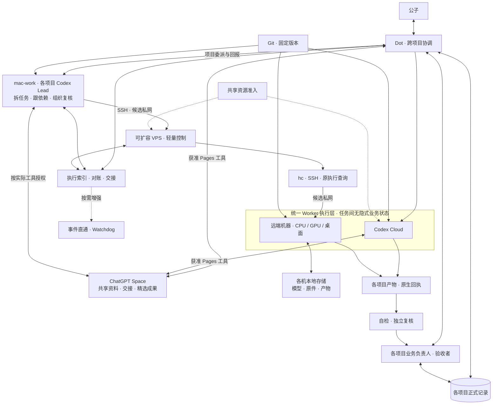

# 多项目协作架构迭代指引

版本：0.5；编制日期：2026-11-01（Asia/Shanghai）。目标是让多个项目同时、可追溯地推进，减少公子在会话之间转述和跟进的负担。**Dot 全局协调，mac-work 承载各项目 AI Lead，VPS 保留轻量控制与查询，Cloud／远端 Worker 执行具体任务。两类 Worker 按任务间无隐式业务状态设计；Dot 和实际提供获准 Pages／Space 工具的 Cloud Worker 均可直接访问其获准资料。任务记录和资产持久保存，运行实例的真实状态仍须追踪。单项目闭环不代表多项目验收通过；VPS 配置可升级，起始规格不是架构上限。**

本文沉淀搭建次序、取舍与验证方法，不授权部署、登录、入网、真实派发、定时监控或业务切换。新增机制是待按具体任务采用和验证的工程建议，不宣称已经实现。当前状态只记在[本仓状态](status.md)；各项目业务状态仍在各自正式入口，本文不维护第二份活动队列。

## 1. 文档归属与建设基线

| 问题 | 唯一维护入口 |
| --- | --- |
| 怎样逐步搭建、何时增加组件、用什么证据决定 | 本文 |
| 组织岗位、授权、单写、汇报和验收 | [组织技能](../skill/organization-collaboration/SKILL.md)，不在本文另写一套规范 |
| Herdr／hc 与其他通信路线的能力、来源及限制 | [通信指引](agent-communication.md)；研究日期和目标端版本分列 |
| VPS 接入、机器环境与首轮运行检查 | [VPS 试点](vps-control-pilot.md)；TUI 命令沿[原试点](pilot.md) |
| mac-work、VPS、Cloud 和执行机各装什么 | [架构中的各端组件清单](architecture.md#各端组件清单)；清单不代表已安装 |
| 算力、协作空间、本地资产、方法与权限怎样组合 | 本文的资源分工、访问路径和状态归属；原记录仍由各自保管方维护 |
| 本次任务的目标、执行绑定与证据 | 复用[任务模板](templates/pilot-task.md)及原项目记录，只补必要缺项 |
| 场景评阅与旧路线资料交接 | [评测资料](organization-collaboration/README.md)；接收资料不等于已执行评测 |

建设基线是：**统一协调与可达资源视图，分布式执行与资产保管。** Dot 关联跨项目目标、依赖和资源；mac-work 上的项目 AI Lead 在委派范围内拆任务、跟依赖、准备任务包、回收证据与组织复核；VPS 按明确请求使用 hc／SSH 控制机器、查询原执行和维护轻索引，不重复常驻项目规划 Agent。业务负责人分别取舍与验收。资源视图复用原任务的范围、容量、保管者和引用，不预建调度服务或第二套业务库；独立云任务不以 mac-work 或 VPS 接通为前置。

## 2. 逻辑分层与多项目职责



图是已选分工的待验证连接设计，不表示已部署或已任命任何人。AI Lead 与业务验收者分列；Space 工具线都以实际工具和资源权限为前提，Cloud 不必经 Mac、Dot 或 VPS 转述资料。Cloud 的任务派发目前仍沿已获准 Dot 入口；Mac Lead 的规划不自动取得另一个派发入口。

机器支路的候选私网采用 Tailscale 时，只按需连通 Mac → VPS、VPS → 执行机；Dot 仍走原生电脑连接，Cloud 按需入网。效率、直连／中继及 DNS／出口对 Dot 的影响统一见[三机网络取舍](architecture.md#三机连通效率与-dot)，不把组网当必然提速或全端授权。

| 位置 | 负责 | 边界 |
| --- | --- | --- |
| Dot | 面向公子的连续交互、跨项目关联与冲突协调，沿获准入口委派／查询 Cloud 和 Mac 本地任务 | 不替项目作未获授权的业务决定或代签验收；不因 Mac 失联就重派其控制的同一执行 |
| 项目业务负责人／验收者 | 本项目需求、输入、优先级、预算、依赖及最终采用／验收 | 由公子或已指定责任人承担；AI Lead 不因宿主变化自动取得最终业务验收权 |
| mac-work 项目 AI Lead | 在授权内拆任务、跟依赖、准备任务包、核对结果并组织独立复核；为各项目保留明确上下文 | 不要求每项目常驻一个进程；Lead 并发按 Mac 实际容量与隔离需要选择，工作事实不能只存在本地聊天。Mac 在线条件、Dot 接入及工具权限仍待实测 |
| Codex Cloud Worker | 承接明确项目的云端编码、测试、文档或复核任务；任务实际提供获准 Pages 工具时，可直接读取资料、写入指定成果或更新指定页面 | 遵循两池共用的任务契约；Space 动作、页面／文件权限与当前写者分别绑定，环境、网络和本地设备权限仍按实际账号核验 |
| VPS 轻控制端 | hc／SSH 机器控制、原执行定向查询、轻量执行索引、日志与结果交接 | 基线不再要求常驻项目 Lead 或协调 Codex；只执行明确请求，不因 Mac 离线自行规划、接管写权或增派任务。索引复用现有持久落点，不新增业务数据库 |
| 机器 Worker | 在获准机器、独立上下文和资产范围内推进具体成果，可按实际需要组织子任务与复核 | 同样按任务间无隐式业务状态设计；机器与模型可常驻，执行上下文、参数和写权显式绑定，不凭旧聊天或其他项目消息取得授权 |

每项执行明确规划者、唯一实际派发／续发入口及当前写者。Mac Lead 准备任务包，Cloud 沿已获准 Dot 入口，机器任务沿 Mac → SSH → VPS／hc 的选定入口执行；不得两边独立重派。Mac Lead 将来若直接取得 Cloud 工具，先核实际能力与控制责任，再在任务内明确绑定；不由桌面能 SSH 推出自动拥有云工具或 Space 权限。范围、供应商、权限或预算变化交相应责任人，普通技术步骤不重复审批。

一个项目不必等于一个仓库或一台机器。复用现有项目引用与实际任务关系，不能用目录名、chat 标题或机器别名代替项目归属。项目负责人和正式入口各自保留；CF-FE Projects 的组织选择不自动证明本仓或某项目已绑定、可写。

### mac-work 在线依赖与分工变更

本次明确替换 0.4 及原 VPS 草案中“VPS 上常驻协调 Codex”的分工：mac-work 承载项目规划，VPS 保持轻控制。选择依据是职责和公子计划利用的资源，不是断言 VPS 必然不够；VPS 仍可升级，Mac 实际规格、在线策略与多会话峰值均未核验。

原“Mac 断开仍能使用”拆成两个目标：**控制／查询独立**需要另有获准且实际可达的 VPS 入口；**持续项目规划独立**当前不承诺，依赖 Mac Lead 的新规划、续派或本地复核会暂停。Dot 可继续独立获准工作；已派机器任务是否存活须核实际 hc 父子和连接生命周期，不能预先声称全停或全续。Mac 失联不自动把 Dot／VPS 变成第二个 Lead，也不触发 UNKNOWN 重派。恢复先查原执行与写权，再明确交接。

官方确认 Dot 可创建／继续已连接计算机上的本地 Codex 任务，但相关本地工作需要计算机在线、桌面应用运行并登录；本地任务不会因断连自动迁往云端。独立 Cloud 任务可以在计算机离线时运行，仍沿原任务与授权入口查询。[Dot 的任务位置](https://learn.chatgpt.com/docs/dots/tasks-and-memory#assigned-work)、[本地接入与离线边界](https://learn.chatgpt.com/docs/enterprise/cloud-local-access#end-user-experience)

### 统一 Worker 的状态边界

云端／远端描述部署位置；无状态任务契约描述对隐式上下文的依赖，两者分别判断。公子提出远端机器 Worker 也可无状态，适合作为共用设计目标：**新 Worker 可凭明确任务包定位输入、权限和成果，不依赖上一个 Worker 的记忆。** 该目标不抹掉单次执行和宿主环境的状态，也不宣称现有任务已全部满足。

| 对象 | 状态归属与处理 |
| --- | --- |
| 业务目标、授权和验收 | 各项目现行正式记录及其有权责任人；不由 Worker 旧聊天或 Space 副本接管 |
| 执行与未决效果 | 原生运行记录＋持久执行索引关联任务、实例、session、写者、产物和下一责任人；断线保留 UNKNOWN |
| Worker 任务上下文 | 输入与必要决策显式可取回；临时工作区、未提交修改和进程内进度在活动执行中保留，不能当普通缓存清除 |
| 宿主环境与资产 | 模型、依赖、认证、原件和已保存产物由相应保管方维护；可重建缓存、版本化资产、唯一原件分别管理 |
| 协作资料与成果入口 | Space 组织获准共享的资料、交接页、摘要和精选成果；本地资产可只交受控引用，不要求全部上传 |

“外置”是离开某个 Agent 的唯一内存／会话，保存到明确保管的记录或资产落点；不等于数据必须离开执行机。win-work 可以同时托管可重建 Worker 与持久模型、原件、成果。仅存在本机的关键资产须记录宿主依赖和备份情况，引用本身不提供容灾。

可启动新 Worker、可跨机迁移、可恢复中间进度分别取证。需要特定 GPU、模型、桌面状态、唯一原件或未外置进度的任务可以保留宿主绑定，逐项减少隐式依赖；不要求为统一概念改造所有任务或清空机器。暖缓存和模型复用有价值，但复用进程前必须明确工作目录、配置版本、旧占用和未决写权，避免把 A 项目状态带入 B 项目。

### 两类 Worker 的任务路由

| 任务条件 | 优先执行位置 | 交接与取舍 |
| --- | --- | --- |
| 输入、依赖及检查可在已获准云环境准备的编码、测试、文档、静态复核 | Codex Cloud | 利用独立工作区并行；先核环境、仓库版本、网络、权限和用量，不能由任务类型推断云环境已就绪 |
| 依赖 win-work 音频模型、GPU、原件、桌面或指定宿主环境 | 对应机器 Worker，经 VPS／hc | 保留制作端的运行配置与资产归属；云端代码检查不代替实际制作和宿主验收 |
| 开发与真实宿主验证分离 | 云端开发／复核 → 机器验证 | 用仓库、固定 commit、路径和适用摘要交接；机器返回实际检查与产物，分别记录两端证据 |
| 某执行池不可用、配额不足或结果 UNKNOWN | 保留原执行；推进另一池的独立获准任务 | 不自动把同一任务跨池重做。确需换执行器时先对账原效果与写权，再在授权内建立新执行关联 |

云端后端也有平台自己的保存能力。2026-11-01 核对的官方文档说明：新任务从已发布环境取得独立工作区；已有任务可续用其保存文件，默认 VM 状态可在最后启动回合或恢复后最多七天内恢复。共用任务契约不依赖该 VM 持续存活保存唯一事实，仍须查询原任务，将重要成果提交或保存到获准持久落点，不能把平台暂存当长期交付。[官方云环境说明](https://learn.chatgpt.com/docs/environments/cloud-environments#reuse-and-update-saved-state)、[VM 状态范围](https://learn.chatgpt.com/docs/environments/cloud-environments#vm-specifications)

云任务和机器任务不默认共享文件、凭证、个人技能或运行环境。跨端只交付获准的版本化输入与成果引用；消息送达不自动赋予目标端权限，也不自动发布环境、安装软件或派发任务。

路由顺序是：先核任务授权及资产允许使用范围，再核 OS、模型／工具版本、网络和必要输入可达性，再核实际共享资源占用，最后比较等待时间、成本和数据搬运。资源多不等于当前可用，优先利用已具备条件的路径，不因另一个池有空闲就复制同一未决执行。

## 3. 从第一条任务就保留的身份与证据

复用既有[上下文与回报](../skill/organization-collaboration/references/context-and-reporting.md)和[任务追溯](../skill/organization-collaboration/references/task-traceability.md)，区分以下对象，不将它们合成一个“完成”状态：

| 对象 | 必须能回答的问题 |
| --- | --- |
| 项目与业务任务 | 哪个项目、哪项成果、原正式入口、负责人及本次授权是什么？ |
| 输入版本 | 本次依据哪个需求、文件或参数版本？后续消息是否改变它？ |
| 某次执行 | 由云端还是机器执行，谁在何环境／目录工作；云任务及环境引用，或机器／terminal／session，加上原生请求／回合引用是什么？ |
| 事件与消息 | 来自哪个已知来源和对象，是否已经观察、交付或处理？它只是上下文还是有效控制指令？ |
| 产物与写权 | 准确对象、版本、位置、适用摘要是什么，谁仍在写，谁已核验或接手？ |

同一业务任务可以跨多条 chat、Issue／PR 或执行回合；收到一条消息不自动新建任务或 Worker。稳定任务 ID 与事件去重键只用于关联，不保证命令、音频制作或其他业务动作幂等。未取得原生引用保留 UNKNOWN，不能补造成功回执。

全局上下文只汇总获准共享的目标、摘要、责任、版本、原件引用及未决项；项目原始对话、日志、私密资料和凭证不默认汇入同一个共享记忆。执行索引关联两类 Worker 的原生引用，复用现有获准持久落点；VPS 保存其受委派部分，不要求全部云任务经过 VPS。正式业务状态仍回到原项目入口。目录／profile 分离不等于安全隔离；真实访问边界按现有工具、账号和执行环境核验。

从首条闭环即保留请求、原生状态、错误、产物／结果、资源观察和报告承接证据，并明确必要记录的持久落点。后面的恢复与 Watchdog 阶段增加故障处置能力，不意味着前期可以没有可观测证据。

### 各维度资源怎样组合

| 资源 | 建议分工 | 整合时保留的边界 |
| --- | --- | --- |
| 人与协调能力 | 公子明确目标／授权，业务负责人取舍验收，Dot 跨项目协调，Mac Lead 规划／跟进，VPS 处理明确的机器控制请求 | 规划者、实际派发入口、写者和验收者分列；模型数量不替代负责人注意力和验收容量 |
| 计算与运行环境 | Mac 按容量承载项目 Lead；Cloud 和机器按实际能力执行；VPS 保持轻控制 | 分别计 Mac 会话负载、云配额、VPS 控制开销与机器执行负载；VPS 可升级，容量不代替权限／接口证据 |
| 源码、方法和配置说明 | 仓库保存固定版本；任务绑定需要的技能、说明和工具条件 | 云端不自动继承个人技能；独立仓库复用按明确版本复制、记录来源，不跨仓共享运行目录或自动同步 |
| ChatGPT Space | 共享需求、研究资料、决策／交接页、评审摘要及精选交付物；Dot 与工具／权限具备的 Cloud Worker 可直接参与 | 属于协作资料入口；正式任务状态仍沿原项目入口，指引正文以本仓为准，Space 可引用固定版本而不再维护竞争副本；两端有权限不等于可同时覆盖同一资产 |
| 机器本地存储 | 模型、原件、依赖、任务工作区、大产物及必要检查点由获准机器保管 | 保存准确机器、路径、版本／摘要和保管者；不把本地路径当可被任何 Worker 打开的链接，不因磁盘常驻就称 Worker 必须有业务状态 |
| 网络、工具与身份 | 按每条边绑定已验证的 Git、Pages、私网、SSH 或文件交接入口 | 同一网络、账号或 Space 成员资格不自动提供所有工具与原件访问；只向任务提供必要能力，凭证留在获准配置位置 |
| 质量、成本与容量 | 自检、独立复核及各负责人验收；分别计模型用量、云配额、机器负载、存储增长和待验队列 | 加 Worker 或扩存储不能抵消错版本、重复执行和未验收；清理缓存不能删除未决成果或唯一恢复依据 |

已有任务包按需补齐：项目／任务与输入版本、允许动作和预算、必要环境与资产引用、唯一控制者／写者、交付位置和验收者。受理后关联原生执行 ID、实际输入／环境与结果。这里是共用交接契约，不要求新建 API、资源注册中心或 Projects 字段；只盘点当前采用任务所需资源，不让全组织资产盘点挡住首条闭环。

### ChatGPT 协作空间与本地存储怎样连通

公子提供的“100G ChatGPT 协作空间”作为待核容量资源纳入规划；本轮已核官方 Space／Pages、Agent 协作与分享文档，确认可组织页面、引用／附加文件并协作。尚未核实该 100G 对应的具体存储范围、账号额度口径、已用量、保留规则或单文件限制，不将 Space、Library 和运行 VM 磁盘默认等同；也没有文档证据证明它是 VPS 可挂载的网络盘或所有 Codex Cloud 任务的共享卷。[Space 总览](https://learn.chatgpt.com/docs/space)、[页面与文件](https://learn.chatgpt.com/docs/space/pages)、[共享权限](https://learn.chatgpt.com/docs/space/collaboration)

**Space 工具访问与文件系统挂载是两条不同路径。** 官方明确 Dot 可在 Space 中协作，Pages 的插入菜单还列出面向 Codex 的任务动作；Codex 插件可提供技能／MCP。在适用的受管 Codex Cloud 执行路径上，命令网络限制本身不关闭托管 apps／MCP。由此将 Cloud → Space 修订为“实际提供并获准使用工具时可直接访问”的路径，不能因没有共享挂载就排除，也不将上述文档拼成“所有 Cloud 任务默认具有 Pages 工具”的保证。[Dot 的 Space 工作流](https://learn.chatgpt.com/docs/space/agents#use-dots-in-space)、[Codex 页面动作](https://learn.chatgpt.com/docs/space/pages#add-content-with-the-insert-menu)、[Codex 插件与 MCP](https://learn.chatgpt.com/docs/plugins#overview)、[Cloud 托管工具与命令网络](https://learn.chatgpt.com/docs/cloud/internet-access#agent-security-command-network-requirements)

2026-11-01 的本会话只读查询另外确认：账号可列举一个可运行的 Codex Cloud 保存配置；Space 分享管理开关为开启。它们分别只证明配置可列举／可运行标记与分享管理政策，不证明本仓已绑定 Cloud 环境、某个 Cloud 任务已暴露 Pages，或 Dot／Cloud 对某个指定 Page 已有读写回执。平台入口支持、任务工具可用、连接账号授权、具体资源权限和实际动作证据分别记录；当前没有在 Dot 或 Cloud 任务内执行目标 Page 读写。

| 访问边 | 现有依据与建议路径 | 尚需证明 |
| --- | --- | --- |
| 公子／有权协作者／Dot ↔ Space | 官方支持页面、文件引用和 `@ChatGPT`／`@dot`；在实际可用客户端与授权工具内处理获准资料 | 目标 Space／Page、账号、读写范围，以及指定接收者实际可读；网页入口与工具可发现都不能代替回读 |
| mac-work Lead ↔ Space／VPS | Space 仅沿其任务实际提供的获准工具；VPS 沿授权 SSH 客户端调用既定 hc 控制入口，不要求为此在 Mac 装本地 hc | Mac 在线、Dot 本地接入、SSH 身份、工具与资源权限均需目标端证据；不把本会话工具清单继承给 mac-work |
| Codex Cloud Worker ↔ Space | 任务实际提供并获准使用 Pages／Space 工具时直接读页面与支持的文件引用、写入指定成果；不强制经 Dot 转述 | 核该 Cloud 任务的实际工具、连接身份、目标 Page／文件和允许动作；平台通用文档不代替任务内回读，不默认所有云任务有相同工具 |
| 当前会话 ↔ Space | 本会话有 Pages 读写和有限文件引用工具；已只读列举可见 Spaces，两页均无条目，本轮未上传或编辑 | 未定位目标 Space，不推出资源不存在。当前文件上传工具单次上限 10 MiB，读取有独立格式／大小限制；这是工具范围，不是对平台容量的判定 |
| Cloud／机器 Worker ↔ 源码与资料 | 源码沿获准仓库固定 commit；Space 资料可由有工具及资源权限的执行端直接读取，其余按任务交付必要文件／可读引用 | 不默认任务可读取任何私人 Space；本会话连接不自动安装到 VPS CLI 或其他任务。工具不具备时先保留该分支边界，按原任务已约定且获准的交接路径处理，不擅自换入口 |
| VPS ↔ 机器本地存储 | 沿实际授权且已验证的 hc 文件接口或 SSH 文件传输通道，按任务查询／交接必要对象 | 私网、身份、路径和读写权限逐边验证；链路尚未接通，不在本轮执行文件搬运 |
| Cloud ↔ 私网服务／机器 | 官方云环境支持配置 Tailscale，并说明 SSH 等 TCP 访问需使用该环境的 HTTP CONNECT 代理；可作为有需要时的定向访问候选 | 需核账号入口、已发布环境、路由、IPv4、客户端代理适配与服务身份。不是 Dot 无头 VPS 接入证明，也不默认绕过原控制者去操作同一执行 |

官方 Space 的页面和原件权限分别判断：能读页面不保证能读链接文件，Space／父页共享可能向下继承。按项目权限组织可共享摘要和原件引用，不把私密原文复制到一个对所有项目开放的总页。[权限继承](https://learn.chatgpt.com/docs/space/collaboration#understand-inherited-access)、[Space 中使用 Agent](https://learn.chatgpt.com/docs/space/agents)、[Cloud 私网与 TCP 条件](https://learn.chatgpt.com/docs/environments/cloud-environments#private-networking-vpn)

插件可用或已安装、分享管理开启都不等于具体 app 动作或文件访问已获准；连接账号决定其可访问范围。[官方 Space 账号与工具权限](https://learn.chatgpt.com/docs/enterprise/chatgpt-space#plugins-and-connected-accounts)

采用直接读写时，任务包关联准确 Space／Page、必要文件引用、输入修订／原文范围、允许读写动作、成果落点、当前写者和接收者。Dot 与 Cloud 可以读取共同资料，并行写不同获准成果；同一页面／章节／文件仍按已约定写权处理，写入前沿工具实际提供的版本核对机制读取最新内容。Cloud 已写到 Space 不代表 Dot 已收到通知或负责人已采用；沿原任务约定报告通道，无推送时落实拉取者与检查点，不额外启用自动同步／唤醒。

起步复用 **Space 资料入口＋Git 固定版本＋各机本地资产＋原生执行索引**。大模型、全量音频原件和持续增长的原始日志不为“用满 100G”而集中上传。只在交付、独立复核或恢复确有需要时，按任务转交必要对象或建立有界备份；容量和搬运成本按实测安排，不预切固定百分比。

每次跨端交接区分：保管方已保存、传输已受理、目标实际读到、版本／摘要一致、负责人采用。版本引用明确对象、位置、输入关联、适用摘要、当前写者和接收者；凭证不写入共享页。资料更新优先引用或按任务单向交付，保留更新时间和源版本，不启用自动双向同步。只有现有通道无法满足已确认的大文件自动交接需求时，才比较新增对象存储／NAS 等方案的价值与维护成本。

后续最小验证只选一条已具备条件且获授权的支路、一份无业务影响的小输入：原保管方给出准确版本 → 执行端实际读取并核对 → 返回小产物与原生回执 → 指定接收者回读并由原负责人验收。若要使用 Space，先绑定真实可读的 Page／文件；该入口未就绪时可先用其他已获准输入验证 Worker。闭环成立后再验证新实例重建、两项目重叠及云机混合交接，不要求全图所有资源一次接通。本轮未执行这些步骤。

## 4. 分阶段迭代

阶段描述能力依赖，不是所有任务的新审批流程。独立资料和已获准工作可以并行；某个入口或组件缺口只限制依赖它的动作。不要求先完成全组织盘点、55 题评测或所有后续阶段，才开展第一条具备条件的工作。

| 阶段 | 本轮要解决的问题 | 最小验证与放行证据 | 未满足时怎样继续 |
| --- | --- | --- | --- |
| I0：绑定目标与范围 | 哪些项目、谁负责、允许做什么、如何交付和停止 | 先绑定具备条件的一项任务，复用项目、输入、正式入口、写者、预算和验收者；I3 前补齐至少两个独立项目的验证绑定。缺项标明影响，不默认目标或阈值 | 第一条已具备条件的任务不等待另一个项目或全组织盘点；缺权限不试派发，不把未绑定项目当已接入 |
| I1：一条端到端闭环 | Dot 能否沿具备条件的入口取得准确执行与结果 | Cloud 核环境、任务 ID 和回读；机器主路径核 Dot → Mac Lead → SSH／VPS／hc → 一台执行机的小任务，核实际位置、版本和原生回执。独立查询另验 | Mac 主路径通过不证明完全脱离 Mac；可选无头 VPS 入口未验不阻塞主路径。Space／VPS 缺口只约束依赖它的任务，独立 Cloud 工作可继续 |
| I2：短回合与长执行分离 | 唯一协调入口会不会被长任务占住 | 有界长任务启动后取得原生引用；期间实际处理查询和另一项已授权请求；原任务继续被正确观察，无重复执行或错误关联 | 如接口实际阻塞，记清限制；先复用真实异步入口或有界查询，不假称已支持自动回调、唤醒或后台调度 |
| I3：多项目同时推进 | 独立项目能否重叠推进，局部阻塞能否被隔离 | 至少两个项目有活动重叠与实际进展；两类 Worker 都采用时再取一轮云端／机器重叠与固定版本交接证据。验证 A 阻塞时 B 无冲突分支继续、共享资源不超分、结果归各项目分别验收 | 单项目、串行或单池结果只证明相应范围。保留未知预留，只调整受影响负载或配置，不冻结全部项目；未接入池保持未验 |
| I4：降低路由与上下文开销 | 是否反复判断同一归属、重复读大日志或遗漏跟进 | 在相同工作口径下比较精确引用续接、重复状态合并、摘要＋按需原件读取；核授权／输入版本没有被压缩或路由丢失 | 无明显问题先保留简单路径；错关联、漏控制指令或多花成本时撤回该优化，原任务不重开 |
| I5：受控恢复与持续运行 | 断线／进程／服务／主机异常后如何找回事实 | 从原索引恢复查询；服务与主机重启分开取得授权和证据；核原进程、已发生效果、待交付报告、写权及日志／备份读取 | 原结果不明先对账，不自动新建执行。资源压力改配置／并发或保留边界，不将服务上线当业务续跑 |
| I6：按价值增加主动性 | 哪些事件确实值得自动观察、准备或处置 | 先观察候选而不执行；有明确规则、范围、预算、停止点和回报责任后，只验证获准动作。Watchdog 另核独立性、误报、恢复权限与维护收益 | 没有收益证据或合法入口时保持人工触发／有界拉取；不默认常驻轮询、全权限诊断 Agent 或自动业务修复 |

I1、I2 的单项目验证是起步切片；I3 是“支持多项目同时推进”的必要验证。I4 和 I6 按问题选择，不要求先建事件总线、持久邮箱或全套自治系统。必要持久化从 I1 即有，I5 的故障深度按实际交付要求决定；有恢复风险时可以提前开展，不必等待任务量增长。

## 5. 多项目验收情境

以下是待验证的工程情境，不是已执行的行为盲测或生产故障注入。采用前绑定真实项目、任务、版本、资源范围和观察窗口；优先用无业务影响的小任务。

| 情境 | 需要取得的证据 | 不能据此宣布什么 |
| --- | --- | --- |
| A 长任务活动时 B 开始推进 | A 原生执行仍活动的时段内，B 已实际派发并取得有效中间成果或结果；时间和原生引用可对照 | 只登记两个项目、只开两个 chat 或串行完成不证明同时推进 |
| 云端与机器 Worker 重叠推进并交接 | 云任务 ID／环境与机器执行引用各归对应项目；活动时段重叠，固定 commit／产物摘要从云端交到获准机器，机器回读版本并返回实际检查 | 两端互见消息不证明文件已交付；云端测试通过不证明 Windows／GPU／音频宿主通过，也不证明所有执行池已接通 |
| 新 Worker 根据任务包接续 | 在已结束或获准停止且完成写权交接的边界，凭保存输入／成果和环境说明建立新实例；记录同机重建、换机或检查点恢复中实际覆盖的一种 | 启动成功不证明三种能力都成立；仍依赖原聊天、GUI 内未保存工程或唯一宿主数据时如实保留绑定 |
| 结果已落本地但回报断开 | 找回原执行和对应文件，核版本、完整性与当前写者，再完成结果交付 | Worker 可重建不等于音频可重复制作或母版可覆盖；连接超时不释放原写权 |
| 同一机器先后承接 A、B | 模型／依赖可以复用，B 的工作目录、配置版本、授权和输出归属显式成立，A 的未决占用保留 | 保留暖缓存不证明项目隔离；不能隐式继承 A 的参数、记忆、数据或写权 |
| Space 资料与机器原件交接 | 指定接收者确能读取获准资料；涉及文件时两端版本／摘要一致，机器本地原件保管与成果保存明确 | 上传成功、页面可读或填了本地路径不证明原件可用；当前不执行跨端测试 |
| Dot 与 Cloud 直接访问 Space | 分别核执行侧真实工具与身份；对一个获准小输入取回读证据，获准写入时核指定成果、写入回执与独立回读；共享写资产保持唯一写者 | 桌面本会话调用不冒称 Cloud 原生调用，分享管理开启不证明目标授权；Space 写入不证明通知、采用或业务验收 |
| A 局部阻塞，B 独立分支继续 | A 的 UNKNOWN／权限问题、当前写者和未解除占用保留；B 的授权、输入与独立资源成立且有继续动作 | 不能把 A 的未知资源当空闲，也不能把一项服务故障扩大为平台全停 |
| 两项目争用同一 GPU、目录锁或验收者 | 对真实共享范围明确准入协调者，记录采用的限制、占用／预留和先后；不争用部分仍可推进 | 不套用源示例 4／6／2；不以机器数、专业名或项目名虚构独立资源池 |
| 跟进事件、结果或输入版本相近 | 续接准确项目／任务／执行和输入版本；已处理事件不重复产生业务动作；范围变化交有权者处理 | 语义相似、相同文件名、相同显示名不证明同一任务；消息到达不扩权 |
| A、B 都产出并待验 | 产物、实际检查及结论各归对应项目；负责人分别验收，实际共用听审能力纳入待验容量 | 汇总通知、Worker 自报完成或一位协调者收到文件不替代各项目验收 |
| 协调端暂时不可达 | 沿各原执行、效果及产物查询后重新汇总；保留下一责任人和未决项，不发生替代派发 | 恢复协调进程不证明业务完整恢复；不能为了切换入口自动回到 Lody 重做 |
| mac-work Lead 离线与恢复 | 分别记录依赖 Mac 的规划暂停、Cloud 独立任务、机器执行存活及可取得的 VPS 原任务查询；恢复后核原运行、产物、写权与待交付报告 | 不把控制可查询写成项目可持续规划；没有独立入口不声称查询独立，不因 Mac 失联自动升格备用 Lead 或重派 |

并行优先安排已具备条件且能减少关键路径等待、完成必要复核或解除阻塞的工作，不以填满槽位为目标。云端配额／并发、机器 GPU／目录写权及共同验收能力分别准入；云端 VM 负载不计成 VPS 本机占用。沿[容量与共享准入](../skill/organization-collaboration/references/planning-and-progress.md#容量的范围与计数)区分执行占用 E、在制承诺 W、待验成果 Q；实际听辨和负责人时间不会随 Agent 数自动扩展。

多个 Worker 接收同一 Thread 的通知有助于获知变化，但不能替代单写和资产冲突控制。需要并行修改同一仓库时按实际需要隔离工作树；独立目录若仍写同一母版、索引或共用服务，也不能当无冲突。

## 6. 优化机制的采用与取舍

### 事件与上下文

先区分有效控制指令、原任务结果、新业务候选和普通日志。已有准确任务绑定的结果按原引用交付，重复日志可合并；新范围和归属冲突交 Dot／相应负责人判断。终端正忙时，不将任意新消息直接粘贴进执行中的 Agent。撤权及公子新指令立即约束相关后续动作，实际停止仍须沿原入口取得证据，不能把取消记录当作进程已停。

确定性准入检查先核来源、身份、目标和当前授权；模型只判断确需语义理解的部分。订阅直通只是上下文递送，不免除授权和版本核对。合并日志／状态时保留原引用、时间及失败，不把停止、撤权或关键输入变化淹没在普通批处理里。

常驻上下文内联必要目标、约束、版本、未决执行和下一检查点；长内容保留准确对象及续读入口。任何摘要不能删掉 UNKNOWN、已发生效果、权限限制和未交还写权。各项目原文按实际权限取回，不用一个无限增长的全局摘要替代来源。

### 何时增加组件

| 候选 | 值得增加的具体触发 | 成本与撤回条件 |
| --- | --- | --- |
| 独立 Router 或分项目域路由 | 全局协调确有持续响应／上下文瓶颈，或不同权限域需要明确隔离；先核是否能靠准确引用直通解决 | 增加模型调用、授权交接和一致性成本；无改善或形成重复派发／第二套业务决策时停止新路径。独立质量审查可有价值，但不因此要求第二个全局总管 |
| 轻量持久队列／Outbox | 已受理请求或已生成报告可能丢失、无人发现，现有原生记录无法满足恢复要求；低任务量也可能需要 | 保存任务映射、事件位置和待交付事实，复用现有持久能力；不另建竞争业务库。每个通道分别证明去重，不能把消息重发安全推广到 SSH／音频动作 |
| 确定性健康检查与服务恢复 | 有无人值守运行需求，且能准确区分意外退出、配置／权限故障和有意停止 | 恢复器与被监控进程分开；只恢复已授权对象，尊重手动停止。配置／权限错误先报告，不用无穷重启掩盖 |
| LLM Watchdog／进展判断 | 反复出现结构化状态不能解释的停滞／偏航，模型诊断能减少实质人工成本 | 额外算力、权限和误判风险；先有界读取与报告，不默认改提示词、扩权、重派、接管写权或自动修业务。仅心跳／新日志不算实质进展 |
| 项目专用执行环境或额外 Agent | 实际安全边界、依赖冲突、专业能力或并发收益要求独立执行 | 按真实权限与负载选粒度，不机械每项目一实例。新增 Agent 不自动产生资源、业务授权或独立验收证据 |
| 整包采用外部原型 | 接口、项目范围、授权、恢复与维护成本能适配，较复用现有能力有明确收益 | 不以“内存可升级”替代兼容性判断，也不因当前内存小就否决。固定版本审查最小依赖；迁移与实际安装另有执行任务 |

### 资源配置是可调参数

Mac 的 Lead 会话负载、VPS 的控制／查询开销、Cloud 配额和执行机负载分别度量。VPS 基线不部署项目规划 Agent，1 vCPU／1 GB／20 GB 只测轻控制；Mac 会话数与并发也不能凭机器名称假定。容量不足时比较升级配置、缓存／日志治理与并发调整；只限制受影响负载，不据此否定架构或冻结独立项目。

不要求起始 1 GB 配置容纳最终所有组件；也不预先把能升级当作必须增加组件的理由。额外 Router、Watchdog 或持久服务的采用先看职责、故障／延迟与收益，所需资源随之安排。内存升级不能证明 Dot 入口、Windows 运行配置或外部原型接口已经兼容。

硬件调整随获授权的部署／容量任务执行；本文不购买、扩容或安装组件。音频、模型及原件继续归获准制作端；升级 VPS 不自动改变其职责或把重活迁入控制端。

## 7. 持久状态、恢复与退出

逻辑上区分业务正式记录、执行索引、原生运行状态和产物保管。两类 Worker 按任务间无隐式业务状态设计，hc／SSH／模型服务／桌面进程及运行工作区仍按各自真实状态管理。具体存储位置、权限、保留期限、大小上限和恢复责任在任务中绑定；不从执行契约推导整个宿主或 daemon 无状态。

最低保留范围是项目／任务／输入版本映射、原生执行引用、未决请求、当前写者、待交付报告和下一责任人。常规日志有界轮转，未决效果与恢复依据不得被普通缓存清理抹掉。恢复测试读取的是实际保存对象，不以“写了备份说明”代替可恢复。

两类 Worker 更换实例前都先查原任务／session、进程、工作区、分支／commit、PR／文件等已发生效果及保存产物。发出取消、超时、进程心跳消失或占用记录过期，都不证明旧执行已停止或可以接管写权。默认先重连查询原执行；确需新实例时，在已知安全边界交接，关联旧执行、新环境／输入版本和仍需完成的工作。仅实际有可读检查点且已验证恢复的任务，才声明中途恢复能力；其余保留原机／原进程依赖。

原执行已结束且实际资源释放有证据时，按任务解除相应执行占用；未决效果和写权继续分别核对、交接。清理临时成果及唯一恢复依据前，须完成必要持久保存和约定回读。等待验收不机械占住已确认空闲的计算资源；释放计算资源也不等于产物已交付或写权已交还。无状态执行不提供业务幂等或恰好一次保证，即便专门作业运行时也可能启动同一程序两次；本仓不照搬其自动重试策略。[Kubernetes Jobs 的重复启动边界](https://kubernetes.io/docs/concepts/workloads/controllers/job/#handling-pod-and-container-failures)

沿[VPS 恢复策略](vps-control-pilot.md#5-任务可靠性与恢复策略)分别验证连接断开、协调进程退出、核心重启、父进程结束和主机重启。新建 Assignment／session 只证明建立了新执行绑定，不能称为原进程续跑；对写入和派发 UNKNOWN 的恢复先核原事实，不照搬其他系统的重试表。

Mac Lead 恢复先读原任务包、执行索引、未决效果、产物与报告承接，再沿原入口查询；不因有本地聊天记录就认定原执行已结束。VPS 的服务与索引恢复不自动创建 Lead 或规划新工作；若以后要求 Mac 离线仍持续规划，再单独比较其他常在线协调宿主与扩容方案，不在本次部署自动接管机制。

撤回某项路由、调度或 Watchdog 优化时，先停止该新机制的继续准入，交清已发执行、UNKNOWN、写权和报告承接，再沿当前合法入口收尾。不能为了“回退”删除关联、恢复旧状态快照或自动改用另一执行器重做。旧 Lody 的逐任务收尾／交接和专属旧验收沿[资料接收边界](organization-collaboration/README.md#退出与运行交接待办的责任)，不因架构迭代自动停用。

## 8. 每轮怎样作决定

每轮只选择一个具体问题，复用已有有效证据，比较“保留现状、改现有流程／配置、增加最小组件”。没有问题或预期价值时不强行增加机制。使用相同项目范围、输入、质量与验收要求比较；样本少时报告实际轨迹，不编 p95、提效比例或普遍最低配置。

| 指标 | 记录口径 |
| --- | --- |
| 多项目进展 | 实测项目数、同时活动执行数、有效重叠窗口及局部阻塞时仍推进的分支；不外推任意规模 |
| 公子及负责人注意力 | 人工转述／找上下文次数、真正需要决定或验收的事项；必要授权与质量检查不能被“降打扰”省略 |
| 交互与排队 | 长任务期间控制请求的实际响应时间、等待年龄、共享资源与待验队列；更新时间不重置积压 |
| 正确性与恢复 | 重复执行、错项目／版本关联、UNKNOWN 保留及对账、写权和各项目独立验收；这些缺陷不能用更快耗时抵消 |
| 成本与容量 | 每项已验收成果的模型调用／可取得用量；Mac Lead 会话峰值、Cloud 配额／排队、VPS 控制开销及机器执行负载分别记录；无价格证据不填造金额 |

记录只需在原任务关联下说明：

```text
本轮具体问题／受影响项目与范围；已有证据和未验项：
当前办法不足在哪里；拟采用的最小变化与不做范围：
输入／版本、唯一写者与派发者、授权／预算、验收者：
验证方法、对照口径、产物与原生证据落点：
结果、代价与未决项；保留／调整／撤回的依据及下一责任人：
```

这不是必须新增的 Project schema 或每轮全量表格。I1–I3 正确性成立后，再按故障与开销选择优化；某项目未完成接入时先准确限定支持范围，不能因另外两个项目通过就将它写成已支持。

## 9. 参考与不照搬的边界

任务间不依赖唯一进程内状态的目标参考 [Twelve-Factor Processes](https://12factor.net/processes)；其持久化原则用于区分可重建缓存和业务事实，不要求本仓新增数据库，也不据此承诺桌面／模型任务随时可杀或跨机恢复。OpenAI 官方文档与本会话工具 schema 只证明各自描述的能力；Space 容量／目标账号访问、Cloud 私网、VPS 接入及文件闭环仍分别取运行证据。

本文参考 [DeepSeek《Super-agent 设计探索》](https://mp.weixin.qq.com/s/zoS7GlReWPhfCjENGxXCdg)的职责分层、事件路由和上下文组织思想。原文实验使用合成消息与模拟耗时任务，展示调度取舍，同时存在多会话额外 token 开销；它不证明本仓的音频质量、跨机恢复、目标规模或资源规格。

原型研究固定为 `deepseek-ai/dsh-superagent-prototype@6337fc823ce20251c8de8085948165c81aaa701e`，仅作为来源参考，未复制代码或安装：

- [原型说明](https://github.com/deepseek-ai/dsh-superagent-prototype/blob/6337fc823ce20251c8de8085948165c81aaa701e/README.md)明确研究性质、面向一个 GitHub 仓库且并未实现原文全部设计。我们的目标是多项目，不能直接套用单仓范围或据其部署栈推定 Codex／Herdr 适配。
- [领域模型](https://github.com/deepseek-ai/dsh-superagent-prototype/blob/6337fc823ce20251c8de8085948165c81aaa701e/docs/001-domain.md)区分授权工作和执行绑定，值得借鉴关联思想；在本仓仍映射到原项目与原任务，不引入第二个正式业务任务库。
- [授权设计](https://github.com/deepseek-ai/dsh-superagent-prototype/blob/6337fc823ce20251c8de8085948165c81aaa701e/docs/002-authorization.md)将订阅消息作为上下文，不因此扩权；其准入策略变更不立即撤销存活任务授权的语义，不替代本仓对公子撤权即时约束的规则。
- [恢复机制](https://github.com/deepseek-ai/dsh-superagent-prototype/blob/6337fc823ce20251c8de8085948165c81aaa701e/docs/003-execution.md#failure-and-recovery)与[持久 Effects](https://github.com/deepseek-ai/dsh-superagent-prototype/blob/6337fc823ce20251c8de8085948165c81aaa701e/docs/007-architecture.md#effects)有具体实现，但不能将消息通道去重／恢复执行绑定推广为任意业务恰好一次或原进程连续运行。
- [Watchdog 部署配方](https://github.com/deepseek-ai/dsh-superagent-prototype/blob/6337fc823ce20251c8de8085948165c81aaa701e/docs/006-deployment.md#hourly-check)供比较故障分类与停止语义，不在本轮创建任何检查计划。

后续实现以目标端实际版本、工具 schema、授权和运行回执为准；新资料引发的范围变化只改受影响的采用决定，保留来源历史与既有任务证据。
