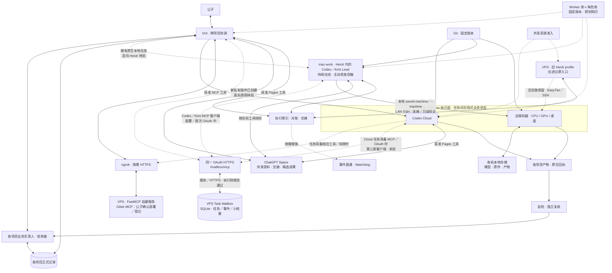

# 多项目协作架构迭代指引

版本：0.13；编制日期：2026-11-01，修订日期：2026-11-02（Asia/Shanghai）。目标是让多个项目同时、可追溯地推进，减少公子在会话之间转述和跟进的负担。**Mac 持续在线是当前设计与部署前提。Dot 全局协调，VPS Task Mailbox 正在建设为 Dot 与 Mac Codex／Kimi 客户端共用的 OAuth HTTPS 持久收发通道；执行侧报告服务和公网入口已运行，真实客户端与 Herdr 闭环仍待验。mac-work 的 Herdr 托管各项目 Codex／Kimi CLI Lead，以本地 saved-machine／--machine 经 LAN SSH 直接连接 Win collab，不经 VPS；原生连接与空 Agent 列表只读回读已有证据。VPS 保留 Gitee MCP、旧 Herdr profile／在途及网络，Cloud 独立执行。信箱收发不自动执行或移交生产写权，工具、Agent 与业务验收分别取证。**

本文沉淀搭建次序、取舍与验证方法，不因写入文档而扩大安装、入网、派发或业务权限。2026-11-02 公子已授权调通组网与准备协作环境的 Goal，已实施必要网络与服务配置；当前证据和未验项统一见[本仓状态](status.md)。网络／SSH、Windows 转发恢复及限定 TUI 小任务通过，不代表 Dot、Agent 或业务全链路通过。各项目业务状态仍在各自正式入口，本文不维护第二份活动队列。

## 1. 文档归属与建设基线

| 问题 | 唯一维护入口 |
| --- | --- |
| 怎样逐步搭建、何时增加组件、用什么证据决定 | 本文 |
| 组织岗位、授权、单写、汇报和验收 | [组织技能](../skill/organization-collaboration/SKILL.md)，不在本文另写一套规范 |
| 按任务组合 Worker、后端与专业角色，固定定义版本和准备稿 | [Worker 与角色库](worker-library/README.md)、[Worker 注册表](worker-library/workers.json)、[角色索引](worker-library/roles/index.json)；只有离线查询／准备，不是实时可用性或派发服务 |
| 当前 TUI 与历史 hc／App 路线的能力、来源及限制 | [通信指引](agent-communication.md)；产品、研究日期与目标端证据分列 |
| Dot 与 Mac 的任务、事件、小结果怎样持久交接 | 本文的[Task Mailbox 输入通道](#task-mailbox输入通道与验收边界)及[VPS 接入记录](vps-control-pilot.md#task-mailbox当前接入快照)；服务实现和运行记录由外仓维护 |
| Mac 原生连接、VPS 旧支路与机器环境 | [VPS 试点](vps-control-pilot.md)；TUI 原生命令沿[试点指引](pilot.md) |
| mac-work、VPS、Cloud 和执行机各装什么 | [三机部署表与用途](architecture.md#三机部署速查)、[详细组件](architecture.md#各端组件清单)；逐端区分已装、用户说明与待验 |
| VPS／Win 网络、现有 LAN、Dot 影响及历史对照 | [独立组网方案](networking-plan.md)；Mac 不装 EasyTier，经 Win 网关仅路由 VPS 虚拟主机，Win 仅宣告 Mac LAN 主机范围 |
| 算力、协作空间、本地资产、方法与权限怎样组合 | 本文的资源分工、访问路径和状态归属；原记录仍由各自保管方维护 |
| 本次任务的目标、执行绑定与证据 | 复用[任务模板](templates/pilot-task.md)及原项目记录，只补必要缺项 |
| 场景评阅与旧路线资料交接 | [评测资料](organization-collaboration/README.md)；接收资料不等于已执行评测 |

建设基线是：**统一协调与可达资源视图，分布式执行与资产保管。** Dot 关联跨项目目标、依赖和资源；Mac 上的项目 AI Lead 拆任务、跟依赖、准备任务包并组织复核，本地 Herdr 原生连接 Win 执行端。VPS 提供 Task Mailbox 和其他自建 MCP 服务，旧控制支路只沿原执行处理其在途任务，不重复常驻项目规划 Agent。信箱持久任务数据与小结果，业务 owner、正式状态与验收仍沿原 Projects／Issues 或既有入口，不建立竞争业务库。接通与只读观察不移交正式生产写控制；独立 Cloud 任务不以 Mac 或信箱接通为前置。

0.7 记录公子选择 Herdr TUI、替换此前 core／hc 优先分工的决定；0.8 的网络 Goal 已取得 VPS／Win EasyTier、Mac 经 Win 到 VPS SSH、VPS → Win SSH 与转发恢复证据。该轮 **VPS profile** 下的 running／reachable、94 字节文件与两个新窗格交叠执行是旧支路成果，不能冒称本次 Mac 原生直连成果。0.9 保留 FastMCP／ngrok 角色调整与当时的 LAN 简化候选；0.10 采用 Mac 经 LAN 原生直连 Win；0.11 明确 Mac 持续在线，不再要求脱离 Mac 运行；0.12 纳入正在接线的 Task Mailbox 输入通道；0.13 加入独立版本化 Worker／角色库及离线选型、准备稿，不新增调度服务或运行队列。Agent 配置与真实多项目业务分别取证，服务启动或库结构通过都不等于协作已验收；主机重启未测只限定历史恢复证据，不是本轮前置。

## 2. 逻辑分层与多项目职责



图是已选分工的连接设计，不表示全图已通。信箱服务／HTTPS 按执行侧报告记录，Dot 与 Mac 的虚线仍待真实客户端调用；既有 Dot 原生本地任务入口另列，不能互相代证。信箱没有通向 Herdr 的自动执行线。AI Lead 与业务验收者分列；Space 工具线以实际工具和资源权限为前提，Cloud 不必经 Mac 或信箱转述资料。Cloud 派发仍沿已获准 Dot 入口，Mac Lead 不自动取得另一派发入口。

当前区分两条物理路径：**Mac 本地 Herdr → LAN SSH → Win collab** 用于本次原生连接／只读验证；**Mac → LAN → Win 网关 → EasyTier → VPS 内网地址** 保留既有 VPS 访问。后一条已有源地址、默认路由／DNS 不变及服务重建恢复回执，不证明前一条 saved-machine 已通过。Mac 不装 EasyTier；Win 的 Mac `/32` 宣告、WLAN／TUN 转发和 Mac 的 VPS `/32` 主机路由保留，不发布整个 LAN。VPS ↔ Win 的旧 P2P 短样本有丢包，持续性能与业务 Agent 未验。简图见[组件图](architecture.md#三机组件与调用图)，详细范围见[独立组网方案](networking-plan.md)。Dot 原生入口与 Cloud 独立路线保留。

| 位置 | 负责 | 边界 |
| --- | --- | --- |
| Dot | 面向公子的连续交互、跨项目关联与冲突协调，沿获准入口委派／查询 Cloud 和 Mac 本地任务 | 不替项目作未获授权的业务决定或代签验收；投递超时或结果 UNKNOWN 时核原任务，不重派同一未决执行 |
| 项目业务负责人／验收者 | 本项目需求、输入、优先级、预算、依赖及最终采用／验收 | 由公子或已指定责任人承担；AI Lead 不因宿主变化自动取得最终业务验收权 |
| mac-work 项目 AI Lead | 在 Herdr 托管的本地 CLI 会话中拆任务、跟依赖、组织复核；本地 saved-machine／--machine 经 LAN SSH 连接 Win | 本次仅连接与原生只读验证，不向 Win pane 注入输入或取得正式生产写控制；项目上下文、唯一写者、Dot 接入和实际权限仍按任务绑定 |
| Codex Cloud Worker | 承接明确项目的云端编码、测试、文档或复核；任务实际提供获准 Pages／信箱 MCP 工具与认证时，可直接访问资料、读任务并发布小结果 | 遵循两池共用任务契约；Cloud 创建／续接沿原云入口，信箱不启动云任务。Dot 插件和 Mac 配置不证明 Cloud 已获工具／认证，真实调用单独验收 |
| VPS 工具服务宿主 | Task Mailbox 的 OAuth HTTPS／SQLite 持久收发、既有 Gitee MCP；原公网入口与认证、旧 Herdr profile／在途及网络保留 | 信箱不执行、唤醒或轮询 Agent，不替代业务 owner／Projects／Issues；不是 Mac 原生直连 Win 的中转，旧任务仍沿原入口收尾 |
| 机器 Worker | 在获准机器、独立上下文和资产范围内推进具体成果，可按实际需要组织子任务与复核 | 同样按任务间无隐式业务状态设计；机器与模型可常驻，执行上下文、参数和写权显式绑定，不凭旧聊天或其他项目消息取得授权 |

每项执行明确规划者、唯一实际派发／续发入口及当前写者。Mac 原生 saved-machine 可以为连接和只读核验注册；这不迁移 VPS 旧任务或自动取得新业务写权。正式任务的写控制仍按原执行绑定，不能因两个客户端可见同一 Win server 就双发。Cloud 沿原获准入口独立执行；Mac Lead 的 Cloud／Space 工具权限另核，不从 LAN 或 SSH 推导。

一个项目不必等于一个仓库或一台机器。复用现有项目引用与实际任务关系，不能用目录名、chat 标题或机器别名代替项目归属。项目负责人和正式入口各自保留；CF-FE Projects 的组织选择不自动证明本仓或某项目已绑定、可写。

### mac-work 持续在线前提与分工变更

公子已明确采用 Mac 本地 Herdr 原生 saved-machine／--machine 经 LAN SSH 连接 Win，不再等待候选取舍。主会话预检已核 Mac machine list 为空、Win TUI 0.9.5、collab running／default stopped；随后 Mac Herdr 0.9.5 的 machine add 退出 0，本机 catalog 从 0 到 1，保存 win-work／collab、enabled=true。按真实返回 ID 的 machine status 为 reachable、定向 agent list 退出 0 且 agents=[]；实际 ID 与地址仅在私密证据保管。这是 **Mac 本地 herdr** 的原生回读，操作员登录 Win 后运行其本地 CLI 不替代该证据。范围见[当前部署与原生直连](architecture.md#当前部署与待评估简化)。

| Mac 原生直连检查点 | 当前证据与边界 |
| --- | --- |
| 连接前目标 | 上述 Mac／Win 预检已回读；不新建 Agent、不启停或替换 Win server |
| saved-machine 与 --machine 只读回读 | 主会话直接回读：Mac catalog 0→1，win-work／collab 启用；machine status reachable、agent list 退出 0／agents=[]。本次只证明原生连接与空列表，未调用模型或启动 Agent |
| 正式写控制 | 本次不移交，不派生产任务；旧 VPS profile／在途任务沿原入口保留，其目录／在途审计独立未决，不以 Mac 新回执代替 |

本次明确替换 0.4 及原 VPS 草案中“VPS 上常驻协调 Codex”的分工：mac-work 承载项目规划，VPS 主要承载自建 MCP 与必要网络服务、保留已有控制绑定。选择依据是职责和公子计划利用的资源，不是断言 VPS 必然不够；VPS 仍可升级。公子明确 Mac 会持续在线，当前按此部署和使用，不另设离线接管或独立查询建设项；实际资源容量与多会话峰值仍按负载取证，持续在线的约定不等于已实测全天稳定性。

2026-11-01 早期草案提出“Mac 断开仍能使用”和 VPS 独立协调；这些目标已被当前持续在线分工替换，不属本轮建设或验收范围。保留旧方案仅用于理解角色变更，不据此增加备用 Lead、独立查询入口或故障测试。

官方确认 Dot 可创建／继续已连接计算机上的本地 Codex 任务，相关本地工作需要计算机在线、桌面应用运行并登录。Mac 在线按当前运行前提接受，Dot 的应用、登录和实际任务权限仍沿其原生入口核验；桌面任务不会自动成为 Herdr Lead 或取得其控制权限。Cloud 沿独立任务与授权入口使用。[Dot 的任务位置](https://learn.chatgpt.com/docs/dots/tasks-and-memory#assigned-work)、[本地接入条件](https://learn.chatgpt.com/docs/enterprise/cloud-local-access#end-user-experience)

Win 的 OMP／Hermes／Kimi 代理分支可以依赖 Mac CLI Proxy，不要求它们脱离 Mac 独立推理；Kimi 官方直连作为另一分支单列，供应商、模型、认证、实际回合及预算分别取证。该依赖选择不新增代理安装或网络变更，不把 SSH 连接成功当作模型链路通过；Windows Codex 不纳入本轮。

### Task Mailbox：输入通道与验收边界

公子已填好独立 OAuth，并授权启动服务与接入云端／本地。当前目标为 **Dot ↔ 同一 OAuth HTTPS `/mailbox/mcp` ↔ VPS SQLite 持久信箱 ↔ Mac Codex／Kimi MCP 客户端**。它补任务与结果的持久交接；既有 Dot 原生本地任务仍是另一入口，Mac Herdr → LAN SSH → Win 的机器主链不变。一个执行仍只有一个实际派发／续发入口，不能把两种收信方式变成双发。

**Codex Cloud 也是条件客户端**：具体云任务具备相应获准 MCP 工具和认证时，可直接读取任务／结果、发布小结果并确认精确版本，无需经 Dot 或 Mac 转述，也不为此接 VPN。当前未取得该 Cloud 任务的发现、`whoami` 或读写回执，不从 Dot 插件创建推定已经接通；首次 Dot／Mac 闭环不以 Cloud 接入为前置。公网访问与命令网络、托管工具分别治理，环境允许域名不授予服务凭据；这里不提供把 Mac 本地配置复制为 Cloud 已就绪的做法。[Cloud 服务访问](https://learn.chatgpt.com/docs/environments/cloud-environments#connect-to-services)、[Cloud 托管工具边界](https://learn.chatgpt.com/docs/enterprise/agent-security#execution-controls-executor)

2026-11-02 来源会话最新快照：执行侧报告 `task-mailbox.service` 运行、回环未认证返回 401 与 OAuth discovery、公网 HTTPS 与 discovery 已通过；Caddy 安全热加载 PID 不变，原 Gitee 路径、OAuth 和进程保留。云端 Task Mailbox 私有插件已创建，Mac Codex／Kimi 正在配置及首次 OAuth；尚无完整的真实工具发现、`whoami`、双向 nonce 或 Herdr 闭环回执。这里是执行侧报告，本轮没有另行 SSH 或云端重测；外仓部分接入文档尚停留在启动前，不能将其旧“未启动”状态覆盖此快照，也不把新快照推广为全链通过。

采用主动收发：发送方 `submit_job`，接收方 `get_job`／`list_events` 查询原任务，核已有授权后才决定是否经原 Herdr 入口执行；随后 `publish_result`，对方 `get_result` 核版本与摘要，再 `ack_result_read`。同 ID 同内容返回原记录、冲突拒绝，是服务内去重约定，不保证外部命令恰好执行一次。`sender`／`recipient` 是任务数据，认证主体用 `whoami` 独立核；业务 owner 与正式记录不转交信箱。`request_cancel` 只是取消请求，读确认不是业务验收、进程停止或写权交还。

本阶段没有自动执行、自动唤醒、后台 poll、常驻 Mac runner／bridge；客户端安装或在线不等于会主动消费任务。接线完成后先取得 Dot 与指定本地客户端各自的工具发现和身份回读，再以稳定 job／事件 ID、nonce、时间、结果版本与摘要做双向主动收发；收到、读取、执行、结果发布和读确认分别记录。Herdr 定向目标与回合仍沿原生引用单独验收，服务 HTTP／OAuth 成功不能替代它。

后续可见进展为一次本地 OAuth 回调已返回、随后令牌交换失败；原实施侧先查同一交换日志，没有重新发起授权。原因与各客户端最终状态沿[本仓状态](status.md)更新，不将回调成功推广为客户端已接通，也不据此猜测回调地址错误。

实现与运维以 [create-network-sh 的契约](https://github.com/ghyghoo8/create-network-sh/blob/main/fastmcp/task-mailbox/SPEC.md)、[接入记录](https://github.com/ghyghoo8/create-network-sh/blob/main/fastmcp/task-mailbox/INTEGRATION.md)和[客户端指引](https://github.com/ghyghoo8/create-network-sh/blob/main/fastmcp/task-mailbox/clients/README.md)为准，本文只引用，不复制代码、部署或建立跨仓运行导入。容量沿实际配置与契约核对，不复制资料间尚未统一的默认数字；大模型、音频原件、大产物留原保管方，只交获准引用与摘要，不进 VPS 信箱。

### Worker 与角色组合：从选择到原生执行

[Worker 库与角色库](worker-library/README.md)分别以 1.0.0 独立维护，当前含 7 个模板、9 个后端和 13 个角色定义。角色描述职责、方法、交付与项目要求；Worker 描述宿主、harness、后端、声明能力及证据快照。11 个专业角色可参与选型，2 个组织导航仅可查阅；两库是知识输入，不是运行实例、任务队列或新 MCP 接口，VPS 与信箱也不是 Worker。

1. **先绑定任务与角色。** Dot 或项目协调者读取实际目标、输入、资产位置、验收、预算和报告路由；项目角色与库内已知项目任务须用匹配的 `--project` 显式加载合同。组织导航不能派发，角色名不产生任职或写权；外部方法 `bundled: false` 不证明目标已安装。
2. **再选模板与明确后端。** `select` 按角色要求、宿主和声明能力给候选，不排名、不自动回退或挑首项；多后端必须明确选择。`active` 只表示模板在维护，所有离线输出的 `live_status` 为 `UNKNOWN`，命中能力仍须核实时环境、工具、认证与项目硬约束。
3. **离线形成请求稿。** `prepare` 固定两库、模板与角色版本、索引／资源摘要，关联原任务和待绑定项；它不执行、启动模型、提交信箱或投递 prompt，也不验证文字授权的真实性。草稿为 `REQUIRES_RUNTIME_PREFLIGHT`；未提交内容不能称已发布，云端取得的实际 commit／文件版本另验。
4. **沿获准原生入口创建并回收。** 具备任务授权与实时条件的执行者绑定专用目标、目录、供应商、权限、唯一派发者和写者，再沿 Herdr／Cloud 原生接口创建或派发，保存真实返回引用。信箱如可用只交接任务数据；结果沿原执行回收、核产物版本和指定接收者回读，再由有权负责人验收。实例不会因角色库存在而自动创建，UNKNOWN 不重派或换后端。

以下只生成离线候选／草稿，示例任务是假数据，不构成派发授权：

```bash
python3 scripts/worker_library.py select --role software_implementation --host win-work
python3 scripts/worker_library.py prepare --worker win-omp --backend cli-proxy-responses --role workspace_quality --task-file docs/worker-library/examples/review-task.json
```

独立复核角色仍须由未参与该版本制作／修改的上下文承担；候选能力不豁免项目冻结输入、资源锁、模型／声线、真实听审等明确要求。Mac 持续在线与 CLI Proxy 依赖沿当前分工；Windows Codex 仍不参与本轮。定义变更更新唯一正文／注册表、相应版本及[库变更记录](worker-library/CHANGELOG.md)，新任务明确采用点，在途实例保留原版本和写者。

### 统一 Worker 的状态边界

云端／远端描述部署位置；无状态任务契约描述对隐式上下文的依赖，两者分别判断。公子提出远端机器 Worker 也可无状态，适合作为共用设计目标：**新 Worker 可凭明确任务包定位输入、权限和成果，不依赖上一个 Worker 的记忆。** 该目标不抹掉单次执行和宿主环境的状态，也不宣称现有任务已全部满足。

| 对象 | 状态归属与处理 |
| --- | --- |
| 业务目标、授权和验收 | 各项目现行正式记录及其有权责任人；不由 Worker 旧聊天或 Space 副本接管 |
| 执行与未决效果 | 原生运行记录＋持久执行索引关联任务、实例、session、写者、产物和下一责任人；断线保留 UNKNOWN |
| Worker 任务上下文 | 输入与必要决策显式可取回；临时工作区、未提交修改和进程内进度在活动执行中保留，不能当普通缓存清除 |
| 宿主环境与资产 | 模型、依赖、认证、原件和已保存产物由相应保管方维护；可重建缓存、版本化资产、唯一原件分别管理 |
| 协作资料与成果入口 | Space 组织获准共享的资料、交接页、摘要和精选成果；本地资产可只交受控引用，不要求全部上传 |

“外置”是离开某个 Agent 的唯一内存／会话，保存到明确保管的记录或资产落点；不等于数据必须离开执行机。win-work 可以同时托管可重建 Worker 与持久模型、原件、成果。仅存在本机的关键资产须记录宿主依赖和备份情况，引用本身不提供容灾。

可启动新 Worker、可跨机迁移、可恢复中间进度分别取证。需要特定 GPU、模型、桌面状态、唯一原件或未外置进度的任务可以保留宿主绑定，逐项减少隐式依赖；不要求为统一概念改造所有任务或清空机器。暖缓存和模型复用有价值，但复用进程前必须明确工作目录、配置版本、旧占用和未决写权，避免把 A 项目状态带入 B 项目。

### 两类 Worker 的任务路由

| 任务条件 | 优先执行位置 | 交接与取舍 |
| --- | --- | --- |
| 输入、依赖及检查可在已获准云环境准备的编码、测试、文档、静态复核 | Codex Cloud | 利用独立工作区并行；先核环境、仓库版本、网络、权限和用量，不能由任务类型推断云环境已就绪 |
| 依赖 win-work 音频模型、GPU、原件、桌面或指定宿主环境 | 对应机器 Worker，当前连接采用 Mac 本地 Herdr 经 LAN SSH | 本次只读连接不构成业务派发或写权移交；旧 VPS 任务不迁移，制作与宿主验收另绑定 |
| 开发与真实宿主验证分离 | 云端开发／复核 → 机器验证 | 用仓库、固定 commit、路径和适用摘要交接；机器返回实际检查与产物，分别记录两端证据 |
| 某执行池不可用、配额不足或结果 UNKNOWN | 保留原执行；推进另一池的独立获准任务 | 不自动把同一任务跨池重做。确需换执行器时先对账原效果与写权，再在授权内建立新执行关联 |

云端后端也有平台自己的保存能力。2026-11-01 核对的官方文档说明：新任务从已发布环境取得独立工作区；已有任务可续用其保存文件，默认 VM 状态可在最后启动回合或恢复后最多七天内恢复。共用任务契约不依赖该 VM 持续存活保存唯一事实，仍须查询原任务，将重要成果提交或保存到获准持久落点，不能把平台暂存当长期交付。[官方云环境说明](https://learn.chatgpt.com/docs/environments/cloud-environments#reuse-and-update-saved-state)、[VM 状态范围](https://learn.chatgpt.com/docs/environments/cloud-environments#vm-specifications)

云任务和机器任务不默认共享文件、凭证、个人技能或运行环境。跨端只交付获准的版本化输入与成果引用；消息送达不自动赋予目标端权限，也不自动发布环境、安装软件或派发任务。

路由顺序是：先核任务授权及资产允许使用范围，再核 OS、模型／工具版本、网络和必要输入可达性，再核实际共享资源占用，最后比较等待时间、成本和数据搬运。资源多不等于当前可用，优先利用已具备条件的路径，不因另一个池有空闲就复制同一未决执行。

## 3. 从第一条任务就保留的身份与证据

复用既有[上下文与回报](../skill/organization-collaboration/references/context-and-reporting.md)和[任务追溯](../skill/organization-collaboration/references/task-traceability.md)，区分以下对象，不将它们合成一个“完成”状态：

| 对象 | 必须能回答的问题 |
| --- | --- |
| 项目与业务任务 | 哪个项目、哪项成果、原正式入口、负责人及本次授权是什么？ |
| 输入版本 | 本次依据哪个需求、文件或参数版本？后续消息是否改变它？ |
| 某次执行 | 由云端还是机器执行，谁在何环境／目录工作；云任务及环境引用，或机器／terminal／session，加上原生请求／回合引用是什么？ |
| 事件与消息 | 来自哪个已知来源和对象，是否已经观察、交付或处理？它只是上下文还是有效控制指令？ |
| 信箱记录与认证 | job／事件 ID、游标、结果版本／摘要和读确认是什么；两端实际 OAuth 主体与 sender／recipient 数据如何分别记录？ |
| 产物与写权 | 准确对象、版本、位置、适用摘要是什么，谁仍在写，谁已核验或接手？ |

同一业务任务可以跨多条 chat、Issue／PR 或执行回合；收到一条消息不自动新建任务或 Worker。稳定任务 ID 与事件去重键只用于关联，不保证命令、音频制作或其他业务动作幂等。未取得原生引用保留 UNKNOWN，不能补造成功回执。

全局上下文只汇总获准共享的目标、摘要、责任、版本、原件引用及未决项；项目原始对话、日志、私密资料和凭证不默认汇入同一个共享记忆。执行索引关联两类 Worker 的原生引用，复用现有获准持久落点；VPS 保存其受委派部分，不要求全部云任务经过 VPS。正式业务状态仍回到原项目入口。目录／profile 分离不等于安全隔离；真实访问边界按现有工具、账号和执行环境核验。

从首条闭环即保留请求、原生状态、错误、产物／结果、资源观察和报告承接证据，并明确必要记录的持久落点。后面的恢复与 Watchdog 阶段增加故障处置能力，不意味着前期可以没有可观测证据。

### 各维度资源怎样组合

| 资源 | 建议分工 | 整合时保留的边界 |
| --- | --- | --- |
| 人与协调能力 | 公子明确目标／授权，业务负责人取舍验收，Dot 跨项目协调，Mac Lead 规划／跟进，VPS 提供工具服务并保管旧控制关联 | 规划者、实际派发入口、写者和验收者分列；本次 Mac 原生只读连接不交接生产写权 |
| 计算与运行环境 | Mac 按容量承载项目 Lead 与本地 Herdr；Cloud 和机器按实际能力执行；VPS 承载 MCP 服务与旧网络支路 | 分别计 Mac 会话、云配额、VPS 工具请求／旧控制及机器负载；容量不代替权限／接口证据 |
| 源码、方法和配置说明 | 仓库保存固定版本；任务绑定需要的技能、说明和工具条件 | 云端不自动继承个人技能；独立仓库复用按明确版本复制、记录来源，不跨仓共享运行目录或自动同步 |
| ChatGPT Space | 共享需求、研究资料、决策／交接页、评审摘要及精选交付物；Dot 与工具／权限具备的 Cloud Worker 可直接参与 | 属于协作资料入口；正式任务状态仍沿原项目入口，指引正文以本仓为准，Space 可引用固定版本而不再维护竞争副本；两端有权限不等于可同时覆盖同一资产 |
| 机器本地存储 | 模型、原件、依赖、任务工作区、大产物及必要检查点由获准机器保管 | 保存准确机器、路径、版本／摘要和保管者；不把本地路径当可被任何 Worker 打开的链接，不因磁盘常驻就称 Worker 必须有业务状态 |
| VPS Task Mailbox | 只保存任务数据、事件、小结果及摘要，供获准客户端主动收发 | OAuth／日志／SQLite 各有实际容量边界；不存大产物、不提供文件挂载、不接管正式业务状态或自动派发 |
| 网络、工具与身份 | 按每条边绑定已验证的 Git、Pages、私网、SSH 或文件交接入口 | 同一网络、账号或 Space 成员资格不自动提供所有工具与原件访问；只向任务提供必要能力，凭证留在获准配置位置 |
| 质量、成本与容量 | 自检、独立复核及各负责人验收；分别计模型用量、云配额、机器负载、存储增长和待验队列 | 加 Worker 或扩存储不能抵消错版本、重复执行和未验收；清理缓存不能删除未决成果或唯一恢复依据 |

已有任务包按需补齐：项目／任务与输入版本、允许动作和预算、必要环境与资产引用、唯一控制者／写者、交付位置和验收者。受理后关联原生执行 ID、实际输入／环境与结果。这里是共用交接契约，不要求新建 API、资源注册中心或 Projects 字段；只盘点当前采用任务所需资源，不让全组织资产盘点挡住首条闭环。

### ChatGPT 协作空间与本地存储怎样连通

公子提供的“100G ChatGPT 协作空间”作为待核容量资源纳入规划；本轮已核官方 Space／Pages、Agent 协作与分享文档，确认可组织页面、引用／附加文件并协作。尚未核实该 100G 对应的具体存储范围、账号额度口径、已用量、保留规则或单文件限制，不将 Space、Library 和运行 VM 磁盘默认等同；也没有文档证据证明它是 VPS 可挂载的网络盘或所有 Codex Cloud 任务的共享卷。[Space 总览](https://learn.chatgpt.com/docs/space)、[页面与文件](https://learn.chatgpt.com/docs/space/pages)、[共享权限](https://learn.chatgpt.com/docs/space/collaboration)

**Space 工具访问与文件系统挂载是两条不同路径。** 官方明确 Dot 可在 Space 中协作，Pages 的插入菜单还列出面向 Codex 的任务动作；Codex 插件可提供技能／MCP。在适用的受管 Codex Cloud 执行路径上，命令网络限制本身不关闭托管 apps／MCP。由此将 Cloud → Space 修订为“实际提供并获准使用工具时可直接访问”的路径，不能因没有共享挂载就排除，也不将上述文档拼成“所有 Cloud 任务默认具有 Pages 工具”的保证。[Dot 的 Space 工作流](https://learn.chatgpt.com/docs/space/agents#use-dots-in-space)、[Codex 页面动作](https://learn.chatgpt.com/docs/space/pages#add-content-with-the-insert-menu)、[Codex 插件与 MCP](https://learn.chatgpt.com/docs/plugins#overview)、[Cloud 托管工具与命令网络](https://learn.chatgpt.com/docs/cloud/internet-access#agent-security-command-network-requirements)

2026-11-01 的本会话只读查询另外确认：账号可列举一个可运行的 Codex Cloud 保存配置；Space 分享管理开关为开启。它们分别只证明配置可列举／可运行标记与分享管理政策，不证明本仓已绑定 Cloud 环境、某个 Cloud 任务已暴露 Pages，或 Dot／Cloud 对某个指定 Page 已有读写回执。平台入口支持、任务工具可用、连接账号授权、具体资源权限和实际动作证据分别记录；当前没有在 Dot 或 Cloud 任务内执行目标 Page 读写。

| 访问边 | 现有依据与建议路径 | 尚需证明 |
| --- | --- | --- |
| 公子／有权协作者／Dot ↔ Space | 官方支持页面、文件引用和 `@ChatGPT`／`@dot`；在实际可用客户端与授权工具内处理获准资料 | 目标 Space／Page、账号、读写范围，以及指定接收者实际可读；网页入口与工具可发现都不能代替回读 |
| mac-work Lead ↔ Space／VPS | Space 仅沿任务实际提供的获准工具；到 VPS 的内网 SSH 已经 Win 网关回读，Mac 不为此安装 EasyTier 或 hc | Dot 原生接入、TUI profile／session 与具体资源权限仍分别取证；网络或本地版本回读不代表 Agent 已接入，不把本会话工具清单继承给其他任务 |
| Mac 本地 Herdr ↔ Win | saved-machine 已在 Mac 保存，collab reachable，按原生 ID 的 agent list 退出 0／agents=[] | 不以操作员登录 Win 后的本地 CLI 回读替代；本次不传文件、不注入 pane 输入、不新增 Agent 或交接业务写权 |
| Dot ↔ Task Mailbox ↔ Mac 客户端 | 共用 OAuth HTTPS `/mailbox/mcp`；服务与公网入口按执行侧报告通过，云端私有插件已创建，Mac Codex／Kimi 接线中 | 工具发现、whoami、两端 nonce 读写及 Herdr 回合未完整取得；不是 Space 文件通道、自动唤醒或机器执行入口 |
| Codex Cloud Worker ↔ Space | 任务实际提供并获准使用 Pages／Space 工具时直接读页面与支持的文件引用、写入指定成果；不强制经 Dot 转述 | 核该 Cloud 任务的实际工具、连接身份、目标 Page／文件和允许动作；平台通用文档不代替任务内回读，不默认所有云任务有相同工具 |
| 当前会话 ↔ Space | 本会话有 Pages 读写和有限文件引用工具；已只读列举可见 Spaces，两页均无条目，本轮未上传或编辑 | 未定位目标 Space，不推出资源不存在。当前文件上传工具单次上限 10 MiB，读取有独立格式／大小限制；这是工具范围，不是对平台容量的判定 |
| Cloud／机器 Worker ↔ 源码与资料 | 源码沿获准仓库固定 commit；Space 资料可由有工具及资源权限的执行端直接读取，其余按任务交付必要文件／可读引用 | 不默认任务可读取任何私人 Space；本会话连接不自动安装到 VPS CLI 或其他任务。工具不具备时先保留该分支边界，按原任务已约定且获准的交接路径处理，不擅自换入口 |
| 旧 VPS ↔ 机器本地存储 | 原任务沿其已验证且获准的文件通道处理必要对象，旧文件回执仅保留原范围 | 不继承 hc 接口，也不把旧 94 字节成果当 Mac 新入口的传输验收；本轮新连接不搬文件 |
| Cloud ↔ 私网服务／机器 | 当前暂不考虑 Cloud 连接 VPN，不准备该访问边 | 不作为 VPS／Win 组网或验收条件；Cloud 独立工作沿既定入口继续，未来有实际需求再评估 |

官方 Space 的页面和原件权限分别判断：能读页面不保证能读链接文件，Space／父页共享可能向下继承。按项目权限组织可共享摘要和原件引用，不把私密原文复制到一个对所有项目开放的总页。[权限继承](https://learn.chatgpt.com/docs/space/collaboration#understand-inherited-access)、[Space 中使用 Agent](https://learn.chatgpt.com/docs/space/agents)

插件可用或已安装、分享管理开启都不等于具体 app 动作或文件访问已获准；连接账号决定其可访问范围。[官方 Space 账号与工具权限](https://learn.chatgpt.com/docs/enterprise/chatgpt-space#plugins-and-connected-accounts)

采用直接读写时，任务包关联准确 Space／Page、必要文件引用、输入修订／原文范围、允许读写动作、成果落点、当前写者和接收者。Dot 与 Cloud 可以读取共同资料，并行写不同获准成果；同一页面／章节／文件仍按已约定写权处理，写入前沿工具实际提供的版本核对机制读取最新内容。Cloud 已写到 Space 不代表 Dot 已收到通知或负责人已采用；沿原任务约定报告通道，无推送时落实拉取者与检查点，不额外启用自动同步／唤醒。

起步复用 **Space 资料入口＋Git 固定版本＋各机本地资产＋原生执行索引**。大模型、全量音频原件和持续增长的原始日志不为“用满 100G”而集中上传。只在交付、独立复核或恢复确有需要时，按任务转交必要对象或建立有界备份；容量和搬运成本按实测安排，不预切固定百分比。

每次跨端交接区分：保管方已保存、传输已受理、目标实际读到、版本／摘要一致、负责人采用。版本引用明确对象、位置、输入关联、适用摘要、当前写者和接收者；凭证不写入共享页。资料更新优先引用或按任务单向交付，保留更新时间和源版本，不启用自动双向同步。只有现有通道无法满足已确认的大文件自动交接需求时，才比较新增对象存储／NAS 等方案的价值与维护成本。

后续最小验证只选一条已具备条件且获授权的支路、一份无业务影响的小输入：原保管方给出准确版本 → 执行端实际读取并核对 → 返回小产物与原生回执 → 指定接收者回读并由原负责人验收。若要使用 Space，先绑定真实可读的 Page／文件；该入口未就绪时可先用其他已获准输入验证 Worker。网络／SSH、限定 TUI pane 与 94 字节小文件已有证据，Dot／接收者和业务闭环仍待验；成立后再验证新实例重建、两项目重叠及云机混合交接，不要求全图所有资源一次接通。

## 4. 分阶段迭代

阶段描述能力依赖，不是所有任务的新审批流程。独立资料和已获准工作可以并行；某个入口或组件缺口只限制依赖它的动作。不要求先完成全组织盘点、55 题评测或所有后续阶段，才开展第一条具备条件的工作。

| 阶段 | 本轮要解决的问题 | 最小验证与放行证据 | 未满足时怎样继续 |
| --- | --- | --- | --- |
| I0：绑定目标与范围 | 哪些项目、谁负责、允许做什么、如何交付和停止 | 先绑定具备条件的一项任务，复用项目、输入、正式入口、写者、预算和验收者；I3 前补齐至少两个独立项目的验证绑定。缺项标明影响，不默认目标或阈值 | 第一条已具备条件的任务不等待另一个项目或全组织盘点；缺权限不试派发，不把未绑定项目当已接入 |
| I1：一条端到端闭环 | Dot 能否沿具备条件的入口取得准确执行与结果 | Mac 原生直连 Win 只读证据已有；当前信箱先分层取得两端工具／身份、双向 nonce 与精确结果回读，再独立核 Herdr 定向执行和原生回执。既有 Dot 本地任务路线另验 | 服务上线、插件创建或信箱读确认不证明模型／业务通过；未绑定分支只限制依赖动作，Cloud 独立继续，旧 VPS 任务不重派 |
| I2：短回合与长执行分离 | 唯一协调入口会不会被长任务占住 | 有界长任务启动后取得原生引用；期间实际处理查询和另一项已授权请求；原任务继续被正确观察，无重复执行或错误关联 | 如接口实际阻塞，记清限制；先复用真实异步入口或有界查询，不假称已支持自动回调、唤醒或后台调度 |
| I3：多项目同时推进 | 独立项目能否重叠推进，局部阻塞能否被隔离 | 至少两个项目有活动重叠与实际进展；两类 Worker 都采用时再取一轮云端／机器重叠与固定版本交接证据。验证 A 阻塞时 B 无冲突分支继续、共享资源不超分、结果归各项目分别验收 | 单项目、串行或单池结果只证明相应范围。保留未知预留，只调整受影响负载或配置，不冻结全部项目；未接入池保持未验 |
| I4：降低路由与上下文开销 | 是否反复判断同一归属、重复读大日志或遗漏跟进 | 在相同工作口径下比较精确引用续接、重复状态合并、摘要＋按需原件读取；核授权／输入版本没有被压缩或路由丢失 | 无明显问题先保留简单路径；错关联、漏控制指令或多花成本时撤回该优化，原任务不重开 |
| I5：原执行对账与记录保留 | 投递或回读超时后如何找回事实 | 沿原任务与原生引用核受理、执行、已发生效果、产物、待交付报告及写权；保留必要日志与索引，不新增离线、重启或故障注入测试 | 原结果不明先对账，不自动新建执行。资源压力改配置／并发或保留边界，不将服务上线当业务续跑 |
| I6：按价值增加主动性 | 哪些事件确实值得自动观察、准备或处置 | 先观察候选而不执行；有明确规则、范围、预算、停止点和回报责任后，只验证获准动作。Watchdog 另核独立性、误报、恢复权限与维护收益 | 没有收益证据或合法入口时保持人工触发／有界拉取；不默认常驻轮询、全权限诊断 Agent 或自动业务修复 |

I1、I2 的单项目验证是起步切片；I3 是“支持多项目同时推进”的必要验证。Task Mailbox 是当前已选且正在接线的持久收发组件；I4 和 I6 不要求另建事件总线或全套自治系统，也不从信箱推导自动调度。必要持久化与超时对账从 I1 即有，不以新增高可用或故障测试作为本轮前置。

## 5. 多项目验收情境

以下是待验证的工程情境，不是已执行的行为盲测或生产故障注入。采用前绑定真实项目、任务、版本、资源范围和观察窗口；优先用无业务影响的小任务。

| 情境 | 需要取得的证据 | 不能据此宣布什么 |
| --- | --- | --- |
| A 长任务活动时 B 开始推进 | A 原生执行仍活动的时段内，B 已实际派发并取得有效中间成果或结果；时间和原生引用可对照 | 只登记两个项目、只开两个 chat 或串行完成不证明同时推进 |
| 云端与机器 Worker 重叠推进并交接 | 云任务 ID／环境与机器执行引用各归对应项目；活动时段重叠，固定 commit／产物摘要从云端交到获准机器，机器回读版本并返回实际检查 | 两端互见消息不证明文件已交付；云端测试通过不证明 Windows／GPU／音频宿主通过，也不证明所有执行池已接通 |
| 新 Worker 根据任务包接续 | 在已结束或获准停止且完成写权交接的边界，凭保存输入／成果和环境说明建立新实例；记录同机重建、换机或检查点恢复中实际覆盖的一种 | 启动成功不证明三种能力都成立；仍依赖原聊天、GUI 内未保存工程或唯一宿主数据时如实保留绑定 |
| 结果已落本地但回报断开 | 找回原执行和对应文件，核版本、完整性与当前写者，再完成结果交付 | Worker 可重建不等于音频可重复制作或母版可覆盖；连接超时不释放原写权 |
| 同一机器先后承接 A、B | 模型／依赖可以复用，B 的工作目录、配置版本、授权和输出归属显式成立，A 的未决占用保留 | 保留暖缓存不证明项目隔离；不能隐式继承 A 的参数、记忆、数据或写权 |
| Space 资料与机器原件交接 | 指定接收者确能读取获准资料；涉及文件时两端版本／摘要一致，机器本地原件保管与成果保存明确 | 上传成功、页面可读或填了本地路径不证明原件可用；本轮机器网络接入不包含 Space 原件交接验收 |
| Dot 与 Cloud 直接访问 Space | 分别核执行侧真实工具与身份；对一个获准小输入取回读证据，获准写入时核指定成果、写入回执与独立回读；共享写资产保持唯一写者 | 桌面本会话调用不冒称 Cloud 原生调用，分享管理开启不证明目标授权；Space 写入不证明通知、采用或业务验收 |
| A 局部阻塞，B 独立分支继续 | A 的 UNKNOWN／权限问题、当前写者和未解除占用保留；B 的授权、输入与独立资源成立且有继续动作 | 不能把 A 的未知资源当空闲，也不能把一项服务故障扩大为平台全停 |
| 两项目争用同一 GPU、目录锁或验收者 | 对真实共享范围明确准入协调者，记录采用的限制、占用／预留和先后；不争用部分仍可推进 | 不套用源示例 4／6／2；不以机器数、专业名或项目名虚构独立资源池 |
| 跟进事件、结果或输入版本相近 | 续接准确项目／任务／执行和输入版本；已处理事件不重复产生业务动作；范围变化交有权者处理 | 语义相似、相同文件名、相同显示名不证明同一任务；消息到达不扩权 |
| A、B 都产出并待验 | 产物、实际检查及结论各归对应项目；负责人分别验收，实际共用听审能力纳入待验容量 | 汇总通知、Worker 自报完成或一位协调者收到文件不替代各项目验收 |
| Dot 投递超时或结果 UNKNOWN | 沿原 Mac 任务及其 Herdr 执行引用核受理、执行、效果和产物；保留下一责任人和未决项，不发生替代派发 | 客户端超时不证明未受理；查询成功也不等于业务验收，不能自动回到 Lody 重做 |
| 信箱两端主动交接 | Dot 与 Mac 指定客户端各自实际发现工具、核身份、读取对方 nonce；原 job、事件、结果版本／摘要及读确认可对应 | 服务端回环、插件创建或另一侧代调不证明双向已通；信箱收件与读确认不代表 Herdr 已执行或负责人已验收 |
| Mac 持续在线与代理依赖 | 按持续在线前提部署；OMP／Hermes／Kimi 代理分支可以使用 Mac CLI Proxy，Kimi 官方分支独立记录实际配置与回合 | 运行约定不证明全天稳定性；不要求独立 VPS 查询、离线接管或脱离 Mac 推理 |

并行优先安排已具备条件且能减少关键路径等待、完成必要复核或解除阻塞的工作，不以填满槽位为目标。云端配额／并发、机器 GPU／目录写权及共同验收能力分别准入；云端 VM 负载不计成 VPS 本机占用。沿[容量与共享准入](../skill/organization-collaboration/references/planning-and-progress.md#容量的范围与计数)区分执行占用 E、在制承诺 W、待验成果 Q；实际听辨和负责人时间不会随 Agent 数自动扩展。

多个 Worker 接收同一 Thread 的通知有助于获知变化，但不能替代单写和资产冲突控制。需要并行修改同一仓库时按实际需要隔离工作树；独立目录若仍写同一母版、索引或共用服务，也不能当无冲突。

## 6. 优化机制的采用与取舍

### 事件与上下文

先区分有效控制指令、原任务结果、新业务候选和普通日志。已有准确任务绑定的结果按原引用交付，重复日志可合并；新范围和归属冲突交 Dot／相应负责人判断。终端正忙时，不将任意新消息直接粘贴进执行中的 Agent。撤权及公子新指令立即约束相关后续动作，实际停止仍须沿原入口取得证据，不能把取消记录当作进程已停。

确定性准入检查先核来源、身份、目标和当前授权；模型只判断确需语义理解的部分。订阅直通只是上下文递送，不免除授权和版本核对。合并日志／状态时保留原引用、时间及失败，不把停止、撤权或关键输入变化淹没在普通批处理里。

常驻上下文内联必要目标、约束、版本、未决执行和下一检查点；长内容保留准确对象及续读入口。任何摘要不能删掉 UNKNOWN、已发生效果、权限限制和未交还写权。各项目原文按实际权限取回，不用一个无限增长的全局摘要替代来源。

### 何时增加组件

| 候选 | 值得增加的具体触发 | 成本与撤回条件 |
| --- | --- | --- |
| 独立 Router 或分项目域路由 | 全局协调确有持续响应／上下文瓶颈，或不同权限域需要明确隔离；先核是否能靠准确引用直通解决 | 增加模型调用、授权交接和一致性成本；无改善或形成重复派发／第二套业务决策时停止新路径。独立质量审查可有价值，但不因此要求第二个全局总管 |
| Task Mailbox 扩展／Outbox | 先完成当前主动收发接线；只有真实回执证明现有契约仍遗漏必要交接事实，再比较最小扩展 | 复用 job／事件／版本及待交付关联，不另建竞争业务库或自动消费者；每个通道分别证明去重，不能推广到 SSH／音频动作 |
| 确定性健康检查与服务恢复 | 有无人值守运行需求，且能准确区分意外退出、配置／权限故障和有意停止 | 恢复器与被监控进程分开；只恢复已授权对象，尊重手动停止。配置／权限错误先报告，不用无穷重启掩盖 |
| LLM Watchdog／进展判断 | 反复出现结构化状态不能解释的停滞／偏航，模型诊断能减少实质人工成本 | 额外算力、权限和误判风险；先有界读取与报告，不默认改提示词、扩权、重派、接管写权或自动修业务。仅心跳／新日志不算实质进展 |
| 项目专用执行环境或额外 Agent | 实际安全边界、依赖冲突、专业能力或并发收益要求独立执行 | 按真实权限与负载选粒度，不机械每项目一实例。新增 Agent 不自动产生资源、业务授权或独立验收证据 |
| 整包采用外部原型 | 接口、项目范围、授权、恢复与维护成本能适配，较复用现有能力有明确收益 | 不以“内存可升级”替代兼容性判断，也不因当前内存小就否决。固定版本审查最小依赖；迁移与实际安装另有执行任务 |

### 资源配置是可调参数

Mac 的 Lead 会话负载、VPS 的控制／查询开销、Cloud 配额和执行机负载分别度量。VPS 基线不部署项目规划 Agent，1 vCPU／1 GB／20 GB 是早期轻控制试点档位，当前 MCP 服务需另按实际依赖、并发请求与峰值度量；Mac 会话数与并发也不能凭机器名称假定。容量不足时比较升级配置、缓存／日志治理与并发调整；只限制受影响负载，不据此否定架构或冻结独立项目。

不要求起始 1 GB 配置容纳最终所有组件；也不预先把能升级当作必须增加组件的理由。额外 Router、Watchdog 或持久服务的采用先看职责、故障／延迟与收益，所需资源随之安排。内存升级不能证明 Dot 入口、Windows 运行配置或外部原型接口已经兼容。

硬件调整随获授权的部署／容量任务执行；本文不购买、扩容或安装组件。音频、模型及原件继续归获准制作端；升级 VPS 不自动改变其职责或把重活迁入控制端。

## 7. 持久状态、恢复与退出

逻辑上区分业务正式记录、执行索引、原生运行状态和产物保管。两类 Worker 按任务间无隐式业务状态设计，TUI server／SSH／模型服务／桌面进程及运行工作区仍按各自真实状态管理。具体存储位置、权限、保留期限、大小上限和恢复责任在任务中绑定；不从执行契约推导整个宿主或 daemon 无状态。

最低保留范围是项目／任务／输入版本映射、原生执行引用、未决请求、当前写者、待交付报告和下一责任人。常规日志有界轮转，未决效果与恢复依据不得被普通缓存清理抹掉。恢复测试读取的是实际保存对象，不以“写了备份说明”代替可恢复。

两类 Worker 更换实例前都先查原任务／session、进程、工作区、分支／commit、PR／文件等已发生效果及保存产物。发出取消、超时、进程心跳消失或占用记录过期，都不证明旧执行已停止或可以接管写权。默认先重连查询原执行；确需新实例时，在已知安全边界交接，关联旧执行、新环境／输入版本和仍需完成的工作。仅实际有可读检查点且已验证恢复的任务，才声明中途恢复能力；其余保留原机／原进程依赖。

原执行已结束且实际资源释放有证据时，按任务解除相应执行占用；未决效果和写权继续分别核对、交接。清理临时成果及唯一恢复依据前，须完成必要持久保存和约定回读。等待验收不机械占住已确认空闲的计算资源；释放计算资源也不等于产物已交付或写权已交还。无状态执行不提供业务幂等或恰好一次保证，即便专门作业运行时也可能启动同一程序两次；本仓不照搬其自动重试策略。[Kubernetes Jobs 的重复启动边界](https://kubernetes.io/docs/concepts/workloads/controllers/job/#handling-pod-and-container-failures)

沿[VPS 对账与恢复策略](vps-control-pilot.md#5-任务可靠性与恢复策略)查询原执行；投递或回读超时先核原受理、进程、效果与产物，不新增断连、协调端退出、server 或主机重启测试。按 TUI 实际版本解释已取得的状态，不继承 core／hc 的恢复语义；新建 Assignment／session 只证明建立了新执行绑定，不能称为原进程续跑。写入和派发 UNKNOWN 不照搬其他系统的重试表。

2026-11-02 原网络 Goal 已取得 Windows 恢复切片：EasyTier 服务重启后 TUN 重建，`HerdrNetwork-Forwarding` 由实际 NetworkProfile 10000 事件触发，状态为 `forwarding_enabled`、任务结果为 0，两张目标接口转发恢复；随后 Mac 通过 `vps-herdr` 内网 SSH 复核成功，源仍为 Mac LAN。另有开机触发，未设周期轮询；该动作不重派任务或恢复 Agent 业务。主机重启与 TUI 生命周期未验仅限定此历史证据，不设为当前 Mac 持续在线方案的门槛，后续回执归[本仓状态](status.md)。

Mac Lead 续接工作时先读原任务包、执行索引、未决效果、产物与报告承接，再沿原入口查询；不因有本地聊天记录就认定原执行已结束。VPS 的服务与索引不因此创建第二 Lead 或规划新工作，原执行的当前写者与正式记录保持有效。

撤回某项路由、调度或 Watchdog 优化时，先停止该新机制的继续准入，交清已发执行、UNKNOWN、写权和报告承接，再沿当前合法入口收尾。不能为了“回退”删除关联、恢复旧状态快照或自动改用另一执行器重做。旧 Lody 的逐任务收尾／交接和专属旧验收沿[资料接收边界](organization-collaboration/README.md#退出与运行交接待办的责任)，不因架构迭代自动停用。

## 8. 每轮怎样作决定

每轮只选择一个具体问题，复用已有有效证据，比较“保留现状、改现有流程／配置、增加最小组件”。没有问题或预期价值时不强行增加机制。使用相同项目范围、输入、质量与验收要求比较；样本少时报告实际轨迹，不编 p95、提效比例或普遍最低配置。

| 指标 | 记录口径 |
| --- | --- |
| 多项目进展 | 实测项目数、同时活动执行数、有效重叠窗口及局部阻塞时仍推进的分支；不外推任意规模 |
| 公子及负责人注意力 | 人工转述／找上下文次数、真正需要决定或验收的事项；必要授权与质量检查不能被“降打扰”省略 |
| 交互与排队 | 长任务期间控制请求的实际响应时间、等待年龄、共享资源与待验队列；更新时间不重置积压 |
| 正确性与恢复 | 重复执行、错项目／版本关联、UNKNOWN 保留及对账、写权和各项目独立验收；这些缺陷不能用更快耗时抵消 |
| 成本与容量 | 每项已验收成果的模型调用／可取得用量；Mac Lead 会话峰值、Cloud 配额／排队、VPS 控制开销及机器执行负载分别记录；无价格证据不填造金额 |

记录只需在原任务关联下说明：

```text
本轮具体问题／受影响项目与范围；已有证据和未验项：
当前办法不足在哪里；拟采用的最小变化与不做范围：
输入／版本、唯一写者与派发者、授权／预算、验收者：
验证方法、对照口径、产物与原生证据落点：
结果、代价与未决项；保留／调整／撤回的依据及下一责任人：
```

这不是必须新增的 Project schema 或每轮全量表格。I1–I3 正确性成立后，再按故障与开销选择优化；某项目未完成接入时先准确限定支持范围，不能因另外两个项目通过就将它写成已支持。

## 9. 参考与不照搬的边界

任务间不依赖唯一进程内状态的目标参考 [Twelve-Factor Processes](https://12factor.net/processes)；其持久化原则用于区分可重建缓存和业务事实，不要求本仓新增数据库，也不据此承诺桌面／模型任务随时可杀或跨机恢复。OpenAI 官方文档与本会话工具 schema 只证明各自描述的能力；Space 容量／目标账号访问、Cloud 私网、VPS 接入及文件闭环仍分别取运行证据。

本文参考 [DeepSeek《Super-agent 设计探索》](https://mp.weixin.qq.com/s/zoS7GlReWPhfCjENGxXCdg)的职责分层、事件路由和上下文组织思想。原文实验使用合成消息与模拟耗时任务，展示调度取舍，同时存在多会话额外 token 开销；它不证明本仓的音频质量、跨机恢复、目标规模或资源规格。

原型研究固定为 `deepseek-ai/dsh-superagent-prototype@6337fc823ce20251c8de8085948165c81aaa701e`，仅作为来源参考，未复制代码或安装：

- [原型说明](https://github.com/deepseek-ai/dsh-superagent-prototype/blob/6337fc823ce20251c8de8085948165c81aaa701e/README.md)明确研究性质、面向一个 GitHub 仓库且并未实现原文全部设计。我们的目标是多项目，不能直接套用单仓范围或据其部署栈推定 Codex／Herdr 适配。
- [领域模型](https://github.com/deepseek-ai/dsh-superagent-prototype/blob/6337fc823ce20251c8de8085948165c81aaa701e/docs/001-domain.md)区分授权工作和执行绑定，值得借鉴关联思想；在本仓仍映射到原项目与原任务，不引入第二个正式业务任务库。
- [授权设计](https://github.com/deepseek-ai/dsh-superagent-prototype/blob/6337fc823ce20251c8de8085948165c81aaa701e/docs/002-authorization.md)将订阅消息作为上下文，不因此扩权；其准入策略变更不立即撤销存活任务授权的语义，不替代本仓对公子撤权即时约束的规则。
- [恢复机制](https://github.com/deepseek-ai/dsh-superagent-prototype/blob/6337fc823ce20251c8de8085948165c81aaa701e/docs/003-execution.md#failure-and-recovery)与[持久 Effects](https://github.com/deepseek-ai/dsh-superagent-prototype/blob/6337fc823ce20251c8de8085948165c81aaa701e/docs/007-architecture.md#effects)有具体实现，但不能将消息通道去重／恢复执行绑定推广为任意业务恰好一次或原进程连续运行。
- [Watchdog 部署配方](https://github.com/deepseek-ai/dsh-superagent-prototype/blob/6337fc823ce20251c8de8085948165c81aaa701e/docs/006-deployment.md#hourly-check)供比较故障分类与停止语义，不在本轮创建任何检查计划。

后续实现以目标端实际版本、工具 schema、授权和运行回执为准；新资料引发的范围变化只改受影响的采用决定，保留来源历史与既有任务证据。
