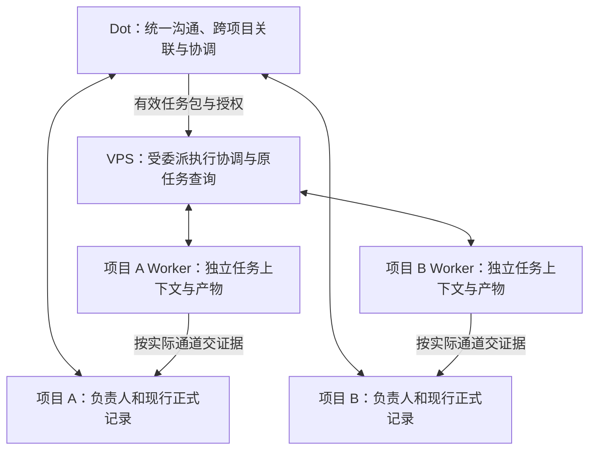

# 多项目协作架构迭代指引

版本：0.1；编制日期：2026-11-01（Asia/Shanghai）。目标是让多个项目同时、可追溯地推进，减少公子在会话之间转述和跟进的负担。**单项目闭环只是起步验证，不代表多项目架构验收通过。VPS 配置可升级，1 vCPU／1 GB／20 GB 是试点起点，不是架构上限或必然阻塞点。**

本文沉淀搭建次序、取舍与验证方法，不授权部署、登录、入网、真实派发、定时监控或业务切换。新增机制是待按具体任务采用和验证的工程建议，不宣称已经实现。当前状态只记在[本仓状态](status.md)；各项目业务状态仍在各自正式入口，本文不维护第二份活动队列。

## 1. 文档归属与建设基线

| 问题 | 唯一维护入口 |
| --- | --- |
| 怎样逐步搭建、何时增加组件、用什么证据决定 | 本文 |
| 组织岗位、授权、单写、汇报和验收 | [组织技能](../skill/organization-collaboration/SKILL.md)，不在本文另写一套规范 |
| Herdr／hc 与其他通信路线的能力、来源及限制 | [通信指引](agent-communication.md)；研究日期和目标端版本分列 |
| VPS 接入、机器环境与首轮运行检查 | [VPS 试点](vps-control-pilot.md)；TUI 命令沿[原试点](pilot.md) |
| 本次任务的目标、执行绑定与证据 | 复用[任务模板](templates/pilot-task.md)及原项目记录，只补必要缺项 |
| 场景评阅与旧路线资料交接 | [评测资料](organization-collaboration/README.md)；接收资料不等于已执行评测 |

建设基线是：Dot 做全局协调，VPS 做受委派任务内的执行协调，远端 Worker 专注项目成果，负责人分别验收。先实现这一条路径，再按具体缺口增加机制；不因有空槽、可扩容或出现新框架而预先增加 Agent 层级。

## 2. 逻辑分层与多项目职责



图是候选职责关系，不表示工具已经互通，也不赋予任何节点额外权限。

| 位置 | 负责 | 边界 |
| --- | --- | --- |
| Dot | 面向公子的连续交互、任务关联、已有权限内的跨项目优先级和冲突协调 | 不替各项目作未获授权的业务决定或代签验收；不因知道任务就直接重派 VPS 正在控制的同一执行 |
| 项目负责人 | 本项目需求、输入、优先级、预算、依赖及最终采用／验收 | 只能在自身范围内取舍；跨项目共享资源不能由各项目独自抢占 |
| VPS 协调 Codex | 在任务包内作必要技术规划、按绑定派发、定向查询、回收证据和交接 | 基线保留一个活动协调会话，不按项目或机器数复制本地 Agent；不重复审全局计划，不建立第二个全局业务队列 |
| 项目 Worker | 在独立上下文和获准资产范围内推进具体成果，可按实际需要组织子任务与复核 | 不将别的项目消息当新授权，不凭订阅消息取得写权；重活、模型和原件留在对应执行端 |

每项执行明确唯一实际派发／续发协调者及当前写者。Dot 与 VPS 的两级委派关联原任务，但同一个远端执行不能由两边独立操控。VPS 遇到任务包外的目标、供应商、权限或预算变化才回交相应责任人；不为普通技术步骤重复审批。

一个项目不必等于一个仓库或一台机器。复用现有项目引用与实际任务关系，不能用目录名、chat 标题或机器别名代替项目归属。项目负责人和正式入口各自保留；CF-FE Projects 的组织选择不自动证明本仓或某项目已绑定、可写。

## 3. 从第一条任务就保留的身份与证据

复用既有[上下文与回报](../skill/organization-collaboration/references/context-and-reporting.md)和[任务追溯](../skill/organization-collaboration/references/task-traceability.md)，区分以下对象，不将它们合成一个“完成”状态：

| 对象 | 必须能回答的问题 |
| --- | --- |
| 项目与业务任务 | 哪个项目、哪项成果、原正式入口、负责人及本次授权是什么？ |
| 输入版本 | 本次依据哪个需求、文件或参数版本？后续消息是否改变它？ |
| 某次执行 | 谁在何机何目录执行，原生请求／terminal／session／回合引用是什么？ |
| 事件与消息 | 来自哪个已知来源和对象，是否已经观察、交付或处理？它只是上下文还是有效控制指令？ |
| 产物与写权 | 准确对象、版本、位置、适用摘要是什么，谁仍在写，谁已核验或接手？ |

同一业务任务可以跨多条 chat、Issue／PR 或执行回合；收到一条消息不自动新建任务或 Worker。稳定任务 ID 与事件去重键只用于关联，不保证命令、音频制作或其他业务动作幂等。未取得原生引用保留 UNKNOWN，不能补造成功回执。

全局上下文只汇总获准共享的目标、摘要、责任、版本、原件引用及未决项；项目原始对话、日志、私密资料和凭证不默认汇入同一个共享记忆。VPS 的轻量索引用于定位执行和恢复查询，正式业务状态仍回到原项目入口。目录／profile 分离不等于安全隔离；真实访问边界按现有工具、账号和执行环境核验。

从首条闭环即保留请求、原生状态、错误、产物／结果、资源观察和报告承接证据，并明确必要记录的持久落点。后面的恢复与 Watchdog 阶段增加故障处置能力，不意味着前期可以没有可观测证据。

## 4. 分阶段迭代

阶段描述能力依赖，不是所有任务的新审批流程。独立资料和已获准工作可以并行；某个入口或组件缺口只限制依赖它的动作。不要求先完成全组织盘点、55 题评测或所有后续阶段，才开展第一条具备条件的工作。

| 阶段 | 本轮要解决的问题 | 最小验证与放行证据 | 未满足时怎样继续 |
| --- | --- | --- | --- |
| I0：绑定目标与范围 | 哪些项目、谁负责、允许做什么、如何交付和停止 | 先绑定具备条件的一项任务，复用项目、输入、正式入口、写者、预算和验收者；I3 前补齐至少两个独立项目的验证绑定。缺项标明影响，不默认目标或阈值 | 第一条已具备条件的任务不等待另一个项目或全组织盘点；缺权限不试派发，不把未绑定项目当已接入 |
| I1：一条端到端闭环 | Dot 是否能实际使用 VPS，VPS 是否能控制准确执行端 | 沿 VPS 试点先核真实入口、Mac 断开后的独立使用及一个非生产任务；原生请求、实际位置、命令结果、产物／结果回读可对应 | 配对／登录成功不能代替 Dot 调用；平台不支持与资源不足分开处理，其他独立准备继续 |
| I2：短回合与长执行分离 | 唯一协调入口会不会被长任务占住 | 有界长任务启动后取得原生引用；期间实际处理查询和另一项已授权请求；原任务继续被正确观察，无重复执行或错误关联 | 如接口实际阻塞，记清限制；先复用真实异步入口或有界查询，不假称已支持自动回调、唤醒或后台调度 |
| I3：多项目同时推进 | 独立项目能否重叠推进，局部阻塞能否被隔离 | 至少两个项目有活动重叠与实际进展证据；再验证 A 阻塞时 B 的无冲突分支继续、共享资源不超分、结果归正确项目并分别验收 | 单项目或先 A 后 B 的串行结果只算局部通过。保留未知预留，只调整受影响负载或配置，不冻结全部项目 |
| I4：降低路由与上下文开销 | 是否反复判断同一归属、重复读大日志或遗漏跟进 | 在相同工作口径下比较精确引用续接、重复状态合并、摘要＋按需原件读取；核授权／输入版本没有被压缩或路由丢失 | 无明显问题先保留简单路径；错关联、漏控制指令或多花成本时撤回该优化，原任务不重开 |
| I5：受控恢复与持续运行 | 断线／进程／服务／主机异常后如何找回事实 | 从原索引恢复查询；服务与主机重启分开取得授权和证据；核原进程、已发生效果、待交付报告、写权及日志／备份读取 | 原结果不明先对账，不自动新建执行。资源压力改配置／并发或保留边界，不将服务上线当业务续跑 |
| I6：按价值增加主动性 | 哪些事件确实值得自动观察、准备或处置 | 先观察候选而不执行；有明确规则、范围、预算、停止点和回报责任后，只验证获准动作。Watchdog 另核独立性、误报、恢复权限与维护收益 | 没有收益证据或合法入口时保持人工触发／有界拉取；不默认常驻轮询、全权限诊断 Agent 或自动业务修复 |

I1、I2 的单项目验证是起步切片；I3 是“支持多项目同时推进”的必要验证。I4 和 I6 按问题选择，不要求先建事件总线、持久邮箱或全套自治系统。必要持久化从 I1 即有，I5 的故障深度按实际交付要求决定；有恢复风险时可以提前开展，不必等待任务量增长。

## 5. 多项目验收情境

以下是待验证的工程情境，不是已执行的行为盲测或生产故障注入。采用前绑定真实项目、任务、版本、资源范围和观察窗口；优先用无业务影响的小任务。

| 情境 | 需要取得的证据 | 不能据此宣布什么 |
| --- | --- | --- |
| A 长任务活动时 B 开始推进 | A 原生执行仍活动的时段内，B 已实际派发并取得有效中间成果或结果；时间和原生引用可对照 | 只登记两个项目、只开两个 chat 或串行完成不证明同时推进 |
| A 局部阻塞，B 独立分支继续 | A 的 UNKNOWN／权限问题、当前写者和未解除占用保留；B 的授权、输入与独立资源成立且有继续动作 | 不能把 A 的未知资源当空闲，也不能把一项服务故障扩大为平台全停 |
| 两项目争用同一 GPU、目录锁或验收者 | 对真实共享范围明确准入协调者，记录采用的限制、占用／预留和先后；不争用部分仍可推进 | 不套用源示例 4／6／2；不以机器数、专业名或项目名虚构独立资源池 |
| 跟进事件、结果或输入版本相近 | 续接准确项目／任务／执行和输入版本；已处理事件不重复产生业务动作；范围变化交有权者处理 | 语义相似、相同文件名、相同显示名不证明同一任务；消息到达不扩权 |
| A、B 都产出并待验 | 产物、实际检查及结论各归对应项目；负责人分别验收，实际共用听审能力纳入待验容量 | 汇总通知、Worker 自报完成或一位协调者收到文件不替代各项目验收 |
| 协调端暂时不可达 | 沿各原执行、效果及产物查询后重新汇总；保留下一责任人和未决项，不发生替代派发 | 恢复协调进程不证明业务完整恢复；不能为了切换入口自动回到 Lody 重做 |

并行优先安排已具备条件且能减少关键路径等待、完成必要复核或解除阻塞的工作，不以填满槽位为目标。沿[容量与共享准入](../skill/organization-collaboration/references/planning-and-progress.md#容量的范围与计数)区分执行占用 E、在制承诺 W、待验成果 Q；实际听辨和负责人时间不会随 Agent 数自动扩展。

多个 Worker 接收同一 Thread 的通知有助于获知变化，但不能替代单写和资产冲突控制。需要并行修改同一仓库时按实际需要隔离工作树；独立目录若仍写同一母版、索引或共用服务，也不能当无冲突。

## 6. 优化机制的采用与取舍

### 事件与上下文

先区分有效控制指令、原任务结果、新业务候选和普通日志。已有准确任务绑定的结果按原引用交付，重复日志可合并；新范围和归属冲突交 Dot／相应负责人判断。终端正忙时，不将任意新消息直接粘贴进执行中的 Agent。撤权及公子新指令立即约束相关后续动作，实际停止仍须沿原入口取得证据，不能把取消记录当作进程已停。

确定性准入检查先核来源、身份、目标和当前授权；模型只判断确需语义理解的部分。订阅直通只是上下文递送，不免除授权和版本核对。合并日志／状态时保留原引用、时间及失败，不把停止、撤权或关键输入变化淹没在普通批处理里。

常驻上下文内联必要目标、约束、版本、未决执行和下一检查点；长内容保留准确对象及续读入口。任何摘要不能删掉 UNKNOWN、已发生效果、权限限制和未交还写权。各项目原文按实际权限取回，不用一个无限增长的全局摘要替代来源。

### 何时增加组件

| 候选 | 值得增加的具体触发 | 成本与撤回条件 |
| --- | --- | --- |
| 独立 Router 或分项目域路由 | 全局协调确有持续响应／上下文瓶颈，或不同权限域需要明确隔离；先核是否能靠准确引用直通解决 | 增加模型调用、授权交接和一致性成本；无改善或形成重复派发／第二套业务决策时停止新路径。独立质量审查可有价值，但不因此要求第二个全局总管 |
| 轻量持久队列／Outbox | 已受理请求或已生成报告可能丢失、无人发现，现有原生记录无法满足恢复要求；低任务量也可能需要 | 保存任务映射、事件位置和待交付事实，复用现有持久能力；不另建竞争业务库。每个通道分别证明去重，不能把消息重发安全推广到 SSH／音频动作 |
| 确定性健康检查与服务恢复 | 有无人值守运行需求，且能准确区分意外退出、配置／权限故障和有意停止 | 恢复器与被监控进程分开；只恢复已授权对象，尊重手动停止。配置／权限错误先报告，不用无穷重启掩盖 |
| LLM Watchdog／进展判断 | 反复出现结构化状态不能解释的停滞／偏航，模型诊断能减少实质人工成本 | 额外算力、权限和误判风险；先有界读取与报告，不默认改提示词、扩权、重派、接管写权或自动修业务。仅心跳／新日志不算实质进展 |
| 项目专用执行环境或额外 Agent | 实际安全边界、依赖冲突、专业能力或并发收益要求独立执行 | 按真实权限与负载选粒度，不机械每项目一实例。新增 Agent 不自动产生资源、业务授权或独立验收证据 |
| 整包采用外部原型 | 接口、项目范围、授权、恢复与维护成本能适配，较复用现有能力有明确收益 | 不以“内存可升级”替代兼容性判断，也不因当前内存小就否决。固定版本审查最小依赖；迁移与实际安装另有执行任务 |

### 资源配置是可调参数

VPS 的 CPU、内存、磁盘、连接数与本地 Agent 数量分别度量。出现容量不足时比较升级配置、减少无用缓存／日志和调整并发的成本；停止的是当前超载档位的加量或受影响工作，不是宣告架构不可行，也不冻结独立项目。

不要求起始 1 GB 配置容纳最终所有组件；也不预先把能升级当作必须增加组件的理由。额外 Router、Watchdog 或持久服务的采用先看职责、故障／延迟与收益，所需资源随之安排。内存升级不能证明 Dot 入口、Windows 运行配置或外部原型接口已经兼容。

硬件调整随获授权的部署／容量任务执行；本文不购买、扩容或安装组件。音频、模型及原件继续归获准制作端；升级 VPS 不自动改变其职责或把重活迁入控制端。

## 7. 持久状态、恢复与退出

逻辑上区分业务正式记录、执行索引、原生运行状态和产物保管。具体存储位置、权限、保留期限、大小上限和恢复责任在任务中绑定；进程可重启不代表状态可丢弃，远端 daemon 也不能未经核验就称为无状态。

最低保留范围是项目／任务／输入版本映射、原生执行引用、未决请求、当前写者、待交付报告和下一责任人。常规日志有界轮转，未决效果与恢复依据不得被普通缓存清理抹掉。恢复测试读取的是实际保存对象，不以“写了备份说明”代替可恢复。

沿[VPS 恢复策略](vps-control-pilot.md#5-任务可靠性与恢复策略)分别验证连接断开、协调进程退出、核心重启、父进程结束和主机重启。新建 Assignment／session 只证明建立了新执行绑定，不能称为原进程续跑；对写入和派发 UNKNOWN 的恢复先核原事实，不照搬其他系统的重试表。

撤回某项路由、调度或 Watchdog 优化时，先停止该新机制的继续准入，交清已发执行、UNKNOWN、写权和报告承接，再沿当前合法入口收尾。不能为了“回退”删除关联、恢复旧状态快照或自动改用另一执行器重做。旧 Lody 的逐任务收尾／交接和专属旧验收沿[资料接收边界](organization-collaboration/README.md#退出与运行交接待办的责任)，不因架构迭代自动停用。

## 8. 每轮怎样作决定

每轮只选择一个具体问题，复用已有有效证据，比较“保留现状、改现有流程／配置、增加最小组件”。没有问题或预期价值时不强行增加机制。使用相同项目范围、输入、质量与验收要求比较；样本少时报告实际轨迹，不编 p95、提效比例或普遍最低配置。

| 指标 | 记录口径 |
| --- | --- |
| 多项目进展 | 实测项目数、同时活动执行数、有效重叠窗口及局部阻塞时仍推进的分支；不外推任意规模 |
| 公子及负责人注意力 | 人工转述／找上下文次数、真正需要决定或验收的事项；必要授权与质量检查不能被“降打扰”省略 |
| 交互与排队 | 长任务期间控制请求的实际响应时间、等待年龄、共享资源与待验队列；更新时间不重置积压 |
| 正确性与恢复 | 重复执行、错项目／版本关联、UNKNOWN 保留及对账、写权和各项目独立验收；这些缺陷不能用更快耗时抵消 |
| 成本与容量 | 每项已验收成果的模型调用／可取得用量、整机 CPU／内存峰值、连接与查询量、磁盘和日志增长；无价格证据不填造金额 |

记录只需在原任务关联下说明：

```text
本轮具体问题／受影响项目与范围；已有证据和未验项：
当前办法不足在哪里；拟采用的最小变化与不做范围：
输入／版本、唯一写者与派发者、授权／预算、验收者：
验证方法、对照口径、产物与原生证据落点：
结果、代价与未决项；保留／调整／撤回的依据及下一责任人：
```

这不是必须新增的 Project schema 或每轮全量表格。I1–I3 正确性成立后，再按故障与开销选择优化；某项目未完成接入时先准确限定支持范围，不能因另外两个项目通过就将它写成已支持。

## 9. 参考与不照搬的边界

本文参考 [DeepSeek《Super-agent 设计探索》](https://mp.weixin.qq.com/s/zoS7GlReWPhfCjENGxXCdg)的职责分层、事件路由和上下文组织思想。原文实验使用合成消息与模拟耗时任务，展示调度取舍，同时存在多会话额外 token 开销；它不证明本仓的音频质量、跨机恢复、目标规模或资源规格。

原型研究固定为 `deepseek-ai/dsh-superagent-prototype@6337fc823ce20251c8de8085948165c81aaa701e`，仅作为来源参考，未复制代码或安装：

- [原型说明](https://github.com/deepseek-ai/dsh-superagent-prototype/blob/6337fc823ce20251c8de8085948165c81aaa701e/README.md)明确研究性质、面向一个 GitHub 仓库且并未实现原文全部设计。我们的目标是多项目，不能直接套用单仓范围或据其部署栈推定 Codex／Herdr 适配。
- [领域模型](https://github.com/deepseek-ai/dsh-superagent-prototype/blob/6337fc823ce20251c8de8085948165c81aaa701e/docs/001-domain.md)区分授权工作和执行绑定，值得借鉴关联思想；在本仓仍映射到原项目与原任务，不引入第二个正式业务任务库。
- [授权设计](https://github.com/deepseek-ai/dsh-superagent-prototype/blob/6337fc823ce20251c8de8085948165c81aaa701e/docs/002-authorization.md)将订阅消息作为上下文，不因此扩权；其准入策略变更不立即撤销存活任务授权的语义，不替代本仓对公子撤权即时约束的规则。
- [恢复机制](https://github.com/deepseek-ai/dsh-superagent-prototype/blob/6337fc823ce20251c8de8085948165c81aaa701e/docs/003-execution.md#failure-and-recovery)与[持久 Effects](https://github.com/deepseek-ai/dsh-superagent-prototype/blob/6337fc823ce20251c8de8085948165c81aaa701e/docs/007-architecture.md#effects)有具体实现，但不能将消息通道去重／恢复执行绑定推广为任意业务恰好一次或原进程连续运行。
- [Watchdog 部署配方](https://github.com/deepseek-ai/dsh-superagent-prototype/blob/6337fc823ce20251c8de8085948165c81aaa701e/docs/006-deployment.md#hourly-check)供比较故障分类与停止语义，不在本轮创建任何检查计划。

后续实现以目标端实际版本、工具 schema、授权和运行回执为准；新资料引发的范围变化只改受影响的采用决定，保留来源历史与既有任务证据。
