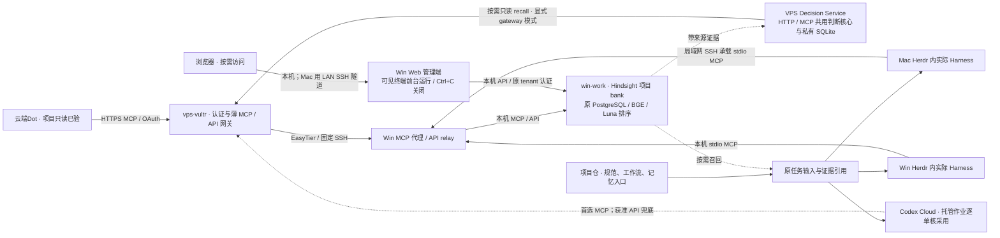

# Hindsight 项目共享记忆接入与实施

修订日期：2026-11-09。Mac／VPS 11 月 5 日部署对齐、读取、修复后的提取与来源读回已有回执；11 月 9 日 Decision Service 跨 bank 读取及 Win Luna 候选级拒答补丁已取得工程证据。各 Harness 和 Codex Cloud 托管作业的采用仍分别记录。公子授权由现有 Hindsight 实施会话主责、连通性维护会话协助，原审核窗口负责工程审核验收；复用 `vps-vultr` 与已有 VPS ↔ win-work EasyTier，将云端Dot和 Codex Cloud 纳入接入范围。[ADR-002](decisions/002-shared-project-memory.md)记录取舍；本页拥有合同、分工与验收要求，最近观测集中在[状态总表](status.md#当前结论)。

## 1. 目标与当前依据

同一项目跨机器、跨 Harness 使用同一份可检索经验。云端Dot保留确认后的目标与理由，下游按任务读取上下文，执行后沉淀带来源的经验。程序管理任务状态，项目负责人或指定验收者决定业务放行。记忆服务故障不阻止已有输入齐备的任务继续执行。

已有实施侧报告：Win 原生 Hindsight、PostgreSQL、BGE 服务及一次重启自启通过；Mac 经现有 SSH 可访问 Win；显式指定项目 bank 的代理正在接入各 Harness。这些是复用基线，不代表本次审核已独立验证全部客户端。DSH 已暂缓，QMD 与第二套记忆服务不在本轮范围。

公子后续明确：Mac Claude 与 Win Codex 排除本轮接入，DSH 继续暂缓；Win Codex 的排除不影响 Codex Cloud。Mac → Win 走既有局域网 SSH；VPS → Win 走 EasyTier。配置沿公子已建立的仓库 `.env` 入口维护，保留忽略规则、不提交私有值；分发仅提供模板和适用字段。

实际版本、入口、资源占用与客户端采用状态由实施者在[环境能力原卡](https://github.com/orgs/CF-FE/projects/6/views/3)维护。凭据、主机私有配置及原始输出留在运行端，仓库保存代码、模板、说明和可公开摘要。

## 2. 接入拓扑

所有 Agent 首选 MCP 记忆工具，包括云端Dot与 Codex Cloud。Mac 的 MCP 客户端配置使用 SSH 连接远端 stdio 服务，SSH 只承载协议数据；不是让模型临场执行 SSH 命令，也不把 Mac Agent 迁到 Win。云端首选 VPS HTTPS MCP。公子后续明确允许 Hindsight API 兜底，并要求较长超时和重试；该补充覆盖此前“只许 MCP”的限制。API 入口同样经已认证的 VPS 到原 Win 实例，不换项目、服务身份或数据库，采用方式明确记录。

- VPS复用既有 HTTPS／认证基础设施，在公子指定的 `create-network-sh/fastmcp/` 增加独立 Hindsight MCP 入口；优先经 EasyTier SSH 调用 Win 既有 stdio 代理，实现必要的 HTTP／stdio 适配。不复制数据库或运行第二套记忆模型，不占用信箱原路由。
- EasyTier已组网不等于应用端口已开放。核当前监听、方向与可达性后定向接通；若 Hindsight 仅监听 loopback，在已有代理与必要私网监听中选择最简方式，不同时新增两套通道。
- Mac保留已验证的 SSH 路径，不为本轮装 VPN；云端走 VPS HTTPS，不加入 EasyTier。地址、端口与连接参数在运行配置中维护，不硬编码进项目工作流。
- 复用认证能力但保留服务区分，不复制信箱凭据。先核客户端支持的认证方式，Bearer、OAuth 或适配以真实兼容性决定。直接代理不够时才加最薄的适配层，不重建平台。
- 代理保持必要 HTTP 方法、流式响应与协议头；只允许 GET 不等于“只读 MCP”，业务读写范围由工具与服务授权表达。

### Web 管理端：按需浏览和配置

官方 Control Plane 1.2.0 复用原 Win Hindsight API，启动脚本直接在可见终端前台运行并显示日志。公子明确要求不常驻：不配置开机启动、不隐藏后台、不设置守护或自动恢复；Ctrl+C 关闭 UI，保留现有 API、PostgreSQL 和 BGE。安装检查后默认关闭。

UI 监听 Win loopback；Mac 浏览经现有 LAN SSH 隧道，不走 VPS 或 EasyTier。后端凭据只由 UI 服务端读取，不在浏览器地址或前端配置中传递。页面具有原 tenant 身份允许的管理写权，保存、删除和触发提取由使用者主动操作；页面可浏览不代表写入提取成功。安装、脚本地址、端口配置、来源和卸载入口统一见[管理端说明](../mcp/hindsight-memory/control-plane/README.md)。

## 3. 项目身份与资料归属

每项目一个稳定 `project_id → bank_id` 映射，沿现有项目登记与仓库记忆入口维护。项目身份以原登记为准，bank 使用已装版本允许的稳定标识，例如 `fanren-work → cf-fe-fanren-work`。换机器、clone 或 Worker 不另建 bank。

项目内角色可用固定 bank 连接；跨项目入口显式传 bank。固定绑定或原任务提供项目；缺失时报告缺口，不静默写 `default`。bank 路由不代替认证与项目授权。

**Decision Service 跨 bank 读取已接入（2026-11-09 工程验证）。** 服务与调用入口的有效可读范围预先配置，调用时可从中选择本项目、共享及相关项目 bank；检索不是每次判断的必经步骤，输入足够时直接判断。实际部署使用 `gateway` 模式，经既有 VPS 网关、固定 SSH 与 Win MCP／API relay 访问原 Hindsight；`native` 是显式配置的原生适配选项，不自动探测或切换地址。一次真实双 bank 查询已取得带来源片段和最终判断，并完成同记录读回；该样本不证明长期相关性或自然业务效果。状态与原始拒答原因的 `UNKNOWN` 见[固定交付边界](https://github.com/CF-FE/decision-service/blob/2e5ff94021d76b89c3bce30c8df38c8702ba0a9e/docs/evidence-and-open-questions.md#当前交付边界)。

只读范围不因反馈而扩大：原执行器的 `application / result` 和带来源纠正直接进入 Decision Service 自己的 SQLite，沿同一事件／修订和原执行引用精确关联；原端保留待传与恢复，服务查询只读对账。该闭环不依赖 retain 写回、webhook、语义召回找全或其他 bank 写权。必要检索片段保留 bank、文档来源和可得观察时间；bank 清单与私有正文不进入公开文档。VPS 网关的 bank 范围与主体 mutations 分开检查，尚非逐 bank 的读写权限矩阵；后续写回／webhook 扩展仍由原维护者办理。[检索合同](https://github.com/CF-FE/decision-service/blob/2e5ff94021d76b89c3bce30c8df38c8702ba0a9e/docs/hindsight-integration.md) · [适配模式](https://github.com/CF-FE/decision-service/blob/2e5ff94021d76b89c3bce30c8df38c8702ba0a9e/docs/provider-integration.md#hindsight-vps-网关) · [消费者反馈](project-workflow-development.md#decision-feedback)

| 信息 | 原维护位置 | Hindsight 的用途 |
| --- | --- | --- |
| 正式规范、工作流、长期设计决定 | 项目仓库 | 可索引并保存原版本引用，原文只维护一处 |
| 经验、失败原因、历史背景、决定理由 | Hindsight | 带来源和观察时间供接手与判断 |
| 本次输入、输出、决定及待处理动作 | 原任务和执行检查点 | 只提炼可复用经验，不接管执行状态 |
| 有限判断、已收反馈修订与关联 | Decision Service 私有 SQLite | 仅在需要时提供带来源背景，不接管反馈接收或原端恢复 |
| 项目进展、正式验收 | GitHub Project／Issue 及验收原件 | 可留历史摘要，当前结论沿原件确认 |
| 投递与结果回传 | 原 Task Mailbox／桥 | 保存关联，不新增一套传输或 ACK 状态 |

仓库已有 README、AGENTS 或记忆文件继续作为短入口，补 bank 映射、规范与任务引用，不逐条复制经验，不双向自动改写。现有 workflow `start` 固定的是入口文件摘要，不是整个 bank 的版本。实际采用的召回摘要及来源留在本次输入／检查点，不改变在途运行定义。

### 三层模型与凭据边界

| 用途 | 当前采用及边界 |
| --- | --- |
| Decision Service 业务判断 | 服务自己的 Luna 根据合法候选作有限判断；服务独立凭据，输出由原 workflow／角色创建者采用 |
| Win Hindsight 内部处理 | recall／consolidation 使用独立配置的 Luna；recall 已应用本仓候选级拒答补丁。reflect 及普通 LLM 沿原路径，普通 LLM 密钥独立保留 |
| 执行角色实际模型 | 由原创建者按宿主能力应用并读回；`gpt-6.1-sol / low` 是专用工程样例，不是所有角色的默认配置 |

三者不组成一个共享模型服务，也不合并密钥。11 月 9 日 Win 补丁保留 Luna 正常答案、仅排除明确拒答候选；正常零概率仍有效，全拒答仍失败。Q8 备选试验已经结束并恢复 Luna，未启用自动 Q8 切换；触发拒答的原因仍未知。内部模型、补丁与拒答的详细说明归[Decision Service 文档 v1.2](https://github.com/CF-FE/decision-service/blob/2e5ff94021d76b89c3bce30c8df38c8702ba0a9e/docs/hindsight-decision-models.md)，本仓拥有[Win 补丁材料](../mcp/hindsight-memory/decision-reranker/README.md)。

## 4. 角色使用规则

| 角色 | 读取 | 写入与责任 |
| --- | --- | --- |
| 云端Dot | 需求背景、历史取舍、相关经验 | 公子确认的目标、约束、需求变更与理由；探索提案注明未确认。向公子汇报，不签业务验收 |
| 协调员 | 项目关系、跨环境经验、交接背景 | 协调经验与交接摘要；当前负责人仍查原绑定 |
| 项目负责人 | 项目历史、业务规范、生产经验 | 项目决定、验收依据、可复用经验；维护记忆入口与重大更正 |
| Worker／Codex Cloud | 当前任务所需上下文 | 实际发现、有效方法、失败原因和证据；不将自检写成负责人验收 |

普通经验直接贡献，不逐条要求人工或负责人批准；正式规范与业务验收沿原责任。只传任务相关摘要和证据引用，不因接入而复制原始音视频、凭据或无关会话。

Herdr承载角色，MCP／Skill配置到实际 Harness。Decision Service 插件与 Skill 由其主仓维护；它的 Cloud Skill 显式加载成功不代证 Hindsight Cloud Skill 已打包或所有客户端已采用。已有会话可能有启动覆盖或需重启，只在自然创建／恢复时采用，不为验证工具打断生产。云端Dot和 Codex Cloud 分别取证，不用本机 CLI 成功代证。

## 5. 最小调用合同与弱连接

默认使用已装版本支持的 `recall`／`retain`，不每轮强制调用，不默认用 `reflect` 重做决策。Skill规定时机，客户端／薄适配层处理配置、关联与有界重试，不新增记忆协调员。

1. **读取：**接手、自然恢复或出现历史上下文缺口时按问题召回，带来源与观察时间；得到必要依据后继续，不灌入全库。
2. **随任务交付：**必要背景、来源与采集时间成为原任务输入，保存在原产物位置。它不是另一套长期记忆。输入齐备时无网络也可按检查点继续。
3. **写入：**重要决定、单元结束或发现经验时写。至少保留项目、原任务／事件、报告者、观察时间、来源、结论与未确认项；用现有 metadata／tags，不另建通用业务协议。
4. **避免重复：**同一来源修订沿稳定 `document_id` 与内容摘要处理，已确认相同内容不再提取。不同写者／独立事件用不同来源 ID，避免互相覆盖；修订说明替代范围。原生去重以已装版本为准，不承诺通用 exactly-once。
5. **故障：**调用有界返回。召回失败沿任务输入、项目源码和原件继续，仅缺必要依据的决定点等待。写失败在原任务保存待补项或可再次导入摘要，恢复后补传，不另建任务总线、永久重试程序或云端已读门槛。
6. **更正：**记录更正与原来源；准确命令、路径或任务 ID 查源记录。生成摘要或推断不自行改规范、派任务或重决在途批次。

### 弱连接的超时、重试与 API 兜底

本轮稳定性优化仅针对 `vps-vultr ↔ win-work`。Mac ↔ Win 为局域网，保持既有连接和参数，不纳入弱连接排查或额外改造。先读取两端 EasyTier 的相关日志及 peer 状态，区分主机／服务重启、链路断连、路径变化、SSH 会话中断与上游处理慢；基于证据调整已有连接恢复机制，不先猜测修改 MTU、路由或升级。

VPS 侧采用较长超时、有界重试和 API 兜底，不扩建缓存／后台队列系统。原任务保留必要上下文与待补摘要即可。以下是 VPS ↔ Win 调用的可配置初始值，不是平台时限或性能承诺；实施者按实际客户端上限调整并记录。

| 参数 | 初始值与约束 |
| --- | --- |
| 连接超时 | 15 秒，避免长时间等一个根本未建立的连接 |
| 单次工具请求 | 最多 90 秒；包含本次连接及上游处理，受总预算约束 |
| 总调用预算 | 最多 180 秒，含重连、退避与 API 切换；云端平台更短上限优先 |
| 自动重试 | 默认最多 2 次尝试（首次 + 1 次重试或 API 切换）；间隔 2–5 秒并加少量抖动，剩余预算不足不再开始 |

云端请求的上游重试由 VPS 适配层负责；入口本身不可达时，客户端只在同一截止时间内恢复该次入口调用，不能另获整套上游预算。Mac 本地路径不新增重试层。客户端、VPS、SSH、SDK 不各自叠加。只对暂时连接错误及已识别的可恢复上游错误重试；身份、权限、项目或参数错误直接回报，限流按服务提示与剩余预算处理。

读取可直接重试。写入沿稳定来源／文档 ID 与内容摘要；部署版本支持预置 operation ID 时优先用服务原生去重，已取得操作 ID 就查询原操作，不重新启动提取。响应丢失时先核原记录，低成本且已确认可幂等的同一经验写入可有限重放，不建通用分布式事务；结果无法确认则保存原任务待核，不能把本地暂存称为 Hindsight 已入库。优先使用已装版本支持的异步写入，提交与索引完成分别记录，模型提取不必占住整条工具连接。

API 兜底针对 MCP 发现、协议或会话故障，或已核实当前宿主没有可用 MCP 接入口。它仍访问同一个 Win 服务：如果 EasyTier、Win 或 Hindsight 本身不可用，换协议不会恢复网络，不再机械切换后耗一整轮预算。底层 API 路由及认证由两位实施者核定；若仍封装原 SSH 路径，需准确说明只绕过了哪一层，不能声称有独立网络兜底。平台当前无法安全调用 API 时明确留下缺口，不以本地调用替代。

当前已验证的 SSH／stdio 路径先保留。若这层实测成为瓶颈，可比较 Hindsight 原生 HTTP MCP／API 经 EasyTier 的路径，仅在部署版本、鉴权和 bank 行为核对后简化，不为潜在优化重建已工作的 Mac 通道。BGE 占用登记到 Win 原能力卡，不新建 GPU 调度系统。

## 6. 实施顺序与写入分工

本节保留 11 月 5 日接入工作的分工和验收要求，不作为新的部署授权。原任务为 [Issue #13](https://github.com/CF-FE/herdr-4-codexcloud/issues/13)。本页编号用于合同引用，不是第二份实时队列；执行进展及验收待项沿该 Issue 回填，审核窗口收回证据。两个既有工程会话承担本次开发协作，不重新任命组织角色。

| 工作包 | 执行者与写入归属 | 输入、动作与交付 |
| --- | --- | --- |
| M1 合同与本地接入 | Hindsight主实施者；Win服务、代理、Harness配置、Skill | 复用部署和Mac SSH；完成稳定bank、按需读写、更正与待补；交源码、模板、实际入口和客户端矩阵 |
| M2 公网入口 | 连通性协助者独占 `create-network-sh/fastmcp/` 对应服务及 `vps-vultr` 部署 | 以M1 Win stdio／上游合同配置独立HTTPS MCP，经既有EasyTier SSH转发；交地址、认证合同、持久启动和撤回方法。Win服务变更由主实施者办理 |
| M3 云端采用 | 主实施者负责云端Dot；协助者负责Codex Cloud环境 | 首选原生 MCP；有明确故障或宿主入口缺口时用已授权 API 兜底，分别记录实际模式。两端均需原生云端执行证据，不用本机请求代证，不把 API 成功称为 MCP 已验 |
| M4 统一审核验收 | 原审核窗口 | 审代码、真实调用、来源和故障行为；复用未变更基线，本轮改变的部署或启动链只补最小验证，不重跑生产流程 |

本仓维护协议、Win／本地客户端适配与可分发 Skill，按实际分发需要归入 `mcp/hindsight-memory/`、`skill/hindsight-memory/`。VPS 服务源码与部署按公子明确指定放在 [create-network-sh/fastmcp/hindsight-memory](https://github.com/ghyghoo8/create-network-sh/tree/main/fastmcp/hindsight-memory)，该既有仓实际 owner 为 `ghyghoo8`，不因组织默认规则自动迁移。上游引擎仍归 [vectorize-io/hindsight](https://github.com/vectorize-io/hindsight)；本仓维护接入和补丁，不复制维护整套引擎。已有实现先核归属和固定来源，避免临时脚本成为唯一维护源；跨仓只固定版本引用，不导入共享运行目录。网络规范仍在[网络文档](networking-plan.md)。

主实施者负责本仓实现分支及整合，协助者负责指定部署仓的独立提交，两者以固定接口和版本交付，避免同时切共享 checkout 分支。审核窗口先交文档与 ADR，之后退出实现文件写入，复审问题交原写者修正。

原实施依赖为 M2 配置等 M1 上游合同、M3 实际采用等 M2 入口。已有入口、客户端样本及后续 Decision Service 跨 bank 证据见[状态总表](status.md#当前结论)；各 Harness 的实际加载、完整 Cloud 作业采用和长期运行仍分别取证，不由一个入口成功代证整条业务链。若必须由公子在账号界面完成一次安装／授权，实施者先备具体连接信息，审核窗口说明唯一必要动作；不要求公子转发业务消息。普通配置、诊断与修复沿本次有效授权推进。

## 7. 集中验收与交付

| 验收项 | 通过依据 |
| --- | --- |
| 公网路径 | 实际请求经 `vps-vultr` 和EasyTier到原Win实例；认证有效、信箱原路由不受影响 |
| 云端Dot | 原生执行实际读取项目记忆并写入一条已确认、带来源的自然决定；服务端能关联来源。记录 MCP 或 API 兜底模式及原因 |
| Codex Cloud | 真实 Cloud 任务通过 VPS 取得项目上下文并回收相关经验；记录环境版本、原生调用与来源。MCP 优先，API 兜底采用与 MCP 待验边界分开 |
| 本地Harness | 同项目实际接手者召回上述来源；矩阵区分已配置、当前会话发现、调用通过，未采用端明确列出 |
| Web 管理端 | 前台脚本可启动并显示已有 bank／配置／操作，Ctrl+C 只关闭 UI，原后端继续运行；不为验证创建记忆或配置自启 |
| 弱连接 | 隔离输入覆盖一次暂时故障后恢复及预算耗尽，核重试不叠加、写入不重新派业务、API 切换不重置预算；已有确定步骤继续。不停止生产服务制造故障 |
| 原件与职责 | 召回可追溯来源；状态、进展与验收沿原记录，无新增业务派发或已读门槛 |

优先用下一条自然开发／业务任务取得跨端证据，不重派凡人听检、不生成音频、不测云端定时。没有自然Cloud作业时保留该项待验并交审核安排，不以本机测试替代。代码变更运行本仓结构检查和单测；文档变更不新写测试。

交付包括仓库／分支／提交、源码与部署版本对应、脱敏配置、启动／升级／恢复／撤回、客户端矩阵、证据及未验项责任人。撤回新增入口或客户端配置时保留记忆和业务检查点，不回滚其他在途工作。文档采纳、代码完成、部署、实际采用、工程验收分开记录。

## 8. 来源与版本核对

- [Hindsight MCP与bank](https://hindsight.vectorize.io/developer/mcp-server)、[retain](https://hindsight.vectorize.io/developer/api/retain)、[recall](https://hindsight.vectorize.io/developer/api/recall)。公开文档可能领先部署，字段和认证以已装版本为准。
- [ChatGPT自定义MCP](https://developers.openai.com/plugins/build/app-quickstart#connect-your-mcp-server-in-chatgpt)、[Codex Cloud服务接入](https://learn.chatgpt.com/docs/environments/cloud-environments#connect-to-services)。普通调用与事件订阅分开，本轮不建设事件唤醒。
- [项目工作流与记忆](project-workflow-development.md#执行权和记忆在哪里)、[动态信息归属](coordination-policy.md#dynamic-records)、[既有网络路径](networking-plan.md)。
