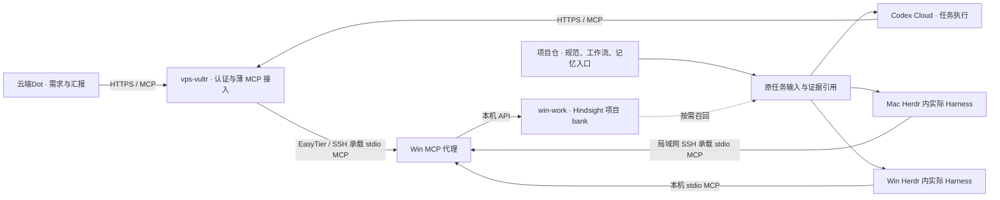

# Hindsight 项目共享记忆接入与实施

2026-11-05 · 方案已采纳，实施与验收分别记载。公子授权由现有 Hindsight 实施会话主责、连通性维护会话协助，原审核窗口负责工程审核验收；复用 `vps-vultr` 与已有 VPS ↔ win-work EasyTier，将云端Dot和 Codex Cloud 纳入接入范围。[ADR-002](decisions/002-shared-project-memory.md)记录取舍；本页拥有合同、分工与验收要求。

## 1. 目标与当前依据

同一项目跨机器、跨 Harness 使用同一份可检索经验。云端Dot保留确认后的目标与理由，下游按任务读取上下文，执行后沉淀带来源的经验。程序管理任务状态，项目负责人或指定验收者决定业务放行。记忆服务故障不阻止已有输入齐备的任务继续执行。

已有实施侧报告：Win 原生 Hindsight、PostgreSQL、BGE 服务及一次重启自启通过；Mac 经现有 SSH 可访问 Win；显式指定项目 bank 的代理正在接入各 Harness。这些是复用基线，不代表本次审核已独立验证全部客户端。DSH 已暂缓，QMD 与第二套记忆服务不在本轮范围。

公子后续明确：Mac Claude 与 Win Codex 排除本轮接入，DSH 继续暂缓；Win Codex 的排除不影响 Codex Cloud。Mac → Win 走既有局域网 SSH；VPS → Win 走 EasyTier。配置沿公子已建立的仓库 `.env` 入口维护，保留忽略规则、不提交私有值；分发仅提供模板和适用字段。

实际版本、入口、资源占用与客户端采用状态由实施者在[环境能力原卡](https://github.com/orgs/CF-FE/projects/6/views/3)维护。凭据、主机私有配置及原始输出留在运行端，仓库保存代码、模板、说明和可公开摘要。

## 2. 接入拓扑

Agent 调用的始终是 MCP 记忆工具，包括云端Dot与 Codex Cloud。Mac 的 MCP 客户端配置使用 SSH 连接远端 stdio 服务，SSH 只承载协议数据；不是让模型临场执行 SSH 命令，也不把 Mac Agent 迁到 Win。两种云端角色统一使用 VPS 的 HTTPS MCP 入口，由入口完成必要的传输适配。Hindsight API 仅是 MCP 服务内部上游，不提供 Agent 直接 API／SDK 的替代路线。

- VPS复用既有 HTTPS／认证基础设施，在公子指定的 `create-network-sh/fastmcp/` 增加独立 Hindsight MCP 入口；优先经 EasyTier SSH 调用 Win 既有 stdio 代理，实现必要的 HTTP／stdio 适配。不复制数据库或运行第二套记忆模型，不占用信箱原路由。
- EasyTier已组网不等于应用端口已开放。核当前监听、方向与可达性后定向接通；若 Hindsight 仅监听 loopback，在已有代理与必要私网监听中选择最简方式，不同时新增两套通道。
- Mac保留已验证的 SSH 路径，不为本轮装 VPN；云端走 VPS HTTPS，不加入 EasyTier。地址、端口与连接参数在运行配置中维护，不硬编码进项目工作流。
- 复用认证能力但保留服务区分，不复制信箱凭据。先核客户端支持的认证方式，Bearer、OAuth 或适配以真实兼容性决定。直接代理不够时才加最薄的适配层，不重建平台。
- 代理保持必要 HTTP 方法、流式响应与协议头；只允许 GET 不等于“只读 MCP”，业务读写范围由工具与服务授权表达。

## 3. 项目身份与资料归属

每项目一个稳定 `project_id → bank_id` 映射，沿现有项目登记与仓库记忆入口维护。项目身份以原登记为准，bank 使用已装版本允许的稳定标识，例如 `fanren-work → cf-fe-fanren-work`。换机器、clone 或 Worker 不另建 bank。

项目内角色可用固定 bank 连接；跨项目入口显式传 bank。固定绑定或原任务提供项目；缺失时报告缺口，不静默写 `default`。bank 路由不代替认证与项目授权。

| 信息 | 原维护位置 | Hindsight 的用途 |
| --- | --- | --- |
| 正式规范、工作流、长期设计决定 | 项目仓库 | 可索引并保存原版本引用，原文只维护一处 |
| 经验、失败原因、历史背景、决定理由 | Hindsight | 带来源和观察时间供接手与判断 |
| 本次输入、输出、决定及待处理动作 | 原任务和执行检查点 | 只提炼可复用经验，不接管执行状态 |
| 项目进展、正式验收 | GitHub Project／Issue 及验收原件 | 可留历史摘要，当前结论沿原件确认 |
| 投递与结果回传 | 原 Task Mailbox／桥 | 保存关联，不新增一套传输或 ACK 状态 |

仓库已有 README、AGENTS 或记忆文件继续作为短入口，补 bank 映射、规范与任务引用，不逐条复制经验，不双向自动改写。现有 workflow `start` 固定的是入口文件摘要，不是整个 bank 的版本。实际采用的召回摘要及来源留在本次输入／检查点，不改变在途运行定义。

## 4. 角色使用规则

| 角色 | 读取 | 写入与责任 |
| --- | --- | --- |
| 云端Dot | 需求背景、历史取舍、相关经验 | 公子确认的目标、约束、需求变更与理由；探索提案注明未确认。向公子汇报，不签业务验收 |
| 协调员 | 项目关系、跨环境经验、交接背景 | 协调经验与交接摘要；当前负责人仍查原绑定 |
| 项目负责人 | 项目历史、业务规范、生产经验 | 项目决定、验收依据、可复用经验；维护记忆入口与重大更正 |
| Worker／Codex Cloud | 当前任务所需上下文 | 实际发现、有效方法、失败原因和证据；不将自检写成负责人验收 |

普通经验直接贡献，不逐条要求人工或负责人批准；正式规范与业务验收沿原责任。只传任务相关摘要和证据引用，不因接入而复制原始音视频、凭据或无关会话。

Herdr承载角色，MCP／Skill配置到实际 Harness。已有会话可能有启动覆盖或需重启，只在自然创建／恢复时采用，不为验证工具打断生产。云端Dot和 Codex Cloud 分别取证，不用本机 CLI 成功代证。

## 5. 最小调用合同与弱连接

默认使用已装版本支持的 `recall`／`retain`，不每轮强制调用，不默认用 `reflect` 重做决策。Skill规定时机，客户端／薄适配层处理配置、关联与有界重试，不新增记忆协调员。

1. **读取：**接手、自然恢复或出现历史上下文缺口时按问题召回，带来源与观察时间；得到必要依据后继续，不灌入全库。
2. **随任务交付：**必要背景、来源与采集时间成为原任务输入，保存在原产物位置。它不是另一套长期记忆。输入齐备时无网络也可按检查点继续。
3. **写入：**重要决定、单元结束或发现经验时写。至少保留项目、原任务／事件、报告者、观察时间、来源、结论与未确认项；用现有 metadata／tags，不另建通用业务协议。
4. **避免重复：**同一来源修订沿稳定 `document_id` 与内容摘要处理，已确认相同内容不再提取。不同写者／独立事件用不同来源 ID，避免互相覆盖；修订说明替代范围。原生去重以已装版本为准，不承诺通用 exactly-once。
5. **故障：**调用有界返回。召回失败沿任务输入、项目源码和原件继续，仅缺必要依据的决定点等待。写失败在原任务保存待补项或可再次导入摘要，恢复后补传，不另建任务总线、永久重试程序或云端已读门槛。
6. **更正：**记录更正与原来源；准确命令、路径或任务 ID 查源记录。生成摘要或推断不自行改规范、派任务或重决在途批次。

超时和召回大小沿现有客户端合理默认及实测配置，出现明显延迟再调整。BGE占用登记到 Win 原能力卡，派发时沿既有入口核资源，不新建 GPU 调度系统。

## 6. 实施顺序与写入分工

一个原任务／Issue管理执行状态。本页编号用于合同引用，不是第二份实时队列。主实施者查重并建立本仓原任务，将链接回填本页；审核窗口收回证据。两个既有工程会话承担本次开发协作，不重新任命组织角色。

| 工作包 | 执行者与写入归属 | 输入、动作与交付 |
| --- | --- | --- |
| M1 合同与本地接入 | Hindsight主实施者；Win服务、代理、Harness配置、Skill | 复用部署和Mac SSH；完成稳定bank、按需读写、更正与待补；交源码、模板、实际入口和客户端矩阵 |
| M2 公网入口 | 连通性协助者独占 `create-network-sh/fastmcp/` 对应服务及 `vps-vultr` 部署 | 以M1 Win stdio／上游合同配置独立HTTPS MCP，经既有EasyTier SSH转发；交地址、认证合同、持久启动和撤回方法。Win服务变更由主实施者办理 |
| M3 云端采用 | 主实施者负责云端Dot；协助者负责Codex Cloud环境 | 复用插件／环境的 MCP 配置入口；各端实际发现并调用同项目记忆工具。不以本地请求、curl 或直接 API／SDK 替代云端 MCP 采用 |
| M4 统一审核验收 | 原审核窗口 | 审代码、真实调用、来源和故障行为；复用未变更基线，本轮改变的部署或启动链只补最小验证，不重跑生产流程 |

本仓维护协议、Win／本地客户端适配与可分发 Skill，按实际分发需要归入 `mcp/hindsight-memory/`、`skill/hindsight-memory/`。VPS 服务源码与部署按公子明确指定放在 [create-network-sh/fastmcp](https://github.com/ghyghoo8/create-network-sh/tree/main/fastmcp)，该既有仓实际 owner 为 `ghyghoo8`，不因组织默认规则自动迁移。已有实现先核归属和固定来源，避免临时脚本成为唯一维护源；跨仓只固定版本引用，不导入共享运行目录。网络规范仍在[网络文档](networking-plan.md)。

主实施者负责本仓实现分支及整合，协助者负责指定部署仓的独立提交，两者以固定接口和版本交付，避免同时切共享 checkout 分支。审核窗口先交文档与 ADR，之后退出实现文件写入，复审问题交原写者修正。

M1与M2只读核对可并行，M2配置等M1上游合同，M3真实采用等M2入口。服务与EasyTier是有效起点；云端账号工具准入、认证兼容、实际Cloud环境仍待核明，不声称整条链已通过。若必须由公子在账号界面完成一次安装／授权，实施者先备具体连接信息，审核窗口说明唯一必要动作；不要求公子转发业务消息。普通配置、诊断与修复沿本次有效授权推进。

## 7. 集中验收与交付

| 验收项 | 通过依据 |
| --- | --- |
| 公网路径 | 实际请求经 `vps-vultr` 和EasyTier到原Win实例；认证有效、信箱原路由不受影响 |
| 云端Dot | 原生工具实际读取本项目记忆，写入一条已确认且带来源的自然需求／决定；服务端能关联同一来源 |
| Codex Cloud | 一个真实 Cloud 任务发现并调用 VPS 的 MCP 记忆工具，取得项目上下文并完成任务相关经验回收；记录环境版本、原生工具活动和来源 |
| 本地Harness | 同项目实际接手者召回上述来源；矩阵区分已配置、当前会话发现、调用通过，未采用端明确列出 |
| 记忆不可达 | 隔离客户端模拟一次不可达，输入齐备的确定步骤继续、待补摘要可保存；不停止生产服务制造故障 |
| 原件与职责 | 召回可追溯来源；状态、进展与验收沿原记录，无新增业务派发或已读门槛 |

优先用下一条自然开发／业务任务取得跨端证据，不重派凡人听检、不生成音频、不测云端定时。没有自然Cloud作业时保留该项待验并交审核安排，不以本机测试替代。代码变更运行本仓结构检查和单测；文档变更不新写测试。

交付包括仓库／分支／提交、源码与部署版本对应、脱敏配置、启动／升级／恢复／撤回、客户端矩阵、证据及未验项责任人。撤回新增入口或客户端配置时保留记忆和业务检查点，不回滚其他在途工作。文档采纳、代码完成、部署、实际采用、工程验收分开记录。

## 8. 来源与版本核对

- [Hindsight MCP与bank](https://hindsight.vectorize.io/developer/mcp-server)、[retain](https://hindsight.vectorize.io/developer/api/retain)、[recall](https://hindsight.vectorize.io/developer/api/recall)。公开文档可能领先部署，字段和认证以已装版本为准。
- [ChatGPT自定义MCP](https://developers.openai.com/plugins/build/app-quickstart#connect-your-mcp-server-in-chatgpt)、[Codex Cloud服务接入](https://learn.chatgpt.com/docs/environments/cloud-environments#connect-to-services)。普通调用与事件订阅分开，本轮不建设事件唤醒。
- [项目工作流与记忆](project-workflow-development.md#执行权和记忆在哪里)、[动态信息归属](coordination-policy.md#dynamic-records)、[既有网络路径](networking-plan.md)。
