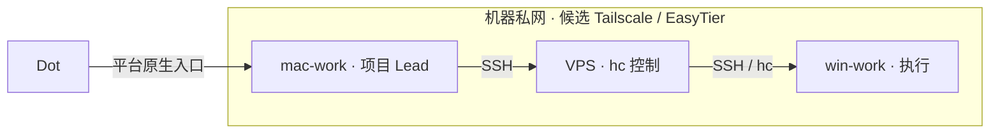

# 三机组网方案与选型对照

版本：0.2；调研／修订日期：2026-11-01（Asia/Shanghai）。适用链路为 **Dot → mac-work 项目 Lead → VPS／hc → win-work／其他执行机**，服务于多个项目同时推进。本文集中维护网络选型、连通边界和对照方法；整体职责与组件归属见[架构](architecture.md#各端组件清单)，当前实际状态只记在[本仓状态](status.md)。

**当前范围只比较 Mac、VPS、Win 三机；按公子确认，暂不考虑 Codex Cloud 连接 VPN。** Cloud 继续作为独立 Worker，沿既定仓库与获准工具路径协作；其 VPN 提供方不计入本轮选型权重、组件准备、成本或验收，也不预建双网桥。

**当前建议仍为对照试点：Tailscale 作为已记录的候选基线，EasyTier 作为对照候选，尚未确定主选。** EasyTier 的主要增量是可自主运行发现与中继、减少托管控制平面依赖；Tailscale 的优势是身份与策略集中管理。排除 Cloud VPN 后，两者在目标三机的连通、性能及维护工作仍未实测，暂不能判断谁更适合。本文不授权安装、入网、开放端口或执行测试。

## 1. 本次采用评估

| 项目 | 判断及依据 |
| --- | --- |
| 能力与目标 | EasyTier 替代候选 Tailscale 网络层，改善三机可达性、连接稳定性与可维护性；保留系统 SSH 和 hc 控制 |
| 当前基线 | 仓库已记录 Tailscale 候选，尚无已部署网络可迁移；不能虚构切换成本，也不能虚构现网性能问题 |
| 增量价值 | **MEDIUM，置信度中等**：自管节点与路径选择有具体价值；更高直连率、更低延迟及更低资源占用仍为 UNKNOWN |
| 总成本 | **MEDIUM，置信度中等**：一次性准备三机节点身份、策略和服务；持续维护密钥／凭据、配置分发、升级、备份和恢复；不计 Cloud VPN 适配 |
| 净结果 | **UNCERTAIN**：自主性收益与持续维护成本尚无目标环境证据可比较 |
| 单一建议 | **PILOT**：后续获准时进行隔离、可撤回的对照，不直接切换生产或并行双控 |
| 关键未知 | 三端 OS／版本、现有 VPN／代理、VPS 线路与带宽、实际直连／中继路径、固定构建 ACL 行为及私网使用频率 |

本评估是针对当前协作链路的取舍，以下表格中的“更省维护／更自主”是设计判断，不是三机实测结果。

## 2. 共同拓扑与分层

图中两段是**业务调用与授权边界**，不是要求所有 IP 流量经过 VPS。两种 Mesh 网络都不能由“已入网”推出“只允许两段 SSH”；需明确放行源身份、目标与实际 SSH 端口，并核回程与拒绝路径。Mac → Win 直接控制不在默认范围；VPS 是否另作发现／中继是网络职责，不自动取得新的派发权。

| 层 | 解决什么 | 不代替什么 |
| --- | --- | --- |
| Tailscale／EasyTier | 机器可达、加密隧道、路由与网络访问策略 | SSH 登录身份、目录权限和任务授权 |
| 系统 OpenSSH | 登录、远端命令和所需文件传输 | Agent 协调、任务幂等和产物验收 |
| hc | 沿既定入口控制机器与原执行、查询结果 | 跨项目业务决策或第二套正式任务记录 |
| Dot／项目 Lead | 沿获准入口规划、委派、回收与组织复核 | 安装软件即取得新权限，或 UNKNOWN 自动重派 |

不要求同一物理局域网。模型、原件和大产物继续在获准执行机保管；网络选型不改变单写、原任务对账和业务验收规则。多个项目共享同一 Win 节点时，网络规则不能自动隔离同一 sshd 后面的文件和进程；项目账号、目录、凭证与工作区仍按原任务区分，不预建“每项目一套 VPN”。

## 3. EasyTier 与 Tailscale 对照

| 维度 | Tailscale 候选基线 | EasyTier 对照候选 | 对我们的影响 |
| --- | --- | --- | --- |
| 三机平台 | 有 Mac／Windows／Linux 客户端 | 同样支持三端、CLI／GUI 与系统服务 | 都能作为候选，发行包存在不代表目标端运行通过。[EasyTier 平台说明](https://github.com/EasyTier/EasyTier#core-features) |
| 控制与发现 | 托管身份／控制平面，管理台维护网络策略 | 可按独立配置连接已知节点，不强制使用 Web 管理台 | EasyTier 自主性较高，相应服务、密钥与恢复由我们维护。[去中心化组网](https://easytier.cn/en/guide/network/decentralized-networking.html) |
| 直连与中继 | 尽量直连；可用自建 peer relay，之后回退 DERP | NAT 打洞、直连及节点中继，可自建初始连接节点 | 不能简化成“EasyTier 自建、Tailscale 只能海外中继”。实际路径决定性能。[Tailscale peer relay](https://tailscale.com/docs/features/peer-relay)、[EasyTier 组网](https://github.com/EasyTier/EasyTier#quick-networking-with-shared-nodes) |
| 身份与退出 | 集中设备身份、授权与删除设备流程 | 传统网络共享主密钥；Secure Mode 可给临时节点独立凭据、TTL 与撤销 | EasyTier 不是没有逐设备手段，但需我们安排凭据持久化、续期、撤销与回读。[删除 Tailscale 设备](https://tailscale.com/docs/features/access-control/device-management/how-to/remove)、[EasyTier 安全模式](https://easytier.cn/en/guide/network/secure-mode.html) |
| 访问策略 | Grants 可按源、目标、协议和端口表达 | ACL 支持 IP、协议、端口、组与入站／出站／转发链 | 两者都需显式策略；EasyTier 传统组定义还涉及相关节点配置一致性。[Grants](https://tailscale.com/docs/features/access-control/grants)、[EasyTier ACL](https://easytier.cn/en/guide/config/acl.html) |
| 开箱默认 | 新 tailnet 初始 allow-all，需收紧 | 稳定源码无对应 ACL 链时默认 Allow；默认可为其他虚网转发 | 两者都不能把“连上”当权限验收；EasyTier 还须明确私有／外网转发边界。[Tailscale 初始策略](https://tailscale.com/docs/reference/examples/acls#allow-all-default-acl)、[EasyTier 默认 ACL](https://github.com/EasyTier/EasyTier/blob/8428a89d2dabc94c97d370ec607c6ca142473626/easytier/src/common/acl_processor.rs#L280-L312)、[共享节点边界](https://easytier.cn/en/guide/network/host-public-server.html#disable-forwarding) |
| 协议与优化 | 按原生直连／中继机制采用 | 提供多种传输及 KCP／QUIC 等可调项 | 选项多也增加定位与维护工作，不默认全开；当前两条 SSH 边都包含 VPS，更强双 NAT 打洞不直接等于主路径更快。[EasyTier 配置](https://easytier.cn/en/guide/network/configurations.html) |
| VPS 开销与费用 | 普通节点与自建中继的负载分开；账号方案／额度按实际核验 | 节点、发现与实际中继负载分开；自建服务与流量由我们承担 | 都需核带宽、流量、CPU、内存与日志；不编造最低配置或免费额度。VPS 可升级，不是必然阻塞点 |
| Dot 影响 | 可只用私网，保留原公网路径 | 同样可不采用出口、子网代理或 Magic DNS | 两者都须核 DNS／路由与既有 VPN；“换产品”不能保证 Dot 零影响，见下节 |

**公平的对照是“托管 Tailscale，必要时自建 peer relay”与“自管 EasyTier 私有节点”**，而不是拿一套精调自建网络与另一套未知公共中继路径比较。Tailscale peer relay 另需满足版本、UDP 可达、授权和带宽条件，不把它当已部署或必需组件。

## 4. 两套候选的最小准备范围

| 位置／事项 | A：Tailscale | B：EasyTier |
| --- | --- | --- |
| mac-work | 客户端、获准设备身份、两段策略所需配置 | 对应客户端、固定不冲突虚拟地址、节点身份与策略 |
| VPS | 客户端；仅有具体需要时增加获准 peer relay | core 节点可兼任初始连接点／受控中继；不为三机起步增加 Web 管理台或数据库 |
| win-work | 客户端，保留原制作环境 | 匹配系统架构的客户端、发布包所需驱动／DLL，保留原制作环境 |
| SSH 与 hc | 复用已有合适组件 | 同样复用，不由 EasyTier 替代 |
| 网络调整 | 按实际尾网策略与客户端能力准备 | 按固定版本明确监听协议、端口、private mode 与外网转发限制 |
| 持久运行 | 身份、策略、服务与恢复责任 | 另明确私密配置、固定密钥／凭据库、分发、升级和备份责任 |

SSH 归属仍为 Mac 客户端、VPS 客户端＋服务端、Win 服务端；细节只维护在[SSH 依赖说明](architecture.md#ssh-依赖与已有组件复用)。本轮不准备 Cloud 的 VPN／SSH 接入，不以云端是否支持某个 VPN 作为三机采用条件；未来出现实际依赖时再就该需求评估。

A 方案使用普通 OpenSSH over Tailscale IP，不随入网启用另一个名为 Tailscale SSH 的认证／授权功能；该功能也不能替代 Windows OpenSSH Server。B 方案同样不替代系统 SSH，两方案均保留原 SSH 身份与校验方式。[Tailscale SSH 的区别与平台限制](https://tailscale.com/docs/features/tailscale-ssh#how-is-tailscale-ssh-different)

## 5. 版本、安全与维护取舍

2026-11-01 查询官方发行元数据：`releases/latest` 返回 **v2.6.4，非预发布**，发布日期 2026-05-12；tag 指向 `8428a89d2dabc94c97d370ec607c6ca142473626`。**v2.7.0 仍标为 Pre-release**；其中新增中心化网络管理、运行时 ACL 替换等能力，不能写成稳定版现成能力。主分支快照为 `24e0303fc55e4e645a11818954dd5b712fb94510`，官网手册随开发变化；本文未下载、安装或运行任何发行包。[v2.6.4](https://github.com/EasyTier/EasyTier/releases/tag/v2.6.4)、[v2.7.0 预发布](https://github.com/EasyTier/EasyTier/releases/tag/v2.7.0)

EasyTier 候选须注意三个具体问题：

1. **私用边界需显式配置。** 固定稳定源码默认 `private_mode=false`、转发白名单为 `*`；仅填网络名和密码不等于关闭其他虚网转发。后续应按目标版本明确只服务获准网络、必要监听范围和转发负载，不把 VPS 默认贡献为社区公共节点。[固定默认配置](https://github.com/EasyTier/EasyTier/blob/8428a89d2dabc94c97d370ec607c6ca142473626/easytier/src/common/config.rs#L31-L72)
2. **安全模式不等于已完成身份管理。** 稳定源码已包含 Secure Mode 和 credential 参数；普通节点仍涉及主密钥，临时节点可用逐设备凭据。独立会话加密、凭据撤销和中继公钥 pinning 各有作用；管理员的凭据库及中继固定私钥需持久保管，不能只把一个共享密码发给所有 Worker。[固定 CLI 参数](https://github.com/EasyTier/EasyTier/blob/8428a89d2dabc94c97d370ec607c6ca142473626/easytier/src/core.rs#L684-L720)、[安全模式机制](https://easytier.cn/en/guide/network/secure-mode.html)
3. **隔离能力要核具体构建。** 官方 PR #2570 修复双方交替 ping 时 ICMP／ICMPv6 请求误匹配响应放行记录、绕过入站丢弃规则的问题，v2.7 预发布列入该修复；固定 v2.6.4 源码尚无该补丁，实际安装包未下载核验。不能由此推导 SSH／所有 TCP 均可绕过，也不能把预发布修复当稳定安装包已修复。依赖该 ICMP 隔离能力的使用先受限，固定构建与拒绝用例应在采用前验证，不为取得新功能默认升级预发布，也不阻塞独立工作。[修复范围](https://github.com/EasyTier/EasyTier/pull/2570)、[固定稳定逻辑](https://github.com/EasyTier/EasyTier/blob/8428a89d2dabc94c97d370ec607c6ca142473626/easytier/src/peers/acl_filter.rs#L354-L380)

这些差异增加 EasyTier 的配置与验证责任，不构成“产品整体不安全”的结论；Tailscale 也必须核实际策略和设备生命周期。跨项目网络权限不能替代 OS／任务权限。配置、密钥、机器身份和原始终端输出不进入本仓，文档不提供一键入网脚本。

## 6. 效率与 Dot 连通怎样判断

直连通常比中继少一跳，但两种产品的实际线路、拥塞、MTU、宿主负载和加密实现都会影响结果。主控制链路的两条边均包含 VPS，不能拿 Mac → Win 的穿透演示代替原链路表现；大文件也不默认绕经 VPS。测命令回读与必要文件传输各自的耗时、失败、吞吐和中继流量，样本不足不编统计提效比例。[Tailscale 连接类型](https://tailscale.com/docs/reference/connection-types)、[EasyTier 传输配置](https://easytier.cn/en/guide/network/configurations.html)

Dot → Mac 沿原生电脑入口，仍需 Mac 在线、ChatGPT 应用运行且访问开启；Mac 的 VPN 不自动延伸到 Dot 云端。组网不取代这个产品入口，也不解决 Mac 离线后的项目规划依赖。[Dot 官方接入条件](https://learn.chatgpt.com/docs/enterprise/dots-admin-guide#access-and-eligibility)

两套候选的起步设计都保留现有公网出口与代理，不选择出口节点、不默认发布整个局域网、不覆盖全局 DNS；先使用不冲突的虚拟地址，名称解析确有需要再引入。Tailscale 默认 overlay 不接管普通公网流量，但 DNS／既有 VPN 仍可能冲突；EasyTier 的 Magic DNS 在 Windows／macOS 也涉及系统 DNS。**这些是降低影响的设计，不是保证 Dot 零影响。**[Tailscale 出口](https://tailscale.com/docs/features/exit-nodes)、[VPN 共存](https://tailscale.com/docs/reference/faq/other-vpns)、[EasyTier Magic DNS](https://easytier.cn/en/guide/network/magic-dns.html)

## 7. 后续对照与选择条件

以下只准备验收方法，不执行。测试时绑定同一三机、同一网络时段与负载、实际版本／配置、身份和观察窗口；两套方案分时或在明确隔离条件下比较，保留原管理通道，不让双网同时修改默认路由／DNS。接入动作沿[VPS 试点 T0–T8](vps-control-pilot.md#6-2026-11-02-测试清单)的有效授权进行，Cloud／Space 不因加入对照表而新增测试。

| 对照项目 | 两套方案用同一证据口径 | Tailscale | EasyTier |
| --- | --- | --- | --- |
| 原生入口与两段控制 | 入网前后 Dot 原任务回读、实际 Mac → VPS 和 VPS → Win 命令与退出码；不能只看 ping | 未验 | 未验 |
| 策略与身份 | 两段允许、未授权方向／端口拒绝；新增／撤销一个试验节点后的实际行为与所需配置工作 | 未验 | 未验 |
| 路径与性能 | 每段直连／中继、命令回读耗时与失败率、必要文件吞吐、中继流量 | 未验 | 未验 |
| 持续运行成本 | 三端 CPU／内存、VPS 带宽与流量、日志增长、需要人工介入的步骤 | 未验 | 未验 |
| 断线与恢复 | 重连后查询原执行、核原写者与产物，无自动重派；服务／主机重启另有授权才测 | 未验 | 未验 |
| 多项目 | 至少两个项目活动重叠，A 阻塞时 B 独立推进，结果与权限不混用 | 未验 | 未验 |

取得证据后按实际目标取舍：

- **EasyTier 值得转为主选**：目标线路的稳定性／可达性或自主运行价值有明确改善，私有节点与身份撤销／ACL 已验证，且有人承接长期维护。
- **Tailscale 更合适**：三机链路表现满足要求，集中身份／策略减少了维护工作，EasyTier 未带来可观察的增量收益。
- 两边表现接近时，以较少的运维动作和已具备的权限／工具选型；不为了 Mesh、更多协议或“开源免费”增加双网桥与第二控制入口。VPS 资源不足可按测量扩容，单一档位不否决整套架构。

本文完成的是调研与待验证方案。正式选择、安装、持久服务、网络修改和业务切换仍分别以对应任务授权及目标端证据为准。
