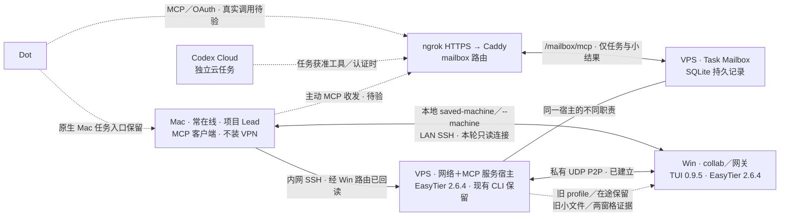

# EasyTier 双节点与现有局域网方案

版本：0.9；修订日期：2026-11-02（Asia/Shanghai）。**Mac 持续在线是公子明确的当前设计与部署前提**，不设 Mac 离线或脱离 Mac 查询／推理验收。当前分三条路径：**Mac Herdr → LAN SSH → Win collab** 的原生控制；**Mac → LAN → Win 网关 → EasyTier → VPS** 的内网管理；**Dot／Mac MCP 客户端／具备获准工具与认证的 Codex Cloud ↔ ngrok HTTPS → Caddy → VPS Task Mailbox** 的任务数据传输。Mac 不安装 VPN，Cloud 不为信箱加入 VPN，VPS 旧 Herdr profile／在途执行与网络保留。运行结果统一见[本仓状态](status.md)，职责见[架构](architecture.md#各端组件清单)。

公子已明确授权调通网络并启动 Goal，选定 Win 作为网关；这替换早期“Win 映射未定／不配子网代理／安装暂停”的准备口径。主会话已部署 VPS／Win 私有 EasyTier、建立 UDP P2P peer，并经内网完成 Mac → VPS、VPS → Win 的 SSH 回读。本文记录主会话取得的证据，不冒称本文编辑者重新操作过宿主；详情见[当前执行任务](status.md#当前执行-goal网络与协作环境就绪)。

范围只发布 `MAC_LAN_IP/32`，Mac 仅增加 `VPS_VIP/32` 主机路由经 Win，默认网关与 DNS 前后不变。本文用角色占位，不保存实际地址、账号、密钥、网络标识或原始日志。Cloud 继续作为独立 Worker，不连接 VPN；不发布整个 LAN、不新增出口节点、广播或端口映射。

旧网络 Goal 已取得分段 SSH、转发恢复与 **VPS profile** 下的小文件／新 pane 输出证据；它们不替代本次 Mac 本地 Herdr 原生直连。主会话已从 Mac 保存 win-work／collab、enabled=true，machine add 退出 0，catalog 0→1；按真实 ID 的 machine status reachable、agent list 退出 0／agents=[]。它只证明原生连接与只读回读，不以先 SSH 登录 Win 后的本地 CLI 代替，也未新增 Agent、控制桥或替换 server。正式写控制、Dot、Agent 业务与性能仍分别未验。

## 1. 已选型与待验证分列

| 项目 | 判断及依据 |
| --- | --- |
| 已选型 | Mac 本地 Herdr 经 LAN SSH 原生连接 Win collab；VPS／Win EasyTier 与指定 Mac 主机代理保留，用于另一条到 VPS 的内网路径 |
| 选择理由与代价 | 自管节点与路径，不给 Mac 新增 VPN；相应身份、配置、升级、日志、备份及恢复由我们承接，不以“开源免费”推导零维护 |
| 运行基线 | EasyTier 2.6.4，两端 TUN 已 up，VPS systemd 与 Win 原有服务运行，UDP P2P peer 已建立；Herdr TUI 0.9.5 在 Mac／VPS／Win 已回读 |
| 路由与转发 | Win 仅发布 Mac 主机 `/32`，`proxy_forward_by_system=true`；WLAN 与当前 TUN 转发已开启，VPS 已学到 Mac 回程；Mac 到 VPS 的 `/32` 路由已持久保存 |
| SSH 证据 | Mac 经 Win 路由内网 SSH 到 VPS 成功，VPS 见源为 Mac LAN 地址；VPS → Win 的 hostname 返回 0、显式失败命令返回 23 |
| Mac 原生 Herdr | 已在 Mac 保存 win-work／collab、enabled=true；按真实 ID 的 machine status reachable、agent list 退出 0／agents=[]。原生连接限定通过，不等于模型／生产写控制通过 |
| 恢复证据 | Win 网络服务重建、TUN 接口变化后，原生任务自动启用 WLAN／新 TUN 转发且任务结果为 0；随后 Mac 再次内网 SSH 成功。主机重启尚未测试 |
| 当前未验 | 完整 Dot 入口、指定 Agent／供应商、真实多项目业务、持续负载与长期稳定性；实际状态沿原执行任务更新 |

配置与接入沿本次 Goal 的有效授权推进，旧安装阶段限制保留历史，不当作当前安装仍暂停。新增项目、业务动作、云端 VPN 和整个 LAN 的开放不由此自动获准。性能与维护收益按实际证据继续判断，不因选型已定就认定优于另一产品。

## 2. 已选拓扑与分层

下图分开记录 Mac 原生连接、VPS 内网管理及新增公网信箱数据通道。虚线的客户端授权／调用仍待实际取证，不表示自动执行。Mac 本地 Herdr 直接连接 Win，不移交旧任务写控制；VPS 旧任务仍沿其原 profile 查询／收尾。范围见[当前部署与原生直连](architecture.md#当前部署与待评估简化)。

Mac → Win 的原生管理不经 VPS；Mac → VPS 内网管理才经 Win 的 IP 路由／子网代理，该网关不代理 SSH 认证。信箱客户端走同一公网 HTTPS 端点，不依赖 EasyTier：执行侧报告服务、HTTPS／OAuth 发现及云端插件创建已推进，真实客户端读写与 Herdr 承接仍待验，详见[接入快照](status.md#vps-任务信箱与客户端接入进行中)。没有为此公开 VPS 回环端口或 Mac／Win 的 Herdr 控制面。

**没有另建 EasyTier 管理平台。** VPS 的 core 作为固定对等节点，systemd 服务 `herdr-easytier` 监听选定 UDP 11010；主机防火墙已放行，公子确认外层云防火墙放行后已收到流量并建立 peer。两个节点无需额外 Web／数据库／Docker 控制平台或专用公共中继。[去中心化组网](https://easytier.cn/en/guide/network/decentralized-networking.html)、[共享节点职责](https://easytier.cn/en/guide/network/host-public-server.html)

Win 仅向 EasyTier 发布 `MAC_LAN_IP/32`，采用系统内核转发；VPS 有该主机回程，Mac 仅把 `VPS_VIP/32` 交给 Win。没有新增 Mac sshd、广泛 LAN 发布、默认路由、广播或端口转发；回程路由不构成任意访问 Mac 服务或文件的授权。

| 层 | 当前作用 | 不代替什么 |
| --- | --- | --- |
| EasyTier／Win 系统转发 | VPS／Win 私网、仅指定 Mac 主机的子网代理及回程 | SSH 身份、应用权限或整个 LAN 的开放 |
| Mac 主机路由 | 仅到 VPS 虚拟地址的流量经 Win；默认出口与 DNS 保留 | Mac 安装 VPN 或 Dot 云端自动加入私网 |
| 系统 OpenSSH | Mac 本地 Herdr 通过 LAN SSH 连接 Win；原 Mac → VPS、VPS → Win 身份保留 | 操作员在 Win 上运行本地 CLI 不能替代 Mac 原生 --machine 回读 |
| Herdr TUI CLI／server | Mac 注册 saved-machine 并只读核 Win 已运行的 collab；VPS 旧 profile／在途仍保留 | 连接不移交生产写权，不创建 Agent、不启停 server、不以原生可见代替业务验收 |
| ngrok／Caddy／Task Mailbox | 公网 HTTPS 进入独立信箱，前缀路由及独立 OAuth；客户端主动持久收发数据 | 不让 Dot／Cloud 自动入私网，不开放任意 shell，不替代 Herdr 执行与结果验收 |
| Dot／项目 Lead | 沿获准入口规划、委派、回收及组织复核 | 网络建成即取得业务权限，或 UNKNOWN 自动重派 |

模型、原件和大产物继续由执行机保管。多个项目共享同一 Win 节点时，网络规则不能自动隔离同一 sshd 后的文件和进程；项目账号、目录、凭证与工作区仍按原任务区分，不预建“每项目一套 VPN”。

Win 的 OMP／Hermes／Kimi 代理分支可依赖持续在线 Mac 的 CLI Proxy，Kimi 官方直连另列；Windows Codex 不纳入本轮。模型请求路径与 Herdr LAN SSH、EasyTier 到 VPS 的路径分开核验，不以网络连接推定代理／模型回合成功，也不由此新增监听、放行端口、自动回退或高可用组件。

## 3. 历史选型参考：EasyTier 与 Tailscale

以下保留 0.2 三机候选调研依据，说明已选产品的收益和维护代价；不将历史三端安装范围继续应用于 Mac。Tailscale 不是当前并行建设或必须实测的第二方案。更省维护／更自主是设计判断，均不代表目标机实测结果。

| 维度 | Tailscale：历史候选 | EasyTier：本次已选 | 对我们的影响 |
| --- | --- | --- | --- |
| 三机平台 | 有 Mac／Windows／Linux 客户端 | 同样支持三端、CLI／GUI 与系统服务 | 均有平台支持；本次采用 EasyTier，发行包存在不代表目标端运行通过。[EasyTier 平台说明](https://github.com/EasyTier/EasyTier#core-features) |
| 控制与发现 | 托管身份／控制平面，管理台维护网络策略 | 可按独立配置连接已知节点，不强制使用 Web 管理台 | EasyTier 自主性较高，相应服务、密钥与恢复由我们维护。[去中心化组网](https://easytier.cn/en/guide/network/decentralized-networking.html) |
| 直连与中继 | 尽量直连；可用自建 peer relay，之后回退 DERP | NAT 打洞、直连及节点中继，可自建初始连接节点 | 不能简化成“EasyTier 自建、Tailscale 只能海外中继”。实际路径决定性能。[Tailscale peer relay](https://tailscale.com/docs/features/peer-relay)、[EasyTier 组网](https://github.com/EasyTier/EasyTier#quick-networking-with-shared-nodes) |
| 身份与退出 | 集中设备身份、授权与删除设备流程 | 传统网络共享主密钥；Secure Mode 可给临时节点独立凭据、TTL 与撤销 | EasyTier 不是没有逐设备手段，但需我们安排凭据持久化、续期、撤销与回读。[删除 Tailscale 设备](https://tailscale.com/docs/features/access-control/device-management/how-to/remove)、[EasyTier 安全模式](https://easytier.cn/en/guide/network/secure-mode.html) |
| 访问策略 | Grants 可按源、目标、协议和端口表达 | ACL 支持 IP、协议、端口、组与入站／出站／转发链 | 两者都需显式策略；EasyTier 传统组定义还涉及相关节点配置一致性。[Grants](https://tailscale.com/docs/features/access-control/grants)、[EasyTier ACL](https://easytier.cn/en/guide/config/acl.html) |
| 开箱默认 | 新 tailnet 初始 allow-all，需收紧 | 稳定源码无对应 ACL 链时默认 Allow；默认可为其他虚网转发 | 两者都不能把“连上”当权限验收；EasyTier 还须明确私有／外网转发边界。[Tailscale 初始策略](https://tailscale.com/docs/reference/examples/acls#allow-all-default-acl)、[EasyTier 默认 ACL](https://github.com/EasyTier/EasyTier/blob/8428a89d2dabc94c97d370ec607c6ca142473626/easytier/src/common/acl_processor.rs#L280-L312)、[共享节点边界](https://easytier.cn/en/guide/network/host-public-server.html#disable-forwarding) |
| 协议与优化 | 按原生直连／中继机制采用 | 提供多种传输及 KCP／QUIC 等可调项 | 选项多也增加定位与维护工作，不默认全开；更强双 NAT 打洞不直接等于主路径更快，实际承载与路径仍须核验。[EasyTier 配置](https://easytier.cn/en/guide/network/configurations.html) |
| VPS 开销与费用 | 普通节点与自建中继的负载分开；账号方案／额度按实际核验 | 节点、发现与实际中继负载分开；自建服务与流量由我们承担 | 都需核带宽、流量、CPU、内存与日志；不编造最低配置或免费额度。VPS 可升级，不是必然阻塞点 |
| Dot 影响 | 可只用私网，保留原公网路径 | 同样可不采用出口、子网代理或 Magic DNS | 两者都须核 DNS／路由与既有 VPN；“换产品”不能保证 Dot 零影响，见下节 |

此前对照口径为“托管 Tailscale，必要时自建 peer relay”与“自管 EasyTier 私有节点”，避免拿精调自建网络与未知公共中继路径比较。该公平性说明继续保留，但不要求本次新增 Tailscale、peer relay 或双网性能比较。

## 4. EasyTier 各端安装与配置准备

以下是本次部署后的归属，不再把全部项目列为待安装；详细组件见[架构清单](architecture.md#各端组件清单)。新增配置、身份或服务仍按实际任务范围处理。

| 位置／事项 | 已部署与已核验 | 当前边界 |
| --- | --- | --- |
| mac-work | TUI 0.9.5，Mac saved-machine 从 0 到 1，win-work／collab 已启用并 reachable，定向 agent list 退出 0／agents=[]；到 VPS 的 `/32` 路由经 Win 另有原证据 | 不装 EasyTier core／cli／TUN；不改变默认网关／DNS，不新增 Mac sshd，不以连接取得生产写权 |
| VPS | EasyTier／TUI 及旧 network Goal 的 profile、小文件／pane 已核；Task Mailbox 原实施侧另报告服务、HTTPS／OAuth 发现通过，客户端接入进行中 | 旧 profile／在途／网络保留，不作为 Mac → Win 中转；网络回执不代替 MCP 客户端调用，本次文档修订不代部署 |
| win-work | 复用 EasyTier 2.6.4 服务，TUN 已 up；仅发布指定 Mac 主机 `/32`，系统转发覆盖 WLAN／当前 TUN；TUI 0.9.5 与 sshd 已回读 | 不另起第二个 EasyTier core，不发布整个 LAN；保留指定 Agent、制作环境和既有会话 |
| SSH 身份 | Mac → VPS 复用原公钥；VPS → Win 使用本次专用身份，仅公钥部署到 Win，并限定来源为 VPS 虚拟地址 | 私钥留在相应客户端，实际账号、密钥、指纹和配置不进入仓库；不复制 Mac 私钥或引入最终 SSH 跳板 |
| 私用与隔离 | 已配置私有网络与必要转发边界；入站／出站／转发 ACL 三链默认 Drop，仅开放指定 SSH 和 ICMP 健康方向 | 配置回读和正向 SSH 成功不等于所有拒绝场景已验，2.6.4 的 ICMP 边界见下一节 |
| 持久化与日志 | 私密配置限制权限；日志为 warn、单文件 5 MiB、保留 3 份；Win 注册启动与 NetworkProfile 10000 事件触发的转发恢复任务 | 无周期轮询；一次网络服务重建自动恢复已验，主机重启及长期日志增长尚未验 |

**VPS 的旧主动访问节点与纯发现／中继节点不能混同。** 原网络 Goal 已让 VPS 带 TUN 地址主动 SSH 到 Win；Mac 新的 LAN 直连不依赖该中转，但不因此删除既有 TUN 或路由。无需为本轮原生连接新增 SOCKS5、端口映射或公共中继。[TUN 与主动访问边界](https://easytier.cn/en/guide/network/no-root.html)

Win TUN 接口重建后，原接口的转发设置不能自动代表新接口；本轮原生任务已按当前接口恢复 WLAN／TUN 的 Forwarding。主会话实测一次网络服务重建，任务成功且新接口转发为 Enabled；随后 Mac 内网 SSH 再次成功。该证据不扩大为整机重启、任意故障或无限自动修复已通过。

系统 SSH 与 TUI 路由细节见[SSH 说明](architecture.md#ssh-依赖与已有组件复用)。本轮以 Mac 本地 `herdr --machine` 经 LAN SSH 只读访问 Win 的 collab，不先登录 Win 再以 Win 本地 CLI 代替。旧 VPS 入口仍服务其原任务，连接动作不形成两边同时写同一资产的授权；hc／App、MCP 控制桥和新临时框架均不加入。

## 5. 版本、安全与维护取舍

2026-11-01 查询官方发行元数据，2026-11-02 安装前复核：**v2.6.4 为非预发布**，tag 指向 `8428a89d2dabc94c97d370ec607c6ca142473626`；**v2.7.0 仍标为 Pre-release**。其中新增中心化网络管理、运行时 ACL 替换等能力，不能写成稳定版现成能力。官网手册随开发变化；VPS 已下载官方 Linux x86_64 v2.6.4 包，SHA-256 对照通过，core／cli 均回读为 `2.6.4-8428a89d`，安装时完成版本核验，随后已进行私网与分段 SSH 测试。[v2.6.4](https://github.com/EasyTier/EasyTier/releases/tag/v2.6.4)、[v2.7.0 预发布](https://github.com/EasyTier/EasyTier/releases/tag/v2.7.0)

EasyTier 部署准备须保留三个具体边界：

1. **私用边界需显式配置。** 固定稳定源码默认 `private_mode=false`、转发白名单为 `*`；仅填网络名和密码不等于关闭其他虚网转发。本轮已明确私有网络、必要监听和外网转发边界，不把 VPS 作为社区公共节点；新节点或新动作仍需按任务配置。[固定默认配置](https://github.com/EasyTier/EasyTier/blob/8428a89d2dabc94c97d370ec607c6ca142473626/easytier/src/common/config.rs#L31-L72)
2. **安全模式不等于已完成身份管理。** 稳定源码已包含 Secure Mode 和 credential 参数；普通节点仍涉及主密钥，临时节点可用逐设备凭据。独立会话加密、凭据撤销和中继公钥 pinning 各有作用；管理员的凭据库及中继固定私钥需持久保管，不能只把一个共享密码发给所有 Worker。[固定 CLI 参数](https://github.com/EasyTier/EasyTier/blob/8428a89d2dabc94c97d370ec607c6ca142473626/easytier/src/core.rs#L684-L720)、[安全模式机制](https://easytier.cn/en/guide/network/secure-mode.html)
3. **隔离能力要核具体构建。** 官方 PR #2570 修复双方交替 ping 时 ICMP／ICMPv6 请求误匹配响应放行记录、绕过入站丢弃规则的问题，v2.7 预发布列入该修复；固定 v2.6.4 源码尚无该补丁，安装时已做 SHA-256 与版本检查，随后虽已运行网络与 SSH，仍未验证该拒绝用例。不能由此推导 SSH／所有 TCP 均可绕过，也不能把预发布修复当稳定安装包已修复。依赖该 ICMP 隔离能力的使用先受限，固定构建与拒绝用例须在依赖此能力前验证，不为取得新功能默认升级预发布，也不阻塞独立工作。[修复范围](https://github.com/EasyTier/EasyTier/pull/2570)、[固定稳定逻辑](https://github.com/EasyTier/EasyTier/blob/8428a89d2dabc94c97d370ec607c6ca142473626/easytier/src/peers/acl_filter.rs#L354-L380)

这些差异增加 EasyTier 的配置与验证责任，不构成“产品整体不安全”的结论；Tailscale 也必须核实际策略和设备生命周期。跨项目网络权限不能替代 OS／任务权限。配置、密钥、机器身份和原始终端输出不进入本仓，文档不提供一键入网脚本。

## 6. 效率与 Dot 连通怎样判断

本轮短样本中，10 次 ping 丢失 3 次，成功回包 RTT 约 132–141 ms；Mac 内网 SSH 一次约 7.3 秒，网络服务重建后复核约 14.8 秒并退出 0。ping RTT、SSH 建连耗时、peer 存在和业务响应是不同指标，样本不能证明稳定性、性能 SLA 或普遍提效。文件吞吐、持续并发及恢复后的长期表现仍需实际窗口。[EasyTier 传输配置](https://easytier.cn/en/guide/network/configurations.html)

VPS 最新瞬时观察为 1 vCPU、总内存约 950 MiB／可用约 701 MiB、剩余磁盘约 12.73 GiB、CPU 约 2%。这只说明该观察时点，不能作为多项目峰值或最低规格证明。配置可按实际负载升级，容量问题只约束相关档位，不作为架构的必然阻塞。

Dot → Mac 仍沿平台原生入口；Mac 在线按当前运行前提接受，ChatGPT 应用、登录和实际访问授权仍按原生任务核验。Mac 到 VPS 的内网 SSH 成功不等于 Dot 已能派发和回读；投递超时先查原任务，不推定未受理。Cloud 不入 VPN，Space 资料工具与正式任务授权独立。[Dot 官方接入条件](https://learn.chatgpt.com/docs/enterprise/dots-admin-guide#access-and-eligibility)

默认网关与 DNS 已做前后核对并保留；本轮只增加定向主机路由和获准子网代理，不启出口节点、全局 DNS 覆盖或整个 LAN 发布。后续变更仍核应用与原生 Dot 入口，不能由这次分段成功保证零影响。

## 7. 后续配置与接入验收

Goal 已授权开展当前网络／Herdr 环境准备，网络与 SSH 已有分段证据；下表只列剩余边界，不重做原任务或把准备文档当新派发入口。按 Mac 持续在线前提推进，不新增离线、断连、主机重启或其他故障测试。具体步骤沿[VPS 试点 T0–T8](vps-control-pilot.md#6-2026-11-02-测试清单)。

| 项目 | 已有证据 | 剩余动作与验收边界 |
| --- | --- | --- |
| EasyTier／路由 | 两端 TUN、私有 UDP P2P、Win 指定主机代理、VPS 回程、Mac 主机路由成立 | 保存脱敏配置版本与原生引用，后续只沿现有网络调整；不扩成整个 LAN 或第二个网络实例 |
| SSH 身份 | Mac → VPS 内网回读成功；VPS → Win hostname 0／显式 exit 23；私钥未跨端复制 | 按实际账户与路径核任务权限，不把登录能力写成任意文件或命令权限 |
| Mac 原生直连 | Mac Herdr 0.9.5 machine add 退出 0，catalog 0→1；win-work／collab enabled，按真实 ID 的 status reachable、agent list 退出 0／agents=[] | 只读连接限定通过；列表空表示当时 0 个已识别 Agent，不新增 Agent 或提交 prompt。真实 ID／地址仅存私密证据，旧 VPS 目录审计仍独立未决 |
| 旧 VPS 远端与小文件 | 原 VPS 注册外层解码失败后按原 ID 对账；旧 profile running／reachable、94 字节及两窗格交叠输出已核 | 这些均为旧入口证据；原注册外层退出码 UNKNOWN，未重注册，两个测试 workspace 已关闭。原 server／在途保留，不外推 Mac 新入口或生产写权 |
| 网络恢复历史 | 2026-11-02 原网络 Goal 中，一次 Win 网络服务重建后任务自动恢复转发，随后 Mac 内网 SSH 复核成功 | 主机重启与备份恢复未测仅限定此证据，不作为当前在线方案的阻塞项；不新增故障测试，不把任务结果 0 代替实际路径回读 |
| Dot／业务／多项目 | 保留原生入口与两池设计 | Dot 派发回读、指定 Agent／provider、业务产物、至少两个项目重叠推进及负责人验收分别取证；当前不报告通过 |
| 性能／隔离 | 有短样本、配置与正向 SSH 证据 | 目标窗口／规模、必要文件吞吐、拒绝用例及 2.6.4 ICMP 限制单列；不自动升级预发布或降低判据报通过 |

UNKNOWN 沿原任务、网络、profile、session、pane、文件与当前写者对账，不自动重派或回到 Lody。当前结果来自主会话宿主工具回读；本文编辑仅整合文档，没有新增主机操作、Git 写入或业务验收。

### 日常核对与恢复入口

先按目标分段定位，不因超时重建网络或 session：Mac → Win 使用 Mac 本地 machine list／status 与准确 --machine 的只读列表，不能以 Win 本地 CLI 回读代替；Mac → VPS 才查原主机路由与 `ssh vps-herdr`。后一路径由 Win 原 EasyTier 服务／转发恢复任务、VPS 原 peer／SSH 分别排查；旧 VPS 任务按其原 profile／session 查询。网络、连接与任务恢复分开，未知执行不重放。

Mac 的变更前网络快照与路由回执保存在用户私密 `~/.ssh/herdr-network-state/`；VPS 配置／收据／验收关联在受限的 `/etc/herdr-network/`、`/var/lib/herdr-network/`；Win 原设置备份、转发脚本与最新状态在受限的 `C:\ProgramData\HerdrNetwork\`。这些是宿主本地恢复依据，未配置离机备份；不将含私密网络或身份的文件上传仓库。撤回配置须先核原设置和未决任务，再只撤本次新增对象，不能用旧快照覆盖后续合法变更。

Mac → VPS 路径依赖 Win 网关及其转发；Mac → Win LAN SSH 依赖该 LAN、sshd 与目标 Herdr，不经 VPS。DHCP 地址、网卡或网络改变时按对应目标核地址与配置，不能混用两条路径的成功回执，也不扩大成整个子网。未设置 DHCP 保留，不宣称任意换网后自动可用。
