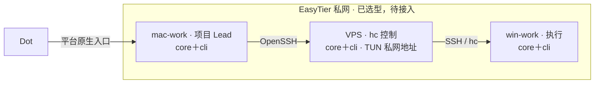

# EasyTier 三机组网方案与部署准备

版本：0.3；修订日期：2026-11-02（Asia/Shanghai）。适用链路为 **Dot → mac-work 项目 Lead → VPS／hc → win-work／其他执行机**，服务于多个项目同时推进。本文维护已选网络方案、连通边界和部署准备，保留历史选型依据；整体职责与安装归属见[架构](architecture.md#各端组件清单)，当前实际状态只记在[本仓状态](status.md)。

**当前网络范围只覆盖 Mac、VPS、Win 三机；按公子确认，暂不考虑 Codex Cloud 连接 VPN。** Cloud 继续作为独立 Worker，沿既定仓库与获准工具路径协作；本轮不为它准备 VPN 组件、预算或接入验收，也不预建双网桥。

**公子已明确选用 EasyTier，接下来按该单一网络方案准备部署；三机实际安装、入网、策略和接入仍待验证。** 原 0.2 的双网对照建议已由本次选择替换，不要求先完成 Tailscale／EasyTier A/B 才能采用 EasyTier。选型不等于部署授权或验收，本轮只更新文档与安装准备表，不安装、入网、开放端口或测试机器。

## 1. 已选型与待验证分列

| 项目 | 判断及依据 |
| --- | --- |
| 已选型 | 三机网络采用 EasyTier；Dot 原生电脑入口、系统 OpenSSH、hc 与项目职责保留原分工 |
| 选择理由与代价 | 可自管发现／中继与路径；相应身份、配置、升级、日志、备份及恢复由我们承接，不以“开源免费”推导零维护 |
| 当前基线 | 此前 Tailscale 仅为仓库候选，未有已部署三机网络可迁移；不虚构切换成本或现网性能问题 |
| 部署准备 | Mac、VPS、Win 均准备匹配平台的 core＋cli；GUI 按需使用，同一节点实例不重复启动 core；具体清单见第 4 节 |
| 接入与容量待验 | 三端实际 OS／版本、TUN 条件、身份／策略、已有 VPN／代理、VPS 线路与带宽、实际直连／中继路径、资源及持续运行 |
| 业务效果待验 | Dot 原生回读、两段 SSH／hc、原任务恢复与多项目并行；更高直连率、更低延迟和更低资源占用仍为 UNKNOWN |

选型依据是自管能力与公子的明确选择，不是已测得 EasyTier 比另一产品更快。后续验证当前选定方案是否满足协作要求；Tailscale 对比保留为历史决策参考，不建设双网桥或第二控制入口。

## 2. 已选拓扑与分层

图中两段是**业务调用与授权边界**，不是要求所有 IP 流量经过 VPS。EasyTier 入网不自动限制成两段 SSH；需明确放行源身份、目标与实际 SSH 端口，并核回程与拒绝路径。Mac → Win 直接控制不在默认范围；VPS 可兼任初始连接点／受控中继，这是同一节点的网络职责，不自动取得新的派发权。图只表示设计，不表示三端已运行。

| 层 | 解决什么 | 不代替什么 |
| --- | --- | --- |
| EasyTier | 机器可达、加密隧道、路由与网络访问策略 | SSH 登录身份、目录权限和任务授权 |
| 系统 OpenSSH | 登录、远端命令和所需文件传输 | Agent 协调、任务幂等和产物验收 |
| hc | 沿既定入口控制机器与原执行、查询结果 | 跨项目业务决策或第二套正式任务记录 |
| Dot／项目 Lead | 沿获准入口规划、委派、回收与组织复核 | 安装软件即取得新权限，或 UNKNOWN 自动重派 |

不要求同一物理局域网。模型、原件和大产物继续在获准执行机保管；网络选型不改变单写、原任务对账和业务验收规则。多个项目共享同一 Win 节点时，网络规则不能自动隔离同一 sshd 后面的文件和进程；项目账号、目录、凭证与工作区仍按原任务区分，不预建“每项目一套 VPN”。

## 3. 历史选型参考：EasyTier 与 Tailscale

以下保留 0.2 调研依据，说明已选方案的收益和维护代价；Tailscale 不是当前并行建设或必须实测的第二方案。更省维护／更自主是设计判断，均不代表三机实测结果。

| 维度 | Tailscale：历史候选 | EasyTier：本次已选 | 对我们的影响 |
| --- | --- | --- | --- |
| 三机平台 | 有 Mac／Windows／Linux 客户端 | 同样支持三端、CLI／GUI 与系统服务 | 均有平台支持；本次采用 EasyTier，发行包存在不代表目标端运行通过。[EasyTier 平台说明](https://github.com/EasyTier/EasyTier#core-features) |
| 控制与发现 | 托管身份／控制平面，管理台维护网络策略 | 可按独立配置连接已知节点，不强制使用 Web 管理台 | EasyTier 自主性较高，相应服务、密钥与恢复由我们维护。[去中心化组网](https://easytier.cn/en/guide/network/decentralized-networking.html) |
| 直连与中继 | 尽量直连；可用自建 peer relay，之后回退 DERP | NAT 打洞、直连及节点中继，可自建初始连接节点 | 不能简化成“EasyTier 自建、Tailscale 只能海外中继”。实际路径决定性能。[Tailscale peer relay](https://tailscale.com/docs/features/peer-relay)、[EasyTier 组网](https://github.com/EasyTier/EasyTier#quick-networking-with-shared-nodes) |
| 身份与退出 | 集中设备身份、授权与删除设备流程 | 传统网络共享主密钥；Secure Mode 可给临时节点独立凭据、TTL 与撤销 | EasyTier 不是没有逐设备手段，但需我们安排凭据持久化、续期、撤销与回读。[删除 Tailscale 设备](https://tailscale.com/docs/features/access-control/device-management/how-to/remove)、[EasyTier 安全模式](https://easytier.cn/en/guide/network/secure-mode.html) |
| 访问策略 | Grants 可按源、目标、协议和端口表达 | ACL 支持 IP、协议、端口、组与入站／出站／转发链 | 两者都需显式策略；EasyTier 传统组定义还涉及相关节点配置一致性。[Grants](https://tailscale.com/docs/features/access-control/grants)、[EasyTier ACL](https://easytier.cn/en/guide/config/acl.html) |
| 开箱默认 | 新 tailnet 初始 allow-all，需收紧 | 稳定源码无对应 ACL 链时默认 Allow；默认可为其他虚网转发 | 两者都不能把“连上”当权限验收；EasyTier 还须明确私有／外网转发边界。[Tailscale 初始策略](https://tailscale.com/docs/reference/examples/acls#allow-all-default-acl)、[EasyTier 默认 ACL](https://github.com/EasyTier/EasyTier/blob/8428a89d2dabc94c97d370ec607c6ca142473626/easytier/src/common/acl_processor.rs#L280-L312)、[共享节点边界](https://easytier.cn/en/guide/network/host-public-server.html#disable-forwarding) |
| 协议与优化 | 按原生直连／中继机制采用 | 提供多种传输及 KCP／QUIC 等可调项 | 选项多也增加定位与维护工作，不默认全开；当前两条 SSH 边都包含 VPS，更强双 NAT 打洞不直接等于主路径更快。[EasyTier 配置](https://easytier.cn/en/guide/network/configurations.html) |
| VPS 开销与费用 | 普通节点与自建中继的负载分开；账号方案／额度按实际核验 | 节点、发现与实际中继负载分开；自建服务与流量由我们承担 | 都需核带宽、流量、CPU、内存与日志；不编造最低配置或免费额度。VPS 可升级，不是必然阻塞点 |
| Dot 影响 | 可只用私网，保留原公网路径 | 同样可不采用出口、子网代理或 Magic DNS | 两者都须核 DNS／路由与既有 VPN；“换产品”不能保证 Dot 零影响，见下节 |

此前对照口径为“托管 Tailscale，必要时自建 peer relay”与“自管 EasyTier 私有节点”，避免拿精调自建网络与未知公共中继路径比较。该公平性说明继续保留，但不要求本次新增 Tailscale、peer relay 或双网性能比较。

## 4. EasyTier 各端安装与配置准备

下表是后续部署准备，不是已安装状态。先核各端已有组件、OS／架构和权限，满足条件即复用；完整安装矩阵统一维护在[架构组件清单](architecture.md#各端组件清单)。

| 位置／事项 | 需准备的组件与配置 | 边界及待验项 |
| --- | --- | --- |
| mac-work | 匹配平台的 `easytier-core`＋`easytier-cli`，TUN 私网地址、节点身份和策略；GUI 可选 | GUI 托管或直接启动 core 选择一种运行方式，同一节点不额外启动第二个 core；保留本地 Lead 与原系统 SSH 客户端 |
| VPS | `easytier-core`＋`easytier-cli`，TUN 私网地址及相应权限；系统 SSH 服务端＋客户端、原 hc 入口 | 本分工须主动向 Win 私网地址发起 SSH；可兼任初始连接点／受控中继，不增加 Web 管理台或数据库 |
| win-work | 匹配 OS／架构的 core＋cli、发行包要求的驱动／DLL、TUN 私网地址与 Windows OpenSSH Server；GUI 可选 | 同一节点实例不重复运行 core；保留指定 Agent、音频模型、驱动与原有制作环境，不默认迁入 WSL |
| 地址与接入 | 明确不与现有 LAN／VPN 冲突的地址、节点身份、初始连接点、必要监听协议／端口 | 虚拟地址与私密配置待目标端绑定；网络可达不代替 SSH 身份、host key 或资产授权 |
| 私用与隔离 | 明确 private mode、其他虚网转发限制、两段 SSH 所需 ACL／OS 防火墙，以及节点凭据模式 | 默认配置不是最小权限；Secure Mode、凭据撤销及固定版本 ICMP 边界见下一节 |
| 持久运行 | 私密配置、固定密钥／凭据库、服务运行方式、日志上限、配置分发、升级、备份和恢复责任 | 先核既有服务及实例，避免重复启动；不由本文自动启用服务、开放端口或建立定时任务 |

**VPS 主控节点与纯发现／中继节点不能混同。** 纯发现／中继可不创建 TUN、无需私网地址；但这不能直接满足 VPS 经私网主动 SSH 到 Win 的主路径。官方无 TUN 模式主动访问其他节点需使用 SOCKS5 或端口转发，本方案不额外引入这些适配，部署时核 TUN 可用性与所需权限。[TUN 与主动访问边界](https://easytier.cn/en/guide/network/no-root.html)、[无地址的共享节点](https://easytier.cn/en/guide/network/host-public-server.html)

SSH 归属仍为 Mac 客户端、VPS 客户端＋服务端、Win 服务端；细节只维护在[SSH 依赖说明](architecture.md#ssh-依赖与已有组件复用)。本轮不准备 Cloud 的 VPN／SSH 接入，不以云端是否支持某个 VPN 作为三机采用条件；未来出现实际依赖时再就该需求评估。

本方案使用普通 OpenSSH over EasyTier IP，EasyTier 不替代系统 SSH。历史 Tailscale 候选也使用系统 OpenSSH，未选用另一个名为 Tailscale SSH 的认证／授权功能；不因网络选型引入新的 SSH 身份体系。[历史功能区别](https://tailscale.com/docs/features/tailscale-ssh#how-is-tailscale-ssh-different)

## 5. 版本、安全与维护取舍

2026-11-01 查询官方发行元数据：`releases/latest` 返回 **v2.6.4，非预发布**，发布日期 2026-05-12；tag 指向 `8428a89d2dabc94c97d370ec607c6ca142473626`。**v2.7.0 仍标为 Pre-release**；其中新增中心化网络管理、运行时 ACL 替换等能力，不能写成稳定版现成能力。主分支快照为 `24e0303fc55e4e645a11818954dd5b712fb94510`，官网手册随开发变化；本文未下载、安装或运行任何发行包。[v2.6.4](https://github.com/EasyTier/EasyTier/releases/tag/v2.6.4)、[v2.7.0 预发布](https://github.com/EasyTier/EasyTier/releases/tag/v2.7.0)

EasyTier 部署准备须保留三个具体边界：

1. **私用边界需显式配置。** 固定稳定源码默认 `private_mode=false`、转发白名单为 `*`；仅填网络名和密码不等于关闭其他虚网转发。后续应按目标版本明确只服务获准网络、必要监听范围和转发负载，不把 VPS 默认贡献为社区公共节点。[固定默认配置](https://github.com/EasyTier/EasyTier/blob/8428a89d2dabc94c97d370ec607c6ca142473626/easytier/src/common/config.rs#L31-L72)
2. **安全模式不等于已完成身份管理。** 稳定源码已包含 Secure Mode 和 credential 参数；普通节点仍涉及主密钥，临时节点可用逐设备凭据。独立会话加密、凭据撤销和中继公钥 pinning 各有作用；管理员的凭据库及中继固定私钥需持久保管，不能只把一个共享密码发给所有 Worker。[固定 CLI 参数](https://github.com/EasyTier/EasyTier/blob/8428a89d2dabc94c97d370ec607c6ca142473626/easytier/src/core.rs#L684-L720)、[安全模式机制](https://easytier.cn/en/guide/network/secure-mode.html)
3. **隔离能力要核具体构建。** 官方 PR #2570 修复双方交替 ping 时 ICMP／ICMPv6 请求误匹配响应放行记录、绕过入站丢弃规则的问题，v2.7 预发布列入该修复；固定 v2.6.4 源码尚无该补丁，实际安装包未下载核验。不能由此推导 SSH／所有 TCP 均可绕过，也不能把预发布修复当稳定安装包已修复。依赖该 ICMP 隔离能力的使用先受限，固定构建与拒绝用例须在依赖此能力前验证，不为取得新功能默认升级预发布，也不阻塞独立工作。[修复范围](https://github.com/EasyTier/EasyTier/pull/2570)、[固定稳定逻辑](https://github.com/EasyTier/EasyTier/blob/8428a89d2dabc94c97d370ec607c6ca142473626/easytier/src/peers/acl_filter.rs#L354-L380)

这些差异增加 EasyTier 的配置与验证责任，不构成“产品整体不安全”的结论；Tailscale 也必须核实际策略和设备生命周期。跨项目网络权限不能替代 OS／任务权限。配置、密钥、机器身份和原始终端输出不进入本仓，文档不提供一键入网脚本。

## 6. 效率与 Dot 连通怎样判断

直连通常比中继少一跳，但两种产品的实际线路、拥塞、MTU、宿主负载和加密实现都会影响结果。主控制链路的两条边均包含 VPS，不能拿 Mac → Win 的穿透演示代替原链路表现；大文件也不默认绕经 VPS。测命令回读与必要文件传输各自的耗时、失败、吞吐和中继流量，样本不足不编统计提效比例。[Tailscale 连接类型](https://tailscale.com/docs/reference/connection-types)、[EasyTier 传输配置](https://easytier.cn/en/guide/network/configurations.html)

Dot → Mac 沿原生电脑入口，仍需 Mac 在线、ChatGPT 应用运行且访问开启；Mac 的 VPN 不自动延伸到 Dot 云端。组网不取代这个产品入口，也不解决 Mac 离线后的项目规划依赖。[Dot 官方接入条件](https://learn.chatgpt.com/docs/enterprise/dots-admin-guide#access-and-eligibility)

EasyTier 起步设计保留现有公网出口与代理，不选择出口节点、不默认发布整个局域网、不覆盖全局 DNS；先使用不冲突的虚拟地址，名称解析确有需要再引入。EasyTier 的 Magic DNS 在 Windows／macOS 涉及系统 DNS，已有 VPN 的路由／地址冲突也须核验。**这些是降低影响的设计，不是保证 Dot 零影响。** 历史 Tailscale overlay 同样不能从普通公网分流推导 DNS／VPN 零冲突。[EasyTier Magic DNS](https://easytier.cn/en/guide/network/magic-dns.html)、[历史 Tailscale 出口](https://tailscale.com/docs/features/exit-nodes)、[VPN 共存](https://tailscale.com/docs/reference/faq/other-vpns)

## 7. EasyTier 部署与验收顺序

以下只准备已选方案的验收方法，本轮不执行。后续先绑定实际三机、版本／配置、身份、目标端口、负载、观察窗口与责任人，保留原管理通道。接入动作沿[VPS 试点 T0–T8](vps-control-pilot.md#6-2026-11-02-测试清单)的有效授权进行；不要求安装 Tailscale 或进行双网 A/B，Cloud VPN／Space 不因本清单新增测试。

| 顺序 | 待执行准备／验证 | 通过证据与边界 |
| --- | --- | --- |
| 1．核安装条件 | 分别核 OS／架构、已有 core／cli／GUI 实例、SSH／hc、TUN 与可用资源，明确私密配置落点 | 准确宿主与版本匹配；VPS 主路径有私网地址及主动 SSH 条件，不将纯中继冒称主控已通 |
| 2．准备网络与身份 | 固定地址、初始连接点、必要监听、私有／转发范围、节点凭据与两段访问策略 | 只写获准配置，GUI／CLI 不重复启动同一节点；端口、服务和持续访问分别按授权实施 |
| 3．核原生入口与控制 | 入网前后 Dot 原任务回读、Mac → VPS 及 VPS → Win 命令和退出码 | 三段证据分别成立，不能只看 ping／入网状态，保留原 SSH 身份与 Agent 供应商绑定 |
| 4．核策略与身份 | 两段允许、未授权方向／端口拒绝，按获准试验验证身份撤销和配置恢复 | 实际流量与结果可对应；ICMP／ICMPv6 固定构建问题单列，不推成全部 TCP 已失效或已安全 |
| 5．测路径与资源 | 每段直连／中继、命令回读耗时／失败率、必要文件吞吐、三端资源及日志／流量增长 | 记录实际样本与窗口；不编最低配置或提效比例，VPS 可按测量及授权扩容，不强制搬入模型和原件 |
| 6．验恢复与多项目 | 重连查询原执行、核原写者／产物；至少两个项目活动重叠且独立推进 | 无自动重派、双控或任务混用；服务／主机重启另有影响范围和授权才测，成果交独立复核与有权验收者 |

EasyTier 选型已完成；未通过项只限制依赖它的使用，记录原问题与下一责任人，不自动切换网络、重派 UNKNOWN 或扩大权限。若将来出现不能满足的实际需求，再按证据和公子的决定修订本方案，不把历史对比复活为当前必须执行的流程。

本轮完成方案、网络图与部署准备。实际安装、持久服务、网络修改、接入测试和业务切换仍分别沿对应任务的有效授权及目标端证据推进；文档日期不构成这些动作已执行或已验收。
