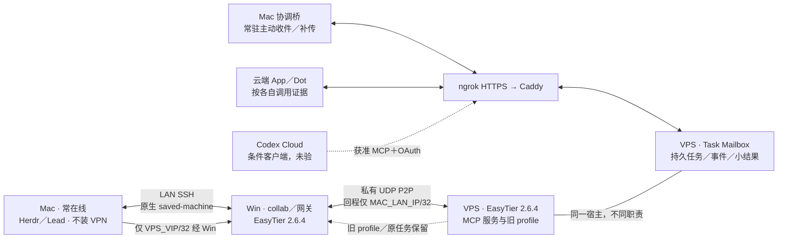

# EasyTier 双节点与现有局域网方案

版本：0.10；修订日期：2026-11-03（Asia/Shanghai）。本页统一维护 EasyTier、主机路由、SSH 配置与运维边界，以及固定版本的已知风险。组件职责见[架构](architecture.md)，当前验收见[状态总表](status.md)，逐轮回执见[网络 Goal 历史](history/status-through-2026-11-03.md#当前执行-goal网络与协作环境就绪)。

Mac 持续在线是公子确认的前提。Mac 不装 VPN，Cloud 不为信箱加入 VPN；当前只发布 `MAC_LAN_IP/32`，Mac 仅增加到 `VPS_VIP/32` 的主机路由经 Win，默认网关与 DNS 保留。本页使用角色占位，真实地址、账号、网络标识、密钥和原始日志留在宿主受限位置。

## 1. 已选型与待验证分列

| 项目 | 已采用的范围 | 证据限制 |
| --- | --- | --- |
| Mac → Win | 本地 Herdr saved-machine／`--machine` 经 LAN SSH 直连既有 `collab` | 原生连接与只读查询已验；Win Herdr 模型／业务回收未验 |
| VPS ↔ Win | EasyTier 2.6.4 私有双节点、TUN、UDP P2P | 功能连通已验；短样本不代表持续质量或容量 |
| Mac → VPS | Win 指定主机代理、系统转发与双向 `/32` 路由 | 内网 SSH 与一次 Win 网络服务重建后的转发恢复已验；主机重启未验 |
| 信箱 HTTPS | ngrok → Caddy → VPS Task Mailbox；Mac 协调桥常驻收件／补传 | 原数据任务及显式 Mac 适配器回传有分层证据；反向新任务、Cloud、生产和长期未验 |
| 身份与隔离 | 原 SSH 身份、独立服务认证、ACL 默认 Drop 与指定方向放行 | 正向成功不证明全部拒绝用例；2.6.4 ICMP 边界见[版本风险](#5-版本安全与维护取舍) |

EasyTier 的取舍是自主管理节点和路径，同时承担配置、身份、升级、日志及恢复工作。Tailscale 只保留历史对照，不是当前并行部署或必测前置。新增机器、整个 LAN 发布、出口节点、广播和端口映射不在现有网络范围内。

## 2. 已选拓扑与分层

三条路径分开定位：Mac → Win 不经 VPS；Mac → VPS 内网管理经 Win 的 IP 转发，该网关不代管 SSH 认证；信箱客户端使用公网 HTTPS，不依赖 EasyTier。Mac 桥已实际收发，不再标为“主动收发待验”；指定 Dot、独立 CLI 和 Cloud 的验证范围仍沿[各客户端记录](https://github.com/CF-FE/task-mailbox-mcp/blob/main/docs/verification.md)，不能互相代验。

VPS 的 core 是固定对等节点，既有 systemd 服务 `herdr-easytier` 使用 UDP 11010；宿主与外层云防火墙按原配置保留。两个节点不需要另建 Web／数据库／Docker 管理平台或社区公共中继。[去中心化组网](https://easytier.cn/en/guide/network/decentralized-networking.html)、[共享节点职责](https://easytier.cn/en/guide/network/host-public-server.html)

| 层 | 负责什么 | 不能替代什么 |
| --- | --- | --- |
| EasyTier／Win 系统转发 | VPS／Win 私网及指定 Mac 主机回程 | SSH 身份、文件／任务权限或整个 LAN 开放 |
| Mac 主机路由 | 只将 VPS 虚拟主机流量交给 Win | 默认出口、DNS 或云端设备权限 |
| 系统 OpenSSH | 原生机器入口的传输、身份和 host key | Herdr session／pane 绑定或业务写权 |
| Herdr TUI | 明确定向原生目标 | 普通 SSH 登录后调用远端 CLI 不能代替 Mac 原生回读 |
| ngrok／Caddy／MCP | 公网服务路由、认证和数据传输 | 不公开 Herdr socket、任意 shell 或自动执行任务 |

Win 代理模型分支可依赖常在线 Mac 的 CLI Proxy，Kimi 官方入口另列。模型请求、LAN SSH 和 EasyTier 管理网是不同路径；不因某段连通而新增监听、放行端口或自动回退。多项目共用同一 sshd 时，项目账号、目录、凭据和当前写者仍须分别绑定，VPN 不自动隔离本机文件和进程。

## 3. 历史选型参考：EasyTier 与 Tailscale

以下概括 2026-11-01 调研的取舍，保留来源；不是新的产品选型或当前最新版本比较。

| 维度 | 当时的比较结论 | 对当前配置的约束 |
| --- | --- | --- |
| 控制面 | Tailscale 提供托管设备／策略管理；EasyTier 可用独立配置连接已知节点 | 采用自管双节点后，由我们维护身份和恢复，不另建管理台。[EasyTier](https://easytier.cn/en/guide/network/decentralized-networking.html) |
| 直连／中继 | 两者均有直连与中继路径，Tailscale 也支持 peer relay | 不以“自建”推定更快，不拿未知公共中继与精调直连比较。[Tailscale peer relay](https://tailscale.com/docs/features/peer-relay) |
| 身份／ACL | Tailscale 有设备管理与 Grants；EasyTier 有 ACL、Secure Mode 和凭据机制 | 连通不等于隔离，需核实际构建、策略和凭据生命周期。[Grants](https://tailscale.com/docs/features/access-control/grants)、[EasyTier ACL](https://easytier.cn/en/guide/config/acl.html) |
| 默认行为 | 当时文档中的新 tailnet 为 allow-all；固定 EasyTier 稳定源码缺少对应 ACL 链时默认 Allow | 当前显式收紧三条链；不把默认值当最小权限。[Tailscale 默认示例](https://tailscale.com/docs/reference/examples/acls#allow-all-default-acl)、[固定 EasyTier ACL](https://github.com/EasyTier/EasyTier/blob/8428a89d2dabc94c97d370ec607c6ca142473626/easytier/src/common/acl_processor.rs#L280-L312) |
| 运维／性能 | 自管提高自主性，也增加升级、日志、流量和故障定位工作 | 以实际路径和负载测量，不编造最低配置、免费额度或提效比例 |

## 4. EasyTier 各端安装与配置准备

已有组件满足条件即复用。下表是配置归属，不是再次安装或重放原网络 Goal 的步骤。

| 位置／事项 | 保留的配置 | 维护时核对 |
| --- | --- | --- |
| mac-work | 到 `VPS_VIP/32` 的持久主机路由经 Win；原 LAN、默认出口和 DNS | 目标地址、Win LAN 地址及路由是否仍匹配；不装 EasyTier／TUN 或新增 sshd |
| VPS | EasyTier 2.6.4 core／cli、TUN、私有 peer、指定 Mac 回程 | 复用 `/opt/easytier/2.6.4/` 固定包和原服务；不把有 TUN 的主动 SSH 节点当纯发现／中继节点 |
| win-work | 原 EasyTier 服务，仅宣告 `MAC_LAN_IP/32`，`proxy_forward_by_system=true`；实际 WLAN／TUN 开启 IPv4 Forwarding | 不另起第二个 core，不发布整个 LAN；TUN 重建后核新接口而非沿用旧接口状态 |
| ACL／监听 | 入站、出站、转发三链默认 Drop，仅开放指定 SSH 和 ICMP 健康方向；私用与外网转发边界显式配置 | 关联实际配置版本、方向和拒绝用例，不从一条 SSH 成功推定全部隔离通过 |
| 日志／恢复任务 | warn 日志、单文件 5 MiB、保留 3 份；Win 启动及 NetworkProfile 10000 连接事件触发一次性转发恢复 | `HerdrNetwork-Forwarding` 有界等待最多 60 秒，非周期轮询；一次服务重建恢复已验，主机重启／长期未验 |

Win 系统转发只负责 IP 路径，不代替应用权限。VPS 无地址纯中继不能满足当前主动 SSH 管理需求；Mac LAN 直连也不构成删除旧 TUN 或路由的理由。[TUN 条件](https://easytier.cn/en/guide/network/no-root.html)

### SSH 依赖与公钥免登

| 位置 | 所需能力与身份归属 |
| --- | --- |
| Mac | 复用系统 SSH 客户端、原私钥与 host key；Herdr 经 LAN 连接 Win，既有内网路径管理 VPS。无需新增 Mac sshd |
| VPS | 服务端接收 Mac 管理，客户端保留旧 Win 支路；专用私钥只留 VPS，向 Win 部署的公钥限定 VPS 虚拟地址来源 |
| Win | OpenSSH Server／sshd 接收获准连接；作为被连接端不必因本方案额外安装出站客户端。实际 shell 和项目文件权限另核 |
| Cloud | 本轮不配置 VPN／SSH；任务按其实际获准工具接入 |

TUI 不能替代 sshd。Win 使用完整发行包，保留 `herdr.exe` 与 app-local ConPTY 文件；Git／Git Bash 按项目模板需要，不默认增加 WSL 或更换既有制作环境。[Windows TUI 包](https://herdr.dev/tui/docs/install/#windows-archive)、[微软 OpenSSH 安装](https://learn.microsoft.com/en-us/windows-server/administration/openssh/openssh_install_firstuse)、[Windows 默认 shell](https://learn.microsoft.com/en-us/windows-server/administration/openssh/openssh-server-configuration#configuring-the-default-shell-for-openssh-in-windows)

公子提供的 [wklchris《Windows 免密码 SSH 连接指南》](https://gist.github.com/wklchris/d875e7056d5536ab520a7921f85a2a7c)于 2026-11-02 纳入参考。原文是 Windows → Windows，Mac／VPS 按自身平台调整；已有身份满足要求即复用，私钥不跨端复制。普通账户默认公钥位于用户目录 `.ssh/authorized_keys`；管理员组默认使用 `C:\ProgramData\ssh\administrators_authorized_keys`，ACL 仅允许 Administrators 与 SYSTEM。以目标实际 `sshd_config`／`sshd -T` 为准，不照搬关闭管理员匹配或空密码建议。[微软公钥部署](https://learn.microsoft.com/en-us/windows-server/administration/openssh/openssh_keymanagement#deploy-the-public-key)

原 Mac 公钥与 VPS 专用公钥的来源限制不同，不将后者的 `from` 限制描述成所有既有身份的配置。公钥免登不是空账户密码，也不授予任意命令或文件权限。历史 hc 的系统 SSH 与 Windows 发起端 scp 依据分别保留于固定源码的 [SSH 调用](https://github.com/herdrdev/herdr-core/blob/7a54c2975225a859b7e7d67302df5efc249fb9d0/crates/herdr-core/src/machines.rs#L150-L165)和[远端复制](https://github.com/herdrdev/herdr-core/blob/7a54c2975225a859b7e7d67302df5efc249fb9d0/crates/herdr-core/src/machines.rs#L510-L522)；它们不证明当前 TUI 的实现或全端必装 scp，产品研究见[通信历史](agent-communication.md)。

## 5. 版本、安全与维护取舍

已部署基线为 **EasyTier 2.6.4**，固定源码 `8428a89d2dabc94c97d370ec607c6ca142473626`；2026-11-02 安装时核官方归档 SHA-256，core／cli 回读 `2.6.4-8428a89d`。当时 v2.7.0 标为预发布，不能将其修复或新功能算作已装版本能力；本页不判断当前最新发行版。[2.6.4 固定发行](https://github.com/EasyTier/EasyTier/releases/tag/v2.6.4)、[当时 2.7.0 对照](https://github.com/EasyTier/EasyTier/releases/tag/v2.7.0)

1. **私用边界要显式配置。** 固定源码默认 `private_mode=false`、转发白名单为 `*`；网络名和密码不等于关闭其他虚网转发。当前配置按私用及必要监听保留，不将 VPS 变成社区公共节点。[固定默认配置](https://github.com/EasyTier/EasyTier/blob/8428a89d2dabc94c97d370ec607c6ca142473626/easytier/src/common/config.rs#L31-L72)
2. **身份机制不等于已完成管理。** 该稳定源码含 Secure Mode／credential 参数；普通节点主密钥、临时凭据、撤销与中继公钥 pinning 各有职责。凭据库及固定私钥须持久保管，不向所有 Worker 分发共享密码。[固定参数](https://github.com/EasyTier/EasyTier/blob/8428a89d2dabc94c97d370ec607c6ca142473626/easytier/src/core.rs#L684-L720)、[安全模式](https://easytier.cn/en/guide/network/secure-mode.html)
3. **2.6.4 的 ICMP 拒绝边界未验。** 官方 PR #2570 修复双方交替 ping 时 ICMP／ICMPv6 请求误匹配响应放行记录的问题；固定 2.6.4 不含该补丁。现有正向 SSH 和网络成功不证明这个拒绝用例通过，也不能推导所有 TCP／SSH 均可绕过。依赖该隔离能力前须核构建与用例，不默认升级预发布。[修复范围](https://github.com/EasyTier/EasyTier/pull/2570)、[固定逻辑](https://github.com/EasyTier/EasyTier/blob/8428a89d2dabc94c97d370ec607c6ca142473626/easytier/src/peers/acl_filter.rs#L354-L380)

版本升级须沿实际安装归属、原任务影响和回退依据处理；文档整理不触发升级或新的拒绝／故障测试。上述风险限定具体能力，不把产品整体判为不可用，也不阻塞无关的获准工作。

## 6. 效率与 Dot 连通怎样判断

分别测 peer 路径、RTT／丢包、SSH 建连、原生命令回读和必要文件吞吐，不用一个指标替代另一个。2026-11-02 旧 VPS ↔ Win 路径短样本为 10 次 ping 丢 3、成功 RTT 约 132–141 ms；它不代表 Mac → Win LAN 质量、持续稳定性或性能 SLA。完整耗时与资源快照保留在[整理前固定记录](https://github.com/CF-FE/herdr-4-codexcloud/blob/9c704572930c721ad061bf44f774763e96096e52/docs/networking-plan.md#6-效率与-dot-连通怎样判断)，不在架构文档重复维护。

后续测量绑定路径、固定配置、负载和观察窗口，记录失败率、吞吐、CPU／内存／磁盘增长；VPS 可按实际负载升级，起始档位不是架构上限。[EasyTier 传输配置](https://easytier.cn/en/guide/network/configurations.html)

Mac 到 VPS SSH 成功不证明 Dot 原生任务权限。默认网关和 DNS 已保留，但后续路由／网络变更仍需按实际任务核普通联网及原生入口，不从已有分段结果承诺零影响。信箱 App、指定 Dot、桥和各 CLI 的调用分别取证；Space 与 Cloud 仍沿各自授权。

## 7. 后续配置与接入验收

| 需要核的对象 | 最小证据与承接入口 |
| --- | --- |
| EasyTier／路由／SSH 变化 | 原配置版本、节点／接口、正向与必要拒绝结果、实际身份及 host key；保留原默认出口／DNS |
| Mac 原生 Win 连接 | 同一真实 profile 的 status、session、pane／Agent 回读；使用[原生目标指引](pilot.md#herdr-目标选择)，不以旧 VPS 或 Win 本地 CLI 代替 |
| 显式 Mac 执行 | 已有首版限定回执沿[适配器验收](herdr-executor.md#验收记录)，不推广成 Win／Cloud 或生产通过 |
| 服务／信箱数据 | 沿[服务验证记录](https://github.com/CF-FE/task-mailbox-mcp/blob/main/docs/verification.md)核对应客户端及原 job／event／结果版本，不将 OAuth 或 HTTPS 成功记成业务执行 |
| 长期／多项目／恢复 | 仅在实际任务范围中取证；主机重启、反向新任务、持续性能与业务恢复保留未验，不新增离线接管要求 |

### 日常核对与恢复入口

先按故障所在路径定位，不因超时重建网络或 session：

- **Mac → Win：**从 Mac 本地 `herdr machine list`／`machine status` 和准确 `--machine` 的只读列表核原目标；命令与参数见[试点指引](pilot.md#herdr-目标选择)。
- **Mac → VPS：**核原主机路由、Win LAN／TUN 转发及 `ssh vps-herdr`；Win 网关只转发 IP，不是新的 SSH 身份入口。
- **VPS → Win 旧任务：**沿旧 profile、session、pane 和原产物查询；恢复旧入口不重派任务、不迁移写权，见[VPS 旧支路](vps-control-pilot.md#5-任务可靠性与恢复策略)。
- **信箱 HTTPS：**按服务、认证、collector 阶段分别定位；网络修复不代替原 job／event 对账，不重置游标或更换身份。

原网络设置与恢复依据保存在宿主受限位置：Mac `~/.ssh/herdr-network-state/`；VPS `/etc/herdr-network/`、`/var/lib/herdr-network/`；Win `C:\ProgramData\HerdrNetwork\`。原 Win `HerdrNetwork-Forwarding` 仅在开机／NetworkProfile 事件后有界恢复当前接口转发，不是通用业务自动恢复器。已知证据只覆盖一次服务重建，未配置离机备份，主机重启未验。

撤回配置前先核原设置、后续合法变更与未决任务，只撤目标新增对象，不能整份旧快照覆盖现状。DHCP 地址、网卡或网络变化时重新核对应路径；未设置 DHCP 保留，不承诺任意换网后自动可用。UNKNOWN 沿原任务、profile／session／pane、原产物和当前写者对账，不自动重放业务。
