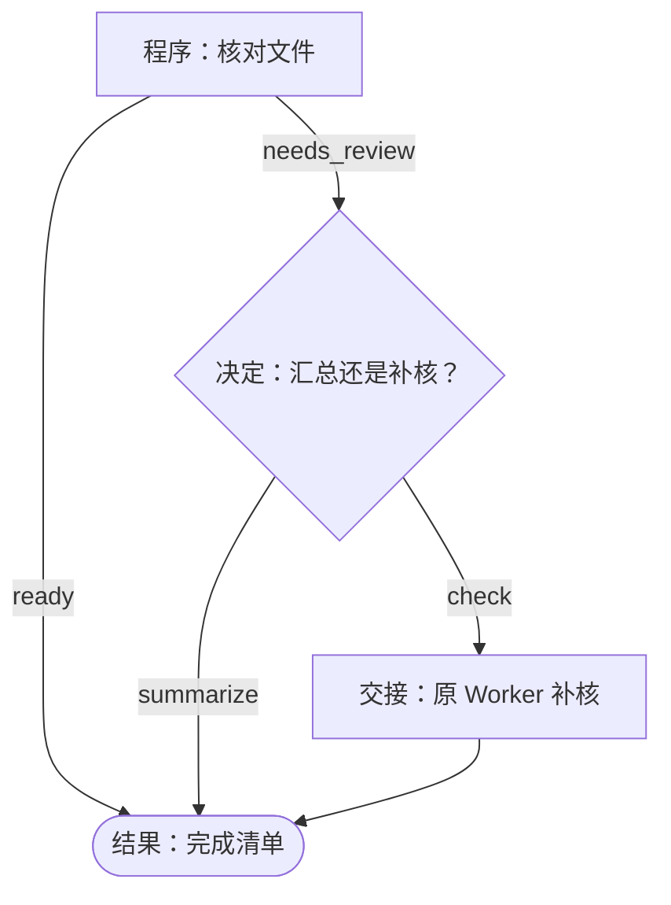
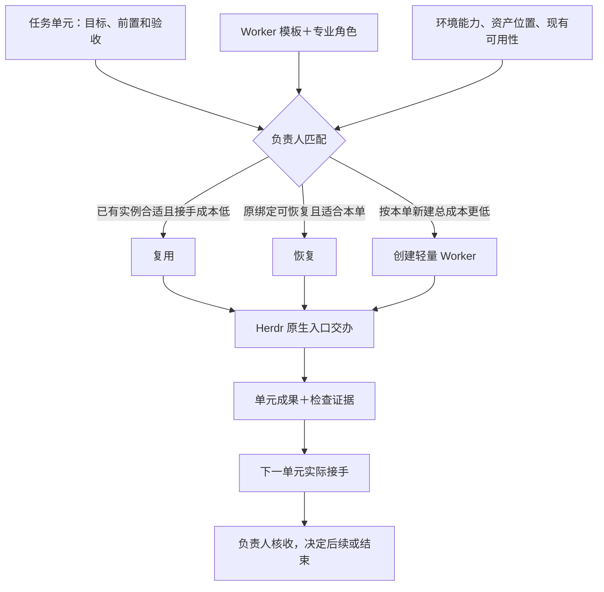

# 项目工作流生成工具 · 第一版开发文档

2026-11-05。第一版已在独立本地项目完成工程验证。负责人使用生成器建立项目自己的流程，开发者按本文接口维护通用工具。采用到真实项目时，由该项目负责人选定首单。[设计依据](decisions/001-project-owned-workflows.md) · [生成器](../scripts/project_workflow.py) · [运行模板](../scripts/project_workflow_template.py)

## 从一次批次复核开始

负责人在原 Herdr 会话读取项目记忆，描述“比对已有资产，请负责人决定直接汇总还是交 Worker 补核”，把决定点、选择和各自去向写成下述 JSON。生成器在项目主仓输出普通 Python。负责人可改分支、替换本地函数、调整证据标准，连同项目记忆入口一起提交项目版本。Router 接手时读记忆和原单，Worker 读本次输入和步骤产物。项目 README 或 AGENTS 已有记忆入口时直接引用。新项目可先写一页，列出资产在哪里、长期决定及其理由、交接沿哪个 Issue。

## 开发和使用接口

开发在本仓的 `scripts/project_workflow.py` 和相邻模板中进行。生成命令为 `python3 scripts/project_workflow.py init --repo PROJECT --spec SPEC.json`。负责人先把目标、证据和允许的去向整理成[可直接使用的规格](examples/project-workflow/batch-review.json)。步骤 ID 唯一，入口和后继均须存在，图可达并在有限步内结束。项目和流程 ID 用小写短横线命名。记忆路径相对项目，生成前必须已经存在。

示例按文件核验的 `outcome` 自动选路，全部匹配走 `ready → finish`，有缺项走 `needs_review → review`。只有后一路需要模型判断。程序节点可以指定一个 `next`，也可以用 `routes` 给不同结果指定去向。负责人可一次决定所有缺项交原 Worker 补核，或带缺项交付当前清单。两条路径都保留每一项的结果。

生成到 `PROJECT/workflows/batch-review/`，其中 `definition.py` 含可读的项目定义，`workflow.py` 含执行入口与可编辑的操作函数。运行只依赖这两个文件和标准库。已有目标目录时保留原文件；通常报告冲突，只有上次源码已发布而 README 未完成、两份源码与原命令逐字相同时，重跑原 `init` 才会只补入口并返回 `readme_recovered: true`。项目迭代直接改生成源码。生成规格用于初始化，运行只读项目代码。

### 工作流集合的阅读入口

项目统一在 `workflows/README.md` 维护集合入口。初始化首条流程时创建入口，新增流程时更新索引并追加该流程的说明；负责人已有的文字及其他流程说明保留。入口属于项目源码，随项目评审、提交和迭代，不依赖协调仓在线。

同一项目的初始化串行发布；`.init.lock` 占用时返回 busy，不覆盖另一次初始化。崩溃遗留锁时，确认原进程已停止后再清理。发布前发现 README 已被编辑则保留新文字、报告恢复方法；重跑原命令会在新文字上补齐入口。README 的 shell 示例将检查点放到仓库外的私有绝对路径，避免把执行台账纳入源码。

README 先用集合图和可点击索引回答“有哪些流程”，再按规格生成每条流程的 Mermaid 步骤图，标明程序、决定、交接和结果。集合图只展示已登记流程，不推定它们之间有依赖。以下分支来自现有批次复核规格：



图下保留简短的输入、输出、接手岗位、运行命令与项目记忆链接。规格未定义的输入格式、实时任务与负责人由项目补充，不能由步骤名称推断。当前进展链接原 Issue／Project，图中结束节点仅表示程序结束。跨单元交接用项目操作返回值及 `run["outputs"][前步骤ID]` 表达，真实接收仍沿原生回执核对。

自动部分只负责初始化时的结构。项目后来直接修改 `definition.py` 时，同时维护对应图和说明；新增另一条流程不重写已维护的图。集合入口回归使用同一项目的两条流程：首条生成后插入负责人说明，再初始化第二条，核对索引、两份步骤图及原手写内容均保留。此增量不改变执行模板或规格合同。增量后的专项测试 13 项通过，全仓 258 项中 255 项通过、3 项既有实机条件测试跳过；仓库结构检查通过。这些是本地工程证据，项目采用仍沿原单取得回执。

以下示范可在 macOS／Linux 的 shell 从协调仓根目录运行，使用两个临时目录模拟独立项目和私有检查点。项目负责人实际使用时替换项目目录、原任务号、清单和证据。Windows 也可用 Python 3.10+ 调用相同的 Python 子命令。项目版本由项目 Git 管理。

```sh
PROJECT=$(mktemp -d)
RUN=$(mktemp -d)/batch.sqlite3
mkdir -p "$PROJECT/docs" "$PROJECT/assets"
printf '%s\n' '接手先核原清单；补核沿原任务；负责人判定是否放行。' > "$PROJECT/docs/project-memory.md"
python3 scripts/project_workflow.py init --repo "$PROJECT" --spec docs/examples/project-workflow/batch-review.json
cd "$PROJECT"
printf abc > assets/a.txt
cat > input.json <<'JSON'
{"items":[
  {"id":"a","path":"assets/a.txt","sha256":"ba7816bf8f01cfea414140de5dae2223b00361a396177a9cb410ff61f20015ad"},
  {"id":"b","path":"assets/b.txt","sha256":"ba7816bf8f01cfea414140de5dae2223b00361a396177a9cb410ff61f20015ad"}
]}
JSON
python3 workflows/batch-review/workflow.py --state "$RUN" start --task issue-2-batch-a --input input.json
python3 workflows/batch-review/workflow.py --state "$RUN" status
python3 workflows/batch-review/workflow.py --state "$RUN" decide --step review --choice check --evidence owner-turn-27
ACTION=$(python3 workflows/batch-review/workflow.py --state "$RUN" status | python3 -c 'import json,sys; print(json.load(sys.stdin)["action"]["id"])')
python3 workflows/batch-review/workflow.py --state "$RUN" receive --action "$ACTION" --status UNKNOWN --evidence native-intent-31
python3 workflows/batch-review/workflow.py --state "$RUN" receive --action "$ACTION" --status COLLECTED --evidence original-manifest-sha256
python3 workflows/batch-review/workflow.py --state "$RUN" resume
```

示例中的两个回执引用代表模拟原生通道的观察。按上述顺序，程序先列出 A 匹配、B 缺失，再等待批量决定，最后带同一动作的回执结束。若创建内容同为 `abc` 的 `assets/b.txt`，换用新任务和新检查点，程序直接输出完整清单。

| 步骤 | 程序行为 | 交给下一步的内容 |
| --- | --- | --- |
| program | 按代码运行项目函数。示例 `verify_files` 接受 `{"items":[{"id":"p01","path":"assets/p01.wav","sha256":"<64位十六进制>"}]}`，从项目根逐项核文件 | 每项保留 ID 和匹配、缺失或摘要不符的结果。缺项随清单交决定者 |
| decision | 输出问题、允许选项、原任务和已有清单，保存检查点。已绑定的决定者从原通道给出选择，调用方导入选择与证据引用 | 只采用当前步骤的合法选项，同一决定重复导入可安全读回；互相冲突的决定须报错 |
| handoff | 按项目、流程、原任务和步骤形成稳定动作 ID，保存交办内容与检查点后返回。调用者按原任务找到原生执行入口 | 原生回执绑定该动作。结果未知时保留原动作，结果已核实才继续。交办内容可以直接读取和复制给获准入口 |
| end | 输出工程结果、完整清单、决定和原生证据引用 | 项目负责人或原单验收者可据此判定业务结果 |

各命令向 stdout 写单个 JSON 对象。正常等待和技术结束均为成功返回，输入错误或合同冲突向 stderr 给出原因并非零退出。状态至少包括 `task`、`step`、`status`、`outputs`、`decisions` 和当前交办 `action`。状态值为 `WAITING_DECISION`、`WAITING_RECEIPT`、`UNKNOWN`、`FINISHED`，可附正在执行的内部状态。相同输入和任务重复 start 可读回，已有检查点遇到不同输入、任务或流程源码版本须报冲突。恢复旧批次时使用该批次原提交。每次状态推进原子写入，查状态不产生动作。

## 自定义项目操作

负责人可以直接使用项目领域语言定义程序节点。例如软件项目要按失败用例清单决定是否需要排查，可在已有的 Python 文件中提供这个函数。参数 `root` 是项目根路径，`run["input"]` 保存原始输入，后续步骤还可读 `run["outputs"][步骤ID]`。函数返回可序列化为 JSON 的值；需要分支时返回字符串 `outcome`。

```python
def classify_tests(root, run):
    failed = run["input"]["failed_tests"]
    return {"outcome": "investigate" if failed else "clean", "failed_tests": failed}


OPERATIONS = {"classify_tests": classify_tests}
```

在规格中使用 `"operation": "classify_tests"`，用 `routes` 把 `investigate` 和 `clean` 分别映射到已有步骤。初始化时加 `--operations path/to/project_operations.py`。生成器将负责人选定的 Python 代码和定义一起固化在项目的 `definition.py`；此后直接维护生成文件。模块顶层只做定义，函数内放确定性计算。已经提交外部作业的程序无法靠 SQLite 回滚该作业，这类步骤应走 handoff 后按原动作回收。

## 执行权和记忆在哪里

### 负责人怎样安排 Worker

负责人按任务单元所需的专业能力，结合 [Worker 模板与专业角色](worker-library/README.md)、目标环境的实际能力、资产位置和现有实例可用性，选择接手总成本合适的 Worker。同项目现有实例合适、上下文清楚且成本较低时复用或沿原绑定恢复。跨项目需要借鉴时，只复刻确有价值的角色模板、技能组合和配置的明确版本，在目标项目建立独立绑定与记忆。若清理历史、迁移和维护旧配置更费力，就按本单最小需求新建轻量 Worker。

一个 Worker 可以承接多个适合的任务单元；单元数量不等于进程数量。负责人统筹接手、成果核收和结束安排，程序通过 Herdr 原生入口执行具体交办；Codex Cloud 作业沿其已授权的独立路由办理。



交接随原任务保留前置成果、输入输出引用、接手方和原生回执。程序单元可以消费前一步的 `outputs`；跨 Worker 的实际接手须有相应原生证据。项目 README 展示这条关系，原 Issue／Project 记录当次进展。

第一版的决定与回执导入命令供持有本地检查点的受信执行者使用。命令记录原通道证据，身份核验、实际外部写入和产物核验沿原角色入口办理。新增项目函数可实现只读核验、计算和可重复的本地转换；有外部副作用的动作放在 handoff。断线后先到原生执行台账按原动作核对，核实结果后导入。信箱用原 job 回传实质进度，Project/Issue 只回填里程碑、阻塞、解除及正式验收。两处回填均可稍后补做。模型给出一次决定后，后续确定性步骤自动推进，无需层层审核。[执行适配器](herdr-executor.md#显式操作) · [项目协作与进展回收](architecture.md#整套协作分工)

若原生动作可能已发生，先用原通道的 `reconcile` 查历史或 `collect` 核已关联的产物。若本地结果已保存而信箱未读到，沿原事件查出件队列并补传。等待这两种情况时没有理由再发一次模型回合。生成程序的动作 ID 用来关联这次交办；取得原生意图或回执后，保留两者关联供接手者查证。已有桥集成例覆盖“一次联系、两版结果”的场景。[原生历史对账](../scripts/coordinator_goal_channel.py) · [出件队列](../scripts/coordinator_transport.py) · [跨组件隔离例](../tests/integration_goal_bridge.py)

项目记忆入口由负责人维护。首次 start 保存入口和当时的文件摘要供追溯，该摘要不代表动态 Hindsight bank 的版本。正式规则与设计决定在项目仓维护，可检索经验按[共享记忆规范](hindsight-memory-integration.md)沉淀；不逐条维护两份摘要。实际采用的召回内容及来源随本单输入／检查点保存，必要上下文随任务交接，记忆暂不可达时已有输入齐备的步骤继续。在途决定仍引用原通道证据，记忆更新不自动重决。原始素材留在资产端；出现新判断走显式分支，修改以后批次的做法则评审项目源码并注明切换点。

## 开发顺序与验收

1. **生成器。** 校验示例、非法分支、环和记忆路径；将本地模板与定义一次发布到新目录。用两个不同项目或两份不同定义生成，证明生成物根植各自项目。
2. **项目运行入口。** 实现四种步骤和上表的 CLI，在项目代码里保留扩展函数的入口。以一次批量决策推进，运行状态能完整读出失败项。
3. **恢复及独立性。** 在隔离项目准备匹配、缺失和不符各一个文件。走一次直接汇总和一次补核。模拟原端已执行、回执晚到，重启后仍见同一动作，导入原回执后完成，重复导入不重复推进。验证修改生成源码会影响新批次，在途批次报告版本冲突。验证另一执行进程仅凭项目源码、原检查点和项目记忆即可接手。
4. **工程交付。** 开发者运行仓库结构检查和完整单测，发布可复制的本地示例。记录工程结果与使用边界。工程验收不需要生产素材、真实业务派发、云端Dot在线或已读。实际启用由项目负责人沿自然业务单安排。

六个端到端用例通过独立 CLI 进程覆盖上述交付点，包括在新目录接手原检查点和费用项目的自定义函数。费用样例先移除原规格及原扩展文件，再从项目副本分别运行自动汇总和待决定分支。全仓单测共 251 项，248 项通过，3 项既有实机条件测试跳过。这些结果覆盖本地生成与运行；真实任务的路由、证据核实和验收沿该项目原单记录。[端到端用例](../tests/test_project_workflow.py)
