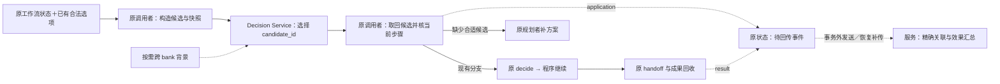
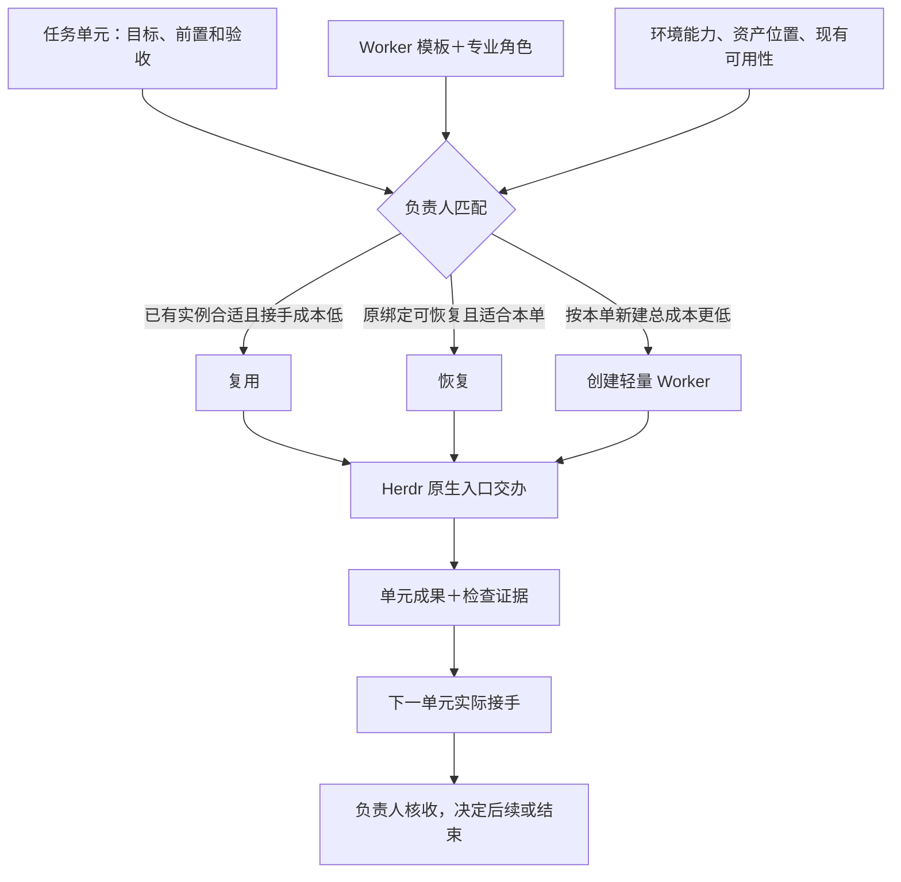

# 项目工作流生成工具 · 第一版开发文档

2026-11-05。第一版已在独立本地项目完成工程验证。负责人使用生成器建立项目自己的流程，开发者按本文接口维护通用工具。采用到真实项目时，由该项目负责人选定首单。[设计依据](decisions/001-project-owned-workflows.md) · [生成器](../scripts/project_workflow.py) · [运行模板](../scripts/project_workflow_template.py)

## 从一次批次复核开始

负责人在原 Herdr 会话读取项目记忆，描述“比对已有资产，请负责人决定直接汇总还是交 Worker 补核”，把决定点、选择和各自去向写成下述 JSON。生成器在项目主仓输出普通 Python。负责人可改分支、替换本地函数、调整证据标准，连同项目记忆入口一起提交项目版本。Router 接手时读记忆和原单，Worker 读本次输入和步骤产物。项目 README 或 AGENTS 已有记忆入口时直接引用。新项目可先写一页，列出资产在哪里、长期决定及其理由、交接沿哪个 Issue。

## 开发和使用接口

开发在本仓的 `scripts/project_workflow.py` 和相邻模板中进行。生成命令为 `python3 scripts/project_workflow.py init --repo PROJECT --spec SPEC.json`。负责人先把目标、证据和允许的去向整理成[可直接使用的规格](examples/project-workflow/batch-review.json)。步骤 ID 唯一，入口和后继均须存在，图可达并在有限步内结束。项目和流程 ID 用小写短横线命名。记忆路径相对项目，生成前必须已经存在。

示例按文件核验的 `outcome` 自动选路，全部匹配走 `ready → finish`，有缺项走 `needs_review → review`。只有后一路需要模型判断。程序节点可以指定一个 `next`，也可以用 `routes` 给不同结果指定去向。负责人可一次决定所有缺项交原 Worker 补核，或带缺项交付当前清单。两条路径都保留每一项的结果。

生成到 `PROJECT/workflows/batch-review/`，其中 `definition.py` 含可读的项目定义，`workflow.py` 含执行入口与可编辑的操作函数。运行只依赖这两个文件和标准库。已有目标目录时保留原文件；通常报告冲突，只有上次源码已发布而 README 未完成、两份源码与原命令逐字相同时，重跑原 `init` 才会只补入口并返回 `readme_recovered: true`。项目迭代直接改生成源码。生成规格用于初始化，运行只读项目代码。

### 工作流集合的阅读入口

项目统一在 `workflows/README.md` 维护集合入口。初始化首条流程时创建入口，新增流程时更新索引并追加该流程的说明；负责人已有的文字及其他流程说明保留。入口属于项目源码，随项目评审、提交和迭代，不依赖协调仓在线。

同一项目的初始化串行发布；`.init.lock` 占用时返回 busy，不覆盖另一次初始化。崩溃遗留锁时，确认原进程已停止后再清理。发布前发现 README 已被编辑则保留新文字、报告恢复方法；重跑原命令会在新文字上补齐入口。README 的 shell 示例将检查点放到仓库外的私有绝对路径，避免把执行台账纳入源码。

README 先用集合图和可点击索引回答“有哪些流程”，再按规格生成每条流程的 Mermaid 步骤图，标明程序、决定、交接和结果。集合图只展示已登记流程，不推定它们之间有依赖。以下分支来自现有批次复核规格：


图下保留简短的输入、输出、接手岗位、运行命令与项目记忆链接。规格未定义的输入格式、实时任务与负责人由项目补充，不能由步骤名称推断。当前进展链接原 Issue／Project，图中结束节点仅表示程序结束。跨单元交接用项目操作返回值及 `run["outputs"][前步骤ID]` 表达，真实接收仍沿原生回执核对。

自动部分只负责初始化时的结构。项目后来直接修改 `definition.py` 时，同时维护对应图和说明；新增另一条流程不重写已维护的图。集合入口回归使用同一项目的两条流程：首条生成后插入负责人说明，再初始化第二条，核对索引、两份步骤图及原手写内容均保留。此增量不改变执行模板或规格合同。增量后的专项测试 13 项通过，全仓 258 项中 255 项通过、3 项既有实机条件测试跳过；仓库结构检查通过。这些是本地工程证据，项目采用仍沿原单取得回执。

以下示范可在 macOS／Linux 的 shell 从协调仓根目录运行，使用两个临时目录模拟独立项目和私有检查点。项目负责人实际使用时替换项目目录、原任务号、清单和证据。Windows 也可用 Python 3.10+ 调用相同的 Python 子命令。项目版本由项目 Git 管理。

```sh
PROJECT=$(mktemp -d)
RUN=$(mktemp -d)/batch.sqlite3
mkdir -p "$PROJECT/docs" "$PROJECT/assets"
printf '%s\n' '接手先核原清单；补核沿原任务；负责人判定是否放行。' > "$PROJECT/docs/project-memory.md"
python3 scripts/project_workflow.py init --repo "$PROJECT" --spec docs/examples/project-workflow/batch-review.json
cd "$PROJECT"
printf abc > assets/a.txt
cat > input.json <<'JSON'
{"items":[
  {"id":"a","path":"assets/a.txt","sha256":"ba7816bf8f01cfea414140de5dae2223b00361a396177a9cb410ff61f20015ad"},
  {"id":"b","path":"assets/b.txt","sha256":"ba7816bf8f01cfea414140de5dae2223b00361a396177a9cb410ff61f20015ad"}
]}
JSON
python3 workflows/batch-review/workflow.py --state "$RUN" start --task issue-2-batch-a --input input.json
python3 workflows/batch-review/workflow.py --state "$RUN" status
python3 workflows/batch-review/workflow.py --state "$RUN" decide --step review --choice check --evidence owner-turn-27
ACTION=$(python3 workflows/batch-review/workflow.py --state "$RUN" status | python3 -c 'import json,sys; print(json.load(sys.stdin)["action"]["id"])')
python3 workflows/batch-review/workflow.py --state "$RUN" receive --action "$ACTION" --status UNKNOWN --evidence native-intent-31
python3 workflows/batch-review/workflow.py --state "$RUN" receive --action "$ACTION" --status COLLECTED --evidence original-manifest-sha256
python3 workflows/batch-review/workflow.py --state "$RUN" resume
```

示例中的两个回执引用代表模拟原生通道的观察。按上述顺序，程序先列出 A 匹配、B 缺失，再等待批量决定，最后带同一动作的回执结束。若创建内容同为 `abc` 的 `assets/b.txt`，换用新任务和新检查点，程序直接输出完整清单。

| 步骤 | 程序行为 | 交给下一步的内容 |
| --- | --- | --- |
| program | 按代码运行项目函数。示例 `verify_files` 接受 `{"items":[{"id":"p01","path":"assets/p01.wav","sha256":"<64位十六进制>"}]}`，从项目根逐项核文件 | 每项保留 ID 和匹配、缺失或摘要不符的结果。缺项随清单交决定者 |
| decision | 输出问题、允许选项、原任务和已有清单，保存检查点。已绑定的决定者从原通道给出选择，调用方导入选择与证据引用 | 只采用当前步骤的合法选项，同一决定重复导入可安全读回；互相冲突的决定须报错 |
| handoff | 按项目、流程、原任务和步骤形成稳定动作 ID，保存交办内容与检查点后返回。调用者按原任务找到原生执行入口 | 原生回执绑定该动作。结果未知时保留原动作，结果已核实才继续。交办内容可以直接读取和复制给获准入口 |
| end | 输出工程结果、完整清单、决定和原生证据引用 | 项目负责人或原单验收者可据此判定业务结果 |

各命令向 stdout 写单个 JSON 对象。正常等待和技术结束均为成功返回，输入错误或合同冲突向 stderr 给出原因并非零退出。状态至少包括 `task`、`step`、`status`、`outputs`、`decisions` 和当前交办 `action`。状态值为 `WAITING_DECISION`、`WAITING_RECEIPT`、`UNKNOWN`、`FINISHED`，可附正在执行的内部状态。相同输入和任务重复 start 可读回，已有检查点遇到不同输入、任务或流程源码版本须报冲突。恢复旧批次时使用该批次原提交。每次状态推进原子写入，查状态不产生动作。

## Decision Service 接入：先跑通现有决定点

2026-11-09，Mac 消费者已固定安装，并与 VPS Decision Service、真实 Mac Herdr 完成一次合成工程闭环，生产业务尚未采用验收。[Decision Service](https://github.com/CF-FE/decision-service/blob/main/docs/architecture.md)由独立项目维护，帮助选择下一步和角色模型配置，目标是提高整条工作流的推进效率与 token 利用率。先跑通包含跨 bank 检索的 MVP，再按实际使用迭代，不以收益基线、完整标签集或统一影子期作为开工前置。本文拥有工作流侧合同，[角色宿主](agent-hosts.md#decision-model-selection)拥有选型的实际应用合同。



### 最小调用与应用合同

**首版程序入口为 HTTP API。** Herdr／项目适配器通过服务调用 `evaluate_decision`、`get_decision`、`record_decision_feedback` 三个逻辑操作，方法、路径与字段统一见服务的 [v1 合同](https://github.com/CF-FE/decision-service/blob/main/docs/api-contract.md)。Mac 安装版到 VPS HTTPS 的真实调用已验证；MCP、插件包及各客户端连接状态由服务主仓维护，不从 HTTP 成功推定其他入口已通过。

调用者在真正需要判断时读取 `status`，以当前 `decision.choices` 构造有稳定 `candidate_id` 的候选，另提供“均不适合”的非执行出口，映射为 `needs_replan` 而不导入 `decide`。请求关联原项目、任务、流程、`step`、`source_sha256`、`input_sha256`，并保留本次相关状态和候选的摘要。关联、冻结请求和待传事件保存在原检查点的 `decision_integration` 中；它不进入业务状态摘要或项目 program 参数，也不改变原 `decisions[step]` 的 `{choice,evidence}` 结构。模板没有独立 `state_version` 或原生 `run_id`，适配器生成的 `unit_id` 显式标记来源。

服务返回 `decision_id`、所选 `candidate_id` 和处置状态；参数由程序从本次冻结候选取回，不使用模型生成的命令。同一请求的候选集合及参数／配置改变即为输入冲突，旧 ID 不套用新映射。已有合法建议可在原授权内直接采用：原调用者核仍是对应待决定步骤、相关状态与候选未变，再将候选映射到原 `decide --step … --choice … --evidence …`。证据引用指向保存的决策记录，包含来源、输入快照和选中候选；它不是用户批准或业务验收证据。模板事务内再次检查当前步骤和选项并自动推进。相同导入重放须沿用原 choice 和 evidence；不能为重试换证据引用。

调用期间状态实质变化时，旧答案记为未采用；重新读取原状态，只在仍需判断时按新快照请求。原选择已应用时读回原记录，避免重复派发。`abstain`、`needs_review`、`needs_replan` 或 `unavailable` 沿原负责人／规划者处理，独立就绪工作继续；不一律转为公子审批，也不以默认通过替代缺失判断。纯模型重算在同一请求的次数和总期限内进行；已发出的业务动作仍按原动作对账。

模型和记忆网络调用放在工作流调用者的薄适配层，不能放进事务内的 `program` 函数；事务失败可能使程序函数再执行。固定规则可以决定的路由直接运行，只剩一个明确合法选项时也无需模型选择。新任务、分支歧义或实质证据变化才触发判断，无变化轮询不调用模型。同一输入与候选版本复用原结果，只传决定所需上下文。复用记录须包含实际采用的检索片段与来源；新证据需要重决时新建关联请求，不把动态 bank 当不变快照。

<a id="decision-storage-boundary"></a>

### 服务记录与原工作流状态分开保存

Decision Service 首版采用 SQLite，文件位于服务主机持久磁盘，仅由该服务访问；Herdr、项目工作流及其他消费者走 API／MCP，不远程打开共享数据库文件。本仓已有的工作流私有 SQLite 检查点继续独立持有业务状态、动作及恢复责任，不与服务库合并。

| 数据 | 维护位置与含义 |
| --- | --- |
| 冻结输入／候选、决策结果、检索来源、服务自身判断模型配置与 attempt | Decision Service 的决策记录；不覆盖原项目定义 |
| application／result 事件与修订、质量证据引用、推荐及实际执行模型类型／型号／强度 | Decision Service 已收到的反馈记录；模型配置、缺省消耗与不记录现金的规则沿下节 |
| decision 与原工作单元／执行引用、已收反馈及已知回收缺口 | Decision Service 的关联记录；只能反映已接收或已对账的事实 |
| 业务状态、原产物／验收权威、待回传事件与恢复责任 | 原工作流／Herdr 及原项目记录；服务库不能恢复尚未回传的事实 |
| 项目经验与召回背景 | Hindsight；服务只保留本次实际采用的必要片段和来源，不复制整个 bank |

前三项是逻辑数据归属，不规定表名、DDL 或框架版本；服务侧选型和运维由[Decision Service 部署文档](https://github.com/CF-FE/decision-service/blob/main/docs/deployment.md)维护。服务持久保存反馈后才确认收到，原端据此更新待传记录；响应丢失沿原事件／修订补传，不因为服务库中没有结果就重做业务。

### 当前能做什么，调整计划还缺什么

| 调整 | 当前能力与接法 |
| --- | --- |
| 继续、补核、选择已有替代路径 | 已在流程图定义为 choice／后继时，可由薄适配层选中后交原 `decide`；当前命令没有任意动作参数导入接口 |
| 并行、重试、改变待办优先级 | 仅当项目已有执行入口或已定义后续节点、且当前合法时才作为可应用候选；通用模板只有一个当前步骤／动作，没有 fork/join、循环重试或优先级调度接口 |
| 新增、拆分步骤或重排在途依赖 | 由原规划者提供具体计划候选；通用模板尚无在途计划更新接口，不能改源码后直接接续旧检查点 |
| 后续批次改用新流程 | 负责人在项目仓迭代源码、图和版本；旧批次用原源码恢复，新批次按注明的切换点采用 |

第一版 MVP 接已有分支即可真实推进，不等待通用重规划引擎。原规划者可一次提供多项已知调整，不要求每个候选额外开一轮模型。需要在途改图时，由项目工作流维护者补计划接续合同：绑定原计划／检查点和新计划版本，列明保留的已完成产物、未决原生动作及新后继，定义可切换检查点和重复应用行为；未决外部动作沿原 ID 回收。不能以新模型建议清空历史或重做已有生产。此项是后续能力，不改变当前源码冲突检查。

<a id="decision-feedback"></a>

### 程序化结果回收与效果验证

**MVP 包含原工作流／角色适配器自动直传反馈，人工纠正作为补充。** 本节约定调用方怎样产生和恢复反馈；服务入口、幂等修订、覆盖率及效果汇总由 Decision Service 的[结果回收合同](https://github.com/CF-FE/decision-service/blob/main/docs/outcome-feedback.md)维护。当前通过下述显式适配入口生成和补传；直接调用旧 runner 不会自动向服务发送反馈。

在采用建议前，将 `decision_id`、本次候选与原项目／任务／流程运行、步骤、动作关联持久保存；发生执行后再补原生执行 attempt。当前模板没有独立 `run_id`，沿原检查点对应的项目／流程／任务及源码、输入摘要关联，不能只挂在会随推进清空的当前 action 上。没有 handoff 时允许无 action；判断重算 attempt 与实际执行 attempt 分开。确认尚未执行时记未发生，原生引用缺失或效果不明时保留 UNKNOWN；不为了填字段创建任务，也不把本地私有路径当对外任务 ID。两类反馈都保留来源、观察时间及本次对象版本：

| 反馈 | 触发点和内容 |
| --- | --- |
| `application` | 原适配器完成应用核对时，报告推荐候选与实际采用动作／模型配置、原生关联；未采用、过期、失败及效果未知分别记录原因。服务返回推荐不等于实际采用 |
| `result` | 对应工作单元／执行 attempt 完成、失败或取消生效时，报告原产物／结果引用与已有质量结论；token／耗时／重试／返工仅附带现成可得数据。不等待角色退出；取消请求不冒充取消生效，终态未知保留待核 |

**先保存关联和待传内容，再在事务外发送。** 本地应用成功但反馈尚未落盘时，恢复后从原决定、原动作与原生回执核实并补成反馈，不为填回执再次执行业务。原 `decide` 已保存的 choice/evidence 可用于核对采用，即使命令随后失败也不能据退出码推断未应用。反馈恢复先只读核原检查点及原生记录，按原步骤重建缺失事件；补传本身不调用 `decide`／`resume` 或重新派发，外部执行未知仍沿原入口对账。适配命令在业务操作后尝试发送，失败保留待传内容，由后续命令或显式 `reconcile` 补传；没有后台守护或新定时任务。主流程完成也保留未传事件及补传责任，网络失败不撤销已提交的业务状态。

同一生产者事件及修订重投沿用稳定键与相同正文，服务已接收则读回原确认，正文不同则报告冲突。质量结论稍后取得或被更正时追加新修订，关联被更新的原事件；不改写已发送正文，也不让去重吞掉更正。用量按原工作单元／attempt 输出带计量范围的快照，新修订替换旧快照，不当作新增消耗累加。反馈缺失只表示尚未收回，不能推断失败、未采用或质量不合格。回传失败不阻塞业务，不启动新的制作／执行 attempt。

**结果可关联，效果仍需比较。** 适配器回传事实及原质量／验收引用，沿既有检查结果与本单验收者判断，不为每次决策新建人工评分任务。服务分别展示应用回收率、已知已结束单元的结果回收率，在途与终态未知另列，并说明覆盖的已知范围；Hindsight 语义召回不能保证找全结果。后续可从精确关联案例提炼经验，观察记录与已验证经验分开，不以记忆入库作为本次回收条件。

**模型配置必须记录，消耗只记现成数据。** 模型类型、具体型号与推理强度保留推荐和实际生效两份记录，必要时附 provider／backend；实际值读不出标“未确认”，不支持强度的标“不适用”，不拿推荐值替代。消耗为低优先级：现成 API 响应、原回执或已接事件能直接提供的 token／耗时等附带记录，否则留 `null`／“未提供”，不记为 0；不新增采集器、遥测或账单链路，不以补齐消耗阻塞 MVP、结果回收或反馈接收。现金费用与 API 等价估价不采集、不记录，也不作为反馈字段。

已有消耗按原计量范围保存，同一执行 attempt 关联多个决策时只记一份，服务判断的现成计量另列。token 按模型与阶段分列，并发步骤耗时不相加冒充整单墙钟时间，缺项不推算全链总量。实际采用的模型配置才计入该配置的执行样本，未采用原因仍留存。后续有可比数据时，结合质量、已有耗时、token 与返工观察效果；关联本身不证明某个决定带来收益，数据完整性不设为首版门槛。

### 两仓交付与一次联调

| 维护方 | 后续开发交付 |
| --- | --- |
| `CF-FE/decision-service` | 有限候选选择、跨 bank 检索、结果与反馈入口、幂等修订、精确关联查询／覆盖率和效果汇总；仅附带现成响应中的消耗，不设必备采集要求 |
| 本仓工具维护者 | 当前决定点的薄适配、原状态关联及 `decide` 导入；应用／结果反馈、原恢复入口补传和模型类型／型号／强度记录；现成消耗可附带，不新接 usage 采集。角色配置适配见[宿主合同](agent-hosts.md#decision-model-selection) |
| 各项目负责人／工作流维护者 | 维护项目候选与现有操作、自然业务接入、后续计划接续及项目验收；不复制第二套任务状态机 |

真实采用时，以一条已有合法分支贯通选择、原检查点继续和角色配置实际应用，再由适配器回收 application／result、读回关联记录。反馈重投与恢复沿同一事件核对，不重复业务，不追加独立的定时／已读测试。基本恢复行为已用本地工程用例核实，不要求为验收中断真实生产；全量 Hindsight webhook／补偿扫描后置。云端Dot照常从信箱或 Project 感知实质进展并向公子汇报，项目验收仍归原验收者。

### 已实现入口与工程证据

入口为 [project_workflow_decision.py](../scripts/project_workflow_decision.py)，公共参数是 `--workflow <原生成的 workflow.py> --state <原私有检查点>`。服务地址、令牌与可选超时由 `DECISION_SERVICE_URL`、`DECISION_SERVICE_TOKEN`、`DECISION_SERVICE_TIMEOUT` 注入；令牌不写入任务、检查点或项目源码。新入口需使用本版生成的 workflow，旧在途批次沿原源码恢复。

| 子命令 | 行为 |
| --- | --- |
| `choose` | 冻结候选、请求和当前状态，判断后调用原 `decide`；`--request-id` 沿已冻结输入恢复，不能顺带换上下文 |
| `resume` / `receive` | 显式调用原业务命令，再独立尝试回传；原命令失败保留错误和已提交事实 |
| `reconcile` | 从原状态重建反馈并补传，既不推进流程，也不重新派发 |
| `record-result` | 以原端证据补充 `completed/failed/cancelled`；仅 `COLLECTED` 时执行结论保留 `unknown` |
| `quality` | 给既有结果追加质量修订，与执行终态分开 |
| `local-status` / `get` | 分别只读本地关联／原 handoff 单元，或查询服务记录，不发送反馈 |

同一单元的每条建议单独报告 application，实际执行结果只产生一个稳定事件，可关联工作流和模型两个决策。未采用建议不覆盖单位实际进展；没有参与执行的过期建议只报告观察，不制造无法回收的结果预期。状态和质量未知不伪造完成。模型创建和读回见[宿主入口](agent-hosts.md#decision-model-selection)。

2026-11-09 本地工程审查已通过。全仓 363 项测试中 359 项通过、4 项既有条件跳过，包含新增工作流 9 项和模型 6 项；结构及 diff 检查通过。隔离联调使用真实本地 HTTP／SQLite 和生成 runner，上游、Herdr 与 rollout 使用替身，覆盖回执丢失、处理中断、部分检索失败、同一单元联合结果和后补质量修订。

随后安装固定代码版本 `8612a9a` 到 `~/Library/Application Support/HerdrDecisionConsumer`，5 个脚本摘要与安装收据一致，旧 `a8edbea` 安装目录保留回退；原 ProjectWorkflowTools 和在途 runner 未覆盖。客户端支持 `/decision-service` 等干净的静态路径前缀，私有凭据留宿主，安装不等于所有 Harness 已加载。

真实合成单元已从安装版 CLI 经 VPS HTTPS 取得 `gpt-6-luna` 选择、提交原分支；再沿专用 Herdr driver 执行一次纯文本标记任务，原生 thread／turn 确认 `openai / gpt-6.1-sol / low`。本机检查点核到 1 次启动意图、1 个真实回合、两个 application 均已采用；云端两条决策读回同一结果修订 2，workflow 为 `FINISHED`、待补传为 0。结果和质量仅针对这条合成工程任务，未操作生产资产或改变现任角色，不替代项目业务验收。跨 bank 实测与其他客户端授权另按服务主仓记录。

### 2026-11-09 实施拆分与审查

公子已授权重新梳理方案并由 `gpt-6.1-sol` 实现会话并行开发；两仓原会话负责方案及审计复核，不编写实现或测试代码。本文沿用已接受的服务／原工作流归属，不新增架构或审批层。服务接口的路径、字段和错误语义由 Decision Service 主仓统一冻结；本节保留首轮工程派工边界，不另维护一份服务 schema。公子随后授权云端与本地安装、全链路测试，其安装及合成验证证据见上节；生产任务仍按原单授权与验收。

采用服务核心、OpenAI／Hindsight 接入、Herdr 消费者三个实现会话。Herdr 的工作流 W 与角色 R 是同一实现者负责的两个切片，统一持有 HTTP 客户端、原单关联及反馈持久化，先贯通 W 再接入 R。相比拆成两个 Herdr 会话，此安排减少公共文件和反馈接口的交叉修改；服务及 provider 接入仍可并行。动态任务状态由 Decision Service 本轮任务队列统一维护，本节不复制进度表。

| 切片 | 可验证交付 | 写入范围 |
| --- | --- | --- |
| W：原分支选择与反馈 | `status` → 持久冻结请求及候选 → HTTP 判断／原请求查询 → 核当前步骤 → 原 `decide` → 只读核采用；沿原检查点保存及补传 application／result | `scripts/project_workflow_template.py`；新增 `scripts/decision_service_client.py`、`scripts/project_workflow_decision.py`；`tests/test_project_workflow.py` 及新增对应 client／decision 测试 |
| R：一个宿主的模型配置应用 | Mac Codex 候选 → 原 Herdr 创建者应用 → 原生目标与配置读回 → 按原工作单元回传；复用 W 客户端和反馈持久化入口 | 新增 `scripts/herdr_model_selection.py`、`tests/test_herdr_model_selection.py`；不改现任负责人冻结的恢复参数 |

Herdr 实现者可按需调整 `scripts/project_workflow.py` 的生成拷贝范围；R 首版绑定原 workflow 工作单元，复用 W 的检查点关联和待传入口。文档由两仓主审整合。已有项目生成物、私有配置、在途检查点、审批模块及 `coordinator_goal_channel.py` 不在写入范围；`docs/status.md` 留主审汇总。新文件名是本次任务写权，尚非已发布命令。部署包若还需纳入入口，先给维护者精确清单，不顺带部署。

W 与 R 共用客户端和原检查点的绑定／读取、排队／待传／确认能力。同一步的工作流选择与模型选择分别保存请求和决策关联；同一次执行结果只生成一个稳定事件，可关联多个 `decision_ids`。R 必须交可调用的原生应用及对账入口，并由本轮任务卡指明调用者；只有配置 helper 或启动准备稿不算完成接入。

**开工前只冻结必要的消费接口。** 三个逻辑操作须有 HTTP 方法、路径、认证配置与示例；查询必须能凭原 `request_id` 找到首次响应丢失的请求。集成请求显式保存稳定请求 ID、预设、原任务／步骤／源码与输入摘要、候选映射及快照；服务响应回显这些关联，并给出 `decision_id`、处置状态及可空候选。反馈合同明确 `event_id/revision`、来源作用域、原单元及可得原生引用、接收确认、同键冲突与后补修订。具体字段名及序列化以服务唯一合同为准，消费者不得各自猜测。模拟 HTTP 与检查点实现可在合同冻结后并行，不等待服务部署、收益基线或用量补齐。

**复用现有行为，避开四个接线误区。**

1. `decisions[step]` 继续只含 `{choice, evidence}`；既有审批适配器精确核对该结构。服务关联和待传事件另存原检查点，不扩大旧对象，也不复制业务状态机。
2. `decide` 提交选择后，后续 `advance` 仍可能失败。恢复先读原选择与证据；`action` 会随推进清空，关联须保留原步骤。`COLLECTED` 只表示结果收回，不能据此生成质量通过。
3. 新增反馈登记、确认和纯补传入口直接结束，不落入 `advance`。HTTP 在事务外运行；查询只读，反馈失败不回滚业务，服务确认丢失沿同事件修订重传。
4. Worker 库只生成准备稿，原角色恢复只接受冻结参数；二者均非动态模型执行器。R 须接实际原创建者入口，核安装版参数后只映射模型／强度。推荐配置、启动配置和可证实的生效配置分开保存，读不出实际值记未确认；启动效果未知时先查原目标，不重建。

**审查和一次集中联调。** 两仓主审分别复核服务与消费者，并互审冻结合同。Herdr 专项覆盖合法选择／非执行出口、等待期间快照变化、选择已提交后失败、反馈确认丢失、质量修订、action 清空后的关联，以及补传不推进业务；模型切片另核非模型参数保持、原目标关联和推荐／实际值分离。采用真实生成的样例 workflow、临时 SQLite 与模拟 HTTP 验行为，最后与服务做一次集中联调。原任务回收范围须有带时间的单元状态观察，不能仅用已收到的 result 反推结果回收率。

实现者运行受影响专项；整合后在本仓根执行 `python3 scripts/check_repository.py` 和 `python3 -m unittest discover -s tests -v`。需要触及 Worker 库时才另跑其 `check`。旧批次保留原 runner 与源码摘要，新代码先在新生成样例采用；不得改摘要绕过旧批次版本冲突。模拟与本地联调只能证明工程行为，实际模型／宿主采用以原生回执记录，无需为此重复生产或增加独立测试单。

## 自定义项目操作

负责人可以直接使用项目领域语言定义程序节点。例如软件项目要按失败用例清单决定是否需要排查，可在已有的 Python 文件中提供这个函数。参数 `root` 是项目根路径，`run["input"]` 保存原始输入，后续步骤还可读 `run["outputs"][步骤ID]`。函数返回可序列化为 JSON 的值；需要分支时返回字符串 `outcome`。

```python
def classify_tests(root, run):
    failed = run["input"]["failed_tests"]
    return {"outcome": "investigate" if failed else "clean", "failed_tests": failed}


OPERATIONS = {"classify_tests": classify_tests}
```

在规格中使用 `"operation": "classify_tests"`，用 `routes` 把 `investigate` 和 `clean` 分别映射到已有步骤。初始化时加 `--operations path/to/project_operations.py`。生成器将负责人选定的 Python 代码和定义一起固化在项目的 `definition.py`；此后直接维护生成文件。模块顶层只做定义，函数内放确定性计算。已经提交外部作业的程序无法靠 SQLite 回滚该作业，这类步骤应走 handoff 后按原动作回收。

## 执行权和记忆在哪里

### 负责人怎样安排 Worker

负责人按任务单元所需的专业能力，结合 [Worker 模板与专业角色](worker-library/README.md)、目标环境的实际能力、资产位置和现有实例可用性，选择接手总成本合适的 Worker。同项目现有实例合适、上下文清楚且成本较低时复用或沿原绑定恢复。跨项目需要借鉴时，只复刻确有价值的角色模板、技能组合和配置的明确版本，在目标项目建立独立绑定与记忆。若清理历史、迁移和维护旧配置更费力，就按本单最小需求新建轻量 Worker。

一个 Worker 可以承接多个适合的任务单元；单元数量不等于进程数量。负责人统筹接手、成果核收和结束安排，程序通过 Herdr 原生入口执行具体交办；Codex Cloud 作业沿其已授权的独立路由办理。



交接随原任务保留前置成果、输入输出引用、接手方和原生回执。程序单元可以消费前一步的 `outputs`；跨 Worker 的实际接手须有相应原生证据。项目 README 展示这条关系，原 Issue／Project 记录当次进展。

第一版的决定与回执导入命令供持有本地检查点的受信执行者使用。命令记录原通道证据，身份核验、实际外部写入和产物核验沿原角色入口办理。新增项目函数可实现只读核验、计算和可重复的本地转换；有外部副作用的动作放在 handoff。断线后先到原生执行台账按原动作核对，核实结果后导入。信箱用原 job 回传实质进度，Project/Issue 只回填里程碑、阻塞、解除及正式验收。两处回填均可稍后补做。模型给出一次决定后，后续确定性步骤自动推进，无需层层审核。[执行适配器](herdr-executor.md#显式操作) · [项目协作与进展回收](architecture.md#整套协作分工)

若原生动作可能已发生，先用原通道的 `reconcile` 查历史或 `collect` 核已关联的产物。若本地结果已保存而信箱未读到，沿原事件查出件队列并补传。等待这两种情况时没有理由再发一次模型回合。生成程序的动作 ID 用来关联这次交办；取得原生意图或回执后，保留两者关联供接手者查证。已有桥集成例覆盖“一次联系、两版结果”的场景。[原生历史对账](../scripts/coordinator_goal_channel.py) · [出件队列](../scripts/coordinator_transport.py) · [跨组件隔离例](../tests/integration_goal_bridge.py)

项目记忆入口由负责人维护。首次 start 保存入口和当时的文件摘要供追溯，该摘要不代表动态 Hindsight bank 的版本。正式规则与设计决定在项目仓维护，可检索经验按[共享记忆规范](hindsight-memory-integration.md)沉淀；不逐条维护两份摘要。实际采用的召回内容及来源随本单输入／检查点保存，必要上下文随任务交接，记忆暂不可达时已有输入齐备的步骤继续。在途决定仍引用原通道证据，记忆更新不自动重决。原始素材留在资产端；出现新判断走显式分支，修改以后批次的做法则评审项目源码并注明切换点。

### 需要新增授权的决定点

`decision` 保存问题与选择，`handoff` 保存原生交接和检查点；现有生成器不会自行向用户提问或监听其他会话的答复。[审批子工作流](approval-workflow.md)规定如何由协调层补齐这一段。项目只维护触发条件、具体范围、审批者及批准后的后继，复用原任务、既有执行者和检查点；已获批准的在途动作只关联证据，不为新机制重提审批或重做执行。普通业务判断仍由相应岗位在权限内处理。

## 开发顺序与验收

1. **生成器。** 校验示例、非法分支、环和记忆路径；将本地模板与定义一次发布到新目录。用两个不同项目或两份不同定义生成，证明生成物根植各自项目。
2. **项目运行入口。** 实现四种步骤和上表的 CLI，在项目代码里保留扩展函数的入口。以一次批量决策推进，运行状态能完整读出失败项。
3. **恢复及独立性。** 在隔离项目准备匹配、缺失和不符各一个文件。走一次直接汇总和一次补核。模拟原端已执行、回执晚到，重启后仍见同一动作，导入原回执后完成，重复导入不重复推进。验证修改生成源码会影响新批次，在途批次报告版本冲突。验证另一执行进程仅凭项目源码、原检查点和项目记忆即可接手。
4. **工程交付。** 开发者运行仓库结构检查和完整单测，发布可复制的本地示例。记录工程结果与使用边界。工程验收不需要生产素材、真实业务派发、云端Dot在线或已读。实际启用由项目负责人沿自然业务单安排。

六个端到端用例通过独立 CLI 进程覆盖上述交付点，包括在新目录接手原检查点和费用项目的自定义函数。费用样例先移除原规格及原扩展文件，再从项目副本分别运行自动汇总和待决定分支。全仓单测共 251 项，248 项通过，3 项既有实机条件测试跳过。这些结果覆盖本地生成与运行；真实任务的路由、证据核实和验收沿该项目原单记录。[端到端用例](../tests/test_project_workflow.py)
