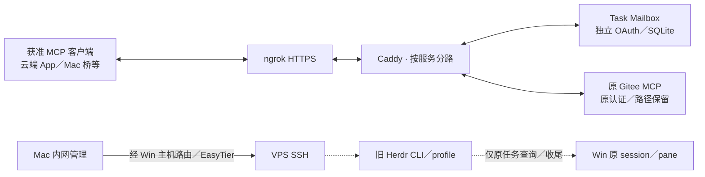

# VPS 服务与旧控制支路指引

修订日期：2026-11-03。本页只维护 VPS 的服务职责、固定安装归属、容量口径和旧任务恢复入口。整体拓扑与各端组件见[架构](architecture.md)，EasyTier／SSH 见[网络方案](networking-plan.md)，当前采用与历史回执见[状态总表](status.md)及[冻结历史](history/status-through-2026-11-03.md)。

VPS 当前承载 Task Mailbox、原 Gitee MCP 和 HTTPS 接入；Mac 常在线承载项目 Lead、协调桥与显式执行适配器。Mac → Win 的 LAN SSH 主链不经 VPS。VPS 的旧 Herdr profile、网络与在途引用保留用于原任务对账，不因新入口建立而迁移或清除。

## 1. 目标与职责

| VPS 职责 | 维护边界 |
| --- | --- |
| MCP 工具服务 | 各服务有独立源码、运行依赖、认证及验证记录；不在本仓标准库环境安装框架 |
| 信箱持久存储 | 保存 job、事件、小结果及精确读确认；不执行 Herdr、shell 或模型 |
| HTTPS 路由 | 复用 ngrok／Caddy 和已登记入口，新增或修改服务只处理其获准路径与认证 |
| 旧 Herdr 控制 | 保留 TUI CLI、原 profile 和原生执行引用；无本地 pane 用途时不启动本地 server |
| 网络与日志 | 保留原 EasyTier／SSH、私密配置和有界日志；网络恢复不等于业务恢复 |

VPS 不常驻项目规划 Codex、不部署模型或桌面应用，也不保存音频原件和大产物。业务正式状态仍归原项目 Projects／Issues 或既有正式入口；信箱不是第二套业务状态库。

## 2. 主链路接入与持续在线前提

Mac → Win 使用本地 Herdr saved-machine／`--machine` 经 LAN SSH 直连既有 `collab`；Mac → VPS 才经 Win 网关和 EasyTier 的指定主机路由。两者的身份、profile 与成功回执不能互换，网络配置细节统一见[拓扑与分层](networking-plan.md#2-已选拓扑与分层)。

Mac 持续在线是已确认前提，不再建设 VPS 常驻 Lead、脱离 Mac 的备用推理或离线接管。原先 Dot → VPS 协调 Codex 的候选路线已退出当前范围；历史研究见[通信指引](agent-communication.md)。VPS 不因可 SSH 访问而获得 Dot 计算机权限，也不需要 `remote-control start`／`pair` 或 app-server。

桌面 Lead 显式调用 Mac 既有 Codex 的首版工程闭环已通过，属于本仓[执行适配器](herdr-executor.md)；它不将 VPS 或信箱升级为自动执行入口，Win／Cloud、生产业务和长期稳定性仍未验。

### Task Mailbox：维护与接入入口

Task Mailbox 与 Mac 协调桥的唯一维护仓为 [CF-FE/task-mailbox-mcp](https://github.com/CF-FE/task-mailbox-mcp)；个人 `create-network-sh` 仅是历史整合来源。本仓不复制服务或桥实现；执行适配器不导入服务运行库，也不接管桥的数据库。

| 要维护什么 | 权威入口 |
| --- | --- |
| 数据字段、稳定 ID、结果版本、取消与读确认 | [服务契约](https://github.com/CF-FE/task-mailbox-mcp/blob/main/SPEC.md) |
| VPS 独立服务、OAuth、反向代理和资源保护 | [部署说明](https://github.com/CF-FE/task-mailbox-mcp/blob/main/docs/deployment.md) |
| 桥安装、常驻收件、hook、台账和结果补传 | [Mac 协调桥](https://github.com/CF-FE/task-mailbox-mcp/blob/main/mac/README.md) |
| 各客户端接入与真实回执 | [客户端指引](https://github.com/CF-FE/task-mailbox-mcp/blob/main/clients/README.md)／[验证记录](https://github.com/CF-FE/task-mailbox-mcp/blob/main/docs/verification.md) |
| 复制来源与后续采用 | [来源记录](https://github.com/CF-FE/task-mailbox-mcp/blob/main/docs/source-updates.json) |

桥已常驻主动收件和补传；原数据任务与本次 Lead 显式 Mac 执行的回传分别有证据。指定 Dot 读取、桌面 App 实际调用和原 review ACK 分别归属，不在本页另写服务总验收表。反向新任务、各 CLI 独立认证、Cloud 条件客户端及长期问题沿上述验证记录承接。

同 ID 同内容的信箱去重不保证外部命令幂等；`sender`／`recipient`、目标和文字授权是数据，不是认证或执行许可。`request_cancel` 仅登记请求，`ack_result_read` 仅确认精确版本／摘要已读，不代表进程停止、业务验收或写权交还。Cloud 直接访问也以具体任务工具和 OAuth 为条件，不为此加入 VPN；信箱不会创建或唤醒云任务。

## 3. Herdr TUI 的选择与版本

当前采用 **Herdr TUI 0.9.5**，不部署 core／hc 或 Herdr App。TUI 与 core 是独立产品，不能改名套用 `hc run/send/wait`、server 或恢复语义；版本研究见[通信指引](agent-communication.md)，原生操作见[试点指引](pilot.md)。

VPS 于 2026-11-02 使用官方 Linux x86_64 固定归档，安装时核过 SHA-256；Herdr 位于 `/opt/herdr-tui/0.9.5/`，EasyTier 位于 `/opt/easytier/2.6.4/`，命令入口在 `/usr/local/bin/`，版本目录保管收据。它们是原安装基线，不是“当前最新版”承诺。[TUI 固定发行](https://github.com/herdrdev/herdr/releases/tag/v0.9.5)

后续升级沿实际安装 owner 和固定包归属处理，不默认调用仅适用于安装器管理的 `herdr update`。`machine add` 可能安装、启动或替换远端程序，不是恢复查询；已有绑定只需按原 profile／session 对账，不能为修复可达性重注册或重建默认 session。[更新归属](https://herdr.dev/tui/docs/install/#update)、[机器连接](https://herdr.dev/tui/docs/connecting-machines/)

Gitee 的历史实现／部署方法来源固定于 [mymcp 的 Gitee 目录](https://github.com/CF-FE/mymcp-4-codexcloud/tree/02e6ca4c1cb201904abd2ef2f107f6dce957e051/mcp/gitee)。源码版本与 VPS 真实运行版本分开核验；保留原服务、认证、进程和公网路径，不因信箱或 Herdr 变更连带重建。

## 4. 资源与网络预算

| 对象 | 维护口径 |
| --- | --- |
| VPS 档位 | 原起始配置为 1 vCPU／1 GB RAM／20 GB SSD、无 GPU；可按测量升级，不当作最低规格或架构上限 |
| 服务负载 | 分别计 FastMCP 服务、ngrok／Caddy、OAuth、EasyTier 与旧 SSH／Herdr 查询，不把执行机模型负载计成 VPS 占用 |
| 持久数据 | SQLite 主库、journal、OAuth 状态、日志、依赖分别计量；实际上限沿服务契约及配置，满额保留明确失败，不删未决记录或自动扩额 |
| 观察窗口 | 绑定服务版本、请求／连接数、并发及持续时间，记录峰值内存、swap／OOM、排队与磁盘增长；瞬时空闲不证明目标容量 |
| 压力承接 | 停止给受影响档位继续加量，依据现有授权调整并发或升级；不把局部压力扩成全项目停工结论 |

公网路由、回环监听与认证分别检查。HTTPS 可达不代表 MCP 获权，私网成功不代表 Herdr 或业务权限；不开放 Herdr socket、任意 shell 或 Codex app-server。模型、原件和大产物继续在原机器或明确获准落点保存，信箱只交小结果或受控引用。

## 5. 任务可靠性与恢复策略

旧任务至少保留原正式任务、唯一控制入口、实际 profile／session／pane、输入版本、当前写者、产物和指定接收者；采用信箱时另关联原 job／event／结果版本。字段复用[任务模板](templates/pilot-task.md)，不在 VPS 再建立独立的业务状态权威。

旧 VPS 支路的只读定位入口仍可沿原 `ssh vps-herdr` 使用；先回读该 VPS 的 `herdr machine list --json`，再按**原记录确认的 profile ID**查询 machine status 和 `--machine` 的 pane／Agent 列表。VPS 返回的 ID 不能用于 Mac 本地 catalog；普通 SSH 或 Win 本地 CLI 结果也不能替代 Mac 原生连接验收。

| 情况 | 保留与处理 |
| --- | --- |
| 查询超时或控制连接中断 | 保留原执行和写权，沿原引用查询；仅使用原任务已有查询预算，不暗设轮询或新重试额度 |
| 派发／写入结果 UNKNOWN | 不自动重发、换入口或换 ID；核原进程、已发生效果与产物，未解项交明确责任人 |
| VPS 服务恢复 | 先读原持久引用和未决请求，再核原生状态；上线不等于原进程续跑，不启动替代 Lead 或无用途的本地 TUI server |
| Win 网络服务恢复 | 只沿[既有转发恢复入口](networking-plan.md#日常核对与恢复入口)核当前接口和路径；不重放业务或据此迁移写权 |
| 认证／权限拒绝 | 停止受拒动作，保留安全错误与原引用，不换身份、端点或工具绕过 |
| 结果补传／读确认 | 沿稳定 event 和精确版本对账；网络受理、接收者读取、业务采用及写权交还分开 |

原 VPS profile 下的小文件与两个 pane 交叠输出只证明旧入口的限定试验；对应记录见[网络历史](history/status-through-2026-11-03.md#当前执行-goal网络与协作环境就绪)。Mac 新入口、适配器及 Win 业务不能继承这些回执，旧任务也不因新连接可用而被自动迁走。

日志、配置与运行证据留获准私密目录。备份只按已有明确目的地和范围执行，未配置离机备份的对象保留未配置；不擅自上传凭据、大产物或新增定时备份。恢复记录不授权新故障注入、主机重启或自动重派。

## 6. 验证入口

原 T0–T8 混合了网络准备、平台入口、业务和容量，现按 owner 分开维护，旧引用保留至本节：

- 网络、SSH、路由及固定版本拒绝边界：[网络验收](networking-plan.md#7-后续配置与接入验收)。
- Herdr 原生目标、单次派发、等待和 UNKNOWN：[通用试点](pilot.md)。
- Lead 显式 Mac 适配器及限定闭环：[适配器验收](herdr-executor.md#验收记录)。
- Task Mailbox／Mac 桥／各客户端：[服务权威验证](https://github.com/CF-FE/task-mailbox-mcp/blob/main/docs/verification.md)。
- 多项目、资源准入、产物交接与负责人验收：[协作迭代指引](collaboration-iteration-guide.md)。

现有网络恢复证据保留历史范围，不把 Mac 离线、主机重启、Cloud VPN 或另建 Tailscale 网络变成当前采用的统一前置。

## 7. 尚待绑定与交付口径

后续具体任务绑定实际项目、目标机器／Agent、输入、权限、并发与观察窗口、报告接收者及验收者；未取得值保留 UNKNOWN。当前缺口和下一步只在[状态总表](status.md)维护，本页不再保存逐轮待办副本。

报告注明固定版本、实际调用侧、原执行引用、产物及未验范围。桌面 Lead 的一次 Mac 合成闭环、指定 Dot 读取、旧 VPS 网络小任务和 Win 原生 CLI 短对话分别列证；它们不合并成自动调度、生产业务或长期稳定性通过。
