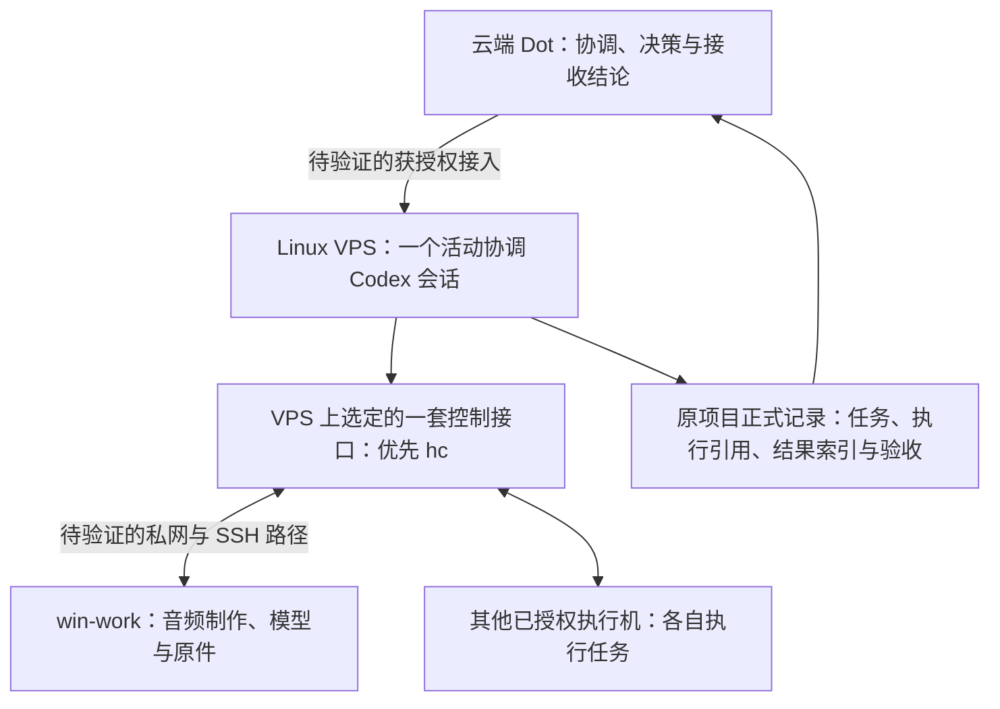

# 轻量 VPS 制作控制端试点方案

方案日期：2026-11-01（Asia/Shanghai）；拟测试日期：2026-11-02。**本次只整理方案，未授权或执行部署、登录、配对、入网、注册机器、派发或接入测试。** 测试日期不构成自动执行或定时监控授权。

目标是验证一台轻量 VPS 能否成为独立于 Mac 的制作控制端。当前结论为**候选试点，接入与容量均未验**，不能报告“Dot 已接通 VPS”或“1 GB 已够用”。实际进展统一记入[本仓状态](status.md)；本文保存设计与验收清单，不另建任务状态库。

后续按[多项目协作迭代指引](collaboration-iteration-guide.md)扩展：预期同时推进多个项目，单任务／单项目闭环只是起步。公子已明确 VPS 配置可升级，本文起始规格不作为架构上限；平台接入兼容性与资源容量分开验证。

## 1. 目标与职责



- VPS 只做派发、定向状态查询、轻量结果索引与交接；不运行音频模型、浏览器、桌面环境或重型构建，不保存音频原件和模型。
- 音频制作及模型继续留在 win-work；其他执行机仅承担各自任务包授权的工作。VPS 与 win-work 的 Codex 供应商、模型、认证、权限分别核验，不复制身份或静默替换 `codex over Claude` 配置。
- 新路线不依赖 Lody。旧 Lody 任务仍由原入口收尾；一个执行和一项待写资产只保留一个控制入口、一个当前写者，不能同时让新旧入口竞争。
- 业务责任、派发、记录和验收仍沿原项目关系与 Projects／Issues 或尚未切换的正式入口。VPS 不取得新的业务决策权，也不建立第二个全局任务队列。

这是对[仓库架构](architecture.md)增加一个候选控制端位置；沿用[通信指引](agent-communication.md)中 core 优先、TUI 对照的判断，不替代原[TUI 试点指引](pilot.md)，不表示生产入口已迁移。

## 2. 先解决 Dot 接入前提

官方 CLI 支持 Linux 安装；`codex remote-control` 可以管理本机 app-server 的远程控制，`pair` 生成短期配对信息。但这些事实不能证明云端 Dot 已能发现、授权或调用这个环境。[Codex CLI](https://learn.chatgpt.com/docs/cli)、[remote-control 命令](https://learn.chatgpt.com/docs/developer-commands#codex-remote-control)

更关键的是，当前官方 Dot 本地计算机接入流程要求目标计算机在线、桌面应用运行并登录相应账号／工作区，由 Dot 的 Computers 入口授予访问。文档没有据此证明“只有 CLI 的无头 Linux VPS”可直接走同一路径。[Dot 本地计算机接入](https://learn.chatgpt.com/docs/enterprise/cloud-local-access#end-user-experience)

因此，**首道关口是核实当前账号、客户端和 Dot 工具是否确实支持这个无头 VPS 入口**。分别记录客户端可见、配对／注册、Dot 获准访问、Dot 实际派发及结果读取；不能由前一项推断后一项。产品里的 Remote 客户端、Dot 本地计算机权限和 CLI 远程服务器也不视为同一个接口。

若当前仅有“Mac 在线后中转到 VPS”或桌面应用路线，记录具体依赖及失败证据：前者只能是依赖 Mac 的临时方案，后者超出本轮无桌面轻量目标。暂停依赖直连的后续建设；不自行安装 GUI、编写桥接服务、增加 MCP／消息平台或换到 Lody。可继续不依赖该入口的资料核对，不能将其称为端到端通过。

安装与认证方案优先使用官方、适合目标 OS／架构的发行渠道和已获准账号。无头登录可核官方 device-code 支持；当前授权尚不包含登录或账户设置变更。不自动改成 API 计费、换供应商或复制 Mac 的认证缓存；认证成功也不等于 Dot 的工作区权限成立。[认证与无头设备登录](https://learn.chatgpt.com/docs/auth#login-on-headless-devices)

## 3. Herdr／hc 的选择与版本

首选验证 `hc`，首轮不同时部署 TUI 与 core 两套控制栈。Herdr TUI 的 `herdr`／server 和 core 的 `hc` 是独立产品；按选定产品、版本和原生机器引用操作，不混用注册、状态与恢复语义。

2026-11-01 的源码研究基线为 herdr-core `de82c962fa6d2a7780d4e5058fda288c14bd0d8f`，crate 为 `0.1.16`，更新记录包含 Windows 连接修复。本轮独立只读研究还取得官方发行元数据 `0.1.16`、generation `1`，列有 Linux x86_64 与 Windows x86_64 归档；**未下载或核验归档，未证明 VPS 或 win-work 可取得、安装或运行**。原 2026-10-30 指引中的 `0.1.14` 与当次发行入口 403 保留为历史观察，不直接用作明日目标版本。[固定更新记录](https://github.com/herdrdev/herdr-core/blob/de82c962fa6d2a7780d4e5058fda288c14bd0d8f/CHANGELOG.md)、[官方发行元数据](https://releases.herdr.dev/core/latest.json)

明日先记录各端实际 OS／CPU 架构、可取得发行号、下载来源及校验结果，再核运行中核心与 CLI 版本；源码版本、元数据、下载字节和已运行版本分列。没有适配的预编译包时，单列构建路径与成本，不临时默默转为源码构建；资源需求可通过升级解决，不能仅因起始内存较小就否定路线。

VPS 使用选定核心的机器连接与远端地址接口；远端须具备对应核心、SSH 与实际 Agent 运行条件。**添加机器可能安装、启动或替换远端组件，不是只读探针**；已有实例的任务、写权和兼容性必须先核对。Windows 连接须核实际 shell、Git／sh、OpenSSH、目录及 Agent 启动配置，不能由 Windows 发行包存在就宣称 win-work 已支持。[core 说明](https://github.com/herdrdev/herdr-core/blob/de82c962fa6d2a7780d4e5058fda288c14bd0d8f/README.md)、[TUI 对照说明](https://github.com/herdrdev/herdr/blob/ee5bfb5041bb3e4a49d591c72308aae3c81ecdde/README.md)

入口协调 Codex 与 hc 跟踪的工作进程分开核验：`remote-control start` 管理远程入口 daemon；core 手册中针对 Codex 工作进程的 `--no-daemon` 是让 hc 跟踪其实际进程的适配条件，不能机械套到入口命令或拼到 `start`／`pair` 后。首轮不把 VPS 协调会话强行放入 hc 子终端，也不伪造父终端环境；通过准确执行引用查询回报，原生父子通知是否可用另行取证。[core Agent 手册](https://github.com/herdrdev/herdr-core/blob/de82c962fa6d2a7780d4e5058fda288c14bd0d8f/crates/herdr-core/src/SKILL.md)、[remote-control 参数](https://learn.chatgpt.com/docs/developer-commands#codex-remote-control)

## 4. 资源与网络预算

| 项目 | 试点约束与检查 |
| --- | --- |
| VPS 配置 | 起始为 1 vCPU、1 GB RAM、20 GB SSD、无 GPU，可按测量和目标负载升级；不是最低规格或架构上限 |
| 协调数量 | 一个活动协调 Codex 会话，不按执行机数量复制本地 Agent；app-server、hc、SSH 等辅助进程仍计入总开销 |
| 本地负载 | 仅控制、查询和小报告；不用本地模型、浏览器、GUI、容器群或重型构建填补缺口 |
| 内存 | 记录整机可用内存、进程／服务峰值、swap 与 OOM；不能只看 Codex 单进程 RSS |
| 磁盘 | 按实际采用配置记录总量及系统、组件、日志、缓存和运行证据占用；20 GB 只是起始档位，先确认安装后的可用量 |
| 容量目标 | 先 1 台／单项目闭环，再扩到至少两个项目同时推进及任务包明确的目标连接数 N；分别计项目数、连接数、执行数和查询频率 |
| 当前档位压力 | OOM、持续换页或明显排队时停止受影响负载的继续加量，评估配置升级或并发调整；不是架构不可行或全项目停工的结论。建议内存和磁盘各留约 20% 余量，按实际可用量与趋势判断 |

每档测试绑定观察窗口、负载、查询间隔和就绪项目／机器清单；未覆盖目标或窗口不足时，只报告短时、局部结果。起始配置不足时，依据峰值和增长数据安排升级或调整并发，不要求 1 GB 容纳最终全部组件；也不能降低约定验收负载来报通过。实际配置调整随获授权的部署／容量任务执行，本轮不扩容或安装。

网络分成两段取证：Dot → VPS 的实际产品／工具接入，以及 VPS → 执行机的获授权私网与 SSH。Tailscale 仍是候选私网路径；不能把 VPS 具有公网地址或 Mac 能 SSH 过去当成两段已通。核 DNS／路由、身份、host key、访问策略和目标端口，不公网裸露 app-server 或核心 API。

win-work 如走 Windows 原生 SSH，需要服务端能力，只有 OpenSSH Client 不够；安装、启用 sshd 与防火墙变更另按实际授权处理。不要为了接入默认迁移到 WSL 或更改既有音频运行环境。路径未定时保留 UNKNOWN，不自动换公网、代理或网络模式。

## 5. 任务可靠性与恢复策略

复用[原任务模板](templates/pilot-task.md)和[组织汇报约定](../skill/organization-collaboration/references/context-and-reporting.md#派发时约定可达汇报)。每次派发在原正式记录中关联以下最小执行索引；敏感值只保留安全引用：

```text
稳定任务 ID／正式入口／本次执行关联：
派发者／目标机及 OS／目录／当前写者／允许动作和预算：
请求摘要／固定输入版本或 hash／组件与启动配置版本：
原生机器、session、terminal／pane、任务／回合／请求引用：
发生／观察时点；发送、受理、执行状态及原生返回：
外层 CLI 退出码／实际远端命令退出码；未取得分别记 UNKNOWN：
产物所在机、路径、版本、大小与摘要；结果索引引用：
报告落点、获准通道、指定接收者；无推送时的拉取者与检查点：
待对账请求／仍持有写权／下一责任人／停止及解除证据：
```

稳定 ID 是关联手段，不保证服务端幂等或恰好一次。派发前核原记录，原生受理后回填真实引用；提交成功、通知、`idle/done`、等待返回及退出 0 都不能替代输入—执行—产物的对应核验。按派发清单逐机回收，不能只依赖“全部子任务已结束”；不可达机器仍单列 UNKNOWN。

| 情况 | 首轮策略 |
| --- | --- |
| 控制连接断开／查询超时 | 保留原执行与写权，重连后定向查询原引用，不重新派发 |
| 瞬态只读查询失败 | 建议单轮最多 2 次附加查询、总窗口 5 分钟；执行前纳入任务包，无相应预算则不重试，不注册轮询任务 |
| 写入、派发或返回结果 UNKNOWN | 自动重试预算为 0；先核原请求、进程和产物，查不清交明确承接 |
| 明确权限拒绝 | 停止受拒动作，保留证据，不换身份、连接或工具绕过 |
| 协调会话退出／VPS 服务恢复 | 读取持久索引、未决请求与当前写者，重新核原生状态；恢复观察不等于重建执行 |
| 核心重启、父进程退出、主机重启 | 分开验证；不承诺同一进程或业务从断点继续，不能从服务上线推断任务已恢复 |

默认先测连接中断后的查询恢复。停止／重启服务或主机，以及子进程存活、`--outlive-parent` 等生命周期选项，均需另行确认其影响和授权；不为保活默认扩大后台执行范围。原生持久化与 holder 的具体覆盖按目标版本核验，不建通用自动重放器。

持久化只保留任务索引和必要小报告，运行日志落在获准的私密位置，不进仓库。复用目标系统已有服务管理、日志轮转和缓存限制机制；安装前明确目录、字节上限、保留份数、责任人与满额停止行为，避免无限输出或删除未决任务证据。未建立有界保留策略，不进入持续运行验收。

备份策略只覆盖必要的配置说明、执行关联和小报告，排除令牌、配对码、模型及音频原件；使用既有获准私密落点，离机副本取决于已授权目的地。无目的地时记未配置，不假称已备份或擅自上传。首次持久运行前验证一次读取恢复；恢复后的 UNKNOWN 仍按原引用对账，不重放任务。服务自动启动、自动重连、定时备份和监控各自需要执行绑定，本文不创建它们。

## 6. 2026-11-02 测试清单

以下均为待执行项目。明日先绑定 VPS、账号／工作区、目标机器、时间预算与责任人，再取得实际安装、登录、持久访问、网络修改和测试范围的有效授权。分阶段留证；前置未通过只暂停依赖动作，不补造全链路成功。

| 编号 | 待执行步骤 | 通过证据与停止条件 |
| --- | --- | --- |
| T0 | 核 VPS OS／架构、可用内存／盘、CPU、现有服务与组件、网络和 SSH 条件；明确目标 N、并发与观察窗口 | 获准宿主的实际只读结果；未知系统、身份、资源或目标则暂停相关安装与接入 |
| T1 | 核当前产品是否提供 Dot 可用的无头 Linux 入口；按有效授权安装官方 CLI、认证，并读该版本 remote-control 帮助 | 记录真实入口、账号／工作区、组件版本及限制；CLI 登录或配对只能证明各自范围。只有 Mac／GUI 路线时标依赖或停止，不能报独立 VPS 接通 |
| T2 | 由实际 Dot 选择／获准使用 VPS，派发无业务影响的只读命令，并回读结果；同时核一个可预期的非零退出码 | 确认运行位置确为 VPS；原生任务／请求关联、真实 stdout／stderr 和实际命令退出码齐全，不能只看外层 CLI 为 0 |
| T3 | 经授权断开 Mac 控制连接，再从独立入口继续查询原任务并发起另一条明确授权的只读命令 | VPS 与远端保持在线且可由 Dot 使用；若仍依赖 Mac 则记录为临时方案，不采用独立控制端结论 |
| T4 | T2、T3 通过后，选一台执行机；核准确机器与服务版本、网络、启动映射和现有任务，再按授权接入 | 精确目标可用，配置未被默认替换；涉及安装／启动／替换时先有对应授权。先验证 win-work 的真实环境，不以发行包存在代替兼容性 |
| T5 | 在该机完成一次“派发—按引用查询—结果回收”，随后验证至少两个独立项目同时推进及目标连接数 N；首轮优先只读小任务 | 请求摘要、项目／任务、输入版本与实际执行／结果对应；取得两项目活动重叠及 A 阻塞时 B 独立推进的证据，共享资源不超分，逐机清单收齐。未取得者保留 UNKNOWN，未覆盖目标不报整体通过 |
| T6 | 在目标连接／执行负载和约定窗口下观测资源，断开并恢复一段已授权控制连接 | 记录峰值、排队、swap/OOM、日志增量及磁盘余量；重连仍能查原任务，实际执行计数无重复。超预算停止加量并报告 |
| T7 | 另行确认后，测试服务或主机重启，以及备份读取恢复 | 分别记重启对象、前后引用、原进程终止／存活、索引可读与未决承接；服务恢复不等于业务续跑。未授权则留待后续，不影响已完成局部证据的保留 |
| T8 | 汇总本轮结果，按约定交独立复核及各项目负责人验收 | 分别报告接入、单项目、多项目并行和规模结论，不以单项目通过代替整体；注明是否依赖 Mac、配置调整与未验项。首轮无生产制作或旧任务迁移 |

T0／T1 的候选只读检查命令如下，**本次未运行，明日以实际系统和安装版本为准**；不将这一代码块当安装脚本：

```bash
uname -srm
cat /etc/os-release
free -m
df -h /
vmstat 1 5
codex --version
codex --help
codex remote-control --help
```

`remote-control start`、`pair`、机器添加及服务管理属于获授权后的操作，本文不提供一键执行串。配对输出和认证状态中如含敏感标识，必须脱敏后记录。普通执行账户与最小权限沿现有安全要求，不把登录或连接成功当成任意文件、命令和持续访问授权。

## 7. 尚待绑定与交付口径

| 缺项 | 当前口径与承接 |
| --- | --- |
| VPS 系统、架构、供应方及现有占用 | UNKNOWN；执行前由宿主维护者提供或授权读取 |
| Dot 的 Linux／无头 Remote 实际入口、账号／工作区与工具支持 | UNKNOWN；T1、T2 先验证，官方桌面路线不推广为纯 CLI 已支持 |
| 项目／执行机清单、数量 N、并发和观察窗口 | UNKNOWN；由试点任务责任方绑定，不能用单项目或单台结果代替目标范围 |
| VPS 到 win-work 的私网路径、SSH 服务／shell／host key | UNKNOWN；按已有网络与机器授权核验，未知时不改公网或 WSL |
| 各端实际 Codex／Herdr 版本、可执行文件、供应商、认证和权限 | UNKNOWN；记录各端实际值，不从仓库或别端复制配置结论 |
| 持久记录、日志上限、备份位置与接收者 | UNKNOWN；沿原正式入口和获准私密落点绑定，未配置不报持续运行通过 |

报告按层给出：文档／发行元数据研究、本地仓库检查、目标 VPS 证据、远端执行机证据、Dot 实际读取，以及负责人验收。记录组件版本、请求与产物引用、峰值资源、观察窗口、日志增长、失败边界、未验项和下一责任人。无推送时由派发者落实拉取者与检查点；不承诺自动提醒或无限等待。

今天交付的是这份方案与清单。明天的目标先是证明真实接入和原任务可回读，再验证一台及目标多机规模；通过后仍须由原负责人决定哪些新任务采用，不能据此宣称生产系统已切换。
