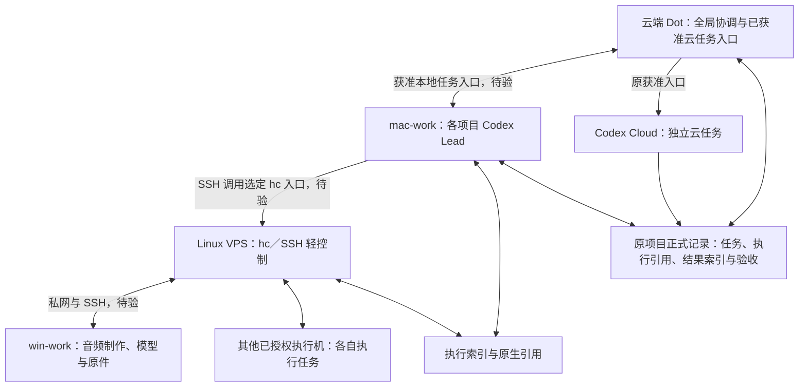

# mac-work 项目协调与轻量 VPS 控制端试点方案

方案日期：2026-11-01（Asia/Shanghai）；拟测试日期：2026-11-02。**本次只整理方案，未授权或执行部署、登录、配对、入网、注册机器、派发或接入测试。** 测试日期不构成自动执行或定时监控授权。

本轮按公子确认的分工修订：**mac-work 承载各项目 AI Lead，VPS 保留 hc／SSH 轻量控制、原执行查询、执行索引与结果交接，执行机承担具体工作及本地资产保管。** 当前仍是候选试点，未核宿主安装、接入或容量，不能报告任何端已接通。实际进展统一记入[本仓状态](status.md)；本文保存设计与验收清单，不另建任务状态库。

2026-11-01 早期方案为 Dot → VPS 上的单协调 Codex → 执行机，目标是制作协调完全脱离 Mac。本次分工替换其托管位置与独立性目标：项目规划暂依赖 mac-work 在线，VPS 不再默认常驻项目规划 Codex；Mac 离线后的**原执行存活、独立控制／查询、项目持续规划**分别验证。前两项不能推导第三项；独立查询需有另一条真实获准入口，未具备时只保留 Mac 恢复后的原任务对账，不宣称 VPS 已独立可用。

后续按[多项目协作迭代指引](collaboration-iteration-guide.md)扩展：预期同时推进多个项目，单任务／单项目闭环只是起步。公子已明确 VPS 配置可升级，本文起始规格不作为架构上限；平台接入兼容性与资源容量分开验证。

本文验证整套方案的**机器执行支路**。Codex Cloud 是并列云端 Worker 池，沿 Dot 已获准的云任务入口使用，不以 VPS 或 hc 接通为前置；其路由、无状态使用方式和跨端交接见[统一指引](collaboration-iteration-guide.md#两类-worker-的任务路由)。下图不表示全部任务都须经过 VPS，本清单不包含云任务接入或派发测试。

两类 Worker 都按任务间无隐式业务状态设计；mac-work 的 Lead 会话、VPS、hc、运行进程及各机本地存储仍保留真实状态。模型、原件和大产物继续在获准机器保管，按明确版本与路径交接必要对象；ChatGPT Space 作为资料与精选成果入口，不假定其可挂载到 VPS。Space 工具的能力及待验边界见[资源连通](collaboration-iteration-guide.md#chatgpt-协作空间与本地存储怎样连通)；当前暂不考虑 Cloud 连接 VPN，不将其作为三机网络选择或主链路验证的条件。

整体图保留 Dot／实际提供获准 Pages 工具的 Codex Cloud 直接访问 Space 的路径，Cloud 不必为资料协作经过 mac-work 或 VPS；目标 Cloud 任务工具和 Page／文件权限仍需分别核验。mac-work 的 Lead 不自动继承这些工具或云任务派发权；已有 Cloud 路线沿获准的原入口。本清单不新增 Cloud／Space 接入测试，也不把 Cloud 保存配置可运行标记当本仓已接入。

## 1. 目标与职责



- mac-work 的项目 Lead 拆任务、跟依赖、准备任务包、回收结果并组织复核；按项目区分上下文和权限，不机械每项目常驻一个进程，也不从岗位定义取得新授权。最终业务验收仍由公子或已指定验收者承担。
- VPS 执行已明确且获准的机器操作、定向状态查询、轻量执行索引与交接；不重复运行项目规划 Agent。它保留真实运行引用，不是具备新业务决策权的第二 Lead；不运行音频模型、浏览器、桌面环境或重型构建，不保存音频原件和模型。
- 音频制作及模型继续留在 win-work；其他执行机仅承担各自任务包授权的工作。各端实际 Agent、供应商、模型、认证、权限分别核验，不复制身份或静默替换 win-work 的 `codex over Claude` 配置。
- 新路线不依赖 Lody。旧 Lody 任务仍由原入口收尾；一个执行和一项待写资产只保留一个控制入口、一个当前写者，不能同时让新旧入口竞争。
- 业务责任、派发、记录和验收仍沿原项目关系与 Projects／Issues 或尚未切换的正式入口。VPS 不取得新的业务决策权，也不建立第二个全局任务队列。
- 每次执行明确一个实际派发／续发入口。Mac Lead 通过 VPS 上选定 hc 入口控制机器任务，Cloud 沿已获准原入口；Dot、Mac 和 VPS 不各自对同一执行重派。Mac 离线不自动将 Dot／VPS 升格为项目 Lead。

完整安装归属统一见[各端组件清单](architecture.md#各端组件清单)。本方案的最小对应关系如下；“需要”是选定链路的准备要求，不是已安装状态：

| 位置 | 基础组件与按需项 |
| --- | --- |
| mac-work | ChatGPT 桌面应用中的本地 Codex、项目规则／技能、Git 与 SSH 客户端；按选定网络配置私网。Codex CLI 仅终端路线需要；本地 hc／Herdr App 按本地终端管理需要采用。经 SSH 调用 VPS 原 hc 入口时无需因此安装本地 hc |
| VPS | herdr-core／hc、接收 Mac 连接的 OpenSSH 服务端、连接执行机的 SSH 客户端、选定私网及有界日志／轻量执行索引；不默认常驻项目 Lead Codex、桌面应用或第二套 TUI 栈 |
| Codex Cloud | 获准的托管环境、仓库／依赖／技能和任务实际提供的工具；不默认安装 hc 或继承 Mac 的 Space／Cloud 权限，环境准备也不是已发布或已接通证据 |
| win-work／其他执行机 | 对应 core、SSH 服务端、指定 Agent CLI 与实际制作／检查工具；模型、原件与产物留本地。Windows 的 Git／sh 按实际模板需要核验，不默认换 WSL 或供应商 |

hc 默认通过系统 SSH 客户端连接远端；core server 不替代 `sshd`。表中 SSH 组件先核已有、满足条件即复用，缺少才按后续授权补齐，不要求重复安装；`--install` 复制 hc 不等于安装 SSH 服务。Windows 发起端复制路径的 scp 依赖等细节统一见[SSH 依赖与复用](architecture.md#ssh-依赖与已有组件复用)。本轮未对协作宿主执行 SSH 登录、安装或接入测试；GitHub 的 Git 交付不作为宿主 SSH 验收。

三机只需按主链路获准互通，不要求同一物理局域网。网络连通、系统 SSH 与 hc 控制分层核验；Tailscale 候选基线、EasyTier 对照及效率／Dot 影响统一见[独立组网方案](networking-plan.md)。今天不入网，不选择出口节点或修改 DNS／代理，后续实施另按有效授权执行。

沿用[通信指引](agent-communication.md)中 core 优先、TUI 对照的判断，不替代原[TUI 试点指引](pilot.md)，不表示生产入口已迁移。

## 2. 主链路接入与可选独立查询

当前主链路先核 **Dot → mac-work 本地项目 Lead → SSH 调用 VPS 原 hc 入口 → 执行机**。官方支持 Dot 在已连接计算机上创建或继续本地 Codex 任务；使用本地步骤时，目标计算机须在线、桌面应用运行并登录相应账号／工作区，访问许可另核。官方能力说明不代替当前 mac-work 的配置、工具和真实回读。[Dot 的任务入口](https://learn.chatgpt.com/docs/dots/tasks-and-memory#assigned-work)、[本地计算机条件](https://learn.chatgpt.com/docs/enterprise/cloud-local-access#end-user-experience)

mac-work 的本地任务入口与 Mac → VPS SSH 分别留证。SSH 可达不代表目标 hc 路由、运行目录、Agent 映射和业务资产权限成立；每次沿选定机器与原生执行引用操作，不把终端显示名当唯一目标。项目 Lead 的真实启动方式、可用工具和并发先核实际版本。

**Dot → 无头 VPS 直连不再是主链路前置。** 它只作为需要脱离 Mac 查询／控制时的可选增强，沿单独获准任务确认真实入口、身份和动作范围。没有独立入口就明确未具备，不新增 GUI、MCP、消息桥或新网络来自动补齐；mac-work 主路径可继续按自身证据验证。

历史路径仍保留原证据边界：官方 CLI 支持 Linux，`codex remote-control` 可管理本机 app-server、`pair` 可生成短期配对信息，但它们不能证明 Dot 已能使用无头 VPS，也不与 Dot Computers 权限等同。若以后采用该路线，核目标版本帮助、实际派发与结果回读，不能把 CLI 登录／配对当端到端通过；本轮基础 VPS 不因此安装 Codex 或 app-server。[Codex CLI](https://learn.chatgpt.com/docs/cli)、[remote-control 命令](https://learn.chatgpt.com/docs/developer-commands#codex-remote-control)

Mac 离线时依赖它的新规划、续派和复核暂停；独立获准 Cloud 工作可沿原入口继续。已派机器任务是否继续，须先验证 hc 父子关系、控制连接和服务生命周期；不能一概保证存活。VPS 只有经另一实际获准入口回读成功后，才能记独立查询成立；这仍不证明项目 Lead 自动迁移。旧方案将依赖 Mac 的路线只视为临时方案，本次已明确接受项目协调依赖 mac-work，不再沿用该否决条件。

各端安装与认证优先使用适合目标 OS／架构的官方渠道和已获准账号；当前授权不包含安装、登录或账户设置变更。不自动改成 API 计费、换供应商或复制别端认证缓存。后续若采用无头 CLI 登录，核该版本 device-code 等实际支持；认证成功仍不等于 Dot 任务或工作区权限成立。[认证说明](https://learn.chatgpt.com/docs/auth#login-on-headless-devices)

## 3. Herdr／hc 的选择与版本

首选验证 `hc`，首轮不同时部署 TUI 与 core 两套控制栈。Herdr TUI 的 `herdr`／server 和 core 的 `hc` 是独立产品；按选定产品、版本和原生机器引用操作，不混用注册、状态与恢复语义。

2026-11-01 此前的源码研究基线为 herdr-core `de82c962fa6d2a7780d4e5058fda288c14bd0d8f`，crate 为 `0.1.16`，更新记录包含 Windows 连接修复。该次独立只读研究还取得官方发行元数据 `0.1.16`、generation `1`，列有 Linux x86_64 与 Windows x86_64 归档；**未下载或核验归档，未证明 VPS 或 win-work 可取得、安装或运行**。原 2026-10-30 指引中的 `0.1.14` 与当次发行入口 403 保留为历史观察，不直接用作明日目标版本。[固定更新记录](https://github.com/herdrdev/herdr-core/blob/de82c962fa6d2a7780d4e5058fda288c14bd0d8f/CHANGELOG.md)、[官方发行元数据](https://releases.herdr.dev/core/latest.json)

明日先记录各端实际 OS／CPU 架构、可取得发行号、下载来源及校验结果，再核运行中核心与 CLI 版本；源码版本、元数据、下载字节和已运行版本分列。没有适配的预编译包时，单列构建路径与成本，不临时默默转为源码构建；资源需求可通过升级解决，不能仅因起始内存较小就否定路线。

VPS 使用选定核心的机器连接与远端地址接口；远端须具备对应核心、SSH 与实际 Agent 运行条件。**添加机器可能安装、启动或替换远端组件，不是只读探针**；已有实例的任务、写权和兼容性必须先核对。Windows 连接须核实际 shell、Git／sh、OpenSSH、目录及 Agent 启动配置，不能由 Windows 发行包存在就宣称 win-work 已支持。[core 说明](https://github.com/herdrdev/herdr-core/blob/de82c962fa6d2a7780d4e5058fda288c14bd0d8f/README.md)、[TUI 对照说明](https://github.com/herdrdev/herdr/blob/ee5bfb5041bb3e4a49d591c72308aae3c81ecdde/README.md)

mac-work 的项目 Lead 入口与 hc 跟踪的工作进程分开核验。桌面本地 Codex 任务不自动成为 hc 子终端；只有明确选择终端／hc 托管路线时才核 Codex CLI、模板和跟踪方式。core 手册中针对 Codex 工作进程的 `--no-daemon` 是让 hc 跟踪其实际进程的适配条件，不是任意版本的通用参数。`remote-control start` 管理的是另一路远程入口 daemon，不能机械拼上工作进程参数；VPS 基础控制路线无需它。不伪造父终端环境，原生父子通知和 Mac 离线后的存活按实际拓扑取证。[core Agent 手册](https://github.com/herdrdev/herdr-core/blob/de82c962fa6d2a7780d4e5058fda288c14bd0d8f/crates/herdr-core/src/SKILL.md)、[remote-control 参数](https://learn.chatgpt.com/docs/developer-commands#codex-remote-control)

## 4. 资源与网络预算

| 项目 | 试点约束与检查 |
| --- | --- |
| VPS 配置 | 起始为 1 vCPU、1 GB RAM、20 GB SSD、无 GPU，可按测量和目标负载升级；不是最低规格或架构上限 |
| mac-work 项目协调 | 先核实际规格、常在线条件、桌面／CLI 入口与会话负载；按项目区分上下文和责任，不固定一项目一进程，实际并发按资源和隔离需要安排 |
| VPS 进程 | 基础为 hc、SSH 及目标系统所需组件，不默认常驻本地项目规划 Codex／app-server；不按项目或执行机数量复制本地 Agent |
| VPS 本地负载 | 仅控制、查询和轻量索引／报告；不运行本地模型、浏览器、GUI、容器群或重型构建 |
| 内存 | 分别记录 mac-work、VPS 及执行机的整机可用内存、进程／服务峰值、swap 与 OOM；不能将 Cloud／执行机模型负载计成 VPS 占用，也不能只看一个进程 RSS |
| 磁盘 | 按实际采用配置记录总量及系统、组件、日志、缓存和运行证据占用；20 GB 只是起始档位，先确认安装后的可用量 |
| 容量目标 | 先 1 台／单项目闭环，再扩到至少两个项目同时推进及任务包明确的目标连接数 N；分别计项目数、连接数、执行数和查询频率 |
| 当前档位压力 | OOM、持续换页或明显排队时停止受影响负载的继续加量，评估配置升级或并发调整；不是架构不可行或全项目停工的结论。建议内存和磁盘各留约 20% 余量，按实际可用量与趋势判断 |

每档测试绑定观察窗口、负载、查询间隔和就绪项目／机器清单；未覆盖目标或窗口不足时，只报告短时、局部结果。起始配置不足时，依据峰值和增长数据安排升级或调整并发，不要求 1 GB 容纳最终全部组件；也不能降低约定验收负载来报通过。实际配置调整随获授权的部署／容量任务执行，本轮不扩容或安装。

主链路分三段取证：Dot → mac-work 的本地任务入口、mac-work → VPS 的获授权 SSH，以及 VPS → 执行机的私网／SSH 与准确 hc 路由。Tailscale 仍是候选私网路径；每段核身份、访问范围与实际结果，SSH 成功不证明全部三段或 Agent 配置已通过。不公网裸露 app-server 或核心 API。Mac 离线后的可选独立查询入口另列网络、身份和读写边界，不从主路径连通自动推断存在。

win-work 如走 Windows 原生 SSH，需要服务端能力，只有 OpenSSH Client 不够；安装、启用 sshd 与防火墙变更另按实际授权处理。不要为了接入默认迁移到 WSL 或更改既有音频运行环境。路径未定时保留 UNKNOWN，不自动换公网、代理或网络模式。

## 5. 任务可靠性与恢复策略

复用[原任务模板](templates/pilot-task.md)和[组织汇报约定](../skill/organization-collaboration/references/context-and-reporting.md#派发时约定可达汇报)。每次派发在原正式记录中关联以下最小执行索引；敏感值只保留安全引用：

```text
稳定任务 ID／正式入口／本次执行关联：
项目 Lead 与运行宿主／唯一实际派发入口／目标机及 OS／目录：
当前写者／允许动作和预算／Mac 离线时的停止与承接边界：
请求摘要／固定输入版本或 hash／组件与启动配置版本：
原生机器、session、terminal／pane、任务／回合／请求引用：
发生／观察时点；发送、受理、执行状态及原生返回：
外层 CLI 退出码／实际远端命令退出码；未取得分别记 UNKNOWN：
产物所在机、路径、版本、大小与摘要；结果索引引用：
报告落点、获准通道、指定接收者；无推送时的拉取者与检查点：
待对账请求／仍持有写权／下一责任人／停止及解除证据：
```

稳定 ID 是关联手段，不保证服务端幂等或恰好一次。派发前核原记录，原生受理后回填真实引用；提交成功、通知、`idle/done`、等待返回及退出 0 都不能替代输入—执行—产物的对应核验。按派发清单逐机回收，不能只依赖“全部子任务已结束”；不可达机器仍单列 UNKNOWN。

| 情况 | 首轮策略 |
| --- | --- |
| 控制连接断开／查询超时 | 保留原执行与写权，重连后定向查询原引用，不重新派发 |
| 瞬态只读查询失败 | 建议单轮最多 2 次附加查询、总窗口 5 分钟；执行前纳入任务包，无相应预算则不重试，不注册轮询任务 |
| 写入、派发或返回结果 UNKNOWN | 自动重试预算为 0；先核原请求、进程和产物，查不清交明确承接 |
| 明确权限拒绝 | 停止受拒动作，保留证据，不换身份、连接或工具绕过 |
| mac-work 离线／Lead 会话退出 | 暂停依赖该 Lead 的新规划、续派与复核；不自动让 Dot／VPS 接管。保留原任务、写权和产物，独立获准工作沿原入口继续 |
| Mac 离线后的 VPS 查询 | 只有另一实际获准入口存在且回读成功，才记独立查询成立；否则待 Mac 恢复后查询。查询能力不等于项目协调迁移 |
| VPS 服务恢复 | 读取持久索引、未决请求与当前写者，重新核原生状态；恢复观察不等于重建执行，不启动替代项目 Lead |
| 核心重启、父进程退出、主机重启 | 分开验证；不承诺同一进程或业务从断点继续，不能从服务上线推断任务已恢复 |

默认先测连接中断后的查询恢复。停止／重启服务或主机，以及子进程存活、`--outlive-parent` 等生命周期选项，均需另行确认其影响和授权；不为保活默认扩大后台执行范围。原生持久化与 holder 的具体覆盖按目标版本核验，不建通用自动重放器。

任务目标、输入版本、原生执行引用、当前写者、成果与下一责任人不能只存在 mac-work 的聊天里；由原正式记录、原生运行端及获准持久索引分别保管。Mac 重新上线时先回读这些记录再续接原执行。资源释放、成果交付与写权交还分别核验；Mac 不可达或占用记录超时都不是旧进程已停的证据。

持久化只保留任务索引和必要小报告，运行日志落在获准的私密位置，不进仓库。复用目标系统已有服务管理、日志轮转和缓存限制机制；安装前明确目录、字节上限、保留份数、责任人与满额停止行为，避免无限输出或删除未决任务证据。未建立有界保留策略，不进入持续运行验收。

备份策略只覆盖必要的配置说明、执行关联和小报告，排除令牌、配对码、模型及音频原件；使用既有获准私密落点，离机副本取决于已授权目的地。无目的地时记未配置，不假称已备份或擅自上传。首次持久运行前验证一次读取恢复；恢复后的 UNKNOWN 仍按原引用对账，不重放任务。服务自动启动、自动重连、定时备份和监控各自需要执行绑定，本文不创建它们。

## 6. 2026-11-02 测试清单

以下均为待执行项目。明日先绑定 mac-work、VPS、账号／工作区、目标机器、时间预算与责任人，再取得实际安装、登录、持久访问、网络修改和测试范围的有效授权。主路径以本次分工为准；原 Dot → 无头 VPS 完全独立方案不再作为默认放行条件。分阶段留证，某段未通过只暂停依赖动作，不补造全链路成功；Cloud／Space 不在本清单新增测试范围内。

| 编号 | 待执行步骤 | 通过证据与停止条件 |
| --- | --- | --- |
| T0 | 分别核 mac-work、VPS 和目标执行机的 OS／架构、资源、组件与网络；明确项目、数量 N、并发、观察窗口及职责 | 获准宿主的实际只读结果；记录现有出口、代理、DNS／VPN 和两段目标路径，mac-work 常在线策略及会话负载有记录；未知部分只暂停相关动作，不从别端配置推断 |
| T1 | 核实际 Dot → mac-work 本地 Codex 任务入口、账号／工作区及授权；按获准范围验证一个非生产项目 Lead 的任务关联与回读 | Mac 在线和桌面应用条件成立，真实任务引用与结果可对应；若实施获准网络调整，对照调整前后 Dot 原生回读、登录与普通联网，不用私网 ping 代替；不要求先装 CLI／本地 hc |
| T2 | 由 mac-work Lead 沿指定 SSH 身份调用 VPS 上选定 hc 入口；先核只读结果及可预期非零退出码 | 实际执行位置、账号、hc 路由、stdout／stderr、远端命令退出码与原请求对应；不只看外层 SSH／CLI 为 0，不启动第二项目 Lead |
| T3 | 选一台执行机，核已有任务、实际 core／Agent 配置、网络和目录，再按授权接入并完成一次无业务影响的派发—查询—结果回收 | 请求、执行与产物对应，供应商／模型／权限未被默认替换；先验 win-work 实际环境，机器添加的安装／启动／替换须有相应授权 |
| T4 | 另行绑定影响范围后断开 mac-work 控制连接；观察原机器任务的实际生命周期，并在有独立获准入口时查询原引用；恢复后由原 Lead 对账 | 项目新规划／续派按依赖暂停；机器进程存活或终止有证据，无自动接管或重派。无独立入口时明确未具备离 Mac 查询，不否决已通过的 Mac 主路径；不在此新建 Cloud 任务 |
| T5 | 主链路成立后验证至少两个独立项目同时推进及目标连接数 N；首轮优先无业务影响的小任务 | 两项目活动重叠、A 局部阻塞时 B 独立推进、共享资源准入与逐项回收成立；项目 Lead 上下文和结果归属明确，未覆盖目标保持未验 |
| T6 | 在目标负载／窗口下分别观测 Mac、VPS 和执行机资源，断开并恢复一段已授权控制连接 | 记录各端峰值、排队、swap/OOM、日志／盘增长；按选定私网记录直连／中继，分测命令回读耗时／失败率与必要文件吞吐。重连查原任务、无重复执行；压力只限制受影响档位，可按授权调整配置／并发，不冻结全部项目 |
| T7 | 另行确认后，测试服务或主机重启，以及备份读取恢复 | 分别记重启对象、前后引用、原进程终止／存活、索引可读与未决承接；服务恢复不等于业务续跑。未授权则留待后续，不影响已完成局部证据的保留 |
| T8 | 汇总本轮结果，交独立复核及公子／已指定验收者；AI Lead 组织交付但不自动代签业务结论 | 分别报告三段接入、单项目／多项目、资源规模、Mac 离线查询／执行存活／规划依赖；不将局部通过合并成完全脱离 Mac。首轮无生产制作或旧任务迁移 |

T0／T1 只读核对方式按各端实际 OS 和入口选择，不把 Linux 命令套到 Mac，也不为桌面本地任务预设 CLI 已安装。VPS 基础准备不要求 Codex 登录或 remote-control；若后续单独采用无头直连增强，再核该版本帮助与认证范围。

机器添加、服务管理以及后续可能采用的 `remote-control start`／`pair` 都属于另有执行授权的操作，本文不提供一键安装串。含敏感标识的配置或返回须脱敏；普通执行账户与最小权限沿现有安全要求，不把登录或连接成功当任意文件、命令和持续访问授权。

## 7. 尚待绑定与交付口径

| 缺项 | 当前口径与承接 |
| --- | --- |
| mac-work 系统、规格、常在线策略、Lead 入口与会话负载 | UNKNOWN；执行前核真实宿主及桌面／CLI 路线，按实际能力安排并发 |
| Dot → mac-work 的本地任务访问、账号／工作区与实际工具 | UNKNOWN；T1 以真实任务和回读取证，不从官方文档、配对或其他会话继承 |
| VPS 系统、架构、供应方、基础组件及现有占用 | UNKNOWN；由宿主维护者提供或授权读取，未测不报起始配置够用 |
| mac-work → VPS 的 SSH 身份、网络、准确 hc 入口 | UNKNOWN；T2 验实际调用与退出码，不默默增加公网或替代控制路径 |
| Mac 离线时的独立查询入口与机器任务生命周期 | UNKNOWN；T4 分开取证。Dot → 无头 VPS 是可选增强，未成立不阻塞 Mac 主路径，也不报告完全独立 |
| 项目／执行机清单、数量 N、并发和观察窗口 | UNKNOWN；由试点任务责任方绑定，不能用单项目或单台结果代替目标范围 |
| VPS 到 win-work 的私网路径、SSH 服务／shell／host key | UNKNOWN；按已有网络与机器授权核验，未知时不改公网或 WSL |
| 各端实际 Codex／Herdr 版本、可执行文件、供应商、认证和权限 | UNKNOWN；记录各端实际值，不从仓库或别端复制配置结论 |
| 持久记录、日志上限、备份位置与接收者 | UNKNOWN；沿原正式入口和获准私密落点绑定，未配置不报持续运行通过 |

报告按层给出：文档／发行元数据研究、本地仓库检查、Dot 本地入口、mac-work Lead、VPS 控制、执行机、指定接收者实际读取，以及有权验收者结论。记录组件版本、请求与产物引用、各端峰值、观察窗口、日志增长、Mac 依赖与失败边界。无推送时由派发者落实拉取者与检查点；不承诺自动提醒或无限等待。

今天交付的是修订后的方案、组件准备关系与待测清单，没有执行上述步骤。明日若获得对应授权，先证明 mac-work 主链路和原任务可回读，再验证多项目／目标规模；Mac 离线查询、原执行存活及项目规划依赖分别报告。通过后仍由原有权责任方决定哪些新任务采用，不能据此宣称生产切换或完全脱离 Mac。
