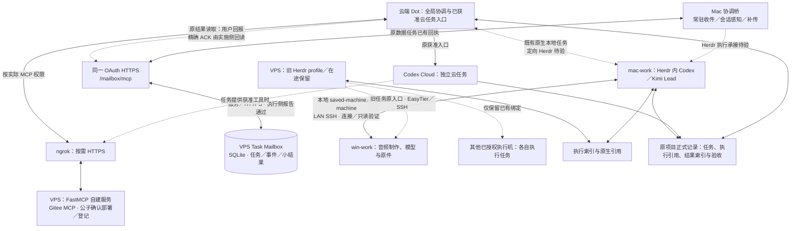

# mac-work 项目协调、VPS Task Mailbox 与既有控制支路

最新角色修订：VPS 主要承载 FastMCP 自建服务，**Task Mailbox 与常驻 Mac 协调桥承担 OAuth HTTPS 持久收发、会话感知和结果补传**。专用桥授权、原数据任务交付及读取已有分层实施侧回执，反向新任务、长期稳定性和 Herdr 业务仍未验。原 Gitee 的认证、进程、路径与公网入口保留，详见[架构清单](architecture.md#vpsmcp-服务与过渡控制)。下文 VPS Herdr 支路仍保存原任务与验收历史；信箱不替代机器控制入口。

公子最新已明确：**Mac 本地 Herdr 以 saved-machine／--machine 经 LAN SSH 直接连接 Win 已运行的 collab**，不再列为候选，也不经 VPS 中转。主会话已取得注册退出 0、Mac catalog 0→1、目标 reachable 及定向 agent list 退出 0／agents=[] 的限定回执。本次不创建 Agent、不启停或替换 server、不移交正式生产写控制；VPS 旧 profile、在途任务与网络保留，其目录／在途审计独立未决。

**Mac 持续在线是公子明确的当前设计与部署前提**，不是待补的离线验收项，也不是已测得全天稳定性的结论。Win 的 OMP／Hermes／Kimi 代理分支可以依赖 Mac CLI Proxy；Kimi 官方直连另列，实际模型、认证和回合仍分别核验，不要求脱离 Mac 推理。Windows Codex 不纳入本轮。

方案日期：2026-11-01，修订日期：2026-11-03（Asia/Shanghai）；原拟测试日期：2026-11-02。**原网络 Goal 已配置 VPS／Win EasyTier 2.6.4、指定主机代理与 Mac 路由，并取得 Mac 经 Win 到 VPS、VPS 到 Win SSH 及转发恢复回执。** 该轮 VPS profile 下的 94 字节文件和两个新 pane 输出是旧入口的限定证据，不证明本次 Mac 原生直连。Agent／业务、主机重启与持续性能仍未验，本仓采用边界见[当前状态](status.md)，服务运行明细沿外部权威记录。

此前已部署的机器控制分工为：**mac-work 承载各项目 AI Lead，VPS 使用 Herdr TUI CLI 与系统 SSH 承担轻量控制、原执行查询、执行索引与交接，Win 承载目标 server／session／pane 及实际工作、本地资产。** 控制远端无需在 VPS 启动本地 TUI server，不部署另一套 hc／Herdr App；网络／SSH 证据不代替 TUI 或负载验收。本文保存设计与验证清单，不另建业务正式状态库。

2026-11-01 早期方案为 Dot → VPS 上的单协调 Codex → 执行机，目标是制作协调完全脱离 Mac。该独立性目标已被当前分工替换，不属本轮建设或验收范围：项目协调明确使用持续在线的 mac-work，VPS 不再默认常驻项目规划 Codex；不新增离线接管、脱离 Mac 查询或推理的规划与测试。旧记录仅保留角色变更来源。

后续按[多项目协作迭代指引](collaboration-iteration-guide.md)扩展：预期同时推进多个项目，单任务／单项目闭环只是起步。公子已明确 VPS 配置可升级，本文起始规格不作为架构上限；平台接入兼容性与资源容量分开验证。

本文分别记录**信箱与 Mac 桥的数据交接、Mac 直连机器主链和旧 VPS 控制支路**。信箱路线依赖其 VPS HTTPS 服务；既有 Dot 原生本地任务入口和 Mac Herdr 经 LAN SSH 管理 Win 不以信箱为前置。Codex Cloud 是并列 Worker 池，沿 Dot 已获准的云任务入口使用，不以 VPS 或 TUI 接通为前置；见[统一指引](collaboration-iteration-guide.md#两类-worker-的任务路由)。本清单不新增 Cloud Worker 接入或派发测试，云端 Dot 的信箱插件与 Cloud Worker 分列。

两类 Worker 都按任务间无隐式业务状态设计；mac-work 的 Lead 会话、VPS、TUI server、运行进程及各机本地存储仍保留真实状态。模型、原件和大产物继续在获准机器保管，按明确版本与路径交接必要对象；ChatGPT Space 作为资料与精选成果入口，不假定其可挂载到 VPS。Space 工具的能力及待验边界见[资源连通](collaboration-iteration-guide.md#chatgpt-协作空间与本地存储怎样连通)；当前暂不考虑 Cloud 连接 VPN，不将其作为三机网络选择或主链路验证的条件。

整体图保留 Dot／实际提供获准 Pages 工具的 Codex Cloud 直接访问 Space 的路径，Cloud 不必为资料协作经过 mac-work 或 VPS；目标 Cloud 任务工具和 Page／文件权限仍需分别核验。mac-work 的 Lead 不自动继承这些工具或云任务派发权；已有 Cloud 路线沿获准的原入口。本清单不新增 Cloud／Space 接入测试，也不把 Cloud 保存配置可运行标记当本仓已接入。

## 1. 目标与职责



信箱与桥的原数据任务回执来自实施侧，本轮未直接 SSH 或云端重测；指定 Dot 读取的用户回报与服务 ACK 回读分别归属，反向新任务及 Herdr 执行仍未验，不能读成全通。图中没有信箱自动执行 Herdr 的控制线。既有原生 Dot 本地任务、信箱收发和旧 VPS Herdr 支路分别取证，不对同一任务重复派发。

- mac-work 的项目 Lead 拆任务、跟依赖、准备任务包、回收结果并组织复核；按项目区分上下文和权限，不机械每项目常驻一个进程，也不从岗位定义取得新授权。最终业务验收仍由公子或已指定验收者承担。
- VPS 承载 Task Mailbox 的 SQLite 持久收发及原 Gitee MCP；信箱不执行任务、不访问 Herdr／shell／模型。Mac 桥另在 Mac 常驻主动轮询和补传，无 Herdr 执行 handler 或已验 Dot 自动唤醒。旧 Herdr 支路只沿现有绑定处理原任务，不重复运行项目规划 Agent，不保存音频原件、模型或大产物。
- 音频制作及模型继续留在 win-work；其他执行机仅承担各自任务包授权的工作。各端实际 Agent、供应商、模型、认证、权限分别核验，不复制身份或静默替换既有配置；Win 当前只考虑 OMP／Hermes／Kimi，Windows Codex 暂不纳入本轮。
- 新路线不依赖 Lody。旧 Lody 任务仍由原入口收尾；一个执行和一项待写资产只保留一个控制入口、一个当前写者，不能同时让新旧入口竞争。
- 业务 owner、派发、正式状态和验收仍沿原项目关系与 Projects／Issues 或尚未切换的正式入口。信箱记录服务内任务数据、事件和小结果，不竞争正式记录、不产生新业务决策权，也不成为全局自动调度器。
- 每次执行明确一个实际派发／续发入口。当前 Mac 本地 Herdr 原生连接 Win，仅做只读验证；旧 VPS 写任务沿原入口，不因新连接移交或双发。Cloud 沿独立获准入口继续；投递超时或结果 UNKNOWN 先核原任务，不启用第二派发入口。

安装位置、用途与准备顺序统一见[三机部署表](architecture.md#三机部署速查)及[组件图](architecture.md#三机组件与调用图)，详细归属见[各端组件](architecture.md#各端组件清单)。本方案的最小对应关系如下；“需要”是选定链路的准备要求，不是已安装状态：

| 位置 | 基础组件与按需项 |
| --- | --- |
| mac-work | 持续在线；Herdr 托管 Codex／Kimi CLI，Mac 协调桥已常驻收件／补传并保留专用 OAuth。各 CLI 原认证分支与桥分别记证，本地 Herdr 执行承接仍未验。win-work／collab saved-machine 已启用并 reachable，agent list 退出 0／agents=[]。保留到 VPS 的 `/32` 路由及 SSH 别名；不装 EasyTier、hc 或 Herdr App |
| VPS | Task Mailbox 独立服务、OAuth 与 SQLite，复用既有 HTTPS 传输入口；服务与原数据任务收发有实施侧回执，逐项见服务权威记录。另已核 TUI 0.9.5、EasyTier 2.6.4 与旧 SSH 支路，原网络／profile／在途保留。无需本地 TUI server，不装项目 Lead Codex、hc 或桌面应用；反向新任务及目标负载仍待验 |
| Codex Cloud | 获准的托管环境、仓库／依赖／技能和任务实际提供的工具；不默认安装 hc 或继承 Mac 的 Space／Cloud 权限，环境准备也不是已发布或已接通证据 |
| win-work／其他执行机 | Win 已核 TUI 0.9.5 完整包、EasyTier GUI 2.6.4、sshd 与指定 Agent／制作工具；当前 EasyTier 服务已入网，仅宣告 Mac LAN 主机 `/32`，IPv4 转发限实际 WLAN／TUN。目标 TUI session 实际 running、新 pane 输出已核，Agent 运行另验；其他执行机不能继承 Win 的接入证据。模型、原件与产物留本地，Git／Git Bash 按实际任务使用，不默认换 WSL 或供应商 |

TUI 的远端连接使用系统 SSH，`herdr server` 不替代 `sshd`；表中已有组件满足条件即复用。Windows 完整包包含 app-local ConPTY 运行时，不能只复制 `herdr.exe`；PowerShell 安装入口不代表全部 Agent 或脚本兼容。细节统一见[SSH 依赖与复用](architecture.md#ssh-依赖与已有组件复用)、[官方 Windows 包](https://herdr.dev/tui/docs/install/#windows-archive)及[微软 OpenSSH Server](https://learn.microsoft.com/en-us/windows-server/administration/openssh/openssh_install_firstuse)。

两条物理路径分开：**Mac 本地 Herdr → LAN SSH → Win collab** 是当前获准的原生连接；**Mac → LAN → Win 网关 → EasyTier → VPS 内网地址** 是保留的 VPS 访问，已有源地址与默认路由／DNS 不变回执。Mac 的 VPS `/32` 路由、Win 的 Mac `/32` 宣告不因前一路径新增而删除，也不发布整个 LAN。网络、SSH 与 Herdr 原生控制分别取证，见[独立组网方案](networking-plan.md)。

身份沿已有归属复用：Mac 继续使用既有公钥认证，该公钥没有新增 `from` 限制；VPS 为访问 Win 新建独立密钥，只把公钥部署到 Win，并限定来自 VPS 虚拟 IP。未复制 Mac 或其他端的私钥，也不把该来源限制外推到所有既有公钥。账户、地址、密钥与配置正文只留在获准私密落点，不进入仓库。

公子选择 TUI 已替换此前 core 优先的试点建议；[通信指引](agent-communication.md)保留日期明确的历史研究，当前 TUI 接口沿[试点指引](pilot.md)核验，不表示生产入口已迁移。

## 2. 主链路接入与持续在线前提

本页保留旧 VPS 机器控制证据，并记录当前已明确的[Mac 原生直连](architecture.md#当前部署与待评估简化)。主会话已核 Mac machine list 为空、Win TUI 0.9.5、collab running／default stopped；本轮只注册连接和原生只读回读，不改变 Win session 的运行状态。该已授权连接不以[Dot 评估](dot-mac-herdr-evaluation.md)完成为前置；两条支路各自取证。

| 当前 Mac 原生连接验收 | 状态与最小回执 |
| --- | --- |
| saved-machine 注册与 machine status | Mac Herdr 0.9.5 machine add 退出 0，外层耗时约 11.3 秒；catalog 0→1，label win-work／remote-session collab／enabled=true。按真实返回 ID 的 machine status 为 reachable、退出 0；该耗时不是 LAN RTT |
| Mac --machine 只读列表 | 主会话从 Mac 按真实 profile ID 回读 agent list，退出 0、result.agents=[]；表示 collab 当时识别到 0 个 Agent，不表示模型或业务回合通过。实际 ID／地址仅存私密证据 |
| 执行边界 | 不向既有 pane 发送输入、不停换 server、不移交正式生产写控制；旧 VPS profile／在途继续沿原入口 |

机器主链为 **Mac Herdr 项目 Lead → Mac saved-machine／--machine → LAN SSH → Win collab**，不经 VPS。上游区分既有 Dot 原生本地任务入口和正在接线的 Task Mailbox；两者均不能仅凭安装／注册声明已定向控制 Herdr。原生机器连接验收必须从 Mac 本地 herdr 发起，操作员先 SSH 登录 Win 再运行 Win CLI 不替代该证据。Dot 原生本地任务仍核其实际授权和回执。[Dot 的任务入口](https://learn.chatgpt.com/docs/dots/tasks-and-memory#assigned-work)、[本地计算机条件](https://learn.chatgpt.com/docs/enterprise/cloud-local-access#end-user-experience)

旧 Mac → VPS SSH 和 VPS → Win 的 `hostname`／`exit 23` 证明对应旧支路，不替代新 Mac profile、目标 collab 与 API 的原生回读。每次沿准确客户端、profile、session 与原生执行引用查询；显示名、SSH 可达、Agent 目录可见或版本号均不构成正式业务权限或产物验收。

**VPS 不承接项目 Lead 或任意 shell 控制。** 当前新增的是持久信箱 MCP，不是从信箱到 Herdr 的自动控制桥；Mac 持续在线，经既有授权与原生 Herdr 入口处理具体任务，不为脱离 Mac 增建备用规划／推理。

2026-11-01 历史路径的证据边界仍保留：官方 CLI 支持 Linux，`codex remote-control` 可管理本机 app-server、`pair` 可生成短期配对信息，但它们不能证明 Dot 已能使用无头 VPS，也不与 Dot Computers 权限等同。该路线已撤出当前范围，基础 VPS 不因此安装 Codex 或 app-server。[Codex CLI](https://learn.chatgpt.com/docs/cli)、[remote-control 命令](https://learn.chatgpt.com/docs/developer-commands#codex-remote-control)

当前项目协调与 Win 代理分支可以依赖 Mac，不将其视为临时方案或否决条件。Dot 客户端投递超时不能证明请求未受理；沿原 Mac 任务、Herdr session／pane、请求与产物核对实际状态，不因等待超时重发或更换写者。Cloud 继续沿独立获准入口使用。

各端安装与认证优先使用适合目标 OS／架构的官方渠道和已获准账号；当前 Goal 已覆盖必要网络、SSH 与协作环境准备，已有组件满足条件即复用。模型调用、Agent 认证与项目业务权限分别核实际任务，不因网络已通而默认更换为 API 计费、换供应商或复制别端认证缓存。认证成功仍不等于 Dot 任务或工作区权限成立。

### Task Mailbox：当前接入快照

数据支路为 **Dot ↔ 同一 OAuth HTTPS `/mailbox/mcp` ↔ VPS SQLite 持久信箱 ↔ 常驻 Mac 协调桥**。服务及桥的代码、文档、配置、Skill／插件与 Issue 唯一维护于 [CF-FE/task-mailbox-mcp](https://github.com/CF-FE/task-mailbox-mcp)，个人整合仓仅为历史来源；其[契约](https://github.com/CF-FE/task-mailbox-mcp/blob/main/SPEC.md)、[来源记录](https://github.com/CF-FE/task-mailbox-mcp/blob/main/docs/source-updates.json)和[客户端指引](https://github.com/CF-FE/task-mailbox-mcp/blob/main/clients/README.md)是维护入口。本仓只引用，不复制实现、部署、测试或建立跨仓运行导入。

2026-11-03 当前采用依据固定文档 `ca8a480`：桥的迁移、唯一后台 collector、新 hook 和原任务数据交付已有实施侧证据。原任务由桌面云端 App 发起并读回，指定 Dot 读取归用户回报及精确 ACK 回读；反向新任务、长期稳定性及 Herdr 业务仍未验。细项状态统一见[服务权威记录](https://github.com/CF-FE/task-mailbox-mcp/blob/main/docs/verification.md)；下表只保留早期接入历史，不另建当前全局验收表。

下表按 2026-11-02 来源会话最新快照记录，均注明证据归属；外仓接入文档仍有启动前文字，不能把其旧状态当当前结论。本轮文档整合没有直接 SSH 或云端重测。

| 层次 | 当前证据与边界 |
| --- | --- |
| 独立 OAuth 与启动授权 | 公子已填好本服务独立 OAuth，并授权启动及云端／本地接入；不在仓库、报告或插件包保存 secret／令牌 |
| VPS 服务与公网入口 | 执行侧报告 `task-mailbox.service` 运行，回环 401／OAuth discovery、公网 HTTPS／discovery 通过；Caddy 安全热加载 PID 不变，原 Gitee 路径、OAuth、进程保留。服务存活和发现文档不代替真实客户端认证／工具调用 |
| 云端客户端 | Task Mailbox 私有插件已创建；不据创建推定 Dot 已完成 OAuth、发现工具或实际读取结果 |
| Codex Cloud 条件客户端 | 具体云任务获得信箱 MCP 工具与认证时，也可直接收发同一公网 HTTPS 端点，不必经 Dot／Mac 或 VPN；当前无该任务工具发现、身份或读写回执，不从 Dot 插件推定继承 |
| Mac Codex／Kimi 客户端 | 正在配置与首次 OAuth；最近一次本地回调已返回、令牌交换失败，原实施侧查同一交换日志且未重启授权。原因、各客户端发现／`whoami` 和真实收发分别待验，不互相继承；最新状态沿[本仓状态](status.md) |
| 双向信箱与 Herdr 闭环 | 尚无完整双向 nonce、精确版本／摘要读确认或 Herdr 回合回执；原网络、回环模拟客户端、Win 原生短对话均不能替代 |

数据流程为 `submit_job` → 对方 `get_job`／`list_events` → 核原授权与任务范围 → `publish_result` → 对方 `get_result` 核精确版本与摘要 → `ack_result_read`。Mac 桥已后台主动收件／补传，实际 Herdr 执行须另有授权与原生承接，不从收件推导；没有自动执行 handler 或已验 Dot 自动唤醒。结果 UNKNOWN 沿原 job／事件、Mac 任务与 Herdr 原生引用对账，不换 ID 重新派发。

Cloud 直接操作信箱与 Cloud 任务创建／续接分开：前者依赖该任务实际工具和 OAuth，后者仍沿原生云任务入口；`submit_job` 不创建云任务或唤醒 Worker。Cloud 按独立 job／结果引用取得自己的读写证据，未验不阻塞首轮 Dot／Mac 数据闭环。[Cloud 服务访问](https://learn.chatgpt.com/docs/environments/cloud-environments#connect-to-services)、[托管工具与命令网络边界](https://learn.chatgpt.com/docs/enterprise/agent-security#execution-controls-executor)

服务内同 ID 同内容返回原记录、冲突拒绝；这不保证外部命令幂等。`sender`／`recipient` 与目标／授权描述都是任务数据，不能冒充认证主体或放大权限；认证身份用 `whoami` 分别回读，业务 owner 仍沿原正式记录。`request_cancel` 只登记请求，`ack_result_read` 只确认对应结果被读取，两者均不证明进程停止、业务验收或写权交还。

信箱只保管任务数据、事件及小结果。具体配额沿实际配置与契约核对，不复制外仓资料间尚未统一的默认数字；SQLite 主库、OAuth 状态、日志、依赖及 HTTP 包络分别计量，数据库限额不等于全服务磁盘限额。大产物留原机器或已有获准落点，在信箱交受控引用与摘要；不为收信安装 VPS 模型或重型执行环境。

## 3. Herdr TUI 的选择与版本

当前选 **Herdr TUI `herdr` 0.9.5**，不同时部署 core／hc。TUI 与 core 是独立产品，不共享 Agent；不能把 `hc run/send/wait` 机械改名为 `herdr` 命令，须按 TUI 的 machine／session／pane 和实际 CLI 核验。

2026-11-02 VPS 使用官方 Linux x86_64 固定版本包，下载 SHA-256 对照通过，安装目录为 `/opt/herdr-tui/0.9.5/` 和 `/opt/easytier/2.6.4/`，命令入口在 `/usr/local/bin/`，收据在各版本目录。首次安装仅执行版本检查，随后当前 Goal 已配置并启动 EasyTier；未装 hc、Herdr App 或 Codex CLI，控制 Win 无需本地 TUI server。手工固定版本安装的后续升级沿明确的包管理归属执行，不默认调用仅适用于官方安装器管理的 `herdr update`。[TUI 发行页](https://github.com/herdrdev/herdr/releases/tag/v0.9.5)、[安装与更新归属](https://herdr.dev/tui/docs/install/#update)

历史对照：2026-11-01 的 herdr-core 研究基线为 `de82c962fa6d2a7780d4e5058fda288c14bd0d8f`，crate／发行元数据为 `0.1.16`、generation `1`；当时未下载或核验归档，当前也未安装 hc。2026-10-30 的 `0.1.14` 与发行入口 403 只保留为当次观察，不作为 TUI 的版本或接口证据。[固定 core 更新记录](https://github.com/herdrdev/herdr-core/blob/de82c962fa6d2a7780d4e5058fda288c14bd0d8f/CHANGELOG.md)

复用 Win TUI 0.9.5、既有安装与 collab 运行证据；本次连接不安装、启动或替换远端程序。原 VPS profile、文件／pane 输出仅保留原范围。Mac 新 profile 与原生状态／列表须单独回读，Agent 业务配置、版本升级和供应商映射仍另核；不因内存小而否定路线，也不因可升级而增加组件。

TUI 远端连接依赖 Herdr 包、SSH 和准确 session。**添加机器可能有安装／启动副作用**；本次限定复用已运行 collab，若操作要求安装、替换或启停 server，应保留原状态并报告该范围差异。Windows PATH、shell 与项目 Agent 配置仍按实际任务核验，不新建 Agent 来证明连接。[TUI 机器连接](https://herdr.dev/tui/docs/connecting-machines/)、[Windows 支持](https://herdr.dev/tui/docs/windows-beta/)

公子已明确项目协调会话由本地 Herdr 托管 Codex／Kimi CLI；新进程的类型与就绪状态已有限定验证，实际项目、模型回合和 Dot 定向交互仍另验。桌面本地任务不会自动成为这些 pane。`remote-control start` 属于另一路入口，VPS 基础控制路线无需它；历史 core 的 `--no-daemon` 等适配条件不能套用 TUI，也不从官方支持说明推定当前业务已验收。

## 4. 资源与网络预算

| 项目 | 试点约束与检查 |
| --- | --- |
| VPS 配置 | 起始为 1 vCPU、1 GB RAM、20 GB SSD、无 GPU，可按测量和目标负载升级；不是最低规格或架构上限 |
| mac-work 项目协调 | 按 Mac 持续在线前提部署，核实际规格、Herdr 内 CLI 入口与会话负载；按项目区分上下文和责任，不固定一项目一进程，实际并发按资源和隔离需要安排；不据运行前提声称全天稳定性已实测 |
| VPS 进程 | 主要预算按实际 FastMCP／ngrok 服务及并发请求度量；现有 Herdr CLI／SSH／EasyTier 支路独立计数。无本地 pane 用途时不启动 TUI server，不常驻项目规划 Codex／app-server，不按项目复制 Agent |
| Task Mailbox 预算 | 分别观测独立服务、SQLite、OAuth 状态与日志；上限以服务契约和实际配置为准，拒写／满额保留明确错误，不自动删未决记录或扩额；模板保护值不当实测占用 |
| VPS 本地负载 | 分别计 FastMCP 工具服务、ngrok 隧道与既有过渡控制／查询／轻量报告；不运行本地模型、浏览器、GUI、容器群或重型构建 |
| 内存 | 分别记录 mac-work、VPS 及执行机的整机可用内存、进程／服务峰值、swap 与 OOM；不能将 Cloud／执行机模型负载计成 VPS 占用，也不能只看一个进程 RSS |
| 磁盘 | 按实际采用配置记录总量及系统、组件、日志、缓存和运行证据占用；20 GB 只是起始档位，先确认安装后的可用量 |
| 容量目标 | 先 1 台／单项目闭环，再扩到至少两个项目同时推进及任务包明确的目标连接数 N；分别计项目数、连接数、执行数和查询频率 |
| 当前档位压力 | OOM、持续换页或明显排队时停止受影响负载的继续加量，评估配置升级或并发调整；不是架构不可行或全项目停工的结论。建议内存和磁盘各留约 20% 余量，按实际可用量与趋势判断 |

每档测试绑定观察窗口、负载、查询间隔和就绪项目／机器清单；未覆盖目标或窗口不足时，只报告短时、局部结果。当前 VPS 即时回读为 1 vCPU、CPU 约 2%、总内存 950 MiB／可用约 701 MiB、磁盘可用约 12.73 GiB；这不是峰值或目标负载证明。起始配置不足时，依据峰值和增长安排升级或调整并发，不要求 1 GB 容纳最终全部组件，也不能降低约定负载来报通过。扩容或新增组件依实际任务授权，不由本方案自动触发。

当前分别核 Dot → Mac、Mac 本地 Herdr → LAN SSH → Win collab，以及独立 VPS MCP 服务；本次 Mac 只读连接不触后两者的业务写控制。原 VPS ↔ Win 的 UDP P2P、云侧防火墙用户确认／宿主 UFW 回读与短样本 ping 保留历史；10 次丢 3 次、成功 RTT 约 132–141 ms 不能当作 Mac LAN 直连的质量指标。新入口的性能与业务权限不从旧结果继承。

win-work 如走 Windows 原生 SSH，需要服务端能力，只有 OpenSSH Client 不够；安装、启用 sshd 与防火墙变更另按实际授权处理。不要为了接入默认迁移到 WSL 或更改既有音频运行环境。路径未定时保留 UNKNOWN，不自动换公网、代理或网络模式。

## 5. 任务可靠性与恢复策略

复用[原任务模板](templates/pilot-task.md)和[组织汇报约定](../skill/organization-collaboration/references/context-and-reporting.md#派发时约定可达汇报)。每次派发在原正式记录中关联以下最小执行索引；敏感值只保留安全引用：

```text
稳定任务 ID／正式入口／本次执行关联：
项目 Lead 与运行宿主／唯一实际派发入口／目标机及 OS／目录：
当前写者／允许动作和预算／停止与承接边界：
请求摘要／固定输入版本或 hash／组件与启动配置版本：
原生机器、session、terminal／pane、任务／回合／请求引用：
采用信箱时的 job／origin_task／事件 ID、游标、两端认证主体引用：
结果版本／SHA-256／读确认；业务 owner 与正式记录引用：
发生／观察时点；发送、受理、执行状态及原生返回：
外层 CLI 退出码／实际远端命令退出码；未取得分别记 UNKNOWN：
产物所在机、路径、版本、大小与摘要；结果索引引用：
报告落点、获准通道、指定接收者；无推送时的拉取者与检查点：
待对账请求／仍持有写权／下一责任人／停止及解除证据：
```

稳定 ID 是关联手段，不保证服务端幂等或恰好一次。派发前核原记录，原生受理后回填真实引用；提交成功、通知、`idle/done`、等待返回及退出 0 都不能替代输入—执行—产物的对应核验。按派发清单逐机回收，不能只依赖“全部子任务已结束”；不可达机器仍单列 UNKNOWN。

| 情况 | 首轮策略 |
| --- | --- |
| 控制连接断开／查询超时 | 保留原执行与写权，重连后定向查询原引用，不重新派发 |
| 瞬态只读查询失败 | 建议单轮最多 2 次附加查询、总窗口 5 分钟；执行前纳入任务包，无相应预算则不重试，不注册轮询任务 |
| 写入、派发或返回结果 UNKNOWN | 自动重试预算为 0；先核原请求、进程和产物，查不清交明确承接 |
| 明确权限拒绝 | 停止受拒动作，保留证据，不换身份、连接或工具绕过 |
| 信箱提交或结果回读超时 | 先按原 job／事件 ID 查询受理与不可变结果版本，不更换 ID 重派；Mac／Herdr 的实际执行仍沿原引用另核 |
| 信箱取消／读确认 | 取消只记请求；读确认只对应精确结果版本与摘要，不据此停止进程、宣布业务完成或释放写权 |
| 网络服务恢复 | Win 已配置 `HerdrNetwork-Forwarding`：开机与实际 NetworkProfile 10000 连接事件触发一次性动作，有界等待最多 60 秒，只恢复实际 WLAN／TUN 的 IPv4 转发，不设周期轮询。已实测 EasyTier 服务重启、TUN 重建后的自动恢复；不据此重派任务或恢复 Agent 业务 |
| VPS 服务恢复 | 读取持久索引、未决请求与当前写者，重新核原生状态；VPS 控制远端无需本地 TUI server，恢复观察不等于重建执行，不启动替代项目 Lead |
| 原生状态与业务状态不同 | 分别保留进程、session、任务和产物证据；服务上线不证明同一进程或业务从断点继续，不因此新建执行 |

2026-11-02 原网络 Goal 在有效授权内已测试 Win EasyTier 服务重启：TUN 接口重建后，原生任务自动触发并回读 `phase=forwarding_enabled`、`TaskLastResult=0`、`automatic_after_restart=true`，实际 WLAN 与新 TUN 的 Forwarding 均 Enabled。随后 Mac 经 `vps-herdr` 复核内网 SSH 成功，源仍为 Mac LAN；原主机密钥与公钥认证继续有效。开机触发已配置但主机重启未测；服务重启后的网络恢复不代表 TUI session／pane、原进程或业务恢复。未测范围只限定历史证据，不新增重启或故障测试，也不为保活增加通用自动重放器。

任务目标、输入版本、原生执行引用、当前写者、成果与下一责任人不能只存在 mac-work 的聊天里；由原正式记录、原生运行端及获准持久索引分别保管。Lead 续接时先回读这些记录，再核原执行。资源释放、成果交付与写权交还分别核验；投递、回读或占用记录超时都不是旧进程已停的证据。

信箱持久化任务数据、事件和必要小结果，其他执行索引沿原入口保管；业务正式记录不转为 SQLite 副本。运行日志落在获准私密位置，不进仓库；服务契约和实际配置分别明确容量、保留及满额拒写行为，不为腾空间删除未决任务证据。复用目标系统已有服务管理与日志限制，目标负载和持续运行仍以实际窗口取证。

备份策略只覆盖必要的配置说明、执行关联和小报告，排除令牌、配对码、模型及音频原件；使用既有获准私密落点，离机副本取决于已授权目的地。无目的地时记未配置，不假称已备份或擅自上传。首次持续业务运行前验证一次读取恢复；恢复后的 UNKNOWN 仍按原引用对账，不重放任务。已部署的网络服务与转发恢复动作只覆盖本节明确对象；它们不授权新增业务监控、定时备份或自动重派。

## 6. 2026-11-02 测试清单

本节保留当时的测试清单、预算与进度描述；不作为当前组件状态。Mac 桥后来已实现后台收件／补传，当前采用见上节及服务权威记录，Herdr 业务验收要求不因桥存在而省略。

以下清单复用当前 Goal 的网络、服务、SSH 与协作环境准备授权，分别标记已有证据与待补项，不因早期“仅文档／安装”范围重复暂停已授权工作。项目、目标机、预算与责任人仍沿原任务绑定；按 Mac 持续在线前提开展，不验证 Mac 离线或脱离 Mac 查询／推理。主机重启、新故障测试、生产任务迁移和旧任务重派不在当前验证内；某段未通过只暂停依赖动作，Cloud／Space 不在本清单新增测试范围内。

Task Mailbox 的启动及云端／本地接入已另获公子授权。当前按以下层次承接原执行，本文不重做部署或调用；它们与下方机器链路 T0–T8 分列：

| 信箱接线 | 所需原生证据与当前边界 |
| --- | --- |
| M1：服务／HTTPS 与客户端接线 | 服务／入口按上述执行侧报告通过、云端私有插件已创建；继续沿原接入任务取得 Dot、Mac Codex、Mac Kimi 各自工具发现和 `whoami`，配置存在不算连接通过 |
| M2：双向主动收发 | 指定 Dot 与本地客户端分别提交固定新 job／事件 ID 与 nonce，对方主动读取并发布变换小结果；两向都核版本、摘要、真实读取与读确认。记录实际调用侧与时间，不用模拟客户端或另一侧代调替代 |
| M3：Herdr 定向与原任务回收 | M2 只证明信箱交接；按原授权把准确 job 与 Mac 任务、Herdr session／pane／回合和唯一写者关联，取得执行／结果回读再分别报告。无自动消费者，不从收信推导模型或业务通过 |

| 编号 | 待执行步骤 | 通过证据与停止条件 |
| --- | --- | --- |
| T0 | 分别核 mac-work、VPS 和目标执行机的 OS／架构、资源、组件与网络；明确项目、数量 N、并发、观察窗口及职责 | 获准宿主的实际只读结果；记录现有出口、代理、DNS／VPN 和两段目标路径，按 Mac 持续在线前提准备，实际会话负载另记；未知部分只暂停相关动作，不从别端配置推断 |
| T1 | 核实际 Dot → mac-work 本地 Codex 任务入口、账号／工作区及授权；按获准范围验证一个非生产项目 Lead 的任务关联与回读 | Mac 在线和桌面应用条件成立，真实任务引用与结果可对应；若实施获准网络调整，对照调整前后 Dot 原生回读、登录与普通联网，不用私网 ping 代替；复用 Mac 的 Herdr 与既有 Codex／Kimi CLI，Dot 原生任务如何定向交互另验，不另装 hc |
| T2 | Mac 本地 Herdr saved-machine 已注册并启用，Win collab reachable；按真实 ID 的 --machine agent list 退出 0／agents=[] | 本次原生连接与只读列表限定通过；不能以先 SSH 登录 Win 再运行 Win 本地 CLI 代替，也不能把空列表扩写成 Agent／模型通过。不创建 Agent、不停换 server |
| T3 | 旧 VPS profile 的 94 字节文件及两个新 pane 交叠执行已有限定通过，测试 workspace 已关闭 | 仅保留旧网络 Goal 证据，不作为 T2 新 Mac 入口的成果；本次不重复派发、不搬文件、不移交生产写权 |
| T4 | 沿原 Mac 任务与 Herdr 引用核对发送、受理、执行和回读；自然出现投递超时或 UNKNOWN 时先查原请求，不制造断连 | 分开记录客户端返回与实际执行，查询原 session／pane、效果和产物；没有重复派发或越权接管，不新增离线或故障测试 |
| T5 | 主链路成立后验证至少两个独立项目同时推进及目标连接数 N；首轮优先无业务影响的小任务 | 两项目活动重叠、A 局部阻塞时 B 独立推进、共享资源准入与逐项回收成立；项目 Lead 上下文和结果归属明确，未覆盖目标保持未验 |
| T6 | 在目标负载／窗口下分别观测 Mac、VPS 和执行机资源，不新增断连测试 | 记录各端峰值、排队、swap/OOM、日志／盘增长；按选定私网记录直连／中继，分测命令回读耗时／失败率与必要文件吞吐。超时查原任务、无重复执行；压力只限制受影响档位，可按授权调整配置／并发，不冻结全部项目 |
| T7 | 保留 2026-11-02 原网络 Goal 的 Win 服务重启、TUN 重建、事件转发恢复及 Mac 内网 SSH 复核证据，不重复注入故障 | 已有自动任务结果 0、`phase=forwarding_enabled`、新接口转发 Enabled 及恢复后 `vps-herdr` 登录回执；主机重启与 Agent 业务续跑未测，不外推，也不作为本轮在线方案的阻塞项 |
| T8 | 汇总本轮结果，交独立复核及公子／已指定验收者；AI Lead 组织交付但不自动代签业务结论 | 分别报告三段接入、单项目／多项目、资源规模、Agent 分支与原任务对账；持续在线是设计前提，局部样本不证明全天稳定性。首轮无生产制作或旧任务迁移 |

T0／T1 只读核对方式按各端实际 OS 和入口选择，不把 Linux 命令套到 Mac，复用当前已验证的本地 CLI 安装与识别证据，不推广为所有项目模型／权限通过。VPS 基础准备不要求 Codex 登录或 remote-control，不为脱离 Mac 增设无头直连路线。

机器添加、服务管理按当前 Goal 的有效授权及已有任务影响范围执行，不新增 `remote-control start`／`pair` 路线。本文不提供一键安装串。含敏感标识的配置或返回须脱敏；普通执行账户与最小权限沿现有安全要求，不把登录或连接成功当任意文件、命令和持续访问授权。

## 7. 尚待绑定与交付口径

| 缺项 | 当前口径与承接 |
| --- | --- |
| mac-work 系统、规格、Lead 入口与会话负载 | 持续在线是公子明确的当前部署前提；已核 macOS 14.8.9、TUI 0.9.5、本地 Codex／Kimi 的类型与就绪状态。资源容量、真实模型回合和项目任务仍待验，不据前提报告全天稳定性 |
| Dot → mac-work 的本地任务访问、账号／工作区与实际工具 | UNKNOWN；T1 以真实任务和回读取证，不从官方文档、配对或其他会话继承 |
| Task Mailbox 与 Herdr 承接 | 专用 Mac 桥及原任务数据交付已有实施侧回执，指定 Dot 读取区分用户回报与精确 ACK 回读；各 CLI／Cloud、反向新任务及 Herdr 业务仍独立验收，逐项状态沿服务权威记录 |
| VPS 系统、架构、供应方、基础组件及现有占用 | 已核 Ubuntu 26.04 LTS／x86_64、1 vCPU、950 MiB RAM，EasyTier／SSH 已接通；即时可用内存约 701 MiB、磁盘约 12.73 GiB。目标负载容量及稳定性未验，旧超时观察不再代表当前不可达 |
| Mac 本地 Herdr → Win collab | 已取得 Mac saved-machine 0→1、enabled、reachable 与定向 agent list 退出 0／agents=[]；不得以旧 VPS 或 Win 本地 CLI 结果替代。Agent／业务写控制仍未移交 |
| 保留的 Mac → VPS 与旧控制 | 原内网 SSH、VPS profile／running session 和原小任务证据保留；在途按原入口，不将新 Mac 连接当写权交接 |
| 项目／执行机清单、数量 N、并发和观察窗口 | UNKNOWN；由试点任务责任方绑定，不能用单项目或单台结果代替目标范围 |
| VPS 到 win-work 的私网路径、SSH 服务／shell／host key | EasyTier UDP P2P 与 SSH 已回读，VPS 专用公钥仅部署 Win 并限制来源；`hostname`／`exit 23` 已验证。Herdr PowerShell pane 已执行标准库小命令；Agent／项目环境仍待验，不据此改公网或 WSL |
| 各端 Herdr 与本次采用 Agent 的版本、可执行文件、供应商、认证和权限 | Mac／VPS／Win 的 herdr 0.9.5 已版本回读。Mac 协调层与 Win OMP／Hermes／Kimi 的证据分别见[能力盘点](local-agent-inventory.md)；Win 原生文本回合为旁支交接，Herdr 派发另验，Windows Codex 暂不考虑 |
| 持久记录、日志上限、备份位置与接收者 | 网络配置／原设置备份与验收证据已保存在各宿主受限目录，日志 warn、5 MiB×3 份已设；正式业务记录、离机备份与接收者仍按项目绑定，不报持续业务运行通过 |

报告分列：信箱独立 OAuth／服务／公网、云端插件与各本地客户端、双向 nonce／结果读确认、Mac 原生连接、旧 VPS 控制与网络 Goal、Dot 原生本地任务、Herdr／Agent／业务及负责人验收。每项标执行侧报告或本会话直接证据，保留客户端、job／事件／结果版本及原生执行关联，不把收发或读确认记成生产写权迁移，无自动推送时落实主动读取者与原任务检查点。

旧 VPS 网络／控制 Goal 的工具版本、路由、转发恢复及 94 字节／双 pane 证据保持其历史范围。本次 Mac saved-machine 注册、reachable 与定向空 Agent 列表已有限定回执；无模型 prompt、Agent 新建、业务派发或正式写权移交。原 VPS 目录审计独立未决；后续以[本仓状态](status.md)为准，多项目与实际负载分别取证，不以 Mac 离线未测阻塞当前方案。
